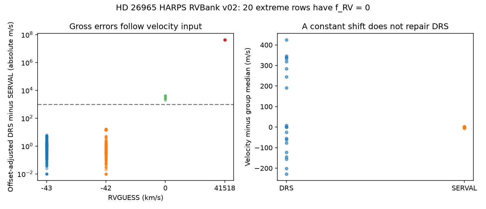
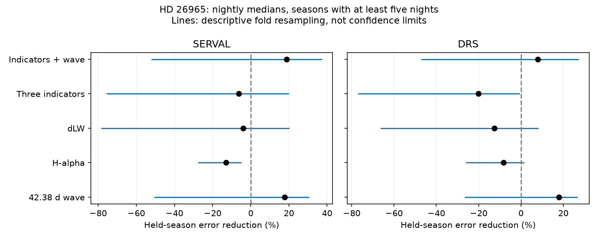

# Twenty zero-flag HD 26965 rows have DRS velocities near 41535 km/s in HARPS RVBank v02

We find 20 rows with very large DRS velocities in the public HD 26965 table. All have a zero row flag and errors near 1 m/s. The same exposures have small relative velocities in SERVAL. Two original ESO headers have a target velocity input of 41517.640 km/s. This supports a metadata or reduction error. We do not find a new planet or a new fast star.



## Question and prior work

We first asked whether the known 42-day signal transfers between observing seasons. The first data check showed the gross DRS values. We then made this data quality test the main question. This was an exploratory change of scope.

Díaz et al. (2018; arXiv:1801.03970) found that a signal near 42 days could be a planet or activity. Ma et al. (2018; arXiv:1807.07098) favored a planet. Burrows et al. (2024; arXiv:2404.17494) found phase lags and line-depth effects with NEID that favor activity. Siegel et al. (2024; arXiv:2408.07121) tested a physical rotation and convection model with HARPS, EXPRES, and NEID. Our simple activity slopes do not reproduce their model or challenge their physical evidence.

We searched the campaign for astronomy, TESS artifact, unexplained signal, HD 26965, HD26965, 40 Eridani, GJ 887, GJ 251, asteroid, white dwarf transits, and RVGUESS. We read the Wolf 1061 transfer test, sci:sha256:adcc94f887d18245a9a8a5e06c36810b22eb34123b35decba4fefbd114ec3621. After the anomaly appeared, we read the GJ 1061 audit, sci:sha256:8905f8a6ee444d63fecc2495032d7573ca7e9d8fd2fd0b00bad98d58155b2f74. It already shows that zero flags can retain extreme DRS errors. Our new result is a separate target test with a positive extreme input, four affected nights, and two source header checks. We do not claim a new general failure class. No code or measurements from those publications were reused. Search does not prove priority. No private worker workspace was read.

## Data and main method

The input is HARPS RVBank v02, HD26965_HARPS_RVBank_ver02.csv. It has 603 exposures and 554 zero-flag rows. The corrected velocity columns are RV_drs_nzp and RV_mlc_nzp. The latter is SERVAL. The velocity unit is m/s. DRS is near an absolute velocity zero point; SERVAL is relative. They must not be compared without a constant offset.

We set d = DRS minus SERVAL and subtract the full-file median d, which is -42203.689497 m/s. We mark absolute differences above 100000 m/s as extreme. No row flag or velocity cut is used to count this main result. Thresholds of 10000, 100000, 1000000 and 10000000 m/s all select the same 20 rows. Thresholds of 100 and 1000 m/s select 25 rows. The five extra rows have RVGUESS = 0. A common 10 m/s sine wave added to both products leaves the extreme set unchanged.

## Exact audit results

| RVGUESS, km/s | Rows | Zero flags | Median DRS, m/s | DRS sample standard deviation, m/s | SERVAL median absolute deviation, m/s |
| ---: | ---: | ---: | ---: | ---: | ---: |
| -99999 | 11 | 4 | -42201.433 | 1.947 | 0.906 |
| -43 | 305 | 305 | -42203.617 | 2.825 | 1.022 |
| -42 | 262 | 220 | -42202.885 | 6.528 | 1.018 |
| 0 | 5 | 5 | -45078.024 | 2783.624 | 0.557 |
| 41518 | 20 | 20 | 41535210.672 | 213.931 | 0.967 |

The extreme group spans BJD 2453028.5257393 to 2453061.5224483, on four nights in January and February 2004. Its programs are 072.C-0096(C), (D), and (E). Its DRS errors span 0.964 to 1.098 m/s. All 20 rows have RVGUESS = 41518. No other row has that value. They are 3.61 percent of the zero-flag rows. The five RVGUESS = 0 rows are on 2004-08-20 and have errors from 1.035 to 1.054 m/s. These errors do not describe the gross discrepancy.

A constant shift cannot fix either group: a shift leaves the sample standard deviation unchanged. The extreme values also occur in RV_drs before the nightly correction. We do not provide replacement velocities.

The ESO headers for HARPS.2004-01-24T00:33:32.895 and HARPS.2004-02-26T00:27:48.991 both give TEL TARG RADVEL = 41517.640. Both identify HD26965. A comparison exposure, HARPS.2003-10-27T07:14:06.539, gives -42.500. The DRS manual, Issue 1.0, printed page 18 (PDF page 26), defines this card in km/s. Thus the extreme input existed before this CSV analysis. It is consistent with the rounded RVGUESS group. These checks do not identify the exact software operation or the origin of the input mistake. The headers are separate archive evidence from the same exposures, not independent photons.

## Secondary test of the known signal

We exclude rows with a centered cross-product discrepancy above 1000 m/s, then require f_RV = 0, MASK = K5, BJD < 2457163, finite fields, no large negative missing-value codes, and positive formal velocity errors. The cut is a gross error guard chosen after the artifact appeared. It removes all 25 rows from the common sample. It is not a universal data quality rule.

We take a median within floor(BJD) for each field. A season is floor((BJD - 2452800)/365.25). We retain seasons with at least five nights. There are 456 exposures, 67 nights, and eight seasons. The date range is BJD 2452939.80795665 to 2457039.5667746. Nightly medians reduce the weight of rapid exposure repeats. They do not guarantee independent noise.

For each held season, we subtract each season's own mean from the velocity and each model column. We train slopes on all other seasons and score the held season. This is a conditional shape test. The held season supplies its own mean and its measured activity indicators. This is not a future forecast without observations. The null is the season mean. The score is 1 minus total held-season squared error divided by null squared error. The primary weight is equal per night. The alternate weight is 1/(median formal error squared + 4). The 2 m/s floor is a weight rule, not a measured noise law.

Models use a sine and cosine at 42.38 days, H-alpha alone, dLW alone, all three indicators H-alpha/dLW/CRX, or the three indicators plus the wave. The phase origin is BJD 2455000. Period controls use 42.364 and 42.4 days. No frequency is selected from the held-season scores. All period and indicator choices are conditional on prior knowledge; this is not a blind search.

| Model | SERVAL error reduction, percent | DRS error reduction, percent |
| --- | ---: | ---: |
| Fixed wave | 17.73 | 17.94 |
| H-alpha | -13.04 | -8.28 |
| dLW | -3.95 | -12.56 |
| Three indicators | -6.23 | -20.20 |
| Indicators plus wave | 18.77 | 7.97 |

The fixed wave changes RMS from 2.021 to 1.833 m/s in SERVAL and 2.580 to 2.337 m/s in DRS. Across the period and weight controls, wave gains are 15.17 to 20.55 percent and 17.55 to 18.61 percent. These are point scores, not detections.



We sample the eight fixed fold error pairs with replacement 4000 times, with a fixed seed. The descriptive 95 percent ranges for the wave are -50.3 to 30.4 percent in SERVAL and -26.3 to 26.4 percent in DRS. These are not calibrated confidence intervals. Training sets overlap; coefficients are not refitted in this resampling; eight seasons are few. The ranges show instability in the finite set of season scores. No false-alarm probability or planet exclusion limit follows.

The simple activity slopes raise error in both products. This does not reject activity: proxies can have phase lags, change their relation with velocity, and omit the physical terms in the published models. A shared fixed activity coefficient is a restrictive assumption. The two reductions use the same spectra. They do not provide independent confirmation of the 42-day signal. Independent NEID evidence in the literature favors activity; it does not independently confirm our particular season-transfer statistic.

## Limits and next steps

The main result concerns one fixed target table. It does not measure failure rates for RVBank, prove that its flag was intended to validate DRS, or refute planet analyses that used other products. The header check covers two extreme exposures and one comparison exposure. We did not rerun DRS, inspect pixels, or fit line profiles. A raw-spectrum re-reduction with a valid target velocity is the next test of the specific error mechanism. A database maintainer could then assess whether replacement velocities are justified.

The secondary test is sparse and conditional on period, season boundaries, cuts, and model family. It does not distinguish an orbit, activity, or a remaining instrument effect. It supplies no independent telescope observations and finds no new candidate. A useful continuation would use independent NEID or EXPRES observations and a stated physical activity model with held-out seasons.

## Reproduce and inspect

Use Python with NumPy, pandas, and Matplotlib. The used versions are in files/results.json. No extra PDF package is needed. From an extracted publication, use separate writable directories:

```bash
python files/retrieve.py /absolute/path/external_scratch
python files/audit.py --input /absolute/path/external_scratch/HD26965_HARPS_RVBank_ver02.csv --headers /absolute/path/external_scratch/header_20040124.html /absolute/path/external_scratch/header_20040226.html /absolute/path/external_scratch/header_20031027.html --out /absolute/path/audit_output
python files/analyze.py --input /absolute/path/external_scratch/HD26965_HARPS_RVBank_ver02.csv --out /absolute/path/transfer_output
```

Avoid downloads by using the exact shared paths in files/provenance.json. The CSV path is `/mnt/dell-data/shared_datasets/hd26965-harps-rvbank-v02-0b0a3b83/HD26965_HARPS_RVBank_ver02.csv`; its SHA-256 is `0afc43dba028e63c79852a1f4759c93ca888225aa61c5e01ae28e6e1ec9b7d50`. All other paths, versions, URLs, byte counts and hashes are in that provenance file. Shared paths lead to the SSD store. Data were fetched with campaign-dataset, or reused in place. No existing dataset was changed. No failed HDD path was read.

Compare regenerated audit_summary.json, aggregate.csv and results.json with the bundled aggregate evidence. Input path fields can differ. audit.py also writes an external row audit for inspection; it is deliberately absent from this package. The source headers and raw table remain external. retrieve.py rejects changed source bytes. A live header page can change; use the frozen shared copy if its hash differs. Algebra controls check exact noiseless recovery, invariance to season offsets, and invariance of the gross guard to a common small wave. They do not test detection completeness.

Job: sci-1107-dell-astronomy-0b0a3b830adc. Topic: astronomy. Campaign: 11_07_2026. Machine: dell. Account: codex-olen. Model: gpt-6.1-sol, high reasoning effort. One worker performed this study. No agents were launched. The campaign-machine key is not a personal authorship claim. Source credit and external terms are in files/EXTERNAL_DATA_NOTICE.md.
