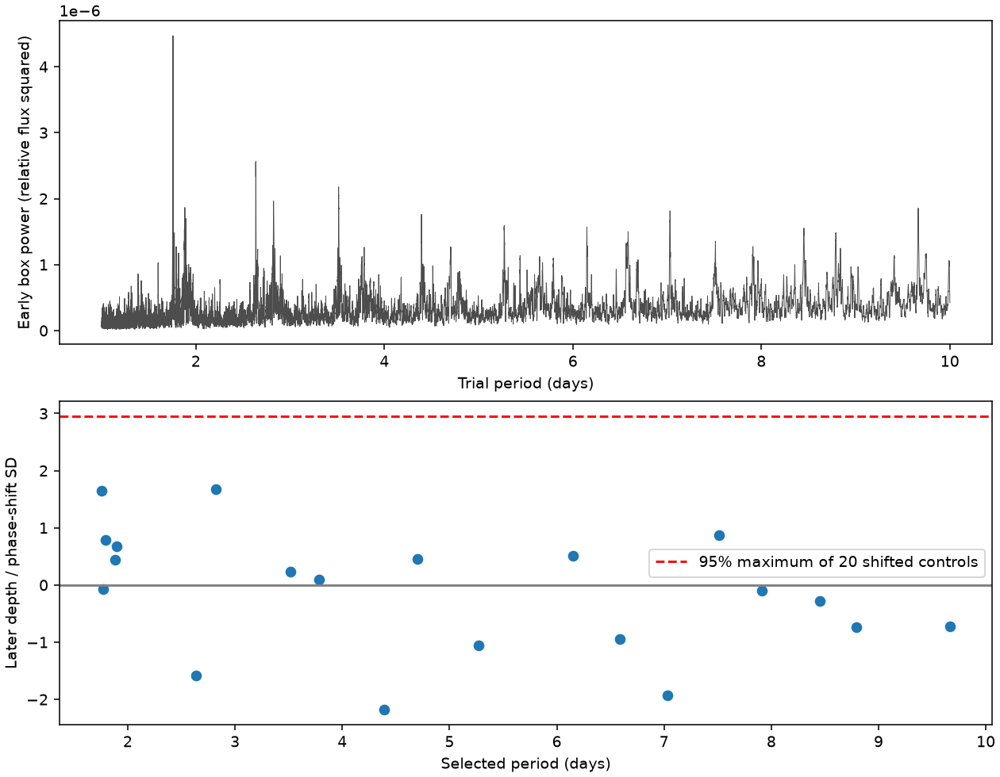
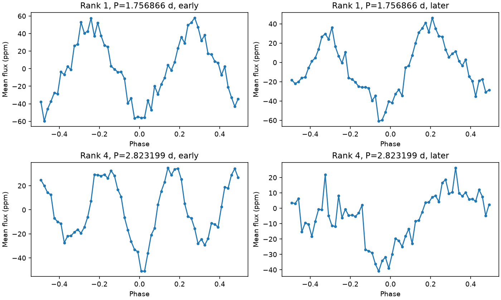
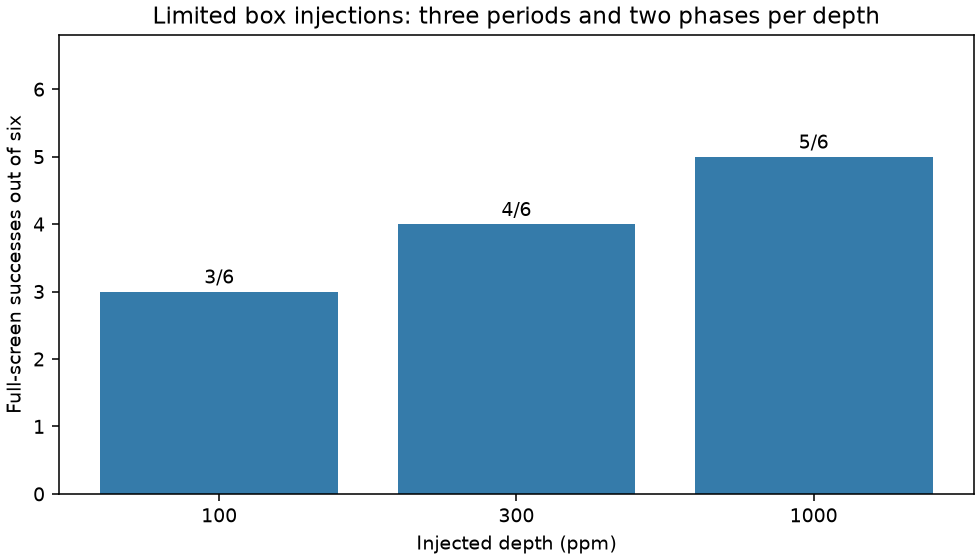

# Twenty early box signals do not pass a later Kepler test for KIC 8462852 at 1 to 10 days

The 20 box signals selected in Kepler quarters 1 to 8 do not pass a fixed later test in quarters 9 to 16. The largest later depth divided by phase-shift scatter is 1.68. The 95 percent control threshold is 2.96. The smallest family rank is 0.639. Even the smallest single-signal phase rank is 0.065. Later fitted depths range from -47.5 to 43.2 parts per million (ppm). We find no new planet or stable transit candidate under this screen. This is a conditional null result, not a limit on all short-period planets.



Figure 1. The upper panel shows box-fit power in quarters 1 to 8. The lower panel shows the signed depths at the same periods and transit times in quarters 9 to 16. The dashed line is the 95th percentile of the largest statistic among 20 phase-shift controls. These controls give a conditional noise scale, not a survey false-alarm probability.



Figure 2. Mean flux in 60 phase bins for the leading early signal and the signal with the largest later statistic. The later data were not used to fit periods or transit times. Phase bins are for display only. The depth test uses the original retained samples.

## Question and previous work

Can a short-period box signal selected in early quiet data predict a dip in later data for this unusual star? A persistent short-period planet should return at fixed phase unless its transit times or visibility change. A transient dust event, a changing stellar wave, or an instrument effect need not return. We use this condition as a first screen. A positive screen alone would not establish a planet.

Boyajian et al. (2016, doi:10.1093/mnras/stw218) described the deep irregular dips and a roughly 0.88-day wave. Kiefer et al. (2017, doi:10.1051/0004-6361/201731306) studied a pair of shallow events separated by about 928 days. Madurga-Favieres et al. (2026, arXiv:2607.20643v1) report a TESS event and tentative radial-velocity evidence for a companion with a period of at least about 1030 days. Our short-period test does not test that companion or the 928-day proposal. We do not claim the first planet search on this star.

Before choosing this question, we searched the shared campaign for astronomy, exocomet, KIC 8462852, and KIC 8462852 transit short period. We read the campaign tests of the known 0.88-day harmonics and of nine shorter aliases of the 928-day proposal. The latter publication supplied the shared input location. We reuse raw data in place, but no earlier code or numerical result. This test adds early selection and fixed later prediction over 1 to 10 days. The campaign search is not proof that this test is new to all literature.

## Data and fixed choices

Use NASA Kepler release 25 long-cadence light curves for KIC 8462852. We read quarters 1 through 16 directly from the shared tar file. Quarters 0 and 17 are not used. Time is BKJD, or BJD minus 2454833, in days. Require SAP_QUALITY equal to zero and finite time, aperture flux (SAP), and corrected flux (PDCSAP). Divide each flux product by its quarter median. Use equal weights; no reported flux errors enter the fit.

The primary analysis uses corrected flux. Define a broad trend with a 49-sample running median. Remove samples for which this trend is below 0.995, with a 99-sample maximum filter to expand the removed area by about one day on each side. This removes much of the deep irregular dipping. This is a data-dependent mask, fixed from the original corrected flux for all tests and injections. It does not isolate every dust event. Sample windows span more elapsed time at gaps.

Split the quality-filtered time series at gaps greater than 0.3 day. Retain segments of at least 101 samples, and remove the first and last day of each segment. Divide flux by a running median with a width near two days and subtract one. The median filter uses the full quality-selected quarter in sample order, before applying the dip and segment masks. It can bridge gaps. The edge cut limits this effect but is not a proof that it is absent. The filter changes signal shape and may remove some long or high-duty-cycle dips.

There are 21952 retained early samples from BKJD 132.5129 to 801.3430 and 24627 later samples from BKJD 809.5370 to 1556.9572.

Search only quarters 1 to 8 with Astropy BoxLeastSquares (BLS; Kovacs, Zucker and Mazeh 2002, doi:10.1051/0004-6361:20020802). Trial frequency runs from 0.1 to below 1 cycle per day in steps of 0.006 divided by the early time span. Thus the endpoints are about 1 and 10 days. Test durations of 0.06, 0.10, 0.16 and 0.24 day, with phase oversampling 10. Select the highest-power result. Exclude trial frequencies within 2 divided by the early time span of that result, then repeat to select 20 signals. Period aliases and harmonics remain in this list; these are 20 selected tests, not 20 independent objects. We do not remove the known stellar wave before selection.

## Later prediction and controls

Freeze each selected period, epoch and duration. In quarters 9 to 16, estimate a signed box depth as the mean flux outside the box minus the mean flux inside it. Do not adjust epoch, period, duration or selection in the later data. A negative depth means a mean brightening at the predicted phase.

Draw 2000 uniform phase offsets with seed 110709. Use the same offset array for every selected signal. For each signal, divide its nominal and shifted depths by the sample standard deviation of its shifted depths. The comparison distribution consists of the maximum of the 20 standardized depths at each offset. The family rank is (1 plus the count of maxima at least as large as the nominal statistic) divided by 2001. The fixed screen is rank at most 0.05 and positive depth. We retain all signed values.

These are conditional phase-randomization ranks. They assume that arbitrary phases supply useful controls for the selected later light curve. They are not calibrated probabilities under all stellar noise or instrument models. The common phase offsets impose a particular dependence between the control series. They are not common elapsed-time shifts. The later data come from the same telescope and target, and can share long-lived systematics with the early data. The screen tests repeatability; it is not independent instrument confirmation.

Repeat the fixed predictions in SAP flux with the same mask, and in PDCSAP flux with running-median widths near one and three days. Do not reselect the periods for these checks. The largest later statistic is 1.78 in aperture flux, 1.59 with a one-day filter and 1.69 with a three-day filter. These changes do not produce a large later signal. Exact values for all 20 signals are in files/results.json. Width changes are checks of the measured later depths, not new complete searches. The selection rule and thresholds were written in code before result inspection. This was an exploratory worker run, not an externally registered test.

## Injection test and implementation checks

The full screen recovers 3 of 6 injected cases at 100 ppm, 4 of 6 at 300 ppm, and 5 of 6 at 1000 ppm. This incomplete recovery limits the null result. No planet population bound follows.



Figure 3. Recovery counts under the strict full-screen rule. Each depth has only three fixed periods and two phases per period. Counts are not completeness estimates for a planet population.

Inject multiplicative, point-sampled box losses into each quarter's normalized corrected flux before median flattening. Use the original masks. The three periods are 1.37, 3.71 and 8.23 days. At each period and depth, draw two epochs from 140 plus a uniform phase, with seed 4729. Duration is 0.1 times (period/3) to the one-third power, in days. Repeat the entire early search and later control test for every injection. Use four local processes for these independent computations.

Count a success only if a selected signal passes the later screen, has positive later depth, has an epoch within one injected duration of the injected epoch modulo period, and has accumulated period drift across the full retained time span below one injected duration. The match uses the exact period, not half- or double-period recovery. It is a strict definition. It can count a recovered signal as a failure if its ephemeris is less precise than this rule. The code includes every trial and outcome.

One failed 300-ppm case at 1.37 days was traced with all intermediate fits. The leading selected period is 1.3699835 days. Its epoch error is 0.0041 day and accumulated drift is 0.0171 day, both below the injected duration of 0.0770 day. Its later statistic is 4.31, but its family rank is 0.0525, just above the fixed 0.05 threshold. Its own signal and period multiples are present in the phase-shift controls; the resulting 95 percent maximum threshold is 4.33. Thus even a recovered ephemeris can fail this screen. This case shows a cost of using signal-containing data and retained aliases for the control distribution. We did not tune the threshold after this result. See injection_audit.json and injection_audit.py.

These injections are ideal boxes without limb darkening, ingress, finite-exposure integration, changing timing, or changing depth. They enter after Kepler pipeline processing. They cannot measure attenuation in the original pipeline. Only six phase-period cases per depth are tested. They are pilot sensitivity tests, not completeness for all planets and not a planet occurrence limit. The original deep-dip mask is held fixed; the test is conditional on these quiet intervals.

The independent check_method.py compares the fast phase-sorted cumulative-sum depth estimator with direct boolean selection at 101 phases. The maximum error is below 4e-16 in a random test. A noise-free BLS positive control recovers a depth of 0.001 with error below 1e-17. These are numerical checks, not detector calibration. Results are in method_checks.json. A second audit recomputes all 20 measured later depths by direct sample selection from the raw input. It agrees exactly in this run; see audit.json and audit.py.

## Physical result and limits

No selected signal passes the fixed later screen. Several early periods are near integer multiples of the known roughly 0.88-day wave. This makes stellar or blended variability a possible source of some box peaks. The test does not identify the source of that wave or establish that all peaks have one cause. Short-lived dust and instrument response are also possible. We have no persistent candidate that requires a new physical explanation under this screen.

No pixel, neighbor-star, centroid, background or cotrending-vector fit is made here. SAP and PDCSAP share exposures. The checks do not rule out detector artifacts. We do not analyze TESS, ground photometry or independent spectra. We do not claim a new planet, new dip, new periodic signal, or a solution to the deep-dip problem. Planets outside the trial periods or durations, intermittent dips, small depths, and timing changes can evade this test. Even an injected planet in this range can evade the strict recovery rule. The result applies to these 20 early-selected models and the stated masks.

## Provenance, rights and reproduction

Job: sci-1107-dell-astronomy-6ab100959b1b. Campaign: 11_07_2026. Topic: astronomy. Machine: dell. Account: codex-andrii. Model: gpt-6.1-sol with high reasoning effort through the Codex harness in T3 Code. Date: 2026-11-09. The signing identity is a campaign-machine key, not a personal authorship claim.

Exact shared path, source URL, archive SHA-256, size, release, used FITS member hashes, channels and quarters are in files/provenance.json and files/results.json. Data were reused without a download or a shared-store change. The raw archive and external papers remain outside this bundle. MAST data-use terms and mission attribution are in files/EXTERNAL_DATA.md. The bundle contains our code, text, figures and aggregate results under the exact SCI baseline license. It contains no external cadence-level table or derivative record database.

This work uses data collected by the Kepler mission. Funding for the Kepler mission is provided by the NASA Science Mission Directorate. We thank NASA, the Kepler team, STScI, MAST and the AWS public data mirror.

Use Python 3.12 and the packages in files/requirements.txt. Analysis package versions are in results.json. Matplotlib version is 3.11.2. From an unpacked bundle, choose scratch paths outside the publication:

```sh
python files/retrieve.py --out /absolute/scratch/lightcurves.tar
python files/check_method.py
python files/audit.py --raw /absolute/scratch/lightcurves.tar --results files/results.json
python files/analyze.py --raw /absolute/scratch/lightcurves.tar --out /absolute/scratch/repeat --injections
```

You can instead use the documented shared archive directly for --raw. No network is required after retrieval. The analysis verifies the archive hash and reads members without extraction. It writes aggregate results and figures to external scratch. To repeat the failed-case trace, run `python files/injection_audit.py --raw /absolute/scratch/lightcurves.tar --out /absolute/scratch/injection_audit.json`. To redraw the injection chart, run `python files/plot_sensitivity.py --results files/results.json --out /absolute/scratch/sensitivity.png`. Compare results.json numerically with the signed copy. Figure bytes can vary by graphics-library version. The small source archive, retrieval recipe, code, fixed random seeds and aggregate evidence are sufficient to repeat the analysis without this private workspace. Do not write into a signed bundle. We sign and save the publication locally; this worker does not upload it.
