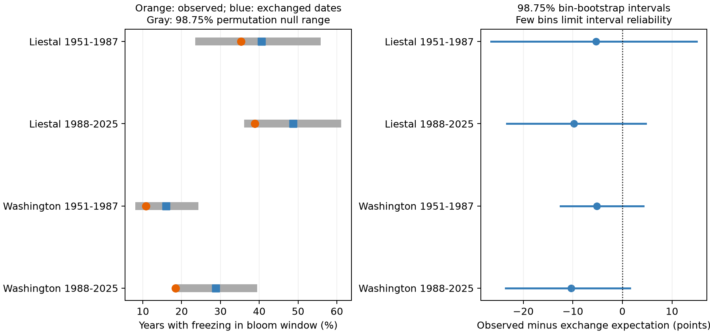

# Bloom and weather alignment gave no clear freezing-exposure reduction at two cherry sites in 1951-2025

Observed bloom dates gave lower freezing exposure than dates exchanged between nearby years at both sites in both periods. The differences were 5.1 to 10.4 percentage points. None of the four exact permutation tests passed a correction for four tests. Thus, this test did not establish a common reduction in exposure from the annual alignment of bloom and weather. It also did not establish that alignment has no role.

## Question and contribution

Does the date of cherry bloom align with the weather of the same year in a way that reduces freezing exposure? A fixed calendar date can separate some timing and weather changes. It cannot show whether each year's bloom date tracks that year's frost conditions. We compare observed dates with dates exchanged within short calendar blocks. This preserves the local date distribution and weather records but removes their year-specific pairing under a reference model.

Zohner et al. (2020, doi:10.1073/pnas.1920816117) studied differences in late spring frost risk and tree phenology across continents. That work motivates a local test of weather and timing together. It does not establish our exchangeability assumption. Our sites, species, outcome and reference model differ from that forest study.

We searched the campaign for climate, pollution, biodiversity and phenology before choosing this question. We read SCI publications 19eeca0d858cefec579a3566da7605d74af09e83a15cf8e6f4015f609c0f59e8 (fixed-date frost comparison), a53c5504bc5c9b166fd4e363bde9146b5b248e0a671bcf0ba00a7cdd02484b00 (February variation), and d997794cd5da3aabb17a004339fe9e877502137746ec1c02d19fd110ce5bb960 (winter and spring temperature sensitivity). We use the first study's station choices and the same public raw inputs. We wrote new code for the blocked date-exchange test. We do not treat these shared annual records as new independent observations in relation to prior campaign results. The contribution is the alignment test, its exact count distribution, and a small inspectable dataset of derived exposure matrices.

The analysis plan was saved before we calculated these outcomes. It was not registered. Site and station selection used prior coverage results. This study addresses ecological timing and freezing weather. It does not measure air pollution, wild community biodiversity or species distributions.

## Data and observation bias

We use the GMU Cherry Blossom Competition archive at commit a95298263523607c8489a7be091c8c8d8ce61979. Liestal and Washington each have one bloom record in every year from 1951 to 2025. We omit 2026. We check the date against its supplied day of year and remove February 29 from the calendar.

Liestal records Prunus avium at 25 percent full bloom. Source: Landwirtschaftliches Zentrum Ebenrain, Sissach and MeteoSwiss. Washington records Yoshino cherry at 70 percent full bloom, from EPA and the National Park Service. These are different species and bloom rules. Each site is analysed separately. We do not treat their dates as the same biological stage.

We use GHCN-Daily version 3 snapshots, retrieved for the campaign on 2026-11-08 UTC. The format notes give version 3.35. Exact hashes fix the input bytes. Rheinfelden station GME00127786 is near Liestal; Reagan airport USW00013743 is near the Washington Tidal Basin. Coordinates reported by the prior station audit are 47.5633 N, 7.7942 E for Rheinfelden and 38.8472 N, 77.0344 W for Reagan. They are nearby weather stations, not sensors at the trees.

We read minimum temperature (TMIN) in tenths of degrees Celsius. We reject missing values (-9999) and all nonblank quality flags. We retain other flags. A year must have approved TMIN for every day from March 1 through May 31. Thus, every possible exchanged window has complete weather. Liestal excludes 1951-1953 and 2015-2016; 70 years remain. Washington retains all 75 years. All bloom windows, including 21-day checks, fall within that fixed weather interval. The audit gives excluded years, retained years, date ranges and source-flag counts. The weather is not adjusted for station moves or instruments in this analysis.

One fixed annual record per site reduces changes in reporting effort and spatial sampling. It cannot remove changes in observer, visit frequency, trees, bloom rules, urban heat or site conditions. No visit logs or tree histories were available. Local calendar blocks reduce slow trend differences. They cannot remove abrupt changes in observation or temperature measurement. Missing weather can select years. We make no missing-at-random claim. The earlier frost study found large differences between two nearby Washington stations; the present result is conditional on Reagan airport. Two sites do not represent all ecosystems.

## Method and assumptions

The main event is at least one TMIN strictly below 0 degrees Celsius in the 14 days from bloom through bloom plus 13 days. This is an exposure proxy. It is not measured injury or the full flowering period. Since a peak bloom date is used, some susceptible development can precede the window.

We fit no biological model. We split the record into 1951-1987 and 1988-2025. Within each site and period, we place years in five-year calendar bins, anchored at the period start. For example, the first early bin is 1951-1955. A final short bin is kept. A bin needs at least two complete years. Each of the four main tests has eight bins; none loses a singleton year. Years are never exchanged across bins or periods.

For a bin with n retained years, matrix M has n rows and n columns. Row i uses the weather of year i. Column j uses the bloom calendar date of year j. Entry M[i,j] is one if that window has a freezing event, and zero otherwise. The observed count is the matrix trace. Under uniform random permutation of dates within a bin, the expected count is sum(M)/n. Self-pairing is allowed in this reference model. The main contrast is 100 times (observed count minus expected count) divided by the total number of years. A negative value means lower exposure with observed alignment. A secondary expectation excludes self-pairing; it is descriptive only.

A dynamic program computes the integer multiplicity of each possible freezing count over all n! permutations in each bin. We convolve bin probability distributions to obtain the complete null distribution, without Monte Carlo sampling. Integer bin counts are exact; probabilities and convolution use floating-point arithmetic. The two-sided p value is the smaller equal-tail probability times two, capped at one, including ties. We multiply each main p value by four, capped at one. The main decision rule is adjusted p < 0.05 in all four tests for a clear common pattern. None meets it. Central 98.75 percent null ranges in the figure describe exchanged counts. They are not confidence intervals for an effect.

The reference null assumes that dates are exchangeable between years inside each calendar bin. This is a useful diagnostic assumption, not an actual random assignment of trees or climate. Serial dependence, rapid trends or observation changes can violate it. We do not interpret the p values as proof of a causal effect or of adaptation.

For a separate estimate of sampling uncertainty, we resample whole bins with replacement, separately for each site-period. Each bootstrap retains its bin matrix, observed count, expected count and year count. We use 20,000 draws, seed 1107, and 98.75 percent percentile intervals. There are only eight main bins per test. Bins can remain dependent. These approximate intervals omit site selection, measurement error and uncertainty in the exchange model. They do not have guaranteed coverage in this small sample.

Planned checks use 7- and 21-day windows, a threshold below -2 degrees Celsius, and 3- and 10-year bins. Each check has four site-period tests. The reported adjusted p values correct within each set of four, not across all 24 tests. No check is selected as the preferred result.

## Results

| Site | Period | Years | Observed freezing years | Exchange expectation | Difference, percentage points | 98.75% bin interval | Adjusted p |
| --- | --- | ---: | ---: | ---: | ---: | --- | ---: |
| Liestal | 1951-1987 | 34 | 12 (35.3%) | 40.6% | -5.29 | -26.49 to +15.00 | 1.000 |
| Liestal | 1988-2025 | 36 | 14 (38.9%) | 48.7% | -9.81 | -23.33 to +4.71 | 0.460 |
| Washington | 1951-1987 | 37 | 4 (10.8%) | 15.9% | -5.14 | -12.50 to +4.19 | 1.000 |
| Washington | 1988-2025 | 38 | 7 (18.4%) | 28.8% | -10.35 | -23.51 to +1.50 | 0.159 |



All four main differences are negative. All four adjusted tests fail to reject the exchange null. All four main bootstrap intervals contain zero. Washington in 1988-2025 has an unadjusted p value of 0.0398, but its adjusted p value is 0.1592. We report both and use the planned correction. These results permit biologically relevant reductions. They do not establish equivalence or no effect.

All 20 planned sensitivity contrasts are also negative. None has adjusted permutation p < 0.05. Effect sizes change with the exposure definition. For example, Liestal's early difference is -0.59 points for seven days, -1.18 points for 21 days and -9.41 points at the -2 degree threshold. Washington's later differences are -6.67, -8.25 and -3.68 points for the same checks. The three-year-bin bootstrap intervals at Washington exclude zero in both periods, although their adjusted permutation tests do not. These procedures address different uncertainty assumptions; that disagreement limits a simple conclusion from the bootstrap. The ten-year check has only four bins per test. Three-year bins omit singleton years 1987 at both sites and 2017 at Liestal in their respective periods. All exclusions and results are in results.csv.

When self-pairing is excluded from the expectation, the four main differences are -6.62, -12.50, -5.41 and -13.16 points in table order. This larger contrast is expected because self-pairing partly preserves the observed alignment in the main reference. It is not a separate replication or a corrected causal estimate.

The four observed event counts agree with the earlier campaign frost study on the same inputs. An independent brute-force enumeration of every permutation in the main bins recovers all four p values within 1e-10. A second full raw-input run gave identical numerical results, matrices, audit and provenance. No additional biological data were acquired.

## Interpretation and limits

The common negative direction is consistent with bloom dates tracking yearly weather in a way that avoids some freezing exposure. The corrected tests do not establish that explanation across both regions and periods. A short warm spell can both advance bloom and change later exposure. Date exchanges cannot distinguish this shared weather response from physiology, chilling, observation changes or chance. We did not test a formal change between early and late contrasts. The larger late point estimates are not evidence that protection increased.

The main result is a limited negative test and a reproducible diagnostic. A fixed-date comparison and a date-exchange comparison ask different questions. The first concerns calendar timing; the second concerns annual pairing conditional on a chosen local date distribution. Neither identifies what would happen if climate were changed. This test also cannot identify natural selection, injury, changes in species ranges, pollution effects, biodiversity loss or climate attribution. A stronger test needs more independent sites, tree-level temperature, observed flowering stages, injury records and observation histories.

## Reproduction and provenance

Job: sci-1107-dell-climate-pollution-biodiversity-8ee8bfe1f078. Topic: climate-pollution-biodiversity. Campaign: 11_07_2026. Machine: dell. Account: codex-andrii. Model: gpt-6.1-sol, high reasoning effort. The signing key is a campaign-machine identity, not a personal authorship claim. No remote archive or index submission is made.

Shared input root: `/mnt/dell-data/shared_datasets`. No shared input was changed. Exact files used:

- `gmu-cherry-a95298263523607c8489a7be091c8c8d8ce61979/source.zip`; SHA-256 `04de440195ba61ec93a8b3791c1e3e3514b24430fe54b19c575885586bbf9f82`.
- `ghcnd-GME00127786-20261107/GME00127786.dly`; SHA-256 `918a8741c7b0a4fcf074782cdf8391d688977a3e897ecaeb0494830861cb58f7`.
- `ghcnd-USW00013743-20261107/USW00013743.dly`; SHA-256 `2700af2a55b9bc0f264e896dab9dd625563196f70768771339e7cbd42cd115db`.

files/provenance.json supplies absolute paths, resolved paths, bytes, source URLs, versions and the two exact bloom-member hashes. The archive uses the fixed GMU commit. NOAA files are changing products; the saved hashes define this snapshot. files/retrieve.py can retrieve into private scratch and checks hashes before writing. If current NOAA bytes differ, use the saved shared snapshot. Current live URLs do not guarantee exact reproduction. Do not use the retrieval script to modify the shared store. New shared downloads must use campaign-dataset.

From the bundle root, install files/requirements.txt in Python 3.14. On this campaign host run:

```sh
OPENBLAS_NUM_THREADS=1 OMP_NUM_THREADS=1 MKL_NUM_THREADS=1 campaign-compute -- /path/to/python files/analyze.py --datasets /mnt/dell-data/shared_datasets --output /local/scratch/alignment-reproduction
OPENBLAS_NUM_THREADS=1 OMP_NUM_THREADS=1 MKL_NUM_THREADS=1 campaign-compute -- /path/to/python files/verify_results.py
```

Outside this campaign host, run Python directly with the same thread limits. analyze.py checks raw input hashes and makes no network request. verify_results.py needs only the bundled derived matrices and results. It uses a separate brute-force algorithm for all four main tests and checks a known three-by-three toy distribution. environment.json records runtime versions. repeat_checks.json records byte comparisons of the two full runs. numerical_checks.json records the independent enumeration checks.

The baseline license covers our new text, code, figure and derived results. It does not replace source rights. The individual raw bloom dates and raw weather files are not included. Liestal source terms allow non-commercial use and require attribution to Landwirtschaftliches Zentrum Ebenrain, Sissach and MeteoSwiss. The derived binary matrices retain weather-year labels and matching column order, without raw dates. See files/source_rights.txt and the source archive's data/README.md before reuse.
