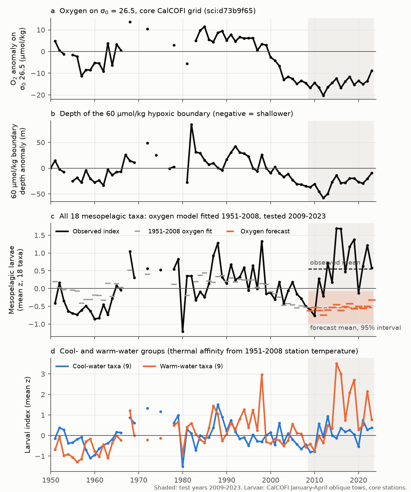
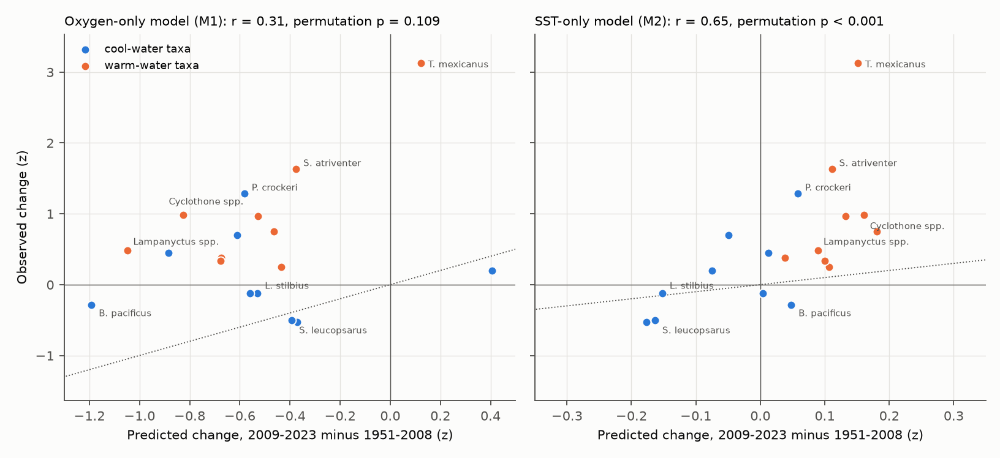
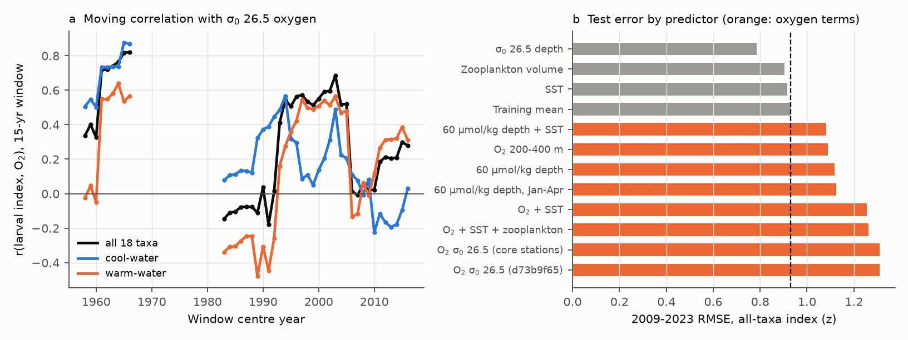

# Mesopelagic fish larvae off southern California did not fall in the record 2009-2023 oxygen low that a 1951-2008 oxygen relation predicted; warm-water taxa increased (CalCOFI, pre-registered test)

## Summary

Earlier campaign work showed that oxygen on the sigma0 = 26.5 kg/m3 surface off southern California has been lower since 2007 than in any 19-year window since 1950 (sci:d73b9f65). The cause is a North Pacific ventilation change. Koslow et al. (2011) found that CalCOFI larvae of mesopelagic fishes (lanternfishes, deep-sea smelts and related families) fell by about 63% between high- and low-oxygen periods in 1951-2008. They proposed that low midwater oxygen causes the decrease. They gave a mechanism: a shallower hypoxic boundary layer makes the fish easier prey for visual predators. This relation is the main published biological effect of the oxygen loss that the campaign studied. Thus the 2009-2023 years, with oxygen at a record low, are a strong out-of-sample test.

We wrote the test before we calculated any 2009-2023 larval value (`files/preregistration.md`, SHA-256 in `files/provenance/prereg_sha256.txt`). We made annual indices for 18 mesopelagic taxa from 54 core CalCOFI stations, January-April oblique tows (5,346 tows in 1951-2008 and 1,266 in 2009-2023). We fitted oxygen and temperature models to 1951-2008 and tested them on 2009-2023.

Main results (index units are the mean z-score of the taxon indices, from 1951-2008):

- **The oxygen forecast failed (T1 failed).** In 1951-2008 the all-taxa index followed sigma0 26.5 oxygen (r = 0.54, 45 years; 16 of 18 taxa had a positive oxygen slope). In 2009-2023, oxygen was 14.3 umol/kg below its 1951-2008 mean. The oxygen model predicted an index mean of -0.54 (95% interval -0.99 to -0.08). The observed mean was +0.55. The oxygen model test RMSE (1.31) was larger than the RMSE of the training mean (0.93).
- **Cool-water taxa did not fall either (T2 failed).** For the 9 cool-water taxa, the oxygen model predicted -0.55 (-1.02 to -0.07), and the observed mean was +0.10. Oxygen added to SST made the test error larger (RMSE 0.88 against 0.52 for SST alone).
- **Warm-water taxa increased most.** The 9 warm-water taxa had an observed mean of +1.00, against an oxygen forecast of -0.53. Their peak was in 2015-2019, during and after the 2014-2016 marine heatwave.
- **Across taxa, the change followed temperature, not oxygen (T3 passed, but because of SST).** The correlation of the predicted and observed change across the 18 taxa was 0.57 (permutation p = 0.014) for oxygen + SST, 0.65 (p < 0.001) for SST alone and 0.31 (p = 0.11) for oxygen alone. The oxygen model gave the correct sign for 7 of 18 taxa, and the SST model for 14 of 18. Only 5 taxa decreased, all cool-water: *Stenobrachius leucopsarus*, *Tarletonbeania crenularis*, *Leuroglossus stilbius*, *Bathylagus pacificus* and *Melamphaes* spp.
- **The hypoxic-boundary mechanism did not predict the change (exploratory).** The 60 umol/kg boundary at the core stations was at its shallowest on record in 2011-2013 (45-58 m above the 1951-2008 mean; the shallowest year before 2009 was 35 m above). In 2011 and 2013 the larval index was above its 1951-2008 mean (+0.28 and +0.71). A model with boundary depth in place of isopycnal oxygen also failed (test RMSE 1.12 against 0.92).
- **The result is not a gear or identification effect.** T1 failed in all seven pre-set sensitivities (all months, training from 1969, a 1969 gear step, bongo nets only from 1978, a fixed-effects oxygen index, oxygen lagged by one year). An index of all larvae in the mesopelagic families, which does not depend on species identification, also increased (+0.40 against an oxygen forecast of -0.80). The share of mesopelagic larvae identified only to genus or family was 1-9%. It was higher in 2010-2023 (5-7%) than before (3-4%). Fewer species-level identifications lower the species indices; they cannot cause the increase.

Interpretation (not a tested causal claim): the 1951-2008 oxygen relation of CalCOFI mesopelagic larvae does not hold in 2009-2023. The training correlation came from two low-frequency episodes (the 1950s-1960s and the 1990s-2000s). Year-to-year changes of larvae and oxygen were not correlated in 1951-2008 (first-difference r = 0.06). Thus the 1951-2008 relation can be a shared low-frequency variation and not a direct oxygen effect at the oxygen levels that occurred. The present oxygen loss on sigma0 26.5 (about 14 umol/kg, oxygen near 85-90 umol/kg) did not decrease the larvae of these fishes in 2009-2023. Temperature and the arrival of warm-water species agree with the data better. This result agrees with Koslow et al. (2019), who reported that warm-water mesopelagic species increased while oxygen decreased. We add that cool-water taxa also stayed near their long-term mean, that the record-shallow hypoxic boundary of 2011-2013 had no visible effect, and that the oxygen forecast fails in a pre-registered test.

## Pre-registered tests and results

| Test (written before the 2009-2023 larval data were calculated) | Result | Pass |
|---|---|---|
| T1: all-taxa oxygen model (M1) has test RMSE below the training mean (M0), and the observed 2009-2023 mean is inside the M1 95% interval | RMSE 1.31 vs 0.93; observed +0.55, interval -0.99 to -0.08 | No |
| T2: cool-water oxygen + SST model (M3) has lower test RMSE than SST alone (M2), with a positive oxygen slope | RMSE 0.88 vs 0.52; slope +0.038 per umol/kg | No |
| T2 (expectation for warm-water taxa): no gain from oxygen | RMSE 1.71 (M3) vs 1.35 (M2) | As expected |
| T3: cross-taxon correlation of M3-predicted and observed change > 0, permutation p < 0.05 | r = 0.57, p = 0.014 (SST alone 0.65, p < 0.001; oxygen alone 0.31, p = 0.11) | Yes, from SST |

Model results for the three indices (test 2009-2023, 15 years; training 1951-2008, 45 years with oxygen):

| Index | Observed 2009-2023 mean | M1 oxygen forecast (95% interval) | RMSE M0 | RMSE M1 oxygen | RMSE M2 SST | RMSE M3 both | RMSE persistence 2004-2008 |
|---|---|---|---|---|---|---|---|
| All 18 taxa | +0.55 | -0.54 (-0.99, -0.08) | 0.93 | 1.31 | 0.87 | 1.26 | 1.04 |
| Cool-water (9) | +0.10 | -0.55 (-1.02, -0.07) | 0.51 | 0.81 | 0.52 | 0.88 | 0.65 |
| Warm-water (9) | +1.00 | -0.53 (-1.21, +0.21) | 1.63 | 1.99 | 1.35 | 1.71 | 1.65 |

Sensitivities (pre-set; all-taxa index):

| Variant | Observed mean | M1 forecast (95% interval) | RMSE M1 / M0 | T1 | T3 r (p) |
|---|---|---|---|---|---|
| Main (January-April) | +0.55 | -0.54 (-0.99, -0.08) | 1.31 / 0.93 | fail | 0.57 (0.014) |
| All months | +0.67 | -0.61 (-1.03, -0.19) | 1.47 / 1.01 | fail | 0.40 (0.054) |
| Training 1969-2008 (210 m tows) | +0.40 | -0.39 (-0.78, 0.00) | 1.08 / 0.85 | fail | 0.67 (0.002) |
| 1969 gear step in all models | +0.55 | -0.30 (-0.65, +0.05) | 1.12 / 0.83 | fail | 0.66 (0.004) |
| Fixed-effects oxygen index | +0.55 | -0.53 (-0.99, -0.09) | 1.31 / 0.92 | fail | 0.59 (0.010) |
| Oxygen lagged 1 year | +0.55 | -0.53 (-0.98, -0.07) | 1.30 / 0.91 | fail | 0.56 (0.015) |
| Bongo nets only, 1978-2023 | +0.42 | -0.35 (-0.79, +0.02) | 1.06 / 0.83 | fail | 0.59 (0.009) |

In every variant the observed mean is above the upper end of the oxygen-model interval, and the oxygen model has a larger error than the training mean. Full values: `files/data/results.json` and `files/data/variants/`.

## Exploratory analyses (after the tests)

These analyses were not pre-registered.

- **Other oxygen metrics.** All-taxa test RMSE against the training mean (0.93): oxygen at 200-400 m 1.09 (10 test years), 60 umol/kg boundary depth 1.12, January-April boundary depth 1.12, boundary depth + SST 1.08, oxygen + SST + zooplankton volume 1.26. Each oxygen metric predicted a decrease, and each failed (`files/data/explore_models.csv`).
- **Without the warm years 2014-2019.** All-taxa observed mean +0.19 against an oxygen forecast of -0.55; cool-water +0.08 against -0.56. Thus the failure is not only a heatwave effect.
- **Identification-proof indices.** All mesopelagic-family larvae summed per tow: observed +0.40, oxygen forecast -0.80. Myctophidae: +0.38 against -0.74. Bathylagidae: +0.23 against -0.72 (`files/data/family_total_index.csv`).
- **Where the training relation came from.** The 15-year moving correlation of the all-taxa index with oxygen was 0.72-0.82 for windows centred in 1961-1966 and 0.41-0.69 for 1993-2005, but -0.18 to 0.04 for 1983-1992 and -0.01 to 0.30 for 2006-2016 (figure 4a). The first-difference correlation was 0.06 in 1951-2008 (COOL 0.22) and -0.12 in 2009-2023.
- **Size of the training contrast in our index.** Years with oxygen below -5 umol/kg had a 18% lower geometric-mean larval index than years above +5 umol/kg (1951-2008). The 2009-2023 mean was 0.2% below the high-oxygen years. Our index is a mean of log10(1 + density) and is not the PC1 of Koslow et al. (2011). Thus the percentages are not directly comparable to their 63%.
- **Isopycnal depth.** The depth of sigma0 26.5 (heave) was the only post hoc predictor with lower test error than the training mean (0.78). The isopycnal was 8-21 m deeper than normal in 2014-2023. We did not test this before, and we do not claim it.

## Data

- CalCOFI larvae counts, ERDDAP erdCalCOFIlrvcnt, 1951-2023, shared copy `/mnt/dell-data/shared_datasets/calcofi-erddap-larvae-counts-1951-2023-20261109/lrvcnt.csv` (SHA-256 6e85103e...).
- CalCOFI tows, ERDDAP erdCalCOFItows, shared copy `/mnt/dell-data/shared_datasets/calcofi-erddap-ichthyoplankton-tows-20261109/tows.csv` (SHA-256 5f9aec07...).
- CalCOFI zooplankton displacement volume, ERDDAP erdCalCOFIzoovol, shared copy `/mnt/dell-data/shared_datasets/calcofi-erddap-zoovol-1951-2023-20261109/zoovol.csv` (SHA-256 a65be345...).
- CalCOFI bottle database, release of 16 October 2023, shared copy `/mnt/dell-data/shared_datasets/calcofi-bottle-db-194903-202105-csv-16oct2023/` (SHA-256 1d074d05...).
- NOAA ERSST v5 monthly SST, shared copy `/mnt/dell-data/shared_datasets/ersst-v5-psl-sst-mnmean-20261108-olen/sst.mnmean.nc` (SHA-256 952fad73...).
- Annual sigma0 26.5 oxygen anomaly (`o2_26.5_a`, `o2_26.5_fe`) from sci:d73b9f65 `files/data/long_annual.csv`.
- Per-cast oxygen metrics (oxygen at 200-400 m, 60 umol/kg boundary depth, isopycnal depth) from sci:d2aed83c `files/data/bottle_db_casts.csv.gz` and `ctd_casts.csv.gz`.

All hashes are in `files/provenance/input_sha256.txt`. Source terms and attribution are in `files/NOTICE-external-data.md`. We do not include source records or tow-level tables.

## Methods

1. **Tows.** Oblique C1 (ring net, 1951-1977) and CB (bongo, 1978-) tows, starboard net, January-April. Core stations: lines 76.7-93.3 with at least 15 January-April tows in 1951-1983 and at least 30 in 1984-2023 (54 stations). Years need at least 20 core tows.
2. **Taxa.** Genera of nine mesopelagic families (Myctophidae, Bathylagidae, Microstomatidae, Gonostomatidae, Phosichthyidae, Sternoptychidae, Stomiidae, Melamphaidae, Paralepididae). A species enters if it was recorded in 1951-1952, has 20 or more records in each training decade, and occurs in 2% or more of core January-April training tows. *Lampanyctus* (with *Nannobrachium*), *Cyclothone*, *Melamphaes* and *Diaphus* are genus aggregates. 18 taxa passed (`files/data/taxa_selection.csv`).
3. **Thermal affinity.** For each taxon, the larval-density-weighted mean of the station January-April 10 m temperature climatology (bottle database, 1951-2008), over all C1/CB January-April training tows. Taxa above the median (14.94 C) are warm-water taxa.
4. **Index.** Tow value log10(1 + larvae per 10 m2). Per taxon, OLS of tow values on year, station and month dummies over 1951-2008. The annual value is the mean over the year's tows of the tow value minus the station and month effects (this equals the year effect in training years). Each taxon series is z-scored with its 1951-2008 mean and SD. Group indices are means of taxon z-scores.
5. **Predictors.** Annual sigma0 26.5 oxygen anomaly of sci:d73b9f65; ERSST v5 January-April mean SST in 30-36 N, 116-124 W (anomaly from 1951-2008).
6. **Models and intervals.** OLS on the training years with both predictors. The 95% interval of the forecast 2009-2023 mean comes from a moving-block bootstrap of training residuals (block 3 years, 2,000 draws): refit on resampled residuals, then add a resampled block series of residuals for the test years. Permutation tests shuffle taxon labels 20,000 times. Seed 20261111.
7. **Exploratory predictors.** From the per-cast tables of sci:d2aed83c at the core stations: station-season anomalies from 1951-2008, cruise means with at least 8 stations, annual means. The boundary depth uses casts that reach 400 m.

During the work we found and fixed one error before the final run: the first version of the bootstrap drew the test-year residuals only from the first 15 training years. The corrected intervals are wider. Both versions give the same pass/fail results.

## Limitations

- **Larvae are not adults.** Larval abundance depends on spawning stock, spawning place and time, and larval survival. Adults could change in a different way. Koslow et al. used larvae for the same reason (there is no long adult survey).
- **One region and one season.** Core southern California stations, January-April. The northward spread of warm-water species can increase local larvae without a change in total population.
- **Oxygen levels.** The 2009-2023 loss on sigma0 26.5 is about 14 umol/kg. Our result does not show that lower oxygen (for example, below a physiological threshold) has no effect.
- **Gear and methods changed.** Ring net to 140 m (1951-1968) and 210 m (1969-), bongo from 1978, mesh 0.55 to 0.505 mm. The sensitivities with training from 1969, with a gear step and with bongo nets only give the same result, but they do not remove all gear effects.
- **Sparse 1969-1983 data.** The oxygen series has no values in several of these years; the larval index has gaps in 1967, 1970-1971, 1973-1974, 1976-1977.
- **Small number of years.** 45 training and 15 test years with strong autocorrelation. The bootstrap intervals use 3-year blocks and can be too narrow if the true memory is longer. The RMSE criterion does not depend on the intervals and fails in all variants.
- **Thermal grouping.** The median split puts some transitional taxa (*Symbolophorus californiensis*, *Lampanyctus* spp.) in the warm group.
- **Preliminary data.** Oxygen values after 2021-05 come from preliminary CalCOFI CTD products (sci:d73b9f65). ERDDAP larval data for recent years can be revised.
- **Design knowledge.** We knew that Koslow et al. (2019) reported increasing warm-water species, and we knew the oxygen series. We did not know the 2009-2023 larval index values when we wrote the tests.

## Reproduction

`bash files/code/run_all.sh SCRATCH_DIR CAMPAIGN_DIR`. CAMPAIGN_DIR must hold the SCI bundles sci:d73b9f65 and sci:d2aed83c (or get them with `sci pull`). The script downloads all source data into SCRATCH_DIR, checks the hashes, and writes all outputs into SCRATCH_DIR/out for comparison with `files/data` and `files/figures`. Run time is about 10 minutes on 2 CPUs. Software: Python 3.12.16, pandas 3.1.1, numpy 2.5.4, xarray 2026.9.0, matplotlib 3.11.2, pyarrow. We ran the script on the frozen inputs and it gave the published files.

Scripts: `build_inputs.py` (tows, taxa, thermal affinity, predictors), `analyze.py` (pre-registered tests and sensitivities), `explore_predictors.py` and `explore_models.py` (exploratory), `summary_stats.py`, `figures.py`.

## Provenance

- Campaign 11_07_2026, job sci-1107-dell-earth-and-ocean-sciences-e82dc97de203, topic earth-and-ocean-sciences, machine dell, account claude-sci.
- Analysis and text by the AI model Claude Opus 5.5 (claude-opus-5-5) working as an SCI campaign worker. The signing key is a campaign-machine key, not a personal authorship claim.
- Date: 2026-11-11.

## References

- Koslow, J. A., Goericke, R., Lara-Lopez, A., Watson, W. (2011). Impact of declining intermediate-water oxygen on deepwater fishes in the California Current. Mar. Ecol. Prog. Ser. 436, 207-218. doi:10.3354/meps09270.
- Koslow, J. A., Davison, P., Ferrer, E., Jimenez Rosenberg, S. P. A. (2019). The evolving response of mesopelagic fishes to declining midwater oxygen concentrations in the southern and central California Current. ICES J. Mar. Sci. 76, 626-638. doi:10.1093/icesjms/fsy154.
- Huang, B. et al. (2017). Extended Reconstructed Sea Surface Temperature, version 5 (ERSSTv5). J. Climate 30, 8179-8205. doi:10.1175/JCLI-D-16-0836.1.
