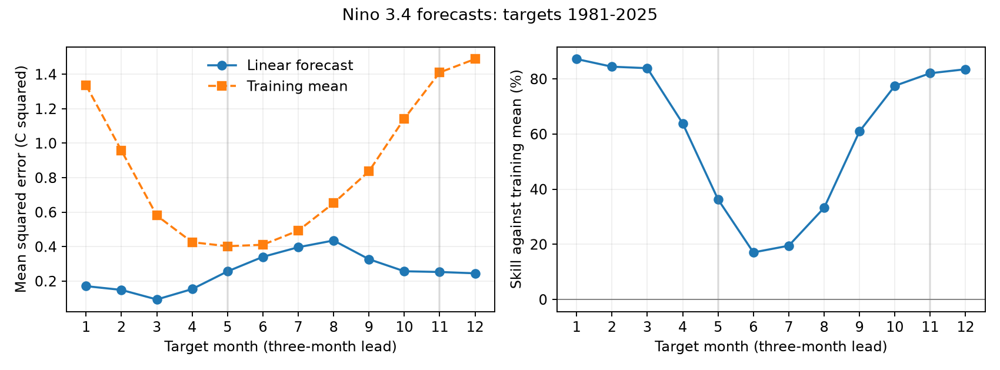
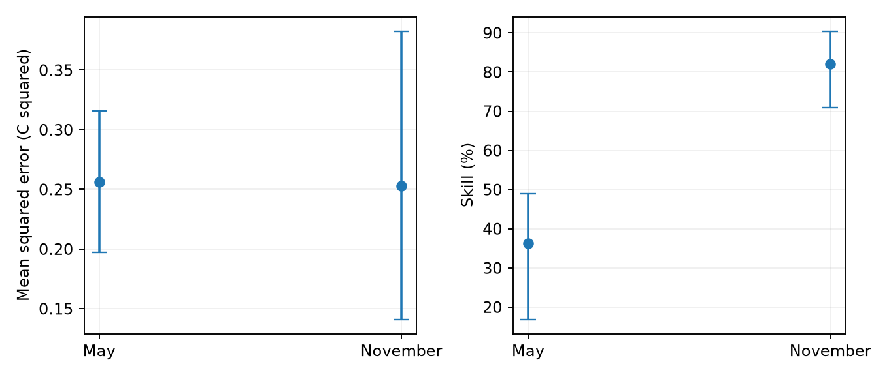

# Three-month Nino 3.4 forecasts had lower May skill but no clear May error increase over November in 1981-2025

A linear forecast from February to May had much lower skill against the training mean than a forecast from August to November. Their absolute errors were close. In 45 target years, the May and November mean squared errors were 0.2564 and 0.2529 C squared. The May-minus-November difference was 0.0034 C squared. Its 95% five-year block interval was -0.1322 to 0.1293. The data do not establish equal errors or a higher May error.

Skill against the training mean was 36.31% for May and 82.07% for November. The difference was -45.76 percentage points, with a 95% interval of -68.09 to -26.98 points. This result applies to a direct linear model, this fixed source, and the stated target years. It is not a test of current operational forecasts.



Figure 1. All target months at a three-month lead. The left panel shows forecast error and error from the expanding training mean. The right panel shows skill relative to that mean. May and November were selected before fitting. The full monthly curve is descriptive. The lowest relative skill is in June, while the largest absolute error is in August.

## Question and prior evidence

Does the spring persistence barrier also imply larger temperature errors for a small statistical forecast? A seasonal comparison can give different answers when the score uses different seasonal baseline errors. This matters when a forecast of an ocean index is used as input to climate-risk studies. This study does not estimate rainfall, water supply, or earthquake risk.

[Torrence and Webster (1998)](https://webster.eas.gatech.edu/Papers/Webster1998cFinal.pdf) studied the seasonal cycle of ENSO persistence and its relation to variance and phase locking. [Jin, Liu, and Duan (2022)](https://doi.org/10.1175/JCLI-D-22-0013.1) distinguish persistence from forecast skill in an ocean oscillator model. Their work also shows why surface persistence alone cannot describe all sources of forecast information. Our experiment is narrower: it compares error and relative skill for one direct surface-temperature regression. It does not discover the spring barrier or test that paper's physical model.

We searched signed campaign results for earthquake, ocean, and ENSO before choosing this test. We read [the winter contrast forecast study](sci:sha256:052912e523273b0db9cc3a13e6f7f1ccfb2c72565d6e9b88a4e004b308ed207a). It uses the same monthly source but tests year-to-year winter forecasts. The present study tests seasonal score differences at short leads. We use no sibling private workspace. The contribution is a fixed, inspectable benchmark with individual forecasts, paired seasonal intervals, and an independent calculation.

## Data

We use the final anomaly column in the [NOAA CPC monthly regional ERSSTv5 table](https://www.cpc.ncep.noaa.gov/data/indices/ersst5.nino.mth.91-20.ascii). [NOAA PSL](https://psl.noaa.gov/data/climateindices/list/) identifies this source and the Nino 3.4 region: 5 N to 5 S and 170 W to 120 W. The table uses a fixed 1991-2020 reference period. The saved record has 918 monthly rows, January 1950 through June 2026. It has no missing or duplicate monthly keys. We use complete test targets only through December 2025. These are monthly values, not the three-month Oceanic Nino Index.

The unchanged shared source is:

```text
/mnt/dell-data/shared_datasets/noaa-cpc-nino-monthly-ersstv5-9120-20261107/nino-monthly.ascii.txt
```

Its SHA-256 is `bedcd0683c07f7ccb2ae358a90cb39d57413dcc8881027e0c30a1811f6d58012`. It has 67,087 bytes. The small exact source is also saved under files/raw for offline use. [provenance.json](files/provenance.json) gives the source URL, shared metadata hash, retrieval metadata, version, region, and used columns. No shared data were changed or downloaded again.

## Method

The primary lead is three months. May targets use February values. November targets use August values in the same year. For each target month, fit a separate ordinary least-squares model:

```text
predicted anomaly = intercept + slope * current anomaly
```

The fit centers the predictor on its training mean. Training starts at target year 1951. At test target year y, it ends at target year y-1. Every training target must be at or before the issue month. Thus, each month has 30 initial training pairs for target 1981 and 74 pairs for target 2025. The first test issue for a January target is October 1980. The method never fits a response that lies after its issue. It uses no event thresholds, sample selection, tuning, or other regions. The baseline is the mean of training targets for that calendar month. A saved diagnostic also uses current anomaly plus the training target-minus-predictor mean difference.

Let E be mean squared forecast error and C be mean squared error from the training mean. Skill is 1 - E/C. Both E and C use the same 45 test targets for each month. We compare May and November in matched target years. We report differences as May minus November. Root mean squared error has units C; squared error has units C squared.

For uncertainty, sample the 45 paired target years in circular five-year blocks, with replacement. Retain the same sampled indices for both months and for forecast and baseline errors. Each draw contains 45 years, with the final block cut to length. Calculate skill from the ratio of mean errors within each draw. Use 10,000 draws and the 2.5 and 97.5 percentiles. The seed is 110708 plus the block length. We do not refit forecasts in each draw. These are conditional intervals for the observed forecast errors under the block assumption. They do not include all model-fit, observation, or model-choice uncertainty. They are not equivalence tests.

The [local plan](files/analysis_plan.md) preceded fitting. It is not an external registration. Planned checks use three- and seven-year blocks, six-month leads, the last 30 training years, and a linear year term. The trend check adds the year term to both forecast and baseline. We also show the two test halves as descriptive checks added after fitting. All reported intervals are marginal; there is no correction for the other comparisons.

## Results

| Measure | May | November | May minus November | 95% five-year block interval for difference |
| --- | ---: | ---: | ---: | ---: |
| Mean squared error, C squared | 0.2564 | 0.2529 | 0.0034 | -0.1322 to 0.1293 |
| Root mean squared error, C | 0.5063 | 0.5029 | 0.0034 | Not calculated |
| Training-mean error, C squared | 0.4025 | 1.4106 | -1.0081 | Not calculated |
| Skill, percent | 36.31 | 82.07 | -45.76 points | -68.09 to -26.98 points |

The training-mean error is 3.50 times as large in November. At nearly the same absolute forecast error, that larger denominator gives a much higher relative skill. This is an arithmetic explanation of the score contrast. It is not a physical explanation of the seasonal variance cycle. The measured baseline error includes both target variance and error in the estimated mean; it is not exactly target variance.

The three-month predictor-target correlations are 0.623 in May and 0.913 in November. These are descriptive correlations across the test years, not an additional fitted forecast test. They show that the seasonal relation is weaker in spring. Scaling the temperature units alone cannot change a correlation. Thus, the result does not make the seasonal persistence barrier disappear.



Figure 2. May and November errors and skills, with marginal five-year block intervals. The paired difference intervals in the table are the appropriate direct comparisons. Overlap of separate intervals is not the test.

| Check | May error | November error | Skill difference, points | 95% interval for skill difference, points |
| --- | ---: | ---: | ---: | ---: |
| Three-month lead, expanding training | 0.2564 | 0.2529 | -45.76 | -68.09 to -26.98 |
| Three-month lead, last 30 training years | 0.2555 | 0.2567 | -45.28 | -69.13 to -25.91 |
| Three-month lead, add year trend | 0.2613 | 0.2738 | -44.94 | -68.34 to -25.62 |
| Six-month lead, expanding training | 0.3264 | 1.1243 | -1.37 | -28.47 to 29.33 |

Errors in this table have units C squared. The three- and seven-year primary intervals for the skill difference are -68.65 to -25.16 and -66.46 to -28.74 points. Their absolute-error difference intervals include zero. The two test halves also have lower May relative skill, with skill differences of -33.34 points in 1981-2002 and -71.69 points in 2003-2025. These checks do not establish a time trend.

At six months the issue seasons change: May targets use the previous November, and November targets use May. Both forecasts then pass through different parts of the seasonal cycle. The May absolute error is lower by 0.7979 C squared, with an interval of -1.1531 to -0.4758. The relative skill difference is uncertain. This lead check limits any claim that one target season is always less predictable than another.

## Interpretation and limits

The proposed finding of smaller May absolute error is not supported at the primary three-month lead. Instead, the errors are close and their difference is uncertain. The clear relative skill contrast coexists with this null absolute-error comparison. Reporting only one score can therefore hide a material seasonal difference in the forecast baseline.

This is a test of one direct linear model from one reconstructed surface index. It does not measure intrinsic predictability, test modern coupled models, or identify winds, heat content, ocean feedbacks, or external forcing. A better model could change the seasonal error pattern. This benchmark cannot support an operational forecast or a claim about impact severity.

There are 45 test years and fewer independent ENSO events. Circular blocks assume that short sequences can represent the longer error process. Record endpoints are joined in resampling. Fitted forecasts share training data, which can create dependence beyond the tested block lengths. Multiple checks use the same record. No independent SST reconstruction was tested. The source values are rounded and can be revised. Its fixed reference period extends beyond early issues. Intercept fits absorb constant month-specific reference offsets, but they cannot remove reconstruction look-ahead or later source revisions. This is a retrospective experiment, not a historical real-time forecast record.

## Reproduction and checks

Follow [REPRODUCE.md](files/REPRODUCE.md). The package includes the exact source, code, dependencies, 2,160 forecasts, monthly summaries, 60,000 bootstrap draws, figures, and provenance. All substantial computations ran through campaign-compute with library threads set to one.

The [independent audit](files/audit.py) uses a Decimal source parser and scalar centered covariance formulas, including the two-predictor trend fit. It checks all 2,160 predictions, the target mapping, training endpoints, squared errors, and primary summary. The largest prediction difference is 1.39e-14 C. The audit does not validate the physical assumptions or bootstrap coverage. A second full run used the bundled source and compared generated evidence bytes. See audit.json and reproduction_check.json.

## Job and license

Job: `sci-1107-syam2-earth-and-ocean-sciences-dfa2631efca0`. Topic: `earth-and-ocean-sciences`. Campaign: `11_07_2026`. Machine: `syam2`. Account: `codex-myxtap`. Model: `gpt-6.1-sol`, high reasoning effort, through the Codex harness in T3 Code. No child agents were used. The campaign-machine key signs this result; it is not a personal authorship claim. No remote submission was made. NOAA data retain their source status. LICENSE applies to new text, figures, derived data, and code as stated there. The private key is outside the package.
