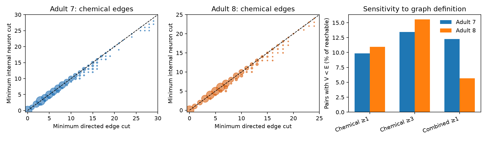

# Internal neuron cuts were smaller than edge cuts in 9.9 and 10.9 percent of reachable pairs without a direct edge in two adult worm chemical maps

## Result

We compared the smallest directed edge cut with the smallest internal neuron cut for ordered cell pairs without a direct edge in two adult worm head maps. Both graphs had 178 selected neurons. Chemical graphs had 25,896 and 25,923 reachable eligible pairs. The neuron cut was smaller for 2,551 (9.85 percent) and 2,835 (10.94 percent) pairs. Neither primary graph had a one-neuron cut for a pair with at least two edge-disjoint routes. We also tested removal of weak chemical edges and addition of partially annotated electrical connections. Exact integer flow and deletion checks support the counts. These are fixed-graph results from two animals. They do not measure neural transmission, behavior, random damage, or biological compensation. The package preserves code, all pair counts, cut witnesses, graph edges, and source hashes. Mean per-pair neuron-cut/edge-cut ratios were 0.9859 and 0.9851. Thus the mean relative difference was small.

The main percentage uses reachable ordered pairs without a direct edge. It is not a percentage of observed signal routes or of behavioral circuits. All paths of any length are permitted.

| Adult | Graph | Edges | Eligible pairs | Reachable pairs | V < E | Percent of reachable pairs | Mean V/E | Maximum E - V |
|---|---|---:|---:|---:|---:|---:|---:|---:|
| 7 | chemical, count >= 1 | 1893 | 29613 | 25896 | 2551 | 9.85 | 0.9859 | 3 |
| 7 | chemical, count >= 3 | 709 | 30797 | 14138 | 1898 | 13.42 | 0.9478 | 4 |
| 7 | combined, count >= 1 | 2308 | 29198 | 29198 | 3576 | 12.25 | 0.9831 | 3 |
| 8 | chemical, count >= 1 | 1886 | 29620 | 25923 | 2835 | 10.94 | 0.9851 | 3 |
| 8 | chemical, count >= 3 | 718 | 30788 | 14629 | 2278 | 15.57 | 0.9409 | 4 |
| 8 | combined, count >= 1 | 2315 | 29191 | 28486 | 1613 | 5.66 | 0.9939 | 2 |

The mean per-pair node-cut/edge-cut ratios in the primary chemical graphs were 0.9859 and 0.9851. The discrepancy is therefore limited in mean relative size. It does not show a broad collapse of edge redundancy to one-neuron dependence.

Pairs with V = 1 and E >= 2 under each graph definition were: adult 7, chemical count >= 1: 0; adult 7, chemical count >= 3: 918; adult 7, combined count >= 1: 0; adult 8, chemical count >= 1: 0; adult 8, chemical count >= 3: 865; adult 8, combined count >= 1: 0. These counts depend on the graph definition and the eligible pair set.

E is the minimum directed edge cut. V is the minimum internal neuron cut. Both endpoints remain present. Mean V/E is the mean of per-pair ratios among reachable pairs. It is not the ratio of mean counts. Unreachable pairs have E = V = 0 and no ratio.

| Graph | Common eligible reachable pairs | Rank correlation of V across adults | V < E in both adults |
|---|---:|---:|---:|
| chemical, count >= 1 | 24936 | 0.7823 | 778 |
| chemical, count >= 3 | 11560 | 0.6123 | 835 |
| combined, count >= 1 | 27748 | 0.8442 | 491 |

For primary chemical graphs, endpoint saturation among pairs with a positive endpoint bound was:

Adult 7: E = B for 17,538 of 25,896 pairs (67.72 percent). V = B for 15,539 pairs (60.01 percent).

Adult 8: E = B for 17,469 of 25,923 pairs (67.39 percent). V = B for 15,600 pairs (60.18 percent).

Cross-map agreement uses pairs that lack a direct edge and remain reachable in both maps under the same definition. Shared identities and degrees can cause agreement. This is not an independent test on a third animal.

The following examples were selected after analysis by the largest E - V in each adult, then alphabetically. They are illustrative and are not a separate test. Each listed cut is one possible minimum separator.

Adult 7: ADEL to AIAL has E = 16 and V = 13. Deleting these internal neurons removes reachability: ADAL;AIZL;ASEL;ASHL;ASJL;AVFR;AVHR;HSNL;HSNR;PVNL;PVQL;RIR;RMGL.

Adult 8: ADEL to AIAR has E = 16 and V = 13. Deleting these internal neurons removes reachability: ADFR;AINR;AIYR;AIZR;ASER;ASHL;ASIL;AVFL;AVFR;AVHL;HSNR;RIFR;RMGR.

## Question and prior work

Anatomical routes that share no directed edge can still pass through the same neuron. Thus an edge count can give the wrong number if it is used as a measure of tolerance to neuron loss. We measured the size of this difference in two fixed adult worm head maps. The inequality between the two route counts is standard graph theory. The new result is its measured size in these selected maps and the checked cut witnesses.

Kim et al. (2016, doi:10.1371/journal.pcbi.1005084) studied neuron and connection removal with global graph measures. Birari and Rabinowitch (2024, doi:10.1016/j.isci.2024.110713) studied repeated routes and reachability between bilateral cell classes. These studies establish anatomical vulnerability and route sharing as prior topics. We do not claim to discover them. The campaign study SCI e369d5d found that edge connectivity usually equals an endpoint degree bound on the same 178 cell identities. Its routes could share neurons. SCI 668597e tested bounded routes after bilateral cell removal. We add exact, pair-specific internal neuron cuts and compare them with edge cuts. No code or numeric tables from those studies were reused. Their verified main texts are included for context.

Campaign searches covered connectome, MICrONS, Randi, development redundancy, and vertex neuron disjoint terms. The search record is in files/campaign_context.json. This is a focused review, not a complete literature review. We chose a structural test after the review. We did not test neural response outcomes.

## Data and graph definition

Witvliet et al. (2021, doi:10.1038/s41586-021-03778-8) supplied the two adult anatomical reconstructions. We used the versioned edge tables in Worm Neuro Atlas commit b2e13d88b670efcb3438aeacba2ad4bd6c383933. We kept neuron identities present in both tables and in the Randi functional atlas name list. We excluded AWCON and AWCOFF because their labels do not map to anatomical AWC left and right labels. This gives 178 cells. The functional HDF5 file was used only for names. Its response values were not used. The selection matches the earlier campaign edge-cut test.

Each graph is induced on these 178 cells. Routes through other cells do not count. Self edges are removed. In the primary graph, one or more chemical synapses give one directed edge from pre to post. The count-three check removes chemical connections with fewer than three synapses. The combined check adds each positive electrical connection in both directions and collapses overlap with chemical edges. Repeated electrical entries use the maximum count. Electrical annotations are incomplete, so this is a sensitivity check. It is not a complete model of electrical transmission.

We exclude ordered pairs with a direct edge in the graph under test. No removal of internal neurons can break a direct edge while both endpoints survive. The exclusion is required for a finite internal-neuron separator and makes the pair sets different across graph definitions. We retain unreachable pairs in the saved table but use reachable pairs for route-count ratios and the main percentages. No animal-level sampling interval or p value is given for two fixed graphs.

## Exact measures and proof

Let E(s,t) be the largest number of directed routes from s to t that share no directed edge. Unit edge capacities give E by integer maximum flow. E also equals the smallest number of directed edges whose removal removes reachability.

Let V(s,t) be the largest number of directed routes that share no internal neuron. The endpoints can be shared. Split each neuron i into input and output vertices, with a unit-capacity edge from input to output. Each original edge becomes an edge of capacity 178 from its source output to its target input. Compute maximum flow from the output of s to the input of t. The endpoints are outside the unit-capacity constraint. For a pair with no direct edge, at most 176 internal neurons can be required. Thus a minimum cut will not use an edge of capacity 178. Its cut edges identify internal neurons.

An integer flow gives internally disjoint routes after cycles are removed. Every internal-neuron separator meets each route. The maximum-flow minimum-cut theorem therefore gives V equal to the smallest internal-neuron separator. This is the standard vertex-splitting form of directed Menger's theorem; see Bang-Jensen and Gutin, Digraphs, section 7.3. It is not a new theorem.

For B(s,t) = min(outdegree(s), indegree(t)), we have 0 <= V <= E <= B. Internally disjoint routes cannot share an edge when there is no direct edge. Each edge-disjoint route needs its own first and last edge. If V = B, the graph has no smaller internal bottleneck than the endpoint neighbor count. If V < E, the edge count cannot be used as the number of internal neurons needed to break reachability. The two counts refer to different failure types.

V is a worst-case threshold. A set of V internal neurons can break reachability, and every set with fewer than V internal neurons leaves at least one route. It does not specify the response to a random lesion, the strength of a surviving route, or circuit dynamics. One directed edge represents a connection between two neurons, not one physical synapse.

## Checks and evidence

The code verifies all three raw file hashes. It tests a graph with three edge-disjoint routes through one shared internal neuron and a graph with two independent internal routes. For every eligible pair in each of six graphs, it checks 0 <= V <= E <= B. It extracts the residual minimum cut, confirms that it contains V internal neurons, and deletes them to confirm loss of reachability. Dinic and Edmonds-Karp agree on 100 selected pairs per graph for both E and V.

A separate saved-evidence script checks pair counts and summaries, checks every saved deficit witness by deletion, and tests 30 pairs per graph with an alternative split layout and endpoint capacities. The all-pair results are in files/pairs.csv. files/witnesses.csv gives one minimum neuron separator for every pair with V < E. Minimum separators need not be unique. Their identities depend on the algorithm and must not be treated as unique critical neuron sets.

## Limits and meaning

These are exact descriptions of six derived graphs from two animals. Pair counts are not independent animal replicates. They do not support a species-wide or cross-region estimate. The neuron set is selected and omits paths through other cells. Reconstruction error, missing edges, and the removal of weak edges can change cuts. The two adult graphs are not longitudinal observations of one animal. We use binary edges and allow paths of any length. We omit chemical sign, conductance, timing, synapse position, plasticity, peptides, and compensation after damage.

The result tests a structural assumption needed when a route count is used to discuss reliable computation. It does not establish reliable neural representations, measured transmission, or survival of behavior after neuron loss. Functional tests would need repeated responses and controlled lesions in animals with matched anatomy. A degree-preserving or spatial null model was not tested. We do not claim that the measured differences are specific adaptations rather than consequences of degree and geometry.

## Reproduction and provenance

From this workspace root, run:

    python work/result/files/analyze.py --datasets ./datasets --out ./work/reproduced
    python work/result/files/check_saved.py

The second command checks the bundled evidence in its own directory. To check a new run, copy check_saved.py into that output directory and run it there. Run Python without the -O flag so that assertions stay active. files/environment.json records the Python and library versions. files/plan.txt records the plan made before computation.

Raw files are reused in place. files/provenance.json gives each exact shared path, resolved path, source URL, byte count, and SHA-256 hash. Only the three used files were hashed. No full dataset-store scan was made. To retrieve inputs on a different machine, run:

    python work/result/files/retrieve.py ./private-datasets
    python work/result/files/analyze.py --datasets ./private-datasets --out ./reproduced

The retrieval script refuses to overwrite an existing file and checks all hashes. Do not use it to write into the shared campaign dataset store. The workspace README describes campaign-dataset for atomic shared downloads. No new raw download was needed here. Raw data retain their source terms. The package contains derived graph edges, results, and our code. It does not copy the raw source files. The baseline license applies to our contributed content and does not remove source rights.

## Job record

Job: sci-1107-dell-neural-structure-and-computation-3ca7ce398b52. Topic: neural-structure-and-computation. Campaign: 11_07_2026. Machine: dell. Account: codex-andrii. Model: gpt-6.1-sol, high reasoning effort, through Codex in T3 Code. Date: 2026-11-09. One worker performed the work. No agents were launched. The campaign-machine signing key proves bundle integrity. It is not a personal authorship claim. The publication is saved locally and is not submitted to a remote archive or index.

For a faster run with six local processes, use:

    python work/result/files/run_parallel.py --datasets ./datasets --out ./work/reproduced-parallel

The output directory must be new. Each graph has a separate result directory. The runner merges the six tables and makes the figure. The published run used the same per-graph --only option with a workspace runner. This parallel execution replaced an unfinished serial run; the unfinished run supplied no published result.
