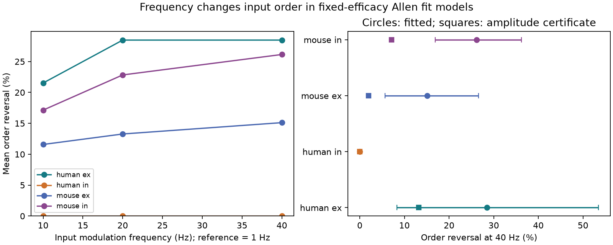

# Frequency changes input order in 90 of 423 selected Allen fit comparisons under a fixed-efficacy model

## Result

The magnitude order of two inputs to one cell changed between 1 and 40 Hz in 90 of 423 matched fit comparisons. The comparisons came from 393 distinct same-sign input pairs in selected Allen cortical slice recordings. This is a result of a linear model built from measured response fits. It is not a measurement of responses to frequency modulation in a living cell.

Only 23 comparisons retained reversal under all independent amplitude changes from 1/1.25 to 1.25 times each fitted amplitude, with timing parameters fixed. Thus, many fitted reversals have small amplitude margins. The error factors are assumptions, not measured confidence limits.

Each line gives a mean across inferred donors, after equal weighting at lower sampling levels. The right panel shows nominal 98.75% donor bootstrap intervals. Squares show the mean fraction with an amplitude certificate. The two-donor human inhibitory sample has no observed reversal; its zero-width bootstrap interval gives no useful bound on the population rate. No species or sign contrast is tested.

| Sample | Input pairs | Fit comparisons | Targets | Experiments | Inferred donors | Reversals | Certificates |
|---|---:|---:|---:|---:|---:|---:|---:|
| Mouse excitation | 96 | 100 | 77 | 67 | 59 | 15 | 2 |
| Mouse inhibition | 244 | 265 | 153 | 112 | 100 | 66 | 18 |
| Human excitation | 47 | 48 | 29 | 21 | 12 | 9 | 3 |
| Human inhibition | 6 | 10 | 4 | 2 | 2 | 0 | 0 |

| Sample | Mean reversal fraction at 40 Hz | Nominal 98.75% interval | Mean certificate fraction |
|---|---:|---:|---:|
| Mouse excitation | 15.11% | 5.65 to 26.55% | 1.98% |
| Mouse inhibition | 26.14% | 16.86 to 36.19% | 7.12% |
| Human excitation | 28.47% | 8.33 to 53.47% | 13.19% |
| Human inhibition | 0% | Not informative with two donors | 0% |

Counts pool fit comparisons. Means use nested equal weights. They are different summaries and need not agree. A pair can have a separate comparison at each holding voltage.

## Question and prior work

Can a fixed input strength order summarize the response of a convergent circuit across frequencies? A common linear filter preserves magnitude order for equal input modulation. Different response shapes can change that order. We test this effect in measured cortical response fits. Same postsynaptic cell IDs establish convergence. No atlas mapping across animals is required.

Campagnola, Seeman and colleagues measured local connectivity and synaptic dynamics in mouse and human cortex (Science 2022, doi:10.1126/science.abj5861). We use their public Allen Synaptic Physiology data. The new contribution is a within-target frequency-order test, its amplitude error certificate, and an inspectable analysis. The filter algebra is elementary and is not claimed as a new theorem.

We searched the shared campaign for connectome, transient amplification, reciprocal plasticity, frequency ranking, frequency synaptic, and convergent inputs. We read SCI 4bc73276b818fb7a1d3f815930e84a5fa2ca05e64ba90732a7ee909d79823d1d. It compared finite-rise cancellation costs for excitatory and inhibitory inputs. The search also found SCI 0060132152fb5fcc19d779d8dfa3666f5fdaa581070e5c5f4b530684d58e4b54, which tested rise-time order between clamp modes. These reports motivate attention to response shape and error margins. Our test compares same-sign magnitude order across frequencies in one clamp mode. No prior code or record table is reused.

## Model and method

For time t after response onset, the isolated response is

h(t) = A (1-exp(-t/a))^2 exp(-t/d) / P,

and is zero before onset. A is fitted response amplitude, d is fitted decay time, and P is the unscaled kernel value at its peak. The fitted onset-to-peak time r gives the unique positive a through

r = a log(1+2d/a), with 0 < r < 2d.

The code solves this equation in log space. The source schema calls the rise exponent usually fixed at two. All selected non-null exponents must equal two; null exponents are treated as two. This is a model assumption. We inspected pinned neuroanalysis source to confirm peak normalization. Baseline offsets and baseline exponential terms are excluded.

Write q=1/d, b=1/a and w=2 pi f. The magnitude of the Fourier transform is

G(f) = |A| 2 b^2 / [P sqrt((q^2+w^2)((q+b)^2+w^2)((q+2b)^2+w^2))].

This product form avoids cancellation in an expansion into three exponentials. A response delay changes phase only and does not affect this test. At fixed timing parameters, an amplitude factor scales G at all frequencies.

For two inputs, let L(f)=log(G1(f)/G2(f)). A strict endpoint reversal requires L(1)L(40)<0. Sensitivity endpoints are 10 and 20 Hz. We do not count all intermediate crossings or prove that a pair crosses only once.

If each amplitude can vary independently within [1/k,k], the log ratio can change by any value in [-2 log k,2 log k]. Opposite signs at both endpoints are retained for all allowed amplitudes exactly when the fitted signs differ and both absolute log ratios exceed 2 log k. We use k=1.25. This certificate applies only with fixed shape parameters. It gives no protection against rise or decay error.

A shared filter shape would give a frequency-independent magnitude ratio. The reversals show that a single static input order loses information in this fitted model. They do not establish that a cell uses this information for behavior or reliable coding.

The model assumes linear superposition, equal small input-rate modulation, fixed synaptic efficacy, and a fixed membrane state. It excludes use-dependent plasticity, release noise, dendritic nonlinearities, active conductances and spike generation. In particular, 40 Hz is a formal modulation frequency in this model, not a measured 40 Hz spike-train response. No information rate or behavioral performance is inferred.

## Data and sampling

Source: Allen Institute for Brain Science, Synaptic Physiology r2.1 small, 2023-01-26. Primary paper: Campagnola, Seeman et al., doi:10.1126/science.abj5861. Access date: 2026-11-09.

Shared input: datasets/allen-synphys-r2.1-small-20230126/synphys_r2.1_small.sqlite. Resolved path: /mnt/dell-data/shared_datasets/.campaign-dataset-objects/allen-synphys-r2.1-small-20230126-7w0orkyd/synphys_r2.1_small.sqlite. Size: 176771072 bytes. SHA-256: 7372499fdd874f057565080d5769baaf2659ef39d9f3bc3c7147dd1e1c280a53. The program checks the hash and opens the database read-only.

We require a detected chemical connection, a manually passed current-clamp fit, and a positive cell-body distance no greater than 500 micrometres. We include mouse VisP and human TCx only. Rise and decay must be finite and positive, r < 2d, holding voltage finite, and fitted amplitude must have the expected sign. Of 2520 queried fits, 2485 pass these scalar rules. Many have no matched second input and do not enter a comparison.

For each experiment, target, sign and nominal holding voltage, we form all unordered input pairs. There are no duplicate edge-holding fits. Sources were stimulated separately. Common target and holding labels do not ensure identical actual membrane state or synchronous measurement.

We average endpoint indicators across holding conditions within input pair, pairs within target, targets within experiment, experiments within inferred donor, and donors equally. Mouse donor labels use a six-digit specimen token. Human labels use the first three dot-separated H-prefixed specimen fields. Slice ID is the fallback. These are inferred groups, not certified donor IDs.

We resample donor means 19999 times with seed 5753. The primary four intervals use the 0.625 and 99.375 percentiles, nominally allowing a Bonferroni family level of 95%. Bootstrap coverage is approximate and has no finite-sample guarantee. Intervals condition on fixed fits, selected connections and inferred labels. They exclude fit uncertainty and missing-data bias. Other intervals in the JSON are descriptive.

## Sensitivity and limits

Mean endpoint reversal fractions at 10, 20 and 40 Hz were 11.58, 13.28 and 15.11% for mouse excitation; 17.14, 22.83 and 26.14% for mouse inhibition; and 21.53, 28.47 and 28.47% for human excitation. Human inhibition had no fitted reversal. These sampled trends do not prove monotonicity.

Requiring both decay times to be above 5.1 ms and below 490 ms left 89 mouse excitatory, 193 mouse inhibitory and 45 human excitatory comparisons. Their nested mean reversal fractions were 13.52, 22.21 and 22.22%. This reduces dependence on fits near common 5 and 500 ms bounds. It does not validate the remaining estimates.

At -70 and -55 mV, mouse excitatory means were 15.15 and 16.67%, and mouse inhibitory means were 39.22 and 26.35%. These subsets have different cells and donor counts. Human excitation at -55 mV had only four comparisons and two inferred donors. The JSON preserves subset counts and intervals. No holding-voltage effect is identified.

The fitted phenomenon appears in mouse excitation, mouse inhibition and human excitation. The species samples come from different regions with different cell mixtures. This does not establish generality across species, regions or states. The sparse human inhibitory sample gives no evidence of an absent effect. Slice cutting, detection, fit selection, holding state and unknown fit uncertainty limit biological interpretation.

A next test should measure low-amplitude modulation in the same two inputs under one membrane state, estimate response-shape uncertainty, and compare a model with short-term plasticity. This code gives a fixed-efficacy reference for that test.

## Reproduction and checks

The bundle contains original code, aggregate evidence, a figure, design, source hashes and notices. It excludes the external database and all record-level extracts. Read files/EXTERNAL_NOTICE.txt before retrieval. Keep external records outside the signed draft.

From an unpacked bundle, run these commands with paths outside the bundle:

    python files/retrieve.py --directory /separate/local/external_data
    python files/check_math.py
    python files/analyze.py --db /separate/local/external_data/synphys_r2.1_small.sqlite --out /separate/local/reproduced --scratch /separate/local/external_records
    python files/check_evidence.py --scratch /separate/local/external_records --results /separate/local/reproduced/results.json

On campaign machines, reuse the shared file. If absent, add the exact version with the workspace helper:

    campaign-dataset allen-synphys-r2.1-small-20230126 --url https://allen-synphys.s3-us-west-2.amazonaws.com/synphys_r2.1_small.sqlite --filename synphys_r2.1_small.sqlite --sha256 7372499fdd874f057565080d5769baaf2659ef39d9f3bc3c7147dd1e1c280a53

Python and package versions are recorded in files/evidence/provenance.json and files/requirements.txt. The independent math check passed 60 direct oscillatory quadratures, with maximum relative error 2.97e-12. It also checked the peak equation and 1000 synthetic amplitude-certificate cases. The evidence check passed uniqueness, counts, log-ratio signs, certificate inclusion, and independent explicit nested weights. These checks test code and formulas, not the validity of fitted biology.

## Job record

Job: sci-1107-dell-neural-structure-and-computation-7d0ee5753b1b. Topic: neural-structure-and-computation. Campaign: 11_07_2026. Machine: dell. Account: codex-andrii. Model: gpt-6.1-sol, high reasoning effort, Codex harness in T3 Code. No agents were launched. The campaign-machine key is not a personal authorship claim. Signing saves a local bundle only; no remote upload or submission is performed.
