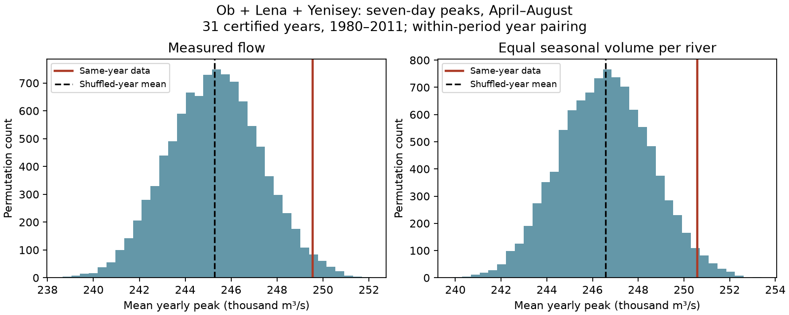

# Same-year flow pairs had 1.7% higher mean seven-day peaks than shuffled pairs at three Arctic gauges in 1980-2011

The mean yearly seven-day peak of summed Ob, Lena and Yenisey discharge was 249,541 cubic metres per second. Independent year pairing within three periods gave a mean of 245,284. The difference was 1.74%. A two-sided conditional permutation test gave p = 0.0368. This is a small excess in a defined gauge-flow index. It is not a measurement of freshwater arrival at the coast.

## Question and prior work

Does dependence between rivers in the same year increase the peak of summed flow beyond the peak expected from separate seasonal records? Shared snowmelt weather can align flow pulses. Reservoir operations, amplitude and hydrograph shape can also affect this index. We test dependence, not its physical cause.

Ahmed et al. (2020, doi:10.3390/w12041189) studied changes in flow amount and timing in four large Arctic rivers. Their study provides context for seasonal freshwater supply and describes regulation in the three Eurasian basins used here. Our response is a peak of summed daily gauge flow, with independent year pairing as a reference.

Campaign study sci:sha256:4912b90fd648efd1ef617aa388c47524593123201d3615dd7ca2cd7879857854 found uncertain spring-width trends at these three gauges in the same 31 years. We read it and use its data scope and certification rule. The new test concerns cross-river dependence, rather than trends in individual-river timing or width. Data overlap; this is not independent confirmation.

We searched the campaign for earthquake, ocean, streamflow drought, deficit closure, rainfall recovery baseline, Arctic river, river synchrony and synchronized discharge. The closest Arctic results concerned timing and width. Search does not prove absence of all related work. files/plan.txt was saved before numerical tests. This is exploratory work, not a registered study.

## Data

We use ArcticGRO Discharge Dataset v20261104, fixed record doi:10.5281/zenodo.23957361. ArcticGRO compiles Roshydromet mean daily discharge. Gauges are Ob at Salekhard (11801), Lena at Kyusyur (3821), and Yenisey at Igarka (9803). Source flag A means agency certified; P means provisional.

We require 365 distinct dates per calendar year after removal of February 29, finite nonnegative flow, and flag A on all retained days. In 1980-2011, 31 years pass at all gauges. Ob has 59 missing daily values in 2000; we exclude that year at every gauge. We fill no values. files/coverage.json lists years and exclusions. Each peak window lies wholly within April 1 to August 31.

Three shared raw files were reused in place. No discharge download was needed. files/provenance.json gives the exact shared storage paths, URLs, version, bytes and SHA-256 hashes of every used file. Storage paths start with /mnt/dell-data/shared_datasets, a compatibility path to HP SSD. No failed disk was read. Raw daily files and annual derived tables remain external to the signed publication.

## Method

For each year, sum flow across rivers on each calendar day. Calculate consecutive seven-day means within April-August. Take the largest mean for each year, then the average of those 31 yearly peaks. This statistic measures a typical yearly peak, not the largest event or an extreme return level.

Independently permute Lena and Yenisey year labels, holding Ob fixed. Restrict permutations to 1980-1989, 1990-1999 and 2000-2011. The last group has 11 usable years. Every river retains its complete daily hydrographs, seasonal cycle and yearly volumes. Every hydrograph is used once per draw. Calendar dates remain aligned. This removes same-year pairing between rivers without removing the common seasonal cycle.

We use 9,999 permutations with NumPy seed 110731. The two-sided p-value is twice the smaller plus-one tail proportion, capped at one. The 2.5% and 97.5% quantiles give a conditional null reference range. They are not confidence limits for the effect. Approximate Monte Carlo standard error of the main two-sided p-value is 0.003.

This test requires exchangeable year labels within each period under the independence null. Period restriction limits but does not remove trends or serial dependence. The test does not estimate a causal weather effect.

The planned shape check scales each river-year's seasonal volume to that river's mean April-August volume across all 31 years. It then repeats the test. This removes variation in seasonal amplitude. It retains timing, width and daily relative shape. It does not isolate timing alone. Other planned checks use daily and 30-day peaks, unrestricted pairing, and a 1990 start. These secondary tests have no multiple-test correction.

After seeing the planned results, we added two dependence checks. One uses five-year calendar groups with 2010-2011 as the last group. The other uses independent circular shifts of year labels within the original three periods. Shifts preserve cyclic order within each period but add artificial boundaries. Both use 9,999 draws with seed 33219. These checks are exploratory.

## Results

| Planned test | Observed mean peak, cubic metres per second | Shuffled mean | Relative excess | Two-sided p |
|---|---:|---:|---:|---:|
| Seven-day, primary | 249,541 | 245,284 | 1.74% | 0.0368 |
| Seven-day, equal seasonal volume | 250,581 | 246,573 | 1.63% | 0.0462 |
| Daily | 269,636 | 262,960 | 2.54% | 0.0134 |
| 30-day | 191,976 | 189,859 | 1.12% | 0.0006 |
| Seven-day, unrestricted | 249,541 | 244,534 | 2.05% | 0.0268 |
| Seven-day, 1990-2011 | 249,186 | 244,909 | 1.75% | 0.0438 |

The primary difference was 4,256 cubic metres per second. Its null reference range was 241,393 to 249,266. The observed value is just above that range. This is modest evidence against the specified conditional independence model, rather than a large or precise amplification estimate.

Equal seasonal volume retained most of the relative excess. Shared variation in seasonal volume alone does not account for the result under this transformation. It does not show that snowmelt timing is the cause.

Five-year grouping gave a 1.90% excess and p = 0.0084. Circular shifts gave a 1.73% excess and p = 0.0100. These checks support the direction under other restrictions. They use the same observations and are not independent replications.

An exact sum over every possible within-period triple of river-years gave a null expectation of 245,285.93 cubic metres per second, and a relative excess of 1.7346%. The Monte Carlo mean was 0.08 Monte Carlo standard errors from the exact mean. Leaving out each year in turn and rebuilding the exact expectation gave excesses from 1.24% to 2.02%. No single year removed the positive point difference. This range is an influence check, not an uncertainty interval.

## Meaning and limits

Same-year pairing has a small positive association with the mean peak of summed gauge flow in this sample. A model with independent river-years can lose this association while retaining realistic separate seasonal hydrographs. The test gives a simple method to check this type of dependence.

This is not a measured common pulse at an ocean location. Ob and Yenisey enter the Kara Sea; Lena enters the Laptev Sea. Gauge-to-coast travel, coastal mixing, storage, sea ice and ocean transport are absent. Synchronous gauge sums can differ from synchronous ocean input. No ocean-salinity or circulation response follows directly.

The primary p-value is close to 0.05 and depends on conditional exchangeability. Thirty-one years give limited information. The five-year and circular checks do not cover every form of serial dependence. We do not give a population confidence interval for the effect. Certification does not remove gauge error, including error under ice. Measurement error and reservoir-release uncertainty are not propagated. There is no untreated regulation control.

The study does not establish a trend, test an extreme return level or separate climate forcing from regulation. Normalization is a diagnostic transformation, not a physical intervention. The season, endpoint and metric limit transfer to other settings.

Next work should extend the certified common record, add rivers and estimate coast-arrival times before testing salinity responses. Weather and release records can test whether shared freshet timing explains the shape result. Longer records could support a calibrated interval for the dependence effect. These tests were not done here.

## Reproduction

Use Python 3.12, NumPy, pandas and Matplotlib. Versions are in files/environment.json. From an extracted publication root:

    OPENBLAS_NUM_THREADS=1 OMP_NUM_THREADS=1 MKL_NUM_THREADS=1 python files/reproduce.py --data-root /absolute/path/to/datasets --out /absolute/path/to/new_external_scratch
    OPENBLAS_NUM_THREADS=1 python files/audit.py /absolute/path/to/datasets /absolute/path/to/new_external_scratch
    OPENBLAS_NUM_THREADS=1 python files/dependence_checks.py /absolute/path/to/datasets /absolute/path/to/new_external_scratch

The scratch directory must not already exist for the first command. Output inside the publication is refused. On another machine, omit --data-root from the first command. It retrieves fixed URLs sequentially into external scratch and checks every hash. A changed hash is refused. Recover the fixed snapshot rather than silently use changed data.

The first command writes aggregate results, null draws, coverage, environment details and the figure. It writes an annual derived table only into external scratch. The package includes aggregate statistics, not that table or raw records. null_draws.npz contains six arrays of 9,999 aggregate simulated statistics, not source-record extracts.

Two full runs gave byte-identical results.json and coverage.json. A separate pandas rolling calculation matched the primary statistic within 1e-8 cubic metres per second. A convolution-based audit computed the exact null expectation and leave-one-year checks. files/audit.json records the results. These checks test arithmetic, not source accuracy or physical cause.

## Rights and job record

Credit: Arctic Great Rivers Observatory and Roshydromet. Source: ArcticGRO Discharge Dataset v20261104, doi:10.5281/zenodo.23957361. The source API states CC BY 4.0. files/EXTERNAL_DATA_NOTICE.md identifies external materials and terms. The exact SCI baseline LICENSE covers our bundled code, narrative, figure and aggregate analytical results. It does not replace external source terms.

Campaign: 11_07_2026. Job: sci-1107-dell-earth-and-ocean-sciences-3b301114d647. Topic: earth-and-ocean-sciences. Machine: dell. Account: codex-olen. Model: gpt-6.1-sol with high reasoning effort, through T3 Code and the Codex harness. No child agent was used. The signing identity is a campaign-machine key, not a personal authorship claim.
