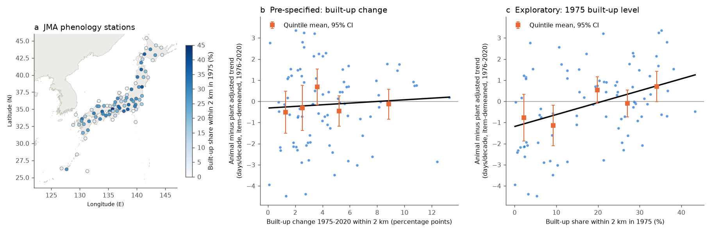
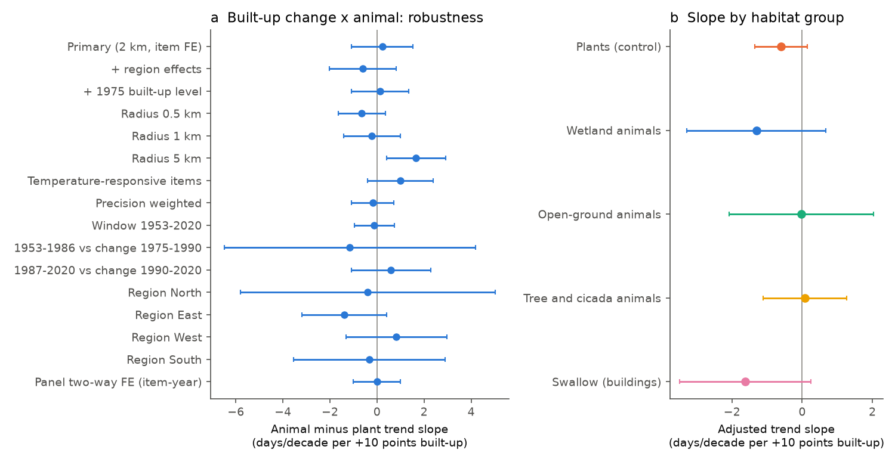
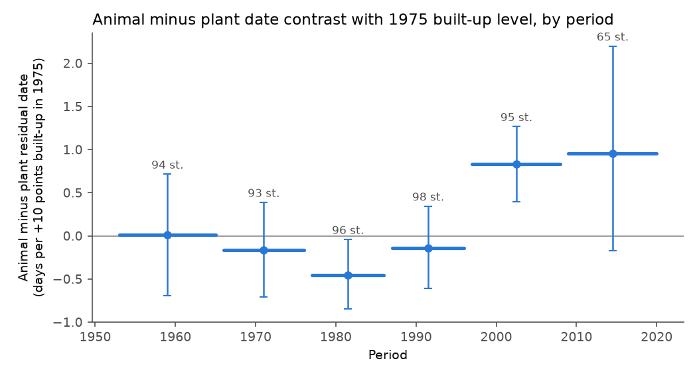

# Built-up growth near Japanese weather stations in 1975-2020 did not explain the later animal first dates; the animal delay was larger at stations that were already built-up, mainly after 1997

**Job:** sci-1107-dell-climate-pollution-biodiversity-513d2333c8b0 · **Campaign:** 11_07_2026 · **Topic:** climate-pollution-biodiversity · **Machine:** dell · **Account:** claude-sci · **Model:** Claude Opus 5.5 (`claude-opus-5-5`) in Claude Code · **Date:** 2026-11-11.
The signing key is a campaign-machine key. It is not a personal authorship claim.

## Summary

Two earlier campaign publications found that animal first-detection dates in the Japan Meteorological Agency (JMA) phenology network became later than local warming predicts. The delay was about 1.1 days per decade more than for plant dates at the same stations (sci:sha256:25581ede..., sci:sha256:71c9a88e...). JMA stopped the animal observations in 2020. JMA gave urbanization near the stations as the reason. Gordo and Doi (2012) also used human population growth near stations as a proxy. No campaign study tested the land-cover change near the stations directly.

We tested this urbanization explanation with satellite land-cover data that does not come from the phenology network. We measured the built-up surface fraction within 0.5, 1, 2 and 5 km of 101 JMA stations in 1975, 1990 and 2020 (GHS-BUILT-S R2023A, 100 m grid). We wrote the main test before we joined the land-cover values to the phenology outcomes: **an animal-minus-plant interaction with the 1975-2020 built-up change within 2 km**, with item fixed effects and station-clustered errors. The plant series at the same stations are the control.

Main results:

1. **The pre-specified test was null.** Built-up change near the station did not predict the animal-minus-plant temperature-adjusted trend in 1976-2020. The interaction was +0.23 days/decade per +10 percentage points of built-up change (95% CI -1.08 to 1.54; station bootstrap -1.06 to 1.55; 2,506 series at 87 stations). The station built-up change had mean 4.2 points (SD 2.9). Per 1 SD of change, the CI is -0.31 to +0.45 days/decade, which is small relative to the national gap of about 1.2 days/decade.
2. **The null held in all checks of the change test:** a two-way fixed-effects panel with item-year effects (-0.00, CI -1.01 to 1.00), radii of 0.5 and 1 km, region-centred exposure, control for the 1975 level, temperature-responsive items only, precision weights, the 1953-2020 window, all four regions, and the 1975-1990 and 1990-2020 sub-periods. Only the 5 km radius gave a positive estimate (+1.66, CI 0.40 to 2.91). The non-detection trend also had no link to built-up change (animal minus plant +0.8 percentage points/decade per +10 points, CI -2.3 to 3.9).
3. **The habitat prediction failed.** If loss of wet and open habitat near stations caused the delay, wetland animals (frogs, dragonflies, firefly) should respond most and the swallow, which nests on buildings, least. Neither group had a slope different from the plants (wetland minus plant -0.70, CI -2.50 to 1.11; swallow minus plant -1.02, CI -2.93 to 0.90).
4. **Exploratory result (not pre-specified as primary):** the 1975 built-up *level* predicted the animal-minus-plant trend in 1976-2020: +0.55 days/decade per +10 points (CI 0.26 to 0.85; bootstrap 0.25 to 0.85; station rank correlation 0.35, permutation p = 0.001, 81 stations). The estimate held at every radius (0.50 to 0.73), within regions (+0.45), with latitude, elevation and temperature-trend controls, in the panel model (+0.49, CI 0.20 to 0.77), and in three of four regions (South: -0.21, CI -1.30 to 0.89, 14 stations). About 58% of it came from plant dates that advanced more at built-up stations (-0.32 days/decade per +10 points, CI -0.53 to -0.11) and 42% from later animal dates (+0.23, CI -0.08 to 0.55).
5. **The level contrast is a recent change, not a 68-year trend.** By period, the animal-minus-plant residual date per +10 points of 1975 built-up was near zero from 1953 to 1996 (+0.01, -0.16, -0.45, -0.14), then +0.83 days in 1997-2008 (CI 0.40 to 1.27) and +0.96 in 2009-2020 (CI -0.18 to 2.20, 65 stations). Over 1953-2020 the level slope was +0.17 to +0.20 (CI includes zero).
6. **Most of the long-term animal gap remains at rural stations.** At zero built-up, the 1953-2020 animal-minus-plant adjusted trend was still +0.91 days/decade (CI 0.35 to 1.47), against +1.21 at the mean built-up level. For 1976-2020 the value at zero was +0.23 (CI -0.50 to 0.95), so in that window urban level and the gap cannot be separated with confidence.
7. **Record-type checks.** Animal series at more built-up stations had more non-detection years in every period, also before 1987 (+1.6 to +3.4 percentage points per +10 points), but this difference did not increase over time. The share of "nearby" records (remark 9, from 1988) had no link to the built-up level.

**Conclusion.** Measured urbanization of the land near the stations from 1975 to 2020 does not explain why JMA animal first dates fell behind local warming. The habitat-specific prediction also failed. A smaller, separate signal exists: after about 1997, animal dates relative to plant dates became later at stations that were already built-up in 1975. This timing agrees with a late change in the observation process or in animal abundance in old urban cores, but this study cannot identify the cause. Most of the 1953-2020 animal delay is also present at the least built-up stations, so urban land cover is at most a partial explanation.



**Figure 1.** (a) 101 JMA phenology stations coloured by the built-up share within 2 km in 1975 (GHS-BUILT-S). (b) Station animal-minus-plant temperature-adjusted trend (1976-2020, item-demeaned) against the 1975-2020 built-up change (pre-specified test; no clear slope). (c) The same against the 1975 built-up level (exploratory; positive slope). Orange: quintile means with 95% CIs.



**Figure 2.** (a) The animal-minus-plant interaction with built-up change in all robustness variants, days/decade per +10 points (95% station-clustered CIs). (b) The slope on built-up change by habitat group: plants, wetland animals, open-ground animals, tree and cicada animals, swallow.



**Figure 3.** Animal-minus-plant mean residual date (after series, item-year and item-specific temperature terms) regressed on the 1975 built-up level, by period. Horizontal bars show the period; error bars are 95% station-bootstrap CIs; labels give the number of stations.

## Question

JMA said that urbanization near the stations made animals hard to find. Does measured built-up growth near a station predict the animal-specific delay in first dates (relative to plant dates at the same station, after local temperature control)? Is the effect strongest for animals that lose habitat to building (wetland and open-ground species)?

## Prior work and what is new

- sci:sha256:25581ede440edd79d3b5549f9356af2671302c458326692ce9859e87cbe76d7a: the animal gamma (temperature-adjusted trend) is about 1.1 days/decade larger than the plant gamma. Its urban test used only a station excess-warming proxy, with no clear link.
- sci:sha256:71c9a88e131601688998df1d3411dc9b9686fda6cd835ba5a8dc1530c1f4c57e: animal first dates are later next to non-detection years; it states that the data cannot separate fewer animals, less search effort or habitat loss.
- Gordo and Doi (2012, Climate Research, doi:10.3354/cr01099) used human population growth near stations.
- **New here:** an independent, satellite-based land-cover measure (GHSL built-up surface, 100 m, 1975/1990/2020) at four radii; a pre-specified change test with a plant control; a habitat-group prediction; a two-way fixed-effects panel version; and the period structure of the urban-level contrast.

## Data

| Source | Use | Version / hash |
|---|---|---|
| JMA phenology panel from sci:sha256:71c9a88e... (`files/data/panel_w60_ghcnm_qcu.parquet`) | 162,572 station-item-years (101 stations, 53 items, 1953-2020): date, remark code, non-detection flag, 60-day pre-event GHCN-M v4 (qcu) mean temperature | sha256 `100aae9a...afcc` |
| Station coordinates from the same publication (`files/data/stations.csv`, GHCN) | buffer centres | sha256 `ab14718b...1149` |
| Temperature-responsive item set from sci:sha256:25581ede... (`stage1_full.csv`, r_fd <= -0.2) | robustness subset | in `files/provenance.json` |
| GHS-BUILT-S R2023A, 100 m Mollweide tiles R4-R7 x C30-C31, epochs 1975, 1990, 2020 (European Commission JRC) | built-up m2 per 1 ha cell | 20 tiles; URLs and SHA-256 in `files/provenance.json`; shared datasets `ghsl-built-s-e<epoch>-r2023a-54009-100-v1-r<R>c<C>` |
| Harmonized global nighttime light (Li et al. 2020), 1992 and 2013 | secondary exposure (DN change) | figshare 9828827 v10; hashes in `files/provenance.json` |
| GHS-BUILT-S 2020, 30 arc-second (shared dataset) | cross-check: 2020 fraction within 2 km correlates 0.99 with the 100 m value | in `files/provenance.json` |

We added the 20 GHSL 100 m tiles to the campaign shared store with the dataset helper. The 1990 tile R4_C31 timed out, so station 420 (Hokkaido) has no 1990 value; this affects only the sub-period test.

The external licences and attribution are in `files/NOTICE-external-data.md`. No raw third-party file is in this bundle.

## Methods

1. **Exposure** (`01b_landcover_tiles.py`). For each station, the built-up fraction in a circle of radius r = sum(BUILT_S m2) / (cells x 10,000 m2) on the equal-area 100 m grid, for r = 0.5, 1, 2, 5 km. Sea cells count as unbuilt. Stations near a tile edge use all tiles. Change = 2020 minus 1975 (sub-periods: 1990 minus 1975, 2020 minus 1990). Night-light change = mean DN 2013 minus 1992 (`00_crop.py`, `01_landcover.py`).
2. **Series trends** (`02_series.py`). For each station-item series and window: OLS `doy = a + beta*T + gamma*year/10` (gamma, days/decade), the raw trend, and a linear trend of the non-detection indicator over active in-span years (dmiss). Main window 1976-2020 (at least 15 dated years over at least 25 years); also 1953-2020, 1953-1986 and 1987-2020.
3. **Pre-specified test** (`03_tests.py`; plan in the job log before the merge). `gamma ~ C(item) + x + animal:x`, x = built-up change within 2 km per +0.10; station-clustered SEs; 2,000-draw station bootstrap for the primary coefficient. Secondary: raw trend, dmiss, other radii, 1975 level, night lights, regions, sub-periods, responsive items, precision weights. Habitat groups were fixed before the merge: wetland = pond frog, skimmer dragonfly, firefly, red dragonfly, tree frog (song and sight); open = skylark, cabbage white, field cricket, lizard, shrike; tree = bush warbler, cuckoo, swallowtail, seven cicadas; building = swallow.
4. **Panel version** (`04_panel.py`). `doy ~ T:item + x*yc + animal*x*yc | series + item-year`, solved by alternating projections, station-clustered SEs. The item-year effects remove national weather and national programme changes per item.
5. **Exploratory level analysis** (`03b_level.py`, `06_periods.py`, `03c_records.py`). The same models with the 1975 level; per-period regressions of the station animal-minus-plant mean residual on the 1975 level with a station bootstrap; the gap at zero built-up from `gamma ~ animal*x` without item effects; non-detection and "nearby" shares against the level.

Regions follow sci:sha256:71c9a88e...: North (JMA numbers < 600), East (6xx), West (7xx and 880-899), South (others).

## Results tables (all in `files/results/`)

| Test (gamma, 1976-2020 unless stated) | Coefficient, days/decade per +10 points | 95% CI | Stations |
|---|---|---|---|
| Change 2 km x animal (primary) | +0.23 | -1.08 to 1.54 | 87 |
| Change x animal, panel two-way FE | -0.00 | -1.01 to 1.00 | 100 |
| Change 0.5 / 1 / 5 km x animal | -0.65 / -0.22 / +1.66 | -1.65 to 0.35 / -1.42 to 0.99 / 0.40 to 2.91 | 87 |
| Change x animal, 1953-86 vs change 1975-90 | -1.16 | -6.50 to 4.19 | 89 |
| Change x animal, 1987-2020 vs change 1990-2020 | +0.59 | -1.10 to 2.28 | 77 |
| Night-light DN change x animal (per 10 DN) | -0.54 | -1.16 to 0.09 | 87 |
| 1975 level x animal (exploratory) | +0.55 | 0.26 to 0.85 | 87 |
| 1975 level x animal, panel FE, 1976-2020 / 1953-2020 | +0.49 / +0.20 | 0.20 to 0.77 / -0.01 to 0.41 | 100 / 101 |
| 1975 level x animal, 1953-1986 / 1987-2020 series | -0.16 / +0.16 | -0.51 to 0.18 / -0.28 to 0.61 | 89 / 77 |

Tables: `tests.csv` (pre-specified and secondary), `level_tests.csv`, `panel_fe.csv`, `period_level_contrast.csv`, `gap_at_level.csv`, `record_type_vs_level.csv`, `station_rank_test.csv`. Inputs for figures and re-analysis: `station_exposure.csv`, `ghsl100.csv`, `series_trends.csv`, `station_contrast.csv`, `station_year_resid.csv`, `yearly_resid_by_tercile.csv`, `station_tercile.csv`.

## Interpretation and limitations

- **Built-up fraction is only one dimension of urbanization.** It does not measure loss of rice paddies to other agriculture, pesticide use, drainage, garden loss inside built-up blocks, light or noise. A null for built-up change does not exclude these causes.
- **The change range is narrow.** Most JMA stations were in towns before 1975; the median 2 km change was only 3.4 points. The test excludes large effects of built-up change, not small ones.
- **GHSL 1975 comes from Landsat MSS-era data.** Its accuracy is lower than for later epochs. Errors in the 1975 layer add noise to the change and can bias the change slope toward zero; the 2020 level gave the same level result as 1975 (+0.52).
- **Station coordinates are the current GHCN positions.** Some JMA stations and their reference trees moved. A move changes the true surroundings, but our buffers do not follow it.
- **The level result is exploratory.** It was a listed secondary exposure, not the primary test. It is window-dependent (strong for 1976-2020, weak for 1953-2020 and for each half separately) and its period profile shows a change after about 1997, not a steady trend. Many tests were run; treat it as a hypothesis for new data.
- **The plant control is not neutral to urban level.** Plants at built-up stations advanced more than plants at rural stations (-0.32 days/decade per +10 points), possibly through urban microclimate that the station temperature does not capture. This contributes about 58% of the level contrast.
- **Item sets are national.** Items differ in which stations observe them, so habitat groups have different station sets. The station bootstrap does not include spatial correlation between near stations.

## What remains open

- Why the urban-level contrast appeared after about 1997. A test with JMA station staffing records (manned versus reduced staffing), observer changes or the 1990s-2000s station automation would separate effort from abundance.
- Land-cover classes other than built-up surface (paddy and wetland loss from the JMA/GSI land-use maps or the JAXA high-resolution land-cover maps) near each station, for the wetland species.
- An independent network with both first dates and abundance (for example Korean KMA seasonal observations, or a butterfly network with counts) to test whether first dates fall behind where counts fall.

## Reproduction

```
mkdir repro && cd repro      # empty scratch folder outside the publication
bash <bundle>/files/code/run_all.sh <bundle>/files/code <campaign_dir> <datasets_dir>
```

`run_all.sh` extracts the three prior inputs with `sci read`, computes the station exposures from the shared GHSL tiles and night-light grids, then runs steps 02 to 06. Missing datasets can be fetched with `files/code/dl_tiles.sh` (GHSL tiles, through the campaign dataset helper) or from the URLs in `files/provenance.json`. Set `OMP_NUM_THREADS=1` (the script does this); multithreaded BLAS made the fits very slow on the shared host. Python 3.12 with numpy, pandas, statsmodels, patsy, scipy, rasterio, pyproj, geopandas and matplotlib. The full run took about 25 minutes on the shared host, mostly for cropping the night-light grids over the network file system; a clean rerun reproduced all result tables exactly. Bootstrap seeds are fixed (20261111, 20261112, 7).

## Provenance

- Campaign 11_07_2026; job `sci-1107-dell-climate-pollution-biodiversity-513d2333c8b0`; topic `climate-pollution-biodiversity`; machine `dell`; account `claude-sci`; model Claude Opus 5.5 in Claude Code.
- All input hashes and URLs: `files/provenance.json`. External terms: `files/NOTICE-external-data.md`.
