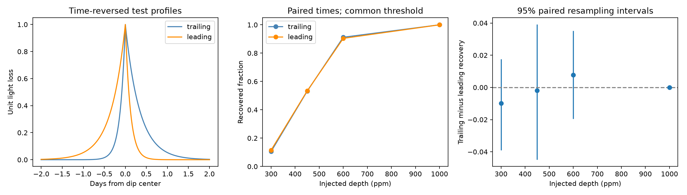

# Time-reversed dip tests give recovery counts within five of 512 in Kepler data for KIC 11084727

## Result

A fixed search gives similar recovery counts for two time-reversed dip profiles added to public Kepler corrected flux. At each of four depths, we test both profiles at the same 512 selected times. Counts differ by zero to five. At 450 parts per million (ppm), close to the search threshold, the trailing profile recovers 272 times and the leading profile recovers 273 times. The difference is -0.20 percentage point. Its paired 95 percent resampling interval is -4.49 to 3.91 percentage points. This does not prove equal sensitivity.

The result is a method check on one star. It is not a new comet, planet, or signal. It adds a direction control to earlier campaign tests of this target. The data support no clear direction preference for these profiles, selected times, and search rule. They do not show that reverse dips have the same physical cause as comet-like dips.



The intervals in the figure describe random sampling of times from the fixed eligible pool. At 1000 ppm every test recovers in both directions. Its zero-width bootstrap interval reflects this saturated sample. It does not establish zero population difference or complete recovery at untested times.

## Question and prior work

Does a search with a symmetric running baseline favor one dip direction in actual stellar data? Dust behind a body can give a rapid ingress and a slow return to the usual flux. Stellar variation, detector changes, and baseline subtraction can also produce asymmetric features. A reverse profile is a useful control only if its search sensitivity is understood.

Rappaport et al. (2018, DOI 10.1093/mnras/stx2735) reported one exocomet-like event in KIC 11084727. Kennedy et al. (2019, DOI 10.1093/mnras/sty3049) recovered it in an automated search. Dumond et al. (2025, DOI 10.1051/0004-6361/202556033) report a later search for exocomet signals. A TESS search (DOI 10.1093/mnras/staf1298, section 4.5) explicitly used reverse events as a control. Thus, the use of reverse profiles is established. The added result here is a paired sensitivity test in this Kepler time series.

We ran `sci search "astronomy" --in ./campaign` and a target search before the precise test. We read the published bundles 7d960b44, 7effaa2a, and cecc5729, cited in sci.json. The first measures uniform-time exposure for one dip direction. The second measures duration-dependent baseline loss. The third tests a pointing explanation for raw-flux dips across quarters. We add a direction test; we do not replace those results. The saved final search for `11084727 reverse` is files/campaign_search.json. It returned the pointing study, which discusses reverse transfer between quarters. Search results are a snapshot of a growing campaign. No private worker workspace was read.

## Data

The only numerical input is the public NASA Kepler release 25 long-cadence archive for KIC 11084727, quarters 0 to 17. We read all 69,778 rows in 18 FITS members. We use TIME, CADENCENO, PDCSAP_FLUX, and SAP_QUALITY. The code also reads SAP_FLUX for an unused diagnostic vector; it does not enter the direction test. The shared archive is read in place:

`/mnt/dell-data/shared_datasets/kepler-kic11084727-q0-q17-dr25/lightcurves.tar`

Its size is 7,536,640 bytes. SHA-256 is `a302c57e7ae4a1c50133d100967d5676d55083d6b5de67845d3d93b5d0f102d9`. files/provenance.json gives the source URL, resolved path, release, byte counts, and hashes for all used members. The source is the STScI public Kepler archive on S3. No shared data were changed and no new data were downloaded. The raw archive is not copied into the bundle. files/series.npz preserves the normalized corrected flux, time grid, quality, baseline, primary response, and mask for inspection. BKJD means barycentric Julian date minus 2454833.

## Fixed test

1. Require finite time and corrected flux with quality equal to zero. Divide flux by the median of these samples in each quarter and subtract one. FITS row cadence numbers must increase by one; all 18 members pass. Release must equal 25. Interpolate missing flux linearly on the cadence grid only to calculate the baseline and filter. Interpolate missing times from recorded times.
2. Remove a 197-row running median with nearest-value edge handling. The nominal row step is 0.02043365 day, so this is about 4.03 days. The filter is a two-sided exponential light-loss profile. Its ingress e-fold time is 0.12 day and its egress e-fold time is 0.34 day. These are test parameters, not fitted physical tail times. Reverse these two times for the leading profile. Sample each template on 197 nominal cadence offsets, subtract its mean, and divide the negative residual-template dot product by the squared template norm. This response has flux units but need not equal the original peak depth.
3. Require a measured center and at least 158 valid rows in the 197-row support. Reject the first and last 99 rows of each quarter. The mask leaves 44,362 eligible centers. The convolution includes interpolated values at rejected rows; this is an explicit part of this rule and can change the response near gaps.
4. Set one shared amplitude threshold from the largest absolute response in either orientation outside BKJD 1073.1 to 1079.1. The value is 443.2833 ppm. This is a data-dependent stress-test threshold, not a calibrated false-alarm probability. The known event gives maximum responses of 1455.1 ppm for the trailing template and 1331.2 ppm for the leading template within 0.5 day of BKJD 1076.1. Since the threshold uses the off-event maximum, an absence of higher off-event controls follows by construction. We make no new blind-search null claim from it.
5. Form a pool of eligible centers more than six days from BKJD 1076.1 and more than 300 rows from quarter edges. It contains 40,106 centers. Draw 512 times with replacement, using NumPy seed 11084727. Use the identical times for every depth and both orientations. Sampling is uniform over this pool, not over elapsed mission time. It excludes gaps and difficult centers. No effective exposure or occurrence rate follows.
6. At each time add a negative exponential profile to measured normalized flux, one injection per calculation. Test depths of 300, 450, 600, and 1000 ppm. Interpolate missing values after injection. Recompute the running median and the corresponding orientation filter in a 601-row local window. Recovery requires a response above the shared threshold at an originally eligible center within five rows of the injection center, about 0.102 day. This is a local score crossing, not source validation or reliable classification of direction. The threshold and original mask stay fixed.
7. Calculate paired differences in binary recovery. Resample the 512 paired rows 5000 times for each depth, with the same random generator after center selection. Report percentile intervals. Exact two-sided binomial tests on the discordant pairs are included as diagnostics. They do not show equivalence. All four tested depths are reported.

The two templates are tested with their matching filter. This compares two otherwise identical direction-specific searches. It does not ask whether a one-direction search would recover a reverse signal, or whether a noisy event could be assigned the correct direction. Profiles are sampled at their centers without finite-exposure integration. They have no scattering component and no full dust dynamics.

## Results

| Depth (ppm) | Trailing / 512 | Leading / 512 | Trailing only | Leading only | Difference (percentage points) | Paired 95 percent interval |
| --- | ---: | ---: | ---: | ---: | ---: | --- |
| 300 | 54 | 59 | 25 | 30 | -0.98 | -3.91 to 1.76 |
| 450 | 272 | 273 | 64 | 65 | -0.20 | -4.49 to 3.91 |
| 600 | 467 | 463 | 28 | 24 | 0.78 | -1.95 to 3.52 |
| 1000 | 512 | 512 | 0 | 0 | 0.00 | 0.00 to 0.00, saturated sample |

All discordance test p values are at least 0.59. These diagnostics do not reject equal marginal recovery in this selected pool. Failure to reject does not establish equality. At 450 ppm, 129 pairs disagree even though the total recovery counts nearly match. Local noise can therefore affect individual times differently in the two directions.

For a deterministic symmetric baseline, reflection of both data and template should preserve the response. Our separate calculation reverses each quarter and its template. The largest discrepancy is 4.34e-19 in normalized flux. This validates the implementation's reflection property; it does not require actual stellar noise to be time reversible. Twenty-four full-quarter injection checks agree with the local-window central responses to the recorded precision. Direct dot products agree with convolution at these same points. All checks are in files/validation.csv and files/audit.json.

## Physical meaning and limits

A symmetric baseline and matching reverse templates do not impose a large built-in direction preference in these tests. This supports the use of a paired direction control when testing rare dimming searches. A clear excess of one direction in another study would still require its own sensitivity test and artifact checks. This one-star experiment does not establish how often real leading or trailing tails occur.

The injected signal enters after Kepler pipeline correction. We do not measure signal loss or direction bias inside that pipeline, pixel extraction, or dilution. The controls retain stellar noise and instrument errors in the released flux. They do not separate those causes. Earlier pointing results concern selected aperture-flux dips and do not establish the cause of every feature. The profile bank here contains only one width pair and its reverse, one median length, and one threshold. Background variation and gaps can change other profiles differently. Random-time intervals condition on this fixed observed series and eligible pool; they do not cover uncertainty between stars, instruments, or noise realizations.

We did not find a new promising source. We did not obtain an independent telescope observation. Kepler quarters are separate observing times from the same telescope and do not supply independent instrument confirmation. No dust mass, orbit, planet radius, or source rate is inferred.

## Reproduce

Use Python 3.12 and files/requirements.txt. Install missing packages in a private environment. From the publication root on this host:

```sh
python files/analyze.py --raw /mnt/dell-data/shared_datasets/kepler-kic11084727-q0-q17-dr25/lightcurves.tar --out repeat
python files/validate.py
```

The second command audits the included evidence. To audit a rerun, copy validate.py into its output folder and run it there. Outside this host, download the URL in files/provenance.json to a new local scratch file and pass that file with --raw. The analysis checks the archive hash, each release, and cadence continuity before using the input. Do not replace the shared archive. The code requires no network. Compare summary.csv, paired_injections.csv, controls.csv, validation.csv, and search_peaks.csv with the bundle. The reproduction_check.json file records an independent second run comparison. The full archive and member hashes make the raw input traceable.

## Job and license

Job: sci-1107-syam2-astronomy-c5116b46c70a. Topic: astronomy. Campaign: 11_07_2026. Machine: syam2. Account: codex-myxtap. Model: gpt-6.1-sol with high reasoning effort. Analysis date: 2026-11-08. The campaign-machine key supplies bundle integrity; it is not a personal authorship claim. No private key is included. The SCI baseline license applies to this contribution. NASA and STScI supply the source observations. The bundle is saved locally with no remote submission.
