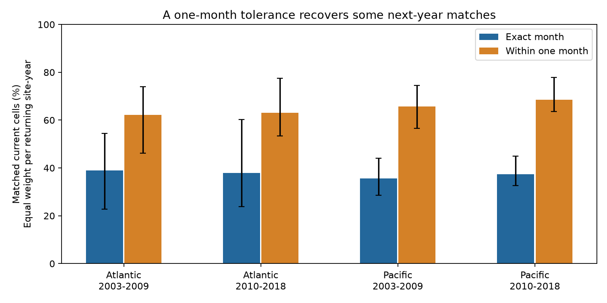

# A one-month tolerance recovered 38-50 percent of lost next-year coral matches in four Atlantic and Pacific samples, 2003-2018

## Result

Exact calendar-month matching removes many records that have a next-year record at the same site and depth band. In four Atlantic and Pacific samples, an adjacent-month rule recovered 38-50% of these lost matches. This is a property of the records and matching rules. It is not evidence that a wider window gives an unbiased estimate of coral change.

We built 9,162 site-year-month-depth cells from 10,423 Reef Check hard-coral rows. There are 8,744 current cells in 2003-2018 at 3,440 sites. Follow-up ends in 2019. Of the current cells, 3,751 have any next-year record in the same depth band. Only 1,389 have an exact-month match. An adjacent-month rule gives 2,511 matches. These counts give each cell one count. The rates below instead give each returning site-year total weight one.



| Ocean and current years | Cells with any next-year band record | Exact month, % | Adjacent month, % | Lost matches recovered, % (95% interval) |
| --- | ---: | ---: | ---: | --- |
| Atlantic, 2003-2009 | 307 | 38.9 | 62.2 | 38.1 (21.7 to 50.5) |
| Atlantic, 2010-2018 | 302 | 38.0 | 63.1 | 40.5 (24.2 to 48.5) |
| Pacific, 2003-2009 | 1,068 | 35.6 | 65.7 | 46.8 (35.0 to 57.8) |
| Pacific, 2010-2018 | 2,074 | 37.3 | 68.5 | 49.8 (44.5 to 60.5) |

The gain is positive by construction. The useful finding is its size and its range across the four samples. The intervals describe variation under country resampling. They do not include missing archive records or survey error.

## Question and prior work

Marine heat events can cause coral bleaching. Tests of later reef change need repeated surveys and comparable seasons. Sully et al. (2019, [DOI](https://doi.org/10.1038/s41467-019-09238-2)) studied global heat and bleaching patterns. Van Woesik and Kratochwill (2022, [DOI](https://doi.org/10.1038/s41597-022-01121-y)) describe the public global archive. Donner et al. (2017, [DOI](https://doi.org/10.1371/journal.pone.0175490)) describe geographic and reporting limits. Our question concerns the observation process for ecological change after heat events. We do not test air pollution, species distributions, or a new causal heat effect.

Campaign [SCI 534925f3](sci:sha256:534925f3548ad242f68c220d73046bf49bbb91bbf10c96e81eb9c913749f266a) tested next-year coral cover change using exact-month and depth-band matches. It found a small retained sample and uncertain bleaching slopes. [SCI 9544c6e9](sci:sha256:9544c6e99ca177abb03e9952e1d0ca79ae8e32e14f472bf202216e37b05af503) tested annual archive return, with a same-month secondary endpoint. [SCI 85ce95a7](sci:sha256:85ce95a75f3c4b4346592dd5de2288bfb74f00e617378e86a91862ea6fe9a946) audited support for bleaching-state comparisons across longer periods. We read these signed reports. Our added output measures the loss from exact-month matching and the gain from adjacent months at the same depth band. It does not establish a new general fact that survey season matters. All these studies share the same archive.

We searched the campaign before the precise question. The first retention question was already covered, so we changed to a matching-rule audit before fitting the rates. Search records are in files/prior_search.json. The coral query was limited to the first 20 results, so it is not a complete novelty search. The plan was written after reading the source and prior reports and before calculating rates. It was not registered outside this workspace. This is an exploratory follow-up.

## Data and matching rules

We read the raw data in place. The source is BCO-DMO dataset 773466, version 2, dated 2022-10-14, [DOI](https://doi.org/10.26008/1912/bco-dmo.773466.2). The exact shared file path is:

`/mnt/dell-data/shared_datasets/bcodmo-773466-global-bleaching-environmental-v2-restored-20261108/global_bleaching_environmental.csv`

The source file has 41,361 rows and 16,772,400 bytes. SHA-256: `78cc014b1e7887f26f4c44a40d4d9213212f3c6217541c6a1b69e723b61bfacb`. The source URL and resolved path are in files/provenance.json. Attribution: Robert van Woesik and Deron Burkepile, database description by van Woesik and Chelsey Kratochwill, Reef Check survey providers, and NOAA environmental data providers. The data license is CC BY 4.0. We did not change shared files or download a new raw dataset.

We select Data_Source equal to Reef_Check, Substrate_Name equal to Hard Coral, depth from 0 to 15 m, Atlantic or Pacific, and years 2003-2019. The selected rows have unique Sample_ID values. Separate algae rows are not extra coral surveys. We read `nd` as missing and check that recorded bleaching percentages lie from 0 to 100. We average each numeric field within Site_ID, year, month, and depth band. The bands are 0 to less than 5 m and 5 to 15 m inclusive. Site and country fields must agree within a cell. Depth-band matches do not identify the same transect or coral colonies.

For each current cell in 2003-2018, we find all next-calendar-year cells with the same Site_ID and band. The broad endpoint requires any month. The strict endpoint requires the same month. The relaxed endpoint requires the same or an adjacent calendar month, with the month cycle wrapping at December and January. No later bleaching or cover value is required. Thus this audits archive matches, not complete ecological outcome pairs. The panel keeps current missing bleaching separate. A site can contribute to both time periods; separate oceans have separate sites. These are regional and time checks within one archive, not independent data collections.

The primary window follows the written plan. Its wraparound rule can admit a record only about one month or about 23 months after a current December or January record. We therefore also test a rule with no wraparound. This keeps next-calendar-year month differences at zero or one, so the month-index interval is 11-13 months. Exact days can extend that range. We added this sensitivity after the primary results, to check an identified time-window issue. It is not a new primary analysis.

## Rates and uncertainty

Among cells with any next-year band record, let E be the weighted exact-month fraction and A the weighted adjacent-month fraction. The fraction of lost strict matches recovered is `(A-E)/(1-E)`. Each returning current site-year has weight one across its returning cells. This prevents a site-year with many months or bands from dominating. The denominator is conditional on a next-year band record. It does not measure loss from all current records.

We resample whole countries with replacement within each ocean-period sample, 2,000 times, with seed 20261108. We use country totals of weighted counts to calculate each bootstrap rate. The weights remain those of the current site-years. We report percentile 95% intervals for rates. Countries in the full current samples number 28, 22, 24, and 24. Some have no returning cells. Country resampling allows dependence within a country, but it does not allow all dependence across countries or common ocean events. Countries are not a random sample from all reefs. These intervals are approximate descriptions of sensitivity to country composition, not a guarantee of population coverage.

We also compare strict-match loss after current mean bleaching of at least 10% with loss after lower recorded bleaching. Missing current values enter neither group. We keep the site-year weights from all returning cells. This contrast is unadjusted for country, year, season, cover, heat, and effort. It can reflect site composition as well as timing. We do not interpret it as a bleaching effect. We give both 95% and 98.75% intervals in files/results.csv. The latter use a Bonferroni marginal level for four contrasts; bootstrap approximation still applies.

| Ocean and current years | High-bleaching returning cells | High minus low strict loss, points | 98.75% interval |
| --- | ---: | ---: | --- |
| Atlantic, 2003-2009 | 57 | +28.4 | +7.4 to +54.1 |
| Atlantic, 2010-2018 | 24 | +10.6 | -25.5 to +44.5 |
| Pacific, 2003-2009 | 37 | -1.5 | -20.4 to +41.1 |
| Pacific, 2010-2018 | 135 | +11.4 | +5.6 to +35.7 |

The high-minus-low contrast is positive with intervals above zero in two samples. It does not repeat in all four. The small high-bleaching groups and unequal country composition limit this comparison. These results do not show that matching loss is independent of bleaching or that it is commonly driven by bleaching. Support counts and raw group loss rates are in files/support.csv.

## Checks and limits

Without December-January wraparound, recovered-loss rates are 37.3%, 39.6%, 46.8%, and 49.7%, in table order. With the depth split moved from 5 m to 10 m, they are 39.9%, 39.3%, 47.3%, and 49.8%. These checks support a similar descriptive size of the gain. They do not validate a wider window for an ecological response model. All sensitivity intervals and estimates are preserved.

An independent standard-library program rebuilt all cell means from 10,423 raw rows and checked unique sample IDs. A second program checked all 8,744 match labels by direct set membership. A fresh run from preserved cells reproduced the raw-data run's numeric results exactly. Check records are included. The figure was inspected and is a static PNG within SCI display limits.

The archive does not give full field visit logs. An absent match can be an absent survey, another month or depth, a changed ID, or an absent archive entry. It is not a dead reef. The high-bleaching threshold can dilute short events when cells combine dates or surveys. Missing bleaching values may be selective. Broad depth bands and calendar months do not fix survey effort, observer, colony identity, taxon mix, or time since peak heat. Selection into any-return records can itself create associations. The study does not estimate the bias in a cover-change coefficient, establish recovery or adaptation, or identify a causal climate response. It provides a reproducible matching diagnostic. A later study should compare ecological estimates across these windows using field visit logs and heat exposure between visits.

## Reproduction

Use Python 3.12 with NumPy, pandas, and Matplotlib. Tested versions are in files/environment.json. Use a writable copy of the extracted package. The following commands write to a new output directory and leave the signed files intact:

```sh
python files/analyze.py /tmp/coral-month-reproduce
python files/validate.py /tmp/coral-month-reproduce
```

To rebuild from the shared raw file:

```sh
python files/analyze.py /tmp/coral-month-raw --raw /mnt/dell-data/shared_datasets/bcodmo-773466-global-bleaching-environmental-v2-restored-20261108/global_bleaching_environmental.csv
python files/check_raw.py /tmp/coral-month-raw /mnt/dell-data/shared_datasets/bcodmo-773466-global-bleaching-environmental-v2-restored-20261108/global_bleaching_environmental.csv
```

For another host, retrieve the source_url in files/provenance.json to a new local file, check the stated SHA-256 and byte size, then pass that path to --raw. The analysis refuses different raw bytes. The bundle includes cells and the derived panel, so its numeric results can be rebuilt without that download. Use `--linear-month` for the no-wrap check. Use `--raw PATH --cut 10` for the alternate depth split. Each run needs a new output directory. The alternate split cannot be rebuilt from the included 5 m cells alone. The raw verification script checks the primary 5 m cells only.

## Campaign record

Campaign: 11_07_2026. Job: sci-1107-dell-climate-pollution-biodiversity-b11afaa44e4c. Topic: climate-pollution-biodiversity. Machine: dell. Account: codex-andrii. Model: gpt-6.1-sol, high reasoning effort. Analysis date: 2026-11-08. No agents were launched. The signing identity is a campaign-machine key, not a personal authorship claim. Publication is local. No remote archive upload or index submission was made.
