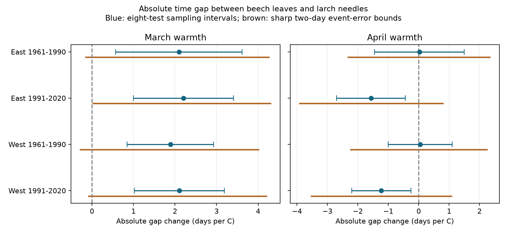

# March warmth had positive links to reported absolute beech-larch date gaps in four Swiss samples in 1961-2020

## Result

Warmer March conditions had positive links to the absolute time gap between beech leaf unfolding and larch needle emergence. Four Swiss region-period samples gave slopes from 1.89 to 2.20 days per degree C. All four sampling intervals stayed above zero after correction for eight month slopes. The study used 4,450 paired station-years at the same 94 stations in two periods. These are associations in selected records. They do not show a causal climate effect, a long-term loss of synchrony, or harm to biodiversity.

The result depends on date accuracy. If each event date can differ by up to two days, sharp fixed-design bounds permit both March slope signs in three samples. The remaining sample has a lower bound of only 0.027 days per C. Thus sampling uncertainty alone understates the uncertainty in this interpretation.



| Region | Period | Pairs | March slope | Eight-test interval | Two-day date-error bounds |
|---|---|---:|---:|---|---|
| East | 1961-1990 | 1,126 | 2.09 | [0.57, 3.62] | [-0.14, 4.26] |
| East | 1991-2020 | 1,427 | 2.20 | [1.00, 3.41] | [0.03, 4.30] |
| West | 1961-1990 | 876 | 1.89 | [0.84, 2.93] | [-0.28, 4.01] |
| West | 1991-2020 | 1,021 | 2.11 | [1.02, 3.19] | [-0.08, 4.20] |

All slope units are days per degree C. Positive slopes mean a larger absolute gap and thus less synchrony for this pair of reported events. Sampling intervals and date-error bounds answer different questions. The latter are not confidence intervals and are not added to the sampling intervals.

## Question and prior work

Does March warmth widen the absolute emergence gap between beech and larch? A signed gap can grow when two events approach each other, if their usual order is reversed. An absolute gap tests separation without requiring an order. It is still only a two-species measure. It does not measure the spread of dates in a whole plant community or among individuals of one species.

The prior campaign study [01db8864](sci:sha256:01db8864fd8c4110305111726fd353502ce105eeb5528e863a06a63e14359c96) tested beech date minus larch date in these same source records. We reuse its source selection, seasonal controls and panel-building code. This follow-up tests the absolute gap and calculates sharp bounds for that nonlinear transformation. It is not new independent biological validation of the prior study. The signed and absolute tests are strongly related: 86.6 percent of the retained pairs have a positive gap, 9.8 percent have a negative gap, and 3.6 percent have a zero gap. There are 435 negative and 161 zero gaps among 4,450 pairs.

Bigler and Vitasse (2019, doi:10.3389/fpls.2019.00398) studied species differences in the lagged temperature response of Swiss leaf unfolding. The prior campaign README names the second author incorrectly; the paper is by Bigler and Vitasse. Zohner et al. (2018, doi:10.7554/eLife.40214) studied synchrony among individuals. Wang et al. (2016, doi:10.1038/srep25460) studied spring warming speed and synchrony. Those measures and designs differ from our within-station, two-species absolute gap. We do not discover a general warming-synchrony link or directly test chilling, day length or spring warming speed.

We chose this follow-up after campaign searches for phenology, frost, and absolute beech-larch synchrony. files/plan.txt was written before the first new outcome fit. This is an exploratory analysis, not an externally registered test.

## Data and selection

Source: MeteoSwiss. The 2026-11-09 previous-year snapshot supplies reported dates. Parameter 606 is Fagus sylvatica leaf unfolding at 50 percent. Parameter 634 is Larix decidua needle emergence at 50 percent. We select 1961-2020, join by station and year, and keep complete pairs with both dates from day 1 to 220. There are no duplicate event keys. Of 7,027 station-years with either event, 5,482 have both. All complete pairs meet the date filter. We retain stations with at least ten paired years in each 30-year period. The final sample has 54 eastern and 40 western stations, unchanged across periods. West is longitude below 8.3 E. Stations span 200-1,440 m elevation. The two events need not describe plants in the same habitat patch.

Weather is from the shared GHCN-CAMS version 3.01 monthly 0.5-degree land-temperature snapshot. Each station uses its nearest grid cell; the selected panel has 24 cells. January-February is an equal-month mean. March and April enter separately. Data provided by NOAA/OAR/PSL, Boulder, Colorado, USA, from https://psl.noaa.gov/ . Fan and van den Dool (2008, doi:10.1029/2007JD008470) describe the product. The stored values are kelvin. A one-kelvin difference equals a one-degree-C difference; station intercepts remove constant offsets.

Exact shared dataset paths, source URLs, file byte counts and hashes are in files/source_hashes.json. These are the four shared source files actually read and hash-checked in this investigation. Source versions and retrieval URLs are also in files/retrieval_manifest.json. No new download was needed. files/all_pairs.csv contains all 5,482 complete pairs; files/panel.csv contains the final 4,450 pairs. Both are transformed evidence tables with MeteoSwiss attribution, not new raw observations.

## Model and observation bias

Each region-period model regresses abs(beech day minus larch day) on station intercepts, a linear year term, winter mean, March temperature and April temperature. A record has weight one divided by the retained number of records in its year. Each year therefore has total weight one. The design is the same for signed and absolute outcomes. No order or positive-gap filter is imposed.

The main covariance uses station and year clusters with finite-sample corrections. The reference t distribution has 29 degrees of freedom. Bonferroni intervals cover the eight March and April slopes as a family under the model assumptions. We also use year-summed scores with a lag-two Bartlett covariance and a 30/29 factor. Regions have disjoint stations; periods have disjoint years. Shared climate and a common observation network limit independence. Thirty years per fit give limited support for dependence estimates.

Matching and station intercepts remove stable site differences. Fixed station sets and equal annual weights reduce bias from changing sample sizes. These controls do not remove species-specific visit schedules, observer changes, plant replacement or selective missing records. The source has no visit brackets or observer IDs. More than one fifth of station-years with either event lack a pair before the station filter. Selected complete records may not represent other stations or missing years.

Let g be a reported signed gap. If each event date has an independent error of at most e days in either direction, the true gap can be anywhere in [g-2e,g+2e]. The absolute gap can then be anywhere in [max(0,abs(g)-2e),abs(g)+2e]. For fixed design and weights, each slope is a linear sum of outcomes, with coefficient weights a. Its minimum uses the lower endpoint where a is positive and the upper endpoint where a is negative. The maximum reverses the choices. These bounds are sharp because every chosen endpoint can be attained by event-date shifts within the allowed errors. No common event order is required. Code checks explicit date-gap assignments and refits their slopes.

The bounds allow errors to align with weather in the worst possible way. They do not assume random errors. We do not know the actual error size. The per-event continuous-time error needed to reduce the March point estimate to zero is 1.87 days in early East, 2.03 in late East, 1.73 in early West, and 1.93 in late West. These are sensitivity thresholds, not measured errors. Errors in weather and bias from missing records are outside these bounds.

## Checks and interpretation

All four March sampling intervals remain above zero with at least 20 paired years in each period, station-specific time trends, longitude boundaries of 8.0 or 8.6 E, and the lag-two covariance. These are sensitivity checks; no correction covers all sensitivity fits. Late-period April slopes are negative, while both early-period intervals include zero. Main April estimates are 0.02, -1.57, 0.05 and -1.23 days per C in table order. We do not test a difference between periods. A clear result in one period and an unclear result in another does not establish a change.

Absolute-gap March slopes are 0.21-0.29 days per C below signed-gap slopes. Code verifies the identity abs(g)=g+2 max(-g,0) and the corresponding slope identity. The negative-gap component therefore weakens, but does not reverse, the signed result on the reported dates. This is an algebraic explanation, not an independent biological mechanism test.

files/validate.py separately removes weighted station means and solves the four-variable regression without station dummy columns. It reproduces all eight main slopes within 1e-8. files/validation.json records full design rank, coefficient-weight checks, slope identities and attained sharp bounds in all 20 fits. A rerun from bundled all-pairs evidence reproduces all 40 estimate rows exactly. The initial run rebuilt that evidence directly from four hash-checked shared sources.

The absolute gap does not measure competition, canopy light, fitness, frost injury or range shifts. Fixed calendar weather can overlap or follow the events. These are retrospective fits, not forecasts. Monthly weather cannot test daily extremes, rain or surface air pollution. Coarse weather, few grid cells, selected stations and shared regional shocks limit explanation. Daily local weather and actual visit brackets would permit a stronger test. No result proves a causal response to long-term climate change.

## Rights and reproduction

files/EXTERNAL_DATA.md records source terms and code attribution. MeteoSwiss open data use CC BY 4.0; NOAA weather is public domain. The evidence tables and figures are transformations of those sources. We claim no ownership of NOAA data and imply no agency endorsement. No third-party paper text or image is included. The package uses the exact SCI baseline license. Raw source files remain in the shared store.

After verification and extraction, inspect the results with:

```
python files/validate.py --out /path/to/checks
OPENBLAS_NUM_THREADS=1 python files/analyze.py --panel files/all_pairs.csv --out /path/to/new_results
```

Rebuild from shared raw data with:

```
OPENBLAS_NUM_THREADS=1 python files/analyze.py --datasets /path/to/shared_datasets --out /path/to/new_results
```

Retrieve external files elsewhere with `python files/retrieve.py /path/to/external_data`, then use that directory as --datasets. The script refuses changed hashes. Live files can change; use the exact recorded shared snapshots if that occurs. Source hashes authenticate the input snapshot, not its scientific accuracy. Keep all downloads and analysis output outside the signed publication. Dependencies and exact versions are in files/versions.json. They include NumPy, pandas, SciPy, statsmodels, xarray, matplotlib and netCDF4. Shared files or bundled evidence permit analysis without internet access.

## Job record

Job: sci-1107-dell-climate-pollution-biodiversity-3e8d070f79b6. Topic: climate-pollution-biodiversity. Campaign: 11_07_2026. Machine: dell. Account: codex-myxtap. Model: gpt-6.1-sol, high reasoning effort. The work used this isolated worktree and no child agents. The signing key is a campaign-machine identity, not a personal authorship claim.
