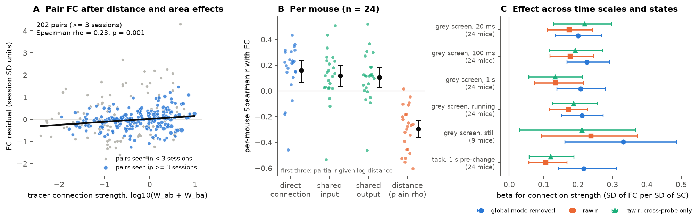
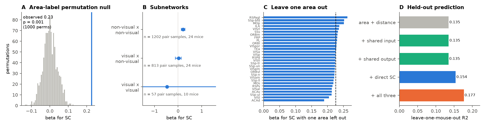
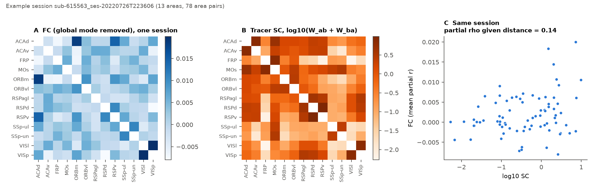

# Tracer connection strength predicts spontaneous inter-areal spike correlations across mouse cortex beyond distance (24 mice, 30 areas), but not for visual to non-visual area pairs

## Summary

We tested one structure–function hypothesis. The hypothesis is that two cortical areas with a stronger direct axonal connection in the Allen tracer connectome have more correlated spiking, after we remove the effects of distance and area identity.

We used Allen SHIELD Neuropixels recordings (DANDI:001051). These recordings sample many cortical areas at the same time in each session. We used 76 sessions from 24 mice, 30 Knox summary areas, 2,111 session × area-pair samples and 317 different area pairs. For each pair of areas, functional coupling (FC) is the mean spike-count correlation between units of area a and units of area b. The primary measure uses 100-ms bins in the 289-s grey-screen block. Before we calculate it, we remove a global mode: the mean activity of all units outside the two areas. The structural predictor (SC) is log10(W_ab + W_ba) from the Knox et al. (2019) 291-region ipsilateral connectome, in the quality-controlled ("new") rebuild of Nathan et al. (2026).

Main results:

1. **SC predicts FC after distance and area effects are removed.** The model has session fixed effects, an additive fixed effect for each area, and log inter-unit distance. In this model, the FC change per SD of SC is β = 0.23 SD (95% mouse-bootstrap CI 0.17–0.29). Area-label permutation of the connectome gives p = 0.001 (the smallest possible value with 1,000 permutations). The null mean is 0.00 and the null SD is 0.04. When we replace the linear distance term with a cubic term plus 8 distance-bin dummies, β = 0.28 (0.22–0.34).
2. **The effect occurs in most mice.** The per-mouse partial Spearman r between FC and SC, controlled for distance, has a mean of 0.16 (CI 0.08–0.24). It is positive in 20 of 24 mice (Wilcoxon p = 0.001).
3. **The effect occurs at all tested time scales and states.** β is 0.20 at 20-ms bins, 0.23 at 100-ms bins and 0.21 at 1-s bins. β is 0.21 in running epochs and 0.33 in still epochs (9 mice only). β is 0.22 for trial-to-trial correlations in the 1-s window before the change during the change-detection task. Raw correlations without global-mode removal give β = 0.11–0.24. Cross-probe unit pairs only (no shared-shank effects) give β = 0.12–0.22. All 95% CIs exclude 0.
4. **The effect is small in held-out prediction.** In leave-one-mouse-out prediction, area identity plus distance explains R² = 0.135 of the within-session FC variance. When we add SC, R² = 0.154. Shared-input or shared-output profile similarity alone adds nothing (0.135). All three structural terms together give R² = 0.177.
5. **The effect depends on the subnetwork.** For pairs of non-visual areas (frontal, somatomotor, retrosplenial), β = 0.21 (0.14–0.29). For visual × non-visual pairs, β = 0.02 (−0.12 to 0.13), which is a null result. Visual × visual pairs are too few to test (57 samples, 10 mice; CI −2.1 to 2.9). When we remove one area at a time, β stays between 0.19 and 0.26.
6. **Connectome QC does not change the prediction.** For these 317 cortical pairs, the pre-QC and post-QC Knox matrices are almost identical (Spearman 0.9995; median |Δlog10 W| = 0.0002). β(new) − β(old) = −0.001. Thus this dataset cannot test whether QC improves functional validity.

**Figure 1.** (A) Mean residual FC for each area pair, after we remove the session, area and distance effects, against tracer SC. Blue: pairs seen in 3 or more sessions (point size shows the number of sessions). Black line: weighted fit. (B) Per-mouse Spearman correlation of FC with direct SC, shared-input similarity and shared-output similarity (all partial on log distance), and with distance alone. Black: mean and 95% bootstrap CI. (C) β for SC (with area and session fixed effects and log distance) in each condition and with each FC measure. Bars show 95% mouse-cluster bootstrap CIs.

**Figure 2.** (A) β for SC compared with a null distribution made by permutation of connectome area labels among the 30 sampled areas. (B) β in three subnetworks. (C) β when we remove one area. Dashed line: β with all areas. (D) Leave-one-mouse-out R² of within-session standardized FC.

**Figure 3.** One example session with 13 areas. FC matrix, SC matrix and their relation.

## Question and motivation

Many human fMRI studies show that structural connectivity partly predicts resting-state functional connectivity (for example, Honey et al. 2009). In the mouse, the Allen tracer connectome gives directed, region-level axonal projection strengths. These strengths are measured in different animals from the recorded animals. Few studies test whether these strengths predict *spiking* correlations between cortical areas with a control for distance. Distance is a strong confound, because both connection strength and correlation decrease with distance. The SHIELD Neuropixels dataset records 5–13 cortical areas at the same time in each mouse. Thus it lets us test this relation inside each animal and repeat the test across animals and behavioral states.

## Data

| Input | Shared store path | Source and version |
| --- | --- | --- |
| Spontaneous (grey-screen) spike times of good cortical units, Knox summary-structure label, CCF coordinates, probe, running speed | `allen_shield_spontaneous_cortex_spikes/v1_2026-11-01/spont_spikes/*.npz` (79 files) | DANDI:001051 v0.260922.1827 (doi:10.48324/dandi.001051/0.260922.1827), CC BY 4.0, Bennett, Sridhar, Allen Institute. Derived cache that a previous campaign made from byte-range reads of the NWB files. |
| Per-unit labels and task trial counts in [−1, 0) s before change or sham change | `allen_shield_spontaneous_cortex_spikes/v1_2026-11-01/cortex_trial_counts/*.npz` (88 files) | Same source. |
| Knox 291-region ipsilateral normalized connection strength, after QC ("new") and before QC ("old"); density variant | `allen_connectome_qc/zenodo20276701-v2/knox_conn_ipsi_{new,old}.csv`, `knox_conn_density_new_bilateral.csv`, `knox_connectome_rgn_numbers_ccfv3.txt` | Nathan et al. 2026, Zenodo doi:10.5281/zenodo.20276701 (v2), CC BY 4.0. The underlying model is Knox et al. 2019. |
| Structure acronyms | `allen_ccf_2017/annotation_25_v2017/structure_graph_1.json` | Allen CCFv3 2017 ontology. |

`files/provenance/input_sha256.txt` gives the SHA-256 of every input file that we read (172 files). The shared-store `SHA256SUMS` files contain the same values. We did not change or copy the shared raw data. The bundle does not contain the spike files.

Orientation check of the connectome matrix: rows are sources and columns are targets. The evidence: W[VISp→SCs] = 0.42 and W[SCs→VISp] = 0.013; W[MOp→CP] = 7.3 and W[CP→MOp] = 0.11.

## Methods

**Units and areas.** We used the good units of the cache (quality "good", ISI violations < 0.5, amplitude cutoff < 0.1, presence ratio > 0.9). We kept units whose Knox summary structure is one of the 291 Knox regions. All units were isocortical and in the left hemisphere. A session area needed 5 or more units, and a session needed 2 or more areas (3 or more area pairs for the models).

**FC.** We binned the spike counts in the grey-screen block (20 ms, 100 ms, 1 s), z-scored each unit and calculated all unit-pair Pearson correlations. *raw* = the mean r over unit pairs (i in a, j in b). *resid* = the mean partial r given g_ab, where g_ab is the z-scored mean activity of all units that are not in a or b. We excluded a and b, so the pair itself does not define the global mode. *xprobe* = raw r over unit pairs on different probes only (we required 10 or more such pairs). The running epochs were 100-ms bins with speed > 5 cm/s, and the still epochs were bins with speed < 1 cm/s. Each state needed 30 s or more. Task FC uses spike counts in [−1, 0) s before each non-aborted go or catch trial change time, correlated across trials (50 or more trials). For each condition, we standardized FC within each session across its area pairs.

**Predictors.** SC = log10(W_ab + W_ba + ε), where ε is half the smallest non-zero entry. Shared input = Pearson r of the log afferent profiles (columns a and b, over the other 289 regions). Shared output = Pearson r of the log efferent profiles (rows). Distance = log10 of the mean Euclidean CCF distance between the units of a and the units of b in that session.

**Models.** We used OLS of standardized FC on z-scored predictors, with session dummies and an additive area indicator (1 for both areas of the pair). The area indicator absorbs area-level differences in correlation, for example from firing rate or recording quality. CIs come from 1,000 cluster bootstraps over mice. The permutation null permutes the connectome labels among the 30 sampled areas (1,000 permutations) and refits the model. This keeps the internal structure of the matrix but breaks the correspondence between labels and matrix entries. For the per-mouse test, we calculated the partial Spearman r (FC vs predictor, given log distance) in each session with 6 or more pairs, averaged Fisher-z within each mouse, and applied a Wilcoxon signed-rank test across mice. For cross-validated R², we fitted on 23 mice and predicted the held-out mouse from the predictor and area terms, centered within each session.

## Interpretation

Tracer-defined direct connection strength has a reliable, positive relation to inter-areal spiking correlation in awake mouse cortex. Distance and area identity do not explain this relation. It is present at 20 ms to 1 s, in grey-screen and task epochs, and in most animals. The effect is small. SC adds approximately 2% of held-out within-session FC variance to a distance-and-area model that explains 13.5%. This is similar to the modest structure–function coupling that region-level fMRI studies report. The effect is strong among frontal, somatomotor and retrosplenial areas. It is absent for visual-to-non-visual pairs. One possible explanation is that, during grey-screen and task conditions, visual areas share fluctuations that the region-level projection strength does not explain. Our data do not test this explanation. Shared-input and shared-output similarity are highly collinear with direct SC (Spearman 0.70–0.83) and with distance. Alone, they do not improve held-out prediction. In the joint model, direct SC stays positive and shared output becomes negative. This is a suppression pattern among collinear predictors, and we do not interpret it causally.

## Limitations

- The FC values are small (mean resid r ≈ 0.004 at 100 ms). The standardized effect is clear, but the absolute correlation differences between strongly and weakly connected pairs are small.
- The connectome comes from different mice and is a regionalized voxel model (Knox 2019). This model interpolates in space, so SC can contain spatial information that our distance control does not remove. A flexible distance control increased β, which argues against a simple distance artifact. But we did not remove spatial smoothness of the model completely.
- Area labels come from CCF registration of the probe tracks. Wrong labels at area borders reduce the measured relation, and adjacent-area pairs on the same shank can share artifacts. The cross-probe-only analysis addresses the second problem.
- Global-mode removal can remove real shared signal, and it can produce negative partial correlations. The raw measure gives the same result with a smaller β.
- The sampled pairs are not uniform. Most are frontal, somatomotor or retrosplenial (1,202 non-visual pair samples). Visual × visual pairs are too few, so this study makes no claim about the visual subnetwork.
- The still-state result comes from 9 mice. The per-mouse test in that state is not significant (p = 0.36), but β is positive.
- The data include only the left hemisphere, only isocortex and only 30 areas. Sessions were recorded in mice trained on a change-detection task. The 76 sessions come from 24 mice, so most mice contribute more than one session. Every inference aggregates by mouse.
- This is a correlational study. Polysynaptic paths and common neuromodulatory drive can produce FC that is not caused by the direct connection.
- We did not compare our results with the earlier campaign studies that made the SHIELD caches (a default-mode-network study and a connectome-hub study), because those publications were not available in this campaign folder.

## Reproduce

1. Make sure that the shared store contains the inputs listed above. Alternatively, rebuild the SHIELD cache from DANDI:001051 with the cache's own `code/` (see the cache README), and download the Zenodo files of record 20276701. Check the inputs against `files/provenance/input_sha256.txt`.
2. Make a Python 3.12 environment with the packages in `files/code/requirements.txt` (numpy, scipy, pandas, matplotlib).
3. Run `SHARED=/path/to/shared_datasets bash files/code/run_all.sh`, from the `files/` folder. It runs `01_build_pairs.py` (pair table, approximately 2 min), `02_stats.py` (statistics, approximately 45 min on one CPU with 1,000 bootstraps and 1,000 permutations; seed 20261107) and `03_figures.py`.

Outputs in `files/results/`: `pairs.csv.gz` (session × area pair × condition FC, distance and unit counts), `pairs_with_predictors.csv.gz`, `primary_pairs.csv.gz` (primary analysis rows), `stats.json` (all primary statistics), `forest.csv` (β and per-mouse tests for each condition and measure), `per_mouse_partial.csv`, `pair_level_residuals.csv` (Figure 1A data), `perm_null_beta_sc.npy`, `sessions.csv`, `02_stats.log`.

## Provenance

- Campaign 11_07_2026, job `sci-1107-hp-neural-structure-and-computation-1433d1cfe225`, topic neural-structure-and-computation, machine hp, account claude-myxtap.
- Model: Claude Opus 5.5 (`claude-opus-5-5`), which did the analysis and writing in the Claude Code harness. The signing key is a campaign-machine key. It is not a personal authorship claim.
- Analysis date: 2026-11-07 (UTC). Computations ran through `campaign-compute` with one thread.
- Licences: text, figures and derived tables CC BY 4.0; code MIT (SCI baseline licence). Source data: DANDI:001051 (CC BY 4.0; credit Bennett, Sridhar, Allen Institute) and Zenodo 20276701 (CC BY 4.0; credit Nathan et al.). Allen CCF: Allen Institute terms of use.
