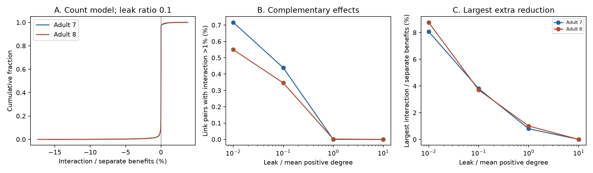

# Joint link gains gave extra noise reduction in some pairs in two passive adult worm models

At the primary assumed leak, doubling two electrical links gave more noise reduction than the sum of their separate effects by over 1% in 150 of 34,191 link pairs in adult map 7 and 151 of 43,660 in adult map 8. All of these pairs shared a neuron. The largest extra reductions were 3.805% and 3.704% of the summed separate reductions. Thus a rule of decreasing benefit from each added link did not hold for these fixed circuit models.

The effect did not cause a failure of pair selection. Selecting the two largest separate benefits found an optimal pair in both maps under all 16 tested model settings. These are model results on incomplete electrical maps, not measured noise effects in animals.

Figure 1. A: The distribution of relative interaction across all link pairs at the primary leak. B: The fraction of pairs with over 1% extra reduction changes with leak. C: The largest extra reduction falls as leak rises. All panels use contact counts as conductance. A negative interaction means the joint reduction is smaller than the sum of separate reductions. The cases share neurons and links. The curves do not give animal confidence intervals.

## Question and prior work

Can separate electrical-link interventions predict the noise reduction from a joint intervention? This question matters when a circuit design or perturbation screen uses separate effects to choose a combined change. The tested hypothesis is that the benefit of a link increase can only fall after another link increases. A positive joint interaction rejects this hypothesis for the stated baseline and interventions.

Witvliet and colleagues supplied the adult wiring maps [doi:10.1038/s41586-021-03778-8]. Their electrical annotations are incomplete, and their main developmental analysis did not use those annotations. Varshney and colleagues used Laplacian models of worm electrical spread [doi:10.1371/journal.pcbi.1001066]. Network noise measures and fast inverse updates have a long history. Summers and colleagues studied network coherence and later corrected a claim of submodularity [2017 correction, cited in sci.json]. Their correction shows that decreasing marginal benefit cannot be assumed in general. It concerns a Laplacian pseudoinverse setting; our test uses a positive leak and a matrix inverse. We do not claim the general failure of submodularity, the variance measure or the inverse update as new discoveries.

We searched the campaign for connectome, Randi, Allen synaptic, diminishing and coherence. We read SCI ab3254d7, which showed that a single link gain can lower a remote voltage response, and SCI 4b74b71a, which compared small-change and full-loss effects on noise variance. Our question concerns the interaction of two gains, rather than the effect of one gain or loss. No prior code or record tables were copied. Our contribution is an exhaustive two-link benchmark, a simple exact sign criterion, and a test of whether the interaction changes the optimal pair. The local plan in files/PLAN.txt preceded calculation but was not externally registered. Search does not establish complete novelty.

## Data and model

We reused two completed shared files without changes or downloads:

- /mnt/dell-data/shared_datasets/worm-witvliet7-b2e13d88/adult7.csv
- /mnt/dell-data/shared_datasets/worm-witvliet8-b2e13d88/adult8.csv

The paths are compatibility paths on the working shared store. No failed disk at /data was used. Both files are from WormNeuroAtlas commit b2e13d88b670efcb3438aeacba2ad4bd6c383933. Files/results/provenance.json gives exact URLs, resolved paths, sizes, hashes and software versions. Each hash matched the dataset helper record.

The files are tab-separated. We used names present in both tables and excluded BWM, CEPsh, GLR and excgl prefixes. We retained all components and isolated cells after selection. Each positive non-self electrical row made one symmetric link. The code checks that an unordered pair is not repeated. The result has 180 cells and 262 links in map 7, and 180 cells and 296 links in map 8. Cells absent from the tables cannot enter as isolated neurons under this rule. Chemical rows only help define name coverage. Chemical transmission is not modeled.

Let W be symmetric conductance, L = diag(W1)-W, g>0, K=L+gI and H=K^(-1). We use the stochastic passive model

    dV = -K V dt + dB.

Each component of B is an independent standard Brownian motion. Capacitance is one. The stationary covariance is H/2 since K(H/2)+(H/2)K=I. The noise score is trace(H), twice total stationary variance. Link gains cannot increase this score. The uniform mode, including each component's uniform mode, is unchanged by link gains. Absolute reductions also equal reductions in the variance after removal of these modes. Our relative interaction divides by summed intervention benefits, not by baseline variance.

Primary conductance equals recorded contact count. Primary leak g is 0.1 times the mean positive weighted degree of the intact graph: 0.474026 in map 7 and 0.542484 in map 8. Leak stays fixed during every intervention. We also test leak ratios 0.01, 1 and 10, and unit conductance per link. These are assumed values, not fitted physiological ranges. The 16 model settings share two source graphs and are not 16 animals.

## Exact interaction criterion

For a link e with endpoint difference vector b and baseline weight w, doubling the link adds w b b^T to K. For two different links, let U have columns sqrt(w_e)b_e and sqrt(w_f)b_f. Write

    I + U^T H U = [[a,c],[c,b]],
    U^T H^2 U   = [[p,s],[s,q]].

All calculations here use trace-inverse benefits. The separate benefits are p/a and q/b. The standard rank-two inverse identity gives the joint benefit

    B_ef = (b p + a q - 2 c s) / (a b - c^2).

The interaction J = B_ef - p/a - q/b therefore satisfies

    J = [c^2 (p/a + q/b) - 2 c s] / (a b - c^2).

The denominator is positive because I+U^T H U is positive definite. The sign follows from the numerator. These equations are an algebraic consequence of the inverse update, not a new matrix theorem. They provide an inexpensive exact test for the stated model. J can be positive even though each link increase alone and together lowers noise. Changing a link's orientation changes both c and s in sign and leaves the criterion fixed. If c=0 the finite interaction is zero.

An original data-free check uses a three-cell path with unit links and unit leak. The trace scores before a change, after either single doubling, and after both doublings are 7/4, 21/13 and 31/21. Hence J=5/1092>0 and J divided by the sum of separate benefits is 5/294, or 1.701%. This exact example is a diagnostic check; it does not establish priority for a general counterexample.

We test every unordered pair of existing links. The main threshold is J/(p/a+q/b)>0.01. Negative values below -0.01 indicate at least 1% less reduction than the sum. The small positive count in summary.csv uses tolerance 1e-8 and is not treated as a biological detection test. We also compare the exact best pair with the two best separate links and with sequential greedy selection. Sequential selection first takes the largest single benefit and then the link with the largest conditional benefit. Ties use numerical array order. Capture is selected joint benefit divided by optimal joint benefit.

## Results

| Count model | Adult 7 | Adult 8 |
|---|---:|---:|
| Total link pairs | 34,191 | 43,660 |
| Primary pairs with over 1% extra reduction | 150 (0.439%) | 151 (0.346%) |
| Primary pairs with over 1% less reduction | 476 (1.392%) | 631 (1.445%) |
| Largest primary extra reduction | 3.805% | 3.704% |
| Largest primary reduction deficit | 15.849% | 17.399% |
| Primary pairs that share a neuron | 1,042 | 1,508 |
| Primary extra-reduction pairs among those pairs | 150 (14.40%) | 151 (10.01%) |
| Largest primary extra reduction in disjoint links | 0.423% | 0.386% |

All primary interactions above 1% were between links that shared a neuron. This is an observed pattern in these models, not a proof that disjoint links cannot give a larger interaction. At the smallest leak, the largest extra effects rose to 8.073% and 8.759%. At leak ratio 1, map 7 had no pairs above 1%, while map 8 had one, with a maximum of 1.004%. At leak ratio 10, neither map had any pair above 1%. Tiny positive floating point values at that setting are not evidence for a nonzero effect.

With unit link weights at the primary leak ratio, 181 and 140 pairs exceeded 1%. The largest extra reductions were 3.716% and 3.686%. Thus the presence of extra reduction repeated under both weight rules, but the exact counts and size depended on the assumptions. The summary table contains all leak, weight and endpoint-scope results. The scope comparisons are descriptive and were specified in the implementation before outcomes; they are not independent population samples.

Both separate-effect selection and sequential greedy selection captured 100% of the optimal two-link benefit in all 16 settings. This is a useful null result. Positive interactions demonstrate a failure of decreasing marginal benefits at some pairs. They did not demonstrate a failure of these selection rules at budget two. We did not test larger budgets or a guarantee for another graph. The largest primary pair variance reductions were 0.255250 and 0.242353 in arbitrary units, versus baseline variances 61.0861 and 53.6118. The relative interactions should therefore not be read as percent changes in total baseline noise.

## Checks and limits

The main code compares every pair's rank-two result with a sequential rank-one calculation. It also uses full eigenvalue calculations for 32 seeded random pairs and up to three extreme pairs in each model setting. The largest scaled full-spectrum discrepancy was below 8.5e-12. A separate implementation rebuilds each circuit from external edge evidence and solves continuous Lyapunov equations for the most positive interaction, most negative interaction and best pair. This checks the stationary variance interpretation and the factor of two. Exact three-cell fractions also pass. Full numerical checks are saved in files/results.

The source electrical annotations are incomplete. Missing paths can change pair interactions. Counts need not equal conductance. Noise intensity, capacitance and leak are not measured. Real circuits can have correlated drive, active currents, rectification and chemical effects. The covariance formula need not hold then. The models have partial head coverage and only two adult animals from one study. There is no test across species, regions, age groups or behavior. No Allen data or activity records were used because this question was a conditional intervention test on wiring. We make no claim of improved representations in animals.

The exact criterion applies to arbitrary symmetric positive-leak passive circuits with the stated noise model. The measured frequency of its two signs does not have established biological generality. We report no p-value or animal bootstrap: link-pair cases are dependent and exhaustive on fixed graphs. Our main scientific result is a reproducible warning for combined-intervention predictions, with a negative finding for selection failure under the tested budget.

## Reproduction and rights

Files/REPRODUCE.md gives commands, column definitions and pinned retrieval instructions. Files/analyze.py and files/validate.py are original code. The bundle retains model-level aggregates, validation results, proof, figure and provenance. Raw records, node lists, edge lists, matrices and link-pair derivative tables remain outside the signed package and can be regenerated into separate scratch. Files/EXTERNAL_DATA.md records source terms and attribution. It does not change the SCI baseline terms for bundled original materials. The package does not rely on private scratch surviving.

Campaign: 11_07_2026. Job: sci-1107-dell-neural-structure-and-computation-fb3012dc8e08. Topic: neural-structure-and-computation. Machine: dell. Account: codex-andrii. Model: gpt-6.1-sol with high reasoning effort, through the Codex harness in T3 Code. Date: 2026-11-09. No agents were launched. The campaign-machine signing key is not a personal authorship claim. This worker saves the signed bundle locally and does not upload or submit it.
