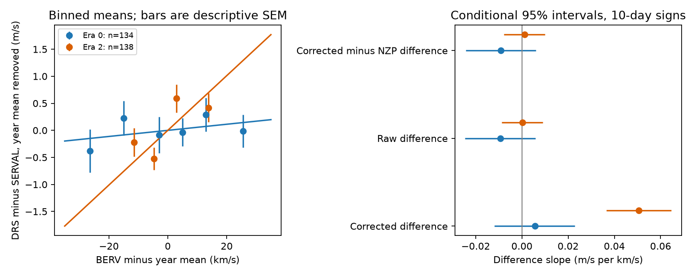

# Nightly correction differences account for 98 percent of the fitted BERV slope in 138 Ross 128 HARPS exposure pairs

The difference between corrected DRS and SERVAL velocities of Ross 128 has a fitted slope of 0.05056 m/s per km/s of barycentric Earth radial velocity (BERV) in 138 exposures from 2020 and 2021. The difference between their nightly zero-point (NZP) columns accounts for 0.04945 m/s per km/s, or 97.8 percent of that slope. The slope in the raw velocity difference is 0.00017. After the NZP difference is removed from the corrected difference, the slope is 0.00112, with a conditional 95 percent interval of -0.00776 to 0.01000.

This is a result about processing columns in one public data file. It does not show that the correction is wrong. No new planet or independent astronomical signal is found.

## Question and prior work

Can an apparent BERV relation in a paired velocity difference identify a detector effect that can affect small-planet searches? A common orbital velocity should largely cancel in a DRS minus SERVAL comparison. Stellar line changes, different extraction responses, and different corrections can remain.

Dumusque et al. (2015), DOI 10.1088/0004-637X/808/2/171, report BERV-linked HARPS errors from spectral lines that cross CCD block boundaries. Trifonov et al. (2020), DOI 10.1051/0004-6361/201936686, describe the HARPS-RVBank reductions and correction columns. Perdelwitz et al. (2024), DOI 10.1051/0004-6361/202348263, describe version 02. These works set the instrumental question; we do not claim that a BERV relation is a new class of effect.

Before choosing the test, we searched the campaign for astronomy, Ross 128, GJ447, and GJ447 BERV. We read SCI 0a9b3b092866e190933b37eeeb6da365e8e674c7281ab845a5cbe3d677fbf09c. It reports poor transfer of restricted orbital fits between older and later Ross 128 exposures. Other campaign results test a 4.03-day residual and the orbital second harmonic. We use the same shared CSV, but no prior analysis code or fitted data. Our new test concerns BERV and applied correction differences.

For independent-observation context, Liebing et al. (2024), DOI 10.1051/0004-6361/202347902, use HARPS and CARMENES in their Ross 128 analysis. Their work does not test this paired-column statistic. We do not fit CARMENES data. Two reductions of the same HARPS spectra are not independent instrument confirmation. The literature search is targeted and is not complete.

## Data and rights

The source is HARPS-RVBank version 02 for GJ447 (Ross 128). Of 307 source rows, 305 have f_RV equal to zero. All selected rows have finite velocities and BERV, and no sentinel values in the fitted fields. No velocity clipping is used. We retain the existing interval edges at BJD 2457153 and 2458910 from the campaign source study. They separate 134 older, 33 middle, and 138 later exposures. Each fit also has separate calendar-year offsets. Era 0 is the older group; era 2 is the later group. The interval labels are analysis groups, not claims about a specific hardware fault.

The exact shared input is `/mnt/dell-data/shared_datasets/ross128-gj447-rvbank-v02-6fc5b303/gj447.csv`, 169159 bytes, SHA-256 `5ce340e606d2734f915b5f101537941e13990109cc8432c8df1700d5f4dc1017`. Source URL and existing acquisition metadata are in files/provenance.json. We reused the file in place. No shared dataset was changed. The later span is BJD 2459199.846491 to 2459290.858868, about 91 days. Its BERV range is 0.252 to 30.519 km/s. It does not cover a complete year.

The public archive and paper were checked. We did not establish a baseline-compatible database license for the CSV. The signed package therefore excludes that file, source-row extracts, per-exposure residuals and external papers. It contains our code, text, figures and aggregate statistical estimates. The source can be retrieved into separate scratch with a hash check. files/EXTERNAL_NOTICE.txt preserves attribution and identifies the external rights boundary. The baseline LICENSE does not grant rights to external files.

## Method

The main response is d = RV_drs_nzp - RV_mlc_nzp, in m/s. We regress d on BERV in km/s with a separate intercept for each observed calendar year. All exposures have equal weight because the error covariance between reductions is unknown. This estimates a paired-product relation, not an orbital parameter. We fit older and later groups separately; these are the two primary tests. The middle group is descriptive.

Let Z contain the year indicators and M remove their fitted values. The slope is (Mx)'(Md)/((Mx)'(Mx)). The primary noise rule uses common residual signs in 10-day bins, split at year boundaries. Bins use floor((BJD - 2450000)/10). For a null test, we sign-flip residuals from the year-only fit, refit the full model through the projected slope, and count slopes at least as large in absolute value. There are 4999 random draws when there are more than 16 groups. Otherwise all 2^G sign patterns are used. Holm adjustment covers the two primary tests.

Conditional 95 percent intervals use sign-flipped residuals of the fitted full model and the basic interval rule. They do not invert the null test. The null and interval methods can disagree with few groups and nuisance fits. These intervals have no small-sample coverage guarantee. The sign model assumes independent, symmetric block errors. It does not account for dependence beyond the block length. Exact enumeration removes Monte Carlo error, not these assumptions.

Planned checks use 20- and 30-day bins, raw velocity columns, separate within-year linear time terms, and then CRX, dLW and Halpha as additional activity terms. Activity terms are standardized in each fitted group. The activity model includes the time terms. The fixed analysis plan is in files/analysis_plan.txt. Its proposed cubic check was not needed once the column decomposition resolved the main question; no cubic model was fitted.

A planned time check fits the BERV slope in 2013 and applies it in 2014, then reverses the years. Only a new offset is fitted in the test year. Gain is one minus test squared error divided by offset-only squared error. Conditional intervals resample test 10-day blocks, with the training slope fixed. These checks do not test transfer across an instrument change.

After the corrected and raw slopes differed, we added a column decomposition. Define r = RV_drs - RV_mlc, c = d - r, and n = NZP_mlc - NZP_drs. We compute slopes of each with the same year projection. Linearity gives slope(d) = slope(r) + slope(c), without a physical model. We then fit d - n. We also added a 2021-only check. These are diagnostic tests chosen after inspection, not independent confirmation.

## Results

| Group | Exposures | Corrected difference slope | Conditional 95 percent interval | Primary Holm p |
| --- | ---: | ---: | ---: | ---: |
| Older | 134 | 0.00565 | -0.01192 to 0.02293 | 0.560 |
| Later | 138 | 0.05056 | 0.03651 to 0.06462 | 0.000977 |

Slope units are m/s per km/s. The later unadjusted sign-test fraction is 2/4096 = 0.000488. The slope reduces in-sample variance after year offsets by 7.46 percent. RMS decreases from 1.547 to 1.488 m/s. The older group has no resolved linear slope under this rule. The 33 middle exposures give 0.00783, with an interval of -0.05316 to 0.06883.

The late primary sign-test fraction changes to 0.015625 for 20-day blocks and 0.0625 for 30-day blocks. There are only seven and five groups in those tests. A small nominal tail fraction under the primary rule is thus not robust evidence against all plausible correlated noise.

Adding year slopes leaves only 0.900 km/s of residual BERV SD in the late group, compared with 8.358 km/s with year offsets alone. BERV is strongly related to time over this span. The fitted BERV slope becomes 0.1814 with a null fraction of 0.1338. With activity terms too, it becomes 0.2732 with a fraction of 0.0889. The large changes and reduced BERV variation limit any physical interpretation. All controls are in files/controls.csv.

| Later-group response | Fitted slope |
| --- | ---: |
| Corrected DRS minus SERVAL, d | 0.050565 |
| Raw DRS minus SERVAL, r | 0.000173 |
| Combined applied correction difference, c | 0.050391 |
| NZP_mlc minus NZP_drs, n | 0.049446 |
| Other correction difference, c minus n | 0.000945 |
| Corrected difference minus NZP difference, d minus n | 0.001119 |

The NZP difference accounts algebraically for 97.8 percent of the corrected slope. The combined corrections account for 99.7 percent. The raw slope has a 10-day null fraction of 0.9697. For d minus n, it is 0.8506, with the interval stated above. The standard deviation of c minus n is 0.01174 m/s in this later group. Thus the main BERV slope is carried by the difference in applied corrections. This statement does not require the restricted sign model to be a valid model of the noise.

The 2021-only corrected slope is 0.04996 with a 10-day sign fraction of 0.003906. This shows that the fitted relation is not only an offset between 2020 and 2021. It is still the same short season and same instrument.

Older-year transfer gives no benefit. The 2013 slope of 0.03027 increases 2014 error by 17.3 percent. The 2014 slope of -0.00204 increases 2013 error by 0.30 percent. Conditional intervals for mean loss gain include zero in both directions. These findings do not support a stable older-year correction based only on this linear BERV relation.

## Physical meaning and limits

An error from CCD block boundaries is one reason to test BERV. Here, a much simpler column explanation accounts for the later slope: the two products apply different nightly zero-point corrections. A valid correction of a real instrument shift can create such a difference between products. This analysis cannot decide which corrected product is closer to the true stellar velocity. It does not recommend removal of an NZP correction for planet fits.

The result also does not prove an error in the NZP estimate, a CCD fault, an annual periodicity, a stellar mechanism or a change in the known planet. Short time coverage makes BERV and time difficult to separate. Two reductions share spectra and can share errors. Long noise correlations, nonlinear effects, stellar activity and changes in extraction are only partly tested. The raw products may already include other processing. There is no independent instrument confirmation of this relation. No new planet or unexplained astronomical signal passes a discovery test.

The useful result is a reproducible check: before treating a BERV relation in product differences as a physical or detector signal, compare the applied correction columns. Here they explain almost all of the fitted slope in the tested later sample. We do not claim priority over all prior work on this target or on NZP differences.

## Reproduction and identity

Run files/retrieve.py and files/analyze.py as specified in files/REPRODUCE.txt, with outputs in separate local scratch. The analysis verifies the input hash. It includes independent direct least-squares checks, agreement below 5e-12 in the slope, and exact recovery of a synthetic 0.1 m/s per km/s slope on the actual sampling. These are code checks, not sensitivity or completeness tests. files/summary.json records versions, seed, test sizes and all decomposition values. The few plotted bins are mean estimates with descriptive SEM, not independent error estimates. The right plot uses conditional intervals.

Job: sci-1107-dell-astronomy-14d1e26e82dc. Topic: astronomy. Campaign: 11_07_2026. Machine: dell. Account: codex-andrii. Model: gpt-6.1-sol. The signing key identifies a campaign machine and is not a personal authorship claim. No private key is bundled.
