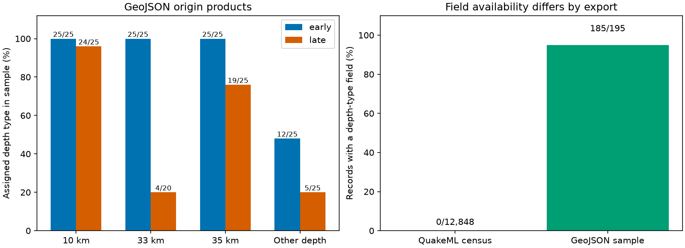

# Exact 33 km depths had mixed assignment labels in 20 global M5.5+ ComCat events in 2013-2025

Four of 20 events at exactly 33 km depth in the late part of a fixed global ComCat snapshot have an operator-assigned depth label. Fifteen have a waveform-model label. One has a location label. Thus, exact 33 km depth is not a complete test for assignment in this selected group. This is a check of catalog metadata, not a check of true depth.

The preferred-origin QuakeML export lacks depthType for all 12,848 events in 2000-2025. A separate GeoJSON origin-product sample has depth-type for 185 of 195 events. The public interfaces therefore provide different amounts of depth-method information in this test. A missing XML field must not be read as proof that no method information exists.



Early means 2000-2012. Late means 2013-2025. Each bar shows counts in a separate sample group, not a global event share.

## Question and prior work

Can exact depth labels or small vertical errors replace an explicit depth-method field in this global catalog? Depth selection is used in tests of surface loading, earthquake clusters and changes in event dynamics. A selection error can alter the group that such a test uses.

The USGS fixed-depth note explains that poorly constrained events can have assigned depths. It also describes the replacement of a 33 km convention by 10 km. Nievas et al. (2020), DOI 10.1007/s10518-019-00718-w, discuss changing conventions. These are known issues. Yeck et al. (2025), DOI 10.1785/0220240372, describe a waveform method that searches depth in 1 km steps. An integer depth can thus be consistent with a waveform method. We do not identify which algorithm produced each checked depth.

The prior campaign study SCI 7d498de3f56fee05c1fb5258d6ffa94a8203046691df4c3ab2b2c96c85aaf059 used this same CSV snapshot. It showed that shallow-share sensitivity bounds depend on the group to which a stable fraction is assigned. It did not check origin types for the global sample. SCI 5465ef98dcc882e42832f2a02be147276f09cb852ac01cd998939a73e9a60e1b found that a small-error filter retained the Stanley 10 km spike. Its six selected detail checks also showed more method information in GeoJSON than in XML. We extend that interface check to a global XML census and a stratified sample of 195 origin products. The source CSV overlaps the first prior study. This is not independent replication of its depth trend.

We searched campaign results for earthquake, magnitude type with depth, default, and depthType, and read the two signed studies above. We inspected initial depth summaries before choosing the metadata question. The scope and sample size were chosen during this investigation. No test was registered in advance.

## Data and selection

The bulk CSV contains 12,848 unique earthquakes with preferred magnitude at least 5.5 in calendar years 2000-2025. Magnitude types, origin sources and tectonic settings are mixed. These are revised parameters, not real-time reports.

CSV shared path:
`/mnt/dell-data/shared_datasets/usgs-global-m55-2000-2025-20261109-earth-a76104/events.csv`

CSV SHA-256:
`162e1e37336624494321d4b9c3f0b823f433ebaeb70430af8fa70b5b2ddb16c3`

We downloaded a matching QuakeML query with includeallorigins=false and includeallmagnitudes=false through the campaign dataset helper.

XML shared path:
`/mnt/dell-data/shared_datasets/usgs-global-m55-2000-2025-preferred-xml-20261109-df9c/events.xml`

XML SHA-256:
`df374118eb36abb47f0e91dec9a72753cb7d19581596d1e31fb532eeff5604ea`

The XML has the same event IDs and depths as the CSV for all 12,848 events. The analysis selects each XML origin through preferredOriginID, not through its order in the file. Both queries are below the 20,000-event service limit. files/provenance.json gives the exact URLs, file sizes, download times and shared paths. ComCat has no fixed release number for these queries; the hashes define the tested versions.

We split the CSV at the end of 2012. Within each era, we made four depth groups: exactly 10, 33 or 35 km, and all other depths. The last group includes intermediate and deep events. For each group, sort event IDs by SHA-256 of the UTF-8 string `df9c-v1:` followed by the ID. Take the first 25, or all events if fewer than 25 exist. This gives 195 events. The late 33 km group has only 20 events and is a full census of that group.

We retrieved the GeoJSON detail response for each selected ID. For each response, select the origin product with the highest preferredWeight. The independent audit confirms a unique maximum in all 195 cases. Its depth, latitude and longitude match the source CSV in all cases. Origin products are distinct from moment-tensor products. We do not select a tensor centroid.

The 195 external detail responses are stored through the dataset helper in separate shared directories. files/detail_sources.json gives every URL, shared path, download time, byte count and SHA-256. These are source locators and integrity records, not event parameter records. No existing dataset was changed.

## Method

Count the explicit depth-type string from each selected product. Treat upper and lower case forms of operator assigned as one label. Missing fields stay missing. The exact raw strings and counts remain in files/detail_counts.csv. The code tests for the substring assign after conversion to lower case; all such strings in the sample are operator-assigned forms.

Count available vertical-error values, and count values at most 2 km. This threshold comes from the Stanley audit. An absent error does not pass the cut. The reported vertical error is not a validation error against a known true depth.

All reported counts describe the fixed inputs. We give no population confidence interval or p value. The sample deliberately gives similar sizes to groups of very different population sizes. Pooled sample fractions must not be used as estimates of global frequency. The late 33 km result has no event-sampling uncertainty within this fixed group, but can still have source and metadata errors.

## Results

| Era | Depth label | All events in group | Checked | Operator assigned | Missing type |
| --- | --- | ---: | ---: | ---: | ---: |
| Early | 10 km | 1,779 | 25 | 25 | 0 |
| Early | 33 km | 651 | 25 | 25 | 0 |
| Early | 35 km | 285 | 25 | 25 | 0 |
| Early | Other | 4,162 | 25 | 12 | 8 |
| Late | 10 km | 1,847 | 25 | 24 | 0 |
| Late | 33 km | 20 | 20 | 4 | 0 |
| Late | 35 km | 121 | 25 | 19 | 0 |
| Late | Other | 3,983 | 25 | 5 | 2 |

All 75 checked early events at the three exact labels have an operator-assigned label. In the late group, 47 of 70 do. The late 33 km group has four operator-assigned labels, 15 waveform-model labels and one location label. Therefore, a rule that treats every 33 km record as operator assigned disagrees with 16 of 20 explicit method labels in this fixed late group. We do not call these 16 depth errors. Their true depths are not known from this audit.

The three-label rule also misses operator-assigned records at other depths: 12 of 25 checked early other-depth records and five of 25 late other-depth records have that label. Exact equality flags are useful diagnostics, but they do not supply the same information as an explicit method field.

Among the 195 checked records, 85 have a reported vertical error at most 2 km. Fifty of these have an operator-assigned label. All 25 late 10 km sample records pass the error cut; 24 are operator assigned. All 25 late 35 km sample records pass; 19 are operator assigned. Thus, a small-error cut does not remove assigned depths in these checked groups. Missing errors in the early sample make a direct early-to-late comparison after an error cut especially selective.

The XML census has zero depthType fields among 12,848 preferred origins. The detail sample has ten missing depth-type fields among 195 preferred origin products. Missing XML method fields and existing GeoJSON method fields occur for the same selected events. This supports retaining richer product metadata in a downstream analysis.

## Meaning and limits

The useful result is a reproducible failure of two substitutes for depth-method metadata: exact depth labels and a small reported error. The rule disagreement is especially large for the late 33 km group. Export format also matters. A practical workflow should preserve depth-type, source product, preference and missingness before it applies depth filters.

The result does not establish accurate true depths, a physical depth trend, fault thickness, hazard, water loading, or ocean forcing. A waveform-model label is not proof that depth is free of constraints or errors. An operator-assigned depth can be a sound estimate for its setting. The labels can be incomplete or incorrect. We did not inspect waveforms, relocate events, compare all alternate origins or validate the reported error estimates.

Only the XML field-availability count is a full global census. The GeoJSON check is a deterministic hash sample except for the 20 late 33 km events. We do not infer that its unweighted totals hold across the catalog. Geography, magnitude, event sequences, source network and later revisions can affect results. The other-depth group includes deep events and must not be treated as a matched shallow control. Separate metadata snapshots can change; all reported numerical comparisons use the recorded hashes.

## Rights and reproduction

The publication includes our code, text, figures and coarse counts under the SCI baseline license. It does not include raw XML, CSV, GeoJSON, waveform data, locations, magnitudes, event parameter extracts or a record-level derivative database. USGS public-domain terms apply to its own products; ComCat also combines contributor material. No blanket right to relicense all contributor records is claimed. files/EXTERNAL_DATA_NOTICE.txt identifies the external sources. External records remain outside the signed package.

Use Python 3.12 and the packages in files/environment.json. From the publication root, with the shared mounts available:

```sh
python3 files/restore_details.py --out ../external_scratch
python3 files/analyze.py --csv /mnt/dell-data/shared_datasets/usgs-global-m55-2000-2025-20261109-earth-a76104/events.csv --xml /mnt/dell-data/shared_datasets/usgs-global-m55-2000-2025-preferred-xml-20261109-df9c/events.xml --details ../external_scratch --out ../reproduced
python3 files/audit.py --csv /mnt/dell-data/shared_datasets/usgs-global-m55-2000-2025-20261109-earth-a76104/events.csv --xml /mnt/dell-data/shared_datasets/usgs-global-m55-2000-2025-preferred-xml-20261109-df9c/events.xml --details ../external_scratch --results ../reproduced
```

restore_details.py copies verified shared responses into separate scratch. If no shared response exists, it retrieves the recorded URL and requires the recorded hash. Live GeoJSON responses can change even when physical parameters do not. A hash mismatch is a reproduction failure, not permission to substitute new bytes silently. retrieve_bulk.py offers the same external retrieval path for the bulk inputs. fetch.py regenerates the sampling and retrieval process for a new live audit; exact repetition needs the archived bytes.

The included coarse counts permit inspection of all reported arithmetic without external records. analyze.py verifies both bulk hashes and all detail hashes. audit.py independently selects the sample with the standard library, checks unique product preference, reconstructs type counts, and checks the XML missing-field census. files/audit.json records the successful audit. Outputs go outside the signed draft.

## Campaign record

Job: sci-1107-dell-earth-and-ocean-sciences-df9c774d5391. Topic: earth-and-ocean-sciences. Campaign: 11_07_2026. Machine: dell. Account: codex-myxtap. Model: gpt-6.1-sol with high reasoning effort through the Codex harness in T3 Code. Local date: 2026-11-09. UTC collection date: 2026-11-10.

No agents were launched. Computations ran in the assigned worktree. Existing shared data were reused in place. New shared data were added through the dataset helper. The campaign-machine key is not a personal authorship claim. Private keys are outside the publication. The signed bundle is saved locally. No remote archive or index submission is made by this worker.
