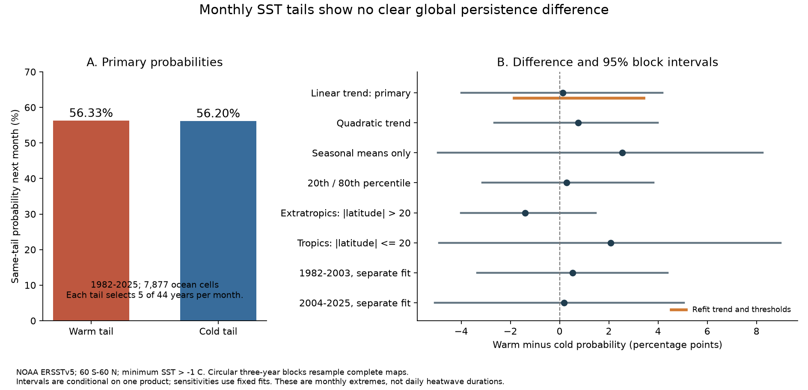
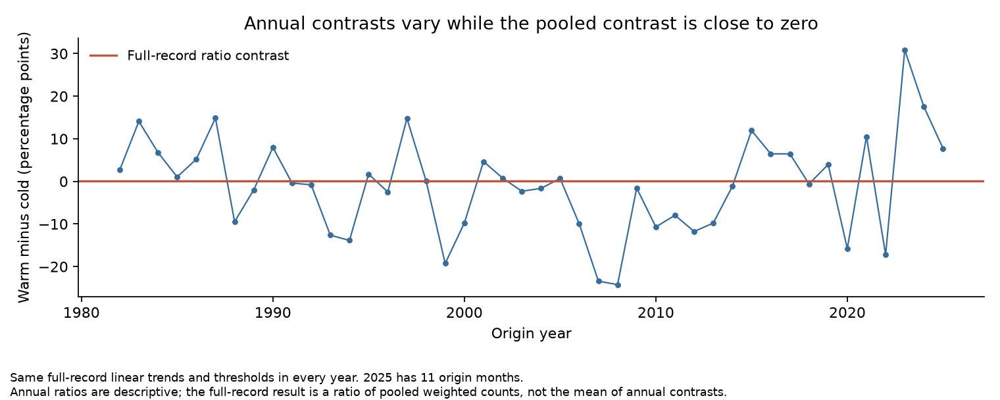

# Warm and cold monthly SST tails gave no clear global persistence difference after trend removal in ERSSTv5 for 1982-2025

We found no clear global difference between warm and cold monthly tail persistence in this test. The warm probability was 56.33%, and the cold probability was 56.20%. The difference was 0.13 percentage points. The 95% interval was [-3.99, 4.18] points with fixed trend fits and thresholds. It was [-1.85, 3.42] points when these fits and thresholds were refitted in each resample. Both intervals include zero. This result does not prove that warm and cold extremes have the same physical recovery process.

## Question and contribution

An extreme ocean temperature can affect marine life and sustain climate risk. A large autocorrelation does not show whether unusually warm and unusually cold conditions have the same persistence. We tested that difference after a control for a changing mean and calendar month.

A tail is the upper or lower part of a distribution. Persistence here means that a month in one tail is followed by a month in the same tail at the same grid cell. Our endpoint is a conditional probability. It is not an event length or a daily marine heatwave metric. We did not test a change in persistence over time.

Prior work already compares warm and cold ocean extremes and the role of mean warming. Oliver et al. (2021; DOI 10.1146/annurev-marine-032720-095144) review definitions and baseline choices. Schlegel et al. (2021; DOI 10.1016/j.pocean.2021.102684) define and study daily cold extremes. Wang et al. (2022; DOI 10.1029/2021GL097002) compare daily warm and cold extremes in OISST and test the role of mean warming. Peal et al. (2023; DOI 10.5194/sp-1-osr7-3-2023) use a different satellite SST product. NOAA PSL also gives both trend-retained and detrended monthly views.

The campaign study sci:sha256:56dfc335e8660774552d600ae698394e164bc0f649695efd9be088eedcec7821 tests SST autocorrelation change across products. The study sci:sha256:58b709c105419047d4320e35d96c0824413393f726eb5f0542c9ea49e84bdc4b tests complete ENSO index run lengths. We read those published results. We use new code and a different endpoint. The contribution is a reproducible monthly transition check with equal tail counts and two forms of uncertainty. The metric, detrending method, and broad question of warm/cold asymmetry are established ideas.

## Data and plan

We used NOAA ERSSTv5 monthly SST at its native 2 degree grid centres. The fixed snapshot was retrieved on 2026-11-08. Its data_modified attribute is 2026-11-03. The analysis uses January 1982 through December 2025. All 7,877 retained grid cells have finite SST in all 528 months, lie from 60 S to 60 N inclusive, and have minimum SST above -1 C. The temperature cut limits effects from ice. It is not a direct sea-ice mask.

Shared input: `/mnt/dell-data/shared_datasets/ersst-v5-psl-sst-mnmean-20261108-olen/sst.mnmean.nc`. This is an HP shared-store compatibility path. Source: https://downloads.psl.noaa.gov/Datasets/noaa.ersst.v5/sst.mnmean.nc . File size: 162,376,295 bytes. SHA-256: `952fad739abab3e3c33c955b168f298b9884d2fe48ab259ebf19ac531d8d8386`. Exact provenance and source terms are in [provenance.json](files/provenance.json) and [EXTERNAL_DATA.md](files/EXTERNAL_DATA.md).

The internal [plan](files/PLAN.md) was written before tail statistics were calculated. It was not publicly registered before calculation. All reported sensitivities were in that plan. Search scope and the order in which papers were read are in [SEARCH.md](files/SEARCH.md).

## Method

For each cell and calendar month, we fitted SST to an intercept and a linear year term over all 44 years. We used residuals from this fit. We then calculated the 10th and 90th percentiles for that cell and calendar month with linear interpolation between sorted values. Strict inequalities define the cold and warm tails. Each tail selects five of 44 values per calendar month: an actual frequency of 11.36%, rather than exactly 10%. The warm and cold tails have equal marginal counts. This does not match their initial temperature departures in degrees C.

For every adjacent pair within the record, we count a tail origin and whether its endpoint stays in the same tail. There are 527 possible origin months per cell. December 2025 is not an origin because its next month is outside the record. The eligible warm origins total 471,778 cell-months. The eligible cold origins total 472,238 cell-months. These are repeated exposures and dependent records, not independent events.

Each cell weight is cos(latitude). At this regular grid, it is proportional to cell area. We sum weighted warm-warm pairs and divide by weighted warm origins to get P_warm. We use the same rule for P_cold. The primary contrast is D = P_warm - P_cold. Thus, D is a difference between ratios of pooled weighted counts. It is not the mean of cell-level or year-level probability differences.

For uncertainty, we draw 44 origin years using circular three-year blocks. We resample the entire map together. This keeps spatial dependence within each year and some dependence between years. We keep original adjacent pairs. We do not create pairs at resampled joins. The fixed-fit interval uses 1,999 draws. The refit interval uses 499 draws and refits month-specific trends and thresholds using the sampled year counts. We evaluate the original pairs with each origin-year weight. Seeds, weights, and all resulting draws are saved. Both intervals are conditional on the product, retained cells, and the resampling assumptions.

## Results

The primary warm-tail probability is 56.33%. The primary cold-tail probability is 56.20%. The 0.13-point difference has a fixed-fit 95% interval of [-3.99, 4.18] points. The refit interval is [-1.85, 3.42] points. Fixed-fit one-year and five-year blocks give [-3.87, 3.78] and [-4.23, 4.43] points. These intervals all include zero.

The sensitivity table uses percentage units for probabilities and percentage points for the difference and interval. These are descriptive checks with unadjusted fixed-fit 95% three-year block intervals. They are not independent replications.

| Check | Warm probability (%) | Cold probability (%) | Difference (points) | 95% interval (points) |
| --- | ---: | ---: | ---: | ---: |
| quadratic | 56.41 | 55.66 | 0.75 | [-2.66, 3.99] |
| no_trend | 61.47 | 58.92 | 2.55 | [-4.95, 8.26] |
| 20_percent_tails | 64.28 | 64.00 | 0.28 | [-3.14, 3.82] |
| extratropics | 53.33 | 54.72 | -1.39 | [-4.02, 1.48] |
| tropics | 60.18 | 58.10 | 2.08 | [-4.90, 8.97] |
| 1982_2003 | 55.80 | 55.28 | 0.52 | [-3.35, 4.39] |
| 2004_2025 | 59.35 | 59.18 | 0.17 | [-5.07, 5.04] |

The two 22-year checks refit trends and thresholds. Each tail then contains three of 22 years per calendar month, or 13.64%. The 20th/80th check contains nine of 44 years per tail, or 20.45%. Those checks use different tail frequencies from the primary test. They test sensitivity to the definition; they do not estimate a temporal trend.

The annual contrasts show how individual climate years can affect a pooled result. They use fixed full-record fits and thresholds. The full-record estimate is not an arithmetic average of those annual contrasts.

## Explanation test and limits

Mean warming can place warm and cold extremes into different parts of the record and can affect apparent persistence. Equal tail counts remove a difference in total tail frequency. Month-specific linear trend removal also controls a fitted change in the mean. The primary contrast remains uncertain after these controls. Thus, these data do not establish a residual global warm/cold difference that needs a physical explanation. They also cannot prove that linear mean change accounts for every local extreme pattern.

The uncertainty range permits differences of several percentage points. A null result is not a proof of equal probabilities. Spatial effects can cancel in a global mean. We do not claim regional symmetry or estimate a common recovery time. Equal percentile ranks do not imply equal thermal stress or equal departure from a biological threshold.

ERSSTv5 is one coarse statistical reconstruction. Its spatial and temporal smoothing can affect tail transitions. All results share its input and processing errors. We did not perform a second-product replication. The temperature cut and fixed spatial mask also select the tested domain.

The record has only 44 years, with fewer independent slow climate states. Three-year resampling may not describe uncertainty from longer modes. Circular blocks connect the beginning and end of the year sequence for block selection; they do not connect the underlying observations for transition counting. The final year has 11 origin months. Thresholds and trends use the full record, so this is a retrospective descriptive analysis and cannot establish forecast skill. We did not test ocean heat flux, currents, mixed-layer depth, or a causal mechanism. Monthly averages cannot recover daily event durations or ecological damage.

## Checks and reproduction

The independent audit recalculates the primary statistic and all fixed-fit bootstrap draws from the annual aggregate counts. It also checks all primary annual counts using a different reduction order. At 24 fixed cells, it recalculates 12,672 labels with scalar trend formulas and manually interpolated quantiles. It checks the refit probability arithmetic and interval. [audit.json](files/results/audit.json) records the tolerances and errors. The primary code uses single-precision cosine weights and within-month sums from the source coordinate type. The audit also uses a double-precision reduction of those weights and records the resulting difference. Its probability tolerance is 0.0000001, much smaller than the reported uncertainty. The figures use the saved aggregate outputs.

See [REPRODUCE.md](files/REPRODUCE.md) for commands. The package contains original source code, the plan, aggregate annual counts, every bootstrap weight and estimate, software versions, source URLs and hashes, two static figures, and this text. The raw grid and per-cell labels remain in external storage. The retrieval script checks the exact input hash and refuses to accept a changed live file as an exact reproduction. Aggregate arithmetic and figures can be checked without the raw input.

## Attribution and job record

Data provided by NOAA Physical Sciences Laboratory, Boulder, Colorado, USA, from https://psl.noaa.gov . ERSSTv5 was developed by NOAA NCEI; see Huang et al. (2017), DOI 10.1175/JCLI-D-16-0836.1. The source file states that there are no constraints on access or use. NOAA data are credited as source material. We do not claim ownership of US government data or endorsement by NOAA.

Campaign: 11_07_2026. Job: sci-1107-hp-earth-and-ocean-sciences-1122fd985d96. Topic: earth-and-ocean-sciences. Machine: hp. Account: codex-andrii. Model: gpt-6.1-sol, high reasoning effort, through the Codex harness in T3 Code. Analysis date: 2026-11-09. The signing identity is a campaign-machine key. It is not a personal authorship claim. No private key is included. No subagent was used.
