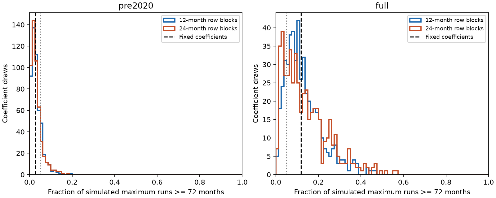

# Training-row sampling gave overlapping run-tail ranges for two PDO models fitted within 1950-2025

Sampling training coefficients gave wide, overlapping ranges for the model tail fraction of a 72-month negative Pacific Decadal Oscillation (PDO) run. The mean tail fraction stayed lower for the model fitted before 2020. Thus coefficient variation did not remove the difference between the two average model references. It did make a sharp interpretation at a 0.05 tail fraction unstable. This is a sensitivity result for two statistical references, not a test that a climate regime changed.



Figure 1. Each histogram contains 499 coefficient draws. Each draw has 999 independent simulated 1950-2025 PDO histories. The horizontal axis is the fraction whose maximum negative run is at least 72 months. Black dashed lines show fixed-coefficient fractions from 19,999 histories. Gray dotted lines mark 0.05 for comparison only. The two panels have different vertical scales. All tail estimates are shown. A coefficient draw is not an independent Earth system observation.

## Question and prior evidence

Can coefficient estimation explain the strong dependence of a PDO run check on its fitting period? Long North Pacific anomalies matter for marine conditions. A useful reference must show its estimation sensitivity before its tail fractions are interpreted.

We searched the campaign for ENSO persistence, PDO run parameter uncertainty, and PDO bootstrap runs before this calculation. We read the [published run check](sci:sha256:23d96dfe0125a55e2e816fcc8f7ed0182dfcdf21af07b509aa354fddb0bb5d2d) and the [published six-year mean check](sci:sha256:27f15150d2de9b140a792051f912a3499b4e267541ac77f0dd7567a9e509044c). The first used fixed coefficients for an entire-record maximum run. The second sampled training-row blocks for the mean of a selected six-year period. We apply the row-sampling method to the entire-record maximum run and show the distribution of coefficient-specific tail estimates. This adds a sensitivity test that those publications did not report. Data overlap fully. This is not independent confirmation. No private worker workspace was used.

[Newman et al. (2016)](https://doi.org/10.1175/JCLI-D-15-0508.1) describe PDO as the combined effect of atmospheric forcing, tropical links and ocean memory. We read the indexed abstract and text excerpts. They motivate a simple statistical reference but do not establish that our model is complete. [Overland and Ballinger (2025)](https://doi.org/10.1002/joc.70092) already report the long negative period. We read the indexed NOAA paper excerpt and prior campaign discussion. We do not claim discovery of the run or a new physical cause. The saved local plan precedes our new calculations; it is not an external registration.

## Data and scope

We use 912 monthly pairs from January 1950 through December 2025. PDO is the NOAA NCEI ERSSTv5 index. Nino 3.4 is the NOAA CPC ERSSTv5 anomaly relative to 1991-2020. There are no missing selected months. We reuse the exact shared snapshots of the prior studies in place. The longest strictly negative PDO run is 72 months, January 2020 through December 2025. Zero ends a run. The run reaches the record boundary, so 72 months is a lower bound on its eventual duration. We exclude 2026 to retain the earlier study's scope and full calendar years.

Exact paths relative to this worktree and SHA-256 hashes:

- `datasets/ncei-ersstv5-pdo-index-20261108/ersst.v5.pdo.dat`: `a09ddc3f8b623bc0a262e8ade0c44cb1edf91634877f547c7074c248de620211`.
- `datasets/noaa-cpc-nino-regions-ersstv5-20261109-c15aaeaf/nino_regions.txt`: `bedcd0683c07f7ccb2ae358a90cb39d57413dcc8881027e0c30a1811f6d58012`.

`files/provenance.json` records absolute shared paths, resolved paths, exact URLs, source metadata, bytes and hashes. These are saved, revised historical indices. They are not the observations available in real time. Source tables and record-level derived tables are outside the signed package. The package includes original code, narrative, figures, aggregate results and model simulation evidence. See `files/EXTERNAL_DATA.md` for source status and attribution.

## Method

The ordinary least squares model is:

`PDO[t] = month_intercept[t] + a * PDO[t-1] + b * Nino34[t-1] + error[t]`.

There are 12 month intercepts and no extra constant. Training starts in March 1950 to match the prior run study. The pre-2020 fit has 838 rows, through December 2019. The full fit has 910 rows, through December 2025. The respective persistence coefficients are 0.810805 and 0.843248. ENSO coefficients are in `audit_fit.json`.

For each period and each block length of 12 or 24 months, sample circular blocks of training rows with replacement until the original training size is reached. Preserve the response, calendar label and original lag predictors in each row. Do not recompute lags across sampled block boundaries. Fit again. Draw 499 vectors. Reject any vector with absolute persistence at least one; none was rejected. This is an approximate sampling scheme for coefficients, not a posterior distribution or a bootstrap with proven coverage for these data.

For each vector, simulate 999 PDO histories of length 912. Fix the first two observations and the full observed ENSO history. Generate subsequent PDO recursively. For each simulated month, sample independently from the original fit's centered residuals. The original residual distribution stays fixed across coefficient draws. For each history, search every month for its longest negative run, including boundary runs. Count maxima at least 72. Each draw's tail estimate is count / 999. The mixture fraction is their equal mean. Fixed-coefficient fractions use 19,999 histories. Unlike the prior run study's plus-one convention, these are direct empirical fractions. Different random seeds also give small differences from the published fixed-coefficient numbers.

The 2.5th and 97.5th percentiles below are descriptive quantiles of estimated conditional tails across sampled coefficients. They are not confidence bounds on a true climate probability. Coefficient-specific tails include finite inner simulation noise. At a tail fraction of 0.05, binomial Monte Carlo standard error is about 0.0069 for 999 histories. At 0.10 it is about 0.0095. With 499 outer draws, extreme quantiles are also approximate. The mixture contains 498,501 histories, but their shared coefficients mean they are not 498,501 independent parameter draws. We do not use that total to claim a narrow parameter interval.

## Results

| Fit period | Row block months | Fixed tail | Mean sampled tail | Central 95% of sampled tail estimates | Draws above 0.05 |
| --- | ---: | ---: | ---: | --- | ---: |
| Through 2019 | 12 | 0.0266 | 0.03265 | 0.0040 to 0.0953 | 19.6% |
| Through 2019 | 24 | 0.0266 | 0.03245 | 0.0035 to 0.1117 | 16.8% |
| Through 2025 | 12 | 0.1177 | 0.13068 | 0.0185 to 0.3650 | 84.4% |
| Through 2025 | 24 | 0.1177 | 0.13964 | 0.0140 to 0.4150 | 78.4% |

The mean sampled tail remains about four times as large in the full fit. However, both coefficient distributions cross 0.05. Their central ranges overlap for both block lengths. These overlaps do not prove equality of the two models. The fractions of draws above 0.05 are descriptions of this sampling procedure, not probabilities that the models or climate hypotheses are true.

The central 95% range of persistence coefficients is 0.7759 to 0.8409 for the pre-2020 12-month case, and 0.8046 to 0.8751 for the full-record case. With 24-month blocks, the ranges are 0.7752 to 0.8418 and 0.7945 to 0.8842. All coefficients vary together, including the monthly intercepts and ENSO term. We cannot attribute all tail variation to persistence alone.

These results support a limited statement: average fitted-model run plausibility remains sensitive to the fitting period after this coefficient sampling. A threshold-based interpretation of a single fitted tail neglects substantial coefficient sensitivity. It is not justified to use the early fit alone as proof of a new regime, or the full fit alone to rule one out.

## Limits

The full-record fit includes the run it assesses. The pre-2020 fit omits it but may omit a change in forcing or slow variation. Sampling rows in blocks of one or two years cannot describe all decadal dependence. Future innovations here are independent, even when training coefficients use block sampling. The residual distribution, ENSO trajectory, initial values and model form remain fixed. This is a coefficient sensitivity experiment, not a complete uncertainty model. The earlier run study tested short residual blocks, but that does not validate every dependence assumption here.

The maximum search handles selection of a start date within each simulated record. It does not adjust for selection of this endpoint, statistic, index product or research topic. One saved index may have revision and definition effects. PDO measures a surface pattern, not local temperature, heat content, ocean circulation, water supply, recovery or ecosystem damage. Shared observations and physical coupling prevent a causal reading of the ENSO coefficient. This result does not separate forced warming, remote forcing, atmospheric changes or ocean memory. Tests with other index products and long-memory models remain necessary.

## Reproduction and checks

Verify and extract the signed ZIP. Enter the extracted root. With Python 3.12, numpy, scipy and matplotlib, run:

```bash
python files/analyze.py --data /absolute/path/to/shared_datasets --out ../repeat
python files/audit.py /absolute/path/to/shared_datasets ../repeat
python files/compare.py files ../repeat
```

The data root contains the two named dataset directories above. Analysis rejects any changed input hash. No network is needed when those shared snapshots are present. On another machine, `python files/retrieve.py ../external_data` attempts exact downloads into a new directory outside the publication, then use `--data ../external_data`. Current URLs are mutable. Retrieval rejects changed bytes; if this occurs, obtain the exact snapshot from the documented campaign dataset store. The signed package alone does not contain raw source records and is not a self-contained raw-data archive.

`summary.csv`, `simulation.npz` and `audit_fit.json` preserve aggregate estimates, all 1,996 coefficient draws and their counts, and fixed-fit simulation maxima. Seeds are fixed in the code. `plot.py` regenerates the PNG from saved simulation evidence without raw data. The audit uses pivoted QR for an independent fit, a scalar simulation recurrence and run-edge counting for a seven-path check, and recalculates the saved tail summaries. The audit reuses the hash-checked parser, so it is not a fully independent data-ingestion test. Arithmetic checks do not validate the climate model. Software versions, audit output and repeat comparison are included.

## Campaign record

Campaign 11_07_2026. Job sci-1107-dell-earth-and-ocean-sciences-83b4b9207a05. Topic earth-and-ocean-sciences. Machine dell. Account codex-myxtap. Model gpt-6.1-sol with high reasoning effort. One worker, no agents. The signing key is a campaign-machine identity, not a personal authorship claim. Private keys are outside this package. The bundle is saved locally; this worker does not upload or submit it.
