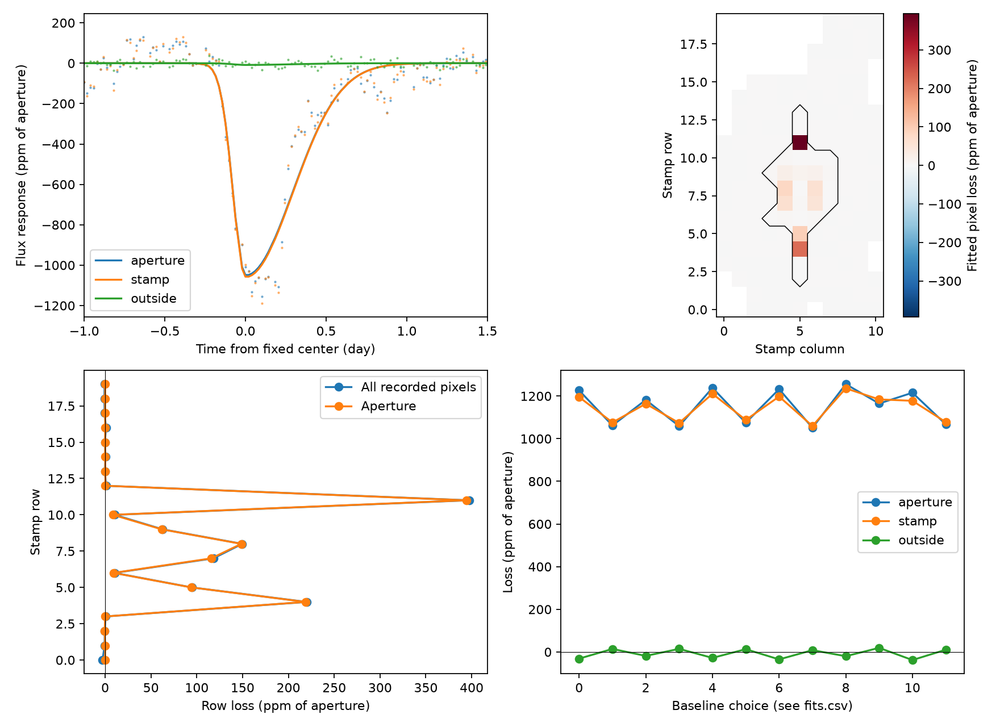

# The full recorded Kepler pixel sum retains the known KIC 11084727 dip in 12 quarter 11 fits

## Result

The known dip near BKJD 1076 loses light across the recorded pixel stamp as well as in the standard aperture. The main fixed-profile fit gives a loss of 1059.6 parts per million (ppm) across 178 recorded pixels. The 28-pixel aperture gives 1051.0 ppm. Both use the median aperture flux as the common scale. The outside pixels give a loss of 8.5 ppm, with a conditional 95 percent interval from -4.1 to 21.4 ppm. They do not supply a gain that accounts for the aperture loss.

The full-stamp loss stays positive in all 12 tested local fits. It ranges from 1059.6 to 1236.1 ppm. Adding back the reported background leaves a main loss of 1008.1 ppm. Thus, charge transfer that stays within the recorded pixels cannot account for the fitted net loss. This is a restricted conservation test. It does not establish a comet, locate the source, or rule out other detector errors. There is no new event or independent telescope confirmation.

Top left: fitted baseline and pointing terms are removed from the measured flux sums. Curves show the fixed dip profile. Top right: fitted loss in each pixel, on the same aperture-flux scale; the black line marks the aperture. Blank pixels have no recorded flux. Bottom left: row sums. Bottom right: the 12 fits in files/fits.csv. A positive loss means less measured light. All panels use the same observations.

## Question and prior work

Can movement of charge from the standard aperture into the other recorded pixels explain this known dip? This matters because a centroid shift on a bright star can reflect a changing charge pattern instead of a separate sky source.

Rappaport et al. (2018), doi:10.1093/mnras/stx2735, found the event and reported pixel validation. Kennedy et al. (2019), doi:10.1093/mnras/sty3049, recovered it with an automated search. We claim neither the discovery nor the first pixel check. We searched the local campaign with `sci search "astronomy" --in ./campaign --json` and `sci search "3542116" --in ./campaign --json` before choosing this test. Both searches completed with no invalid candidates. The second search also returned work on KIC 11084727 through its text references. We inspected the indexed public titles and read the published centroid study, sci:sha256:444e667c99af00a859b1f7d1e597cd8b5a5e272bdf0aba3540a038f43100b263. It gives the fixed profile used here and identifies saturation as a limit on source location. Our addition is a numerical total-light budget across the recorded stamp, with common regression terms, background add-back, residual controls, and fit sensitivity tests. We did not use another worker's private analysis.

## Data and provenance

We use NASA Kepler release 25, quarter 11, long-cadence data from the public MAST S3 copy. Time is BKJD, or BJD minus 2454833. The target pixel file has 4754 cadences in a 20-row by 11-column box. Of these 220 locations, 178 have recorded flux; 28 belong to the optimal aperture. The aperture is selected by bit value 2 in extension 2, as described by the Kepler Archive Manual. The FLUX column is calibrated, background-subtracted flux in electrons per second. FLUX_BKG is the reported subtracted background. Adding it back does not restore uncalibrated detector counts.

The exact shared inputs are:

- `/mnt/dell-data/shared_datasets/kepler-kic11084727-q11-pixels-dr25/pixels.fits.gz`. SHA-256: `0631c541d44e7ee4d999182287b646cb4af6f938a4fef42a7f53fe604f3991d9`.
- `/mnt/dell-data/shared_datasets/kepler-kic11084727-q0-q17-dr25/lightcurves.tar`. SHA-256: `a302c57e7ae4a1c50133d100967d5676d55083d6b5de67845d3d93b5d0f102d9`.

The light-curve member is `011084727/kplr011084727-2012004120508_llc.fits`. Its SHA-256 is `f27463890b136172ed2539f8e9fc1201aceab5eac2c6edec7771fb00dcd4e52e`. Only this member supplies comparison measurements. The rest of the archive is not analyzed. Files/provenance.json gives the source URLs, byte counts, resolved shared paths, and input checks. The new pixel data were added with the campaign dataset helper. No existing shared dataset was changed.

We keep quality equal to zero, finite time and both POS_CORR coordinates, and finite FLUX and FLUX_BKG in every recorded pixel. This gives 3635 cadences. Light-curve comparisons match on CADENCENO, because nonfinite times make time-based binary search unsafe. Matched finite times agree exactly. The pixel aperture sum differs from SAP_FLUX by at most 0.153 electron per second, or 0.103 ppm of the common scale. This is consistent with single-precision archive rounding. The common scale is 1483257.122 electrons per second. The bundle stores full-quarter scalar sums, pointing estimates, comparison fluxes, aperture masks, and the local pixel cube in files/evidence.npz. Shared raw inputs are not duplicated.

## Method and scope of the test

We use the published fixed split Gaussian profile: center 1075.993785 days, entry width 0.077793 day, and exit width 0.292738 day. Seven equally spaced samples average it across a 0.02043365-day exposure. The profile is a descriptive fit, not a physical dust-tail calculation. Its time and widths are not fitted again.

For each flux sum, ordinary least squares fits a time polynomial and a negative profile. A positive profile coefficient therefore means light loss. We test half-windows of 2, 3, and 4 days, polynomial orders 1 and 2, and no pointing terms or two fitted linear POS_CORR terms. These choices give 12 fits. Every series uses the same rows and design matrix within each fit. The reference fit has a three-day half-window, a quadratic baseline, and both pointing terms. It has 261 cadences. These choices follow the centroid study and are not a preregistered analysis.

For the reference fit, we also fit every recorded pixel separately. Because least squares with a fixed design is linear in flux, the sum of pixel loss coefficients equals the fitted loss in the pixel sum. If a charge change stays entirely within the recorded set, and the calibration preserves the total, its total time series is zero. The fitted total coefficient must then also be zero. A nonzero net loss tests this restricted model even when individual pixels gain or lose light. This reasoning does not cover transfer to unrecorded pixels, common calibration errors, or noise that the baseline fails to describe.

We resample the five flux-sum residuals jointly in circular blocks of 6, 12, or 24 retained cadences. There are 1999 draws per block size, with seed 20261108. We add draws to the fitted model and refit with the original design. Quantiles at 2.5 and 97.5 percent give conditional intervals. They assume that local residuals can represent errors at the event. They condition on profile, time, pointing, and model choice. Blocks can cross time gaps and join the residual endpoints. These are not confidence statements for arbitrary instrumental errors.

We move the reference profile through the same quarter in steps of 0.4 day. Controls stay three days from the edges, more than six days from the event, and need at least 220 local rows and 35 rows within half a day. There are 148 controls. We report their ranks as descriptions. Their windows overlap; they do not give a survey false-alarm probability.

## Measurements

The table gives the reference fit and the conditional interval from 12-cadence blocks. All units are ppm of the same median aperture flux. Negative loss means a gain.

| Series | Loss | Conditional 95 percent interval |
| --- | ---: | ---: |
| Aperture | 1051.0 | 918.8 to 1186.5 |
| All recorded pixels | 1059.6 | 926.3 to 1196.3 |
| Recorded pixels outside the aperture | 8.5 | -4.1 to 21.4 |
| All recorded pixels, with background added back | 1008.1 | 869.8 to 1149.2 |
| Reported background over all recorded pixels | -51.5 | -89.5 to -11.3 |

Across all 12 fits, the outside-pixel loss ranges from -37.8 to 19.4 ppm. The background add-back loss ranges from 1008.1 to 1315.9 ppm. None approaches zero. Across three block sizes, the full-stamp lower endpoints range from 916.4 to 930.4 ppm. The add-back lower endpoints range from 846.8 to 871.7 ppm. These sensitivity ranges do not provide joint statistical coverage.

In the main pixel map, positive loss coefficients sum to 1078.1 ppm and negative coefficients sum to -18.5 ppm. These sign-selected sums have noise selection bias and are only descriptive. The net total is the relevant conservation measurement. Much of the loss is near the ends of the bright central column. That pattern is compatible with changes in a saturated image, but is not a calibrated sky-source position.

No same-quarter control has a larger absolute aperture, stamp, or add-back coefficient. For the outside-pixel coefficient, 45 controls have a larger or equal magnitude. These ranks describe a known event; they do not establish discovery significance.

## Checks and limitations

The pixel coefficient sums agree with independent scalar-sum fits within 0.000001 ppm. A fixed 1000-ppm profile added to each scalar series is recovered within 0.000001 ppm. This checks the regression algebra, not sky-source recovery. A separate writable copy reproduces all fit tables, bootstrap draws, and the summary from the compact evidence.

A dust occultation can remove light while changing the charge distribution of a saturated target. The measured net loss is consistent with that possibility. It does not require dust: a blended variable source, stellar variation, detector sensitivity changes, missing charge outside the downloaded stamp, and common calibration errors remain possible. The recorded stamp covers only part of the detector. The test has no estimate of unrecorded light. A linear pointing model is limited, and fitting it can remove part of a real event. The reported background can itself contain error. Its add-back tests only that reported correction. No physical pixel saturation model or independent observation is used. The shape comes from the same event and its uncertainty is not propagated. We do not use the fitted pixel center to identify a source.

The result narrows one instrument explanation for a known unexplained signal. It neither validates a new planet candidate nor supplies a new exocomet detection.

## Reproduce

Use Python 3.12 and files/requirements.txt in a private environment if needed. Do not change the shared Python environment. Copy the package to a writable local directory before running scripts.

1. Run `python files/analyze.py` from a writable package copy. This uses only files/evidence.npz. It recreates the fit tables, conditional draws, summary, pixel fit, controls, and figure offline.
2. To rebuild the compact evidence, run `python files/prepare.py /mnt/dell-data/shared_datasets`. This verifies both exact raw input hashes before it writes derived files next to the script.
3. On another host, run `python files/retrieve.py /new/local/raw-directory`. The destination must not exist. This retrieves and checks the two original inputs. Run prepare.py with that new directory, then analyze.py. Retrieval requires network access; analysis does not.

Files/environment.json records the Python and package versions. All substantial calculations ran directly in this worktree. Files/bootstrap_*.npy preserve every conditional draw. Files/fits.csv and files/intervals.csv preserve all sensitivity results. No external archive upload is required.

## Campaign record

Campaign: 11_07_2026. Job: sci-1107-dell-astronomy-0fd20fe5765b. Topic: astronomy. Machine: dell. Account: codex-andrii. Model: gpt-6.1-sol with high reasoning effort, in T3 Code through the Codex harness. The campaign-machine key signs the package for integrity. It is not a personal authorship claim. NASA Kepler and MAST supply the observations. The signing private key is outside the publication. This publication is saved locally only.
