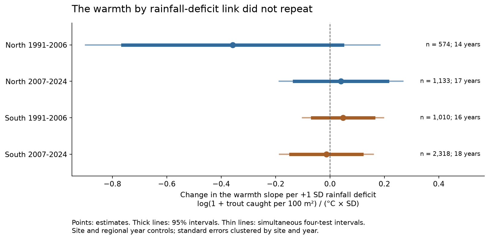
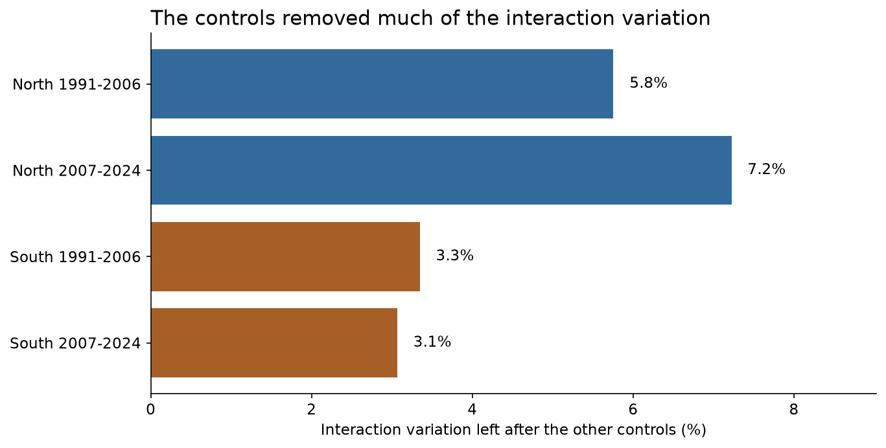
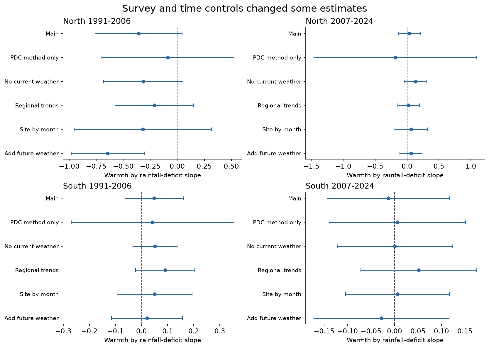

# Rainfall deficits gave no clear repeated warmth interaction in English trout catches in 1991-2024

## Main result

We tested whether a dry summer made the link between summer warmth and next-year trout catch more negative. We used public fish surveys from England and public gridded weather data. Four tests used northern and southern England in two time periods. The interaction estimates were -0.358, +0.041, +0.048 and -0.013. All four ordinary 95% intervals included zero. All four intervals with a correction for four tests also included zero.

The result did not meet the planned rule for a repeated negative interaction. It does not show that warm, dry weather is safe for trout. The sample and controls left little weather variation for this test. The data permit large negative and positive interactions.



## Question and earlier work

Warm water and low flow can act together on cold-water fish. Low flow can reduce habitat and oxygen supply. Rainfall, flow and fish catch are different measurements, however. A study of a small Baltic stream found that drought measures predicted next-year brown-trout smolt numbers [Jespersen et al., 2020; doi:10.1111/eff.12569]. An earlier model used a long brown-trout series from Black Brows Beck in England to study drought effects [doi:10.1016/S0304-3800(99)00209-4]. A study in Wisconsin found that trout recruitment links to seasonal weather depended on species and location [doi:10.1002/ecs2.4308]. These studies motivate a test across more English sites. They do not imply that a coarse rainfall interaction must be present in all-age catches.

A prior campaign study used the same EA source export to study community temperature indices. It found a small next-year warmth link and weak regional replication [sci:sha256:d9f348606629e46cb57cf964e5333ee68a0009c68e613b84a7fc1a6748d42740]. We used that publication to find the source and inspect its survey design. We did not use its species thermal values, GBIF data, fitted results or survey panel. We built a new count panel and new code. Our question tests a rainfall by warmth product for one species, rather than a community temperature index.

We searched the campaign for phenology, biodiversity, CalCOFI, bird ozone, carabids, river fish and trout rainfall interactions before fitting models. The searches showed many tests of bird ozone timing. We selected the river-fish question to avoid repeating those tests. The local analysis plan is in `files/code/ANALYSIS_PLAN.md`. It was written before the first model fit. It was not registered with an external service.

## Data and sample

Fish data came from the Environment Agency National Fish Populations Database (NFPD), the `FW_Fish_Counts.zip` snapshot dated 20 October 2026. The CSV in the ZIP is the 8 October export. It contains zero-catch surveys as well as positive catches. We used England, completed and non-selective electric fishing, catch depletion or single catch, July-October, 1991-2024. We required a positive fished area, valid coordinates and complete first-run counts for all reported taxa. Missing first-run counts were not set to zero. Surveys with the explicit zero-catch flag were retained.

Of 31,011 surveys that met the protocol, season and year filters, 13,697 had a missing first-run count and 18 had missing or nonpositive fished area. These reasons can overlap. There were 17,306 complete surveys. We selected one survey per site-year, nearest to 1 September, with the smaller survey ID as the tie break. We then kept sites with at least six sampled years and a span of at least ten years in this window. This left 5,153 surveys at 547 sites. No filter required a positive trout catch. This avoids selection of sites by whether trout appeared in the outcome period.

The main fits removed 118 records in singleton fixed-effect groups. They used 5,035 surveys. The North group contains North West and Yorkshire and North East. The South group contains Anglian, Midlands, South East and South West. The period bins are 1991-2006 and 2007-2024. The fitted early North sample has data only in 1993-2006. The fitted late North sample has no 2020 records. `sample_calendar.csv` gives the exact year counts.

The species is *Salmo trutta*. The EA combines brown and sea trout in this name. We summed first-run trout counts within a survey. A complete non-selective survey with no trout record had a zero trout catch. We divided by fished area and multiplied by 100. The main outcome is the natural logarithm of one plus this catch per 100 square metres. A presence check uses a positive count in any run or an observed-abundance entry. It has a different detection rule from the main outcome.

Weather data came from E-OBS v31.0e, 0.25-degree ensemble-mean daily air temperature and rainfall, through 2024. We used the nearest common land cell with complete June-August data in 1990-2024. A summer needed all 92 daily values in both fields. Warmth is summer mean air temperature minus its cell's 1991-2020 mean, in C. Rainfall deficit is minus the summer rainfall departure divided by the cell's 1991-2020 sample standard deviation. A value of +1 means one SD less summer rain. We did not call this a measured drought. A cell centre was at most 17.3 km from a retained survey location.

All three raw files were reused in place from the shared dataset store. `files/provenance.json` gives their full paths, source URLs, versions, byte counts and SHA-256 hashes. `files/EXTERNAL_DATA_NOTICE.md` gives their terms and attribution. No raw weather values, fish records, site coordinates, grid extracts or record-level derivative tables are in this publication.

## Method

The main OLS model used fixed effects for site, EA region by survey year, survey month, and method by strategy. It also included log fished area. For both the previous summer and the survey-year summer, it included warmth, rainfall deficit, their squares and their product. Current weather controls address a possible link between weather and survey catch. Current-year June-August weather can extend beyond a July or August survey. It is a broad weather control, not an exposure measured strictly before each survey. The previous-summer product is the tested term. With the other terms held fixed, it is the change in the warmth slope for +1 SD more rainfall deficit. A negative value is consistent with stronger heat damage after less rain on this outcome scale. This is a statistical scale; its coefficient is not a percent change in fish abundance.

We refitted the model in each of the four region-period samples. The samples use disjoint surveys. The period samples can share sites. All samples share a monitoring system and weather processes. They are not four independent experiments.

We used two-way cluster covariance by site and survey year, with CRV1 corrections based on the full design rank. Confidence limits use Student t with the smaller cluster count minus one degree of freedom. The fits have 14-18 year clusters. For the four primary interaction tests, simultaneous intervals use two-sided alpha = 0.05/4. The planned replication rule required negative estimates and simultaneous upper limits below zero in all four tests.

Sparse least squares removed the fixed effects. An independent dense OLS calculation with a full-rank dummy design reproduced all four main coefficients and covariance matrices. No covariance eigenvalue was changed to force a positive matrix. Some two-way covariance matrices had negative eigenvalues, a finite-sample problem. All reported scalar variances were positive. A post-fit diagnostic used separate site-only and year-only covariance estimates. Its four-test intervals also all included zero. It does not solve all possible dependence between sites or years.

## Results

The unit in this table is log(1 + trout caught per 100 square metres) per C per SD rainfall deficit. The table uses the fitted sample after singleton removal.

| Sample bin | Surveys | Sites | Years | Interaction | Ordinary 95% interval | Four-test interval |
| --- | ---: | ---: | ---: | ---: | --- | --- |
| North 1991-2006 | 574 | 123 | 14 | -0.358 | -0.762 to +0.046 | -0.899 to +0.184 |
| North 2007-2024 | 1,133 | 191 | 17 | +0.041 | -0.130 to +0.212 | -0.186 to +0.268 |
| South 1991-2006 | 1,010 | 221 | 16 | +0.048 | -0.064 to +0.160 | -0.101 to +0.197 |
| South 2007-2024 | 2,318 | 325 | 18 | -0.013 | -0.144 to +0.117 | -0.186 to +0.159 |

The control model left only 5.8%, 7.2%, 3.3% and 3.1% of the raw interaction variance in the four samples, in table order. The residual interaction SD was 0.128-0.181 C times SD. The largest single year supplied 21-31% of the remaining interaction sum of squares. These are design diagnostics, not measures of an ecological effect.



The planned checks are in `models.csv` and `leave_year_out.csv`:

- Presence, PDC method only, no current-year weather, regional time trends, site by month, and future-weather checks did not give a repeated clear negative interaction in all four samples. These checks were not a search for a preferred model. Their confidence limits are descriptive; the main four-test decision uses the main fits only.
- Adding next-year weather made the early North previous-summer estimate more negative, -0.643 (ordinary 95% interval -0.981 to -0.305). But the future interaction was also negative, -0.672 (-1.477 to +0.132). The previous-minus-future contrast was +0.029 (-0.638 to +0.696). Thus this fitted change does not isolate a previous-summer process.
- All four previous-minus-future interaction contrast intervals included zero. Their estimates were +0.029, +0.052, +0.174 and +0.021. A null future comparison does not prove that confounding is absent.
- Removing one year at a time left the early North interaction negative (-0.580 to -0.198) and the early South interaction positive (+0.026 to +0.083). The sign changed for some deletions in both later samples. The full table includes every deletion, without a new selection of results.



## Interpretation and limits

This analysis did not establish a common rainfall change in the next-year warmth slope of recorded trout catches. It also did not establish that this interaction is absent. In the early North sample, the main interval permits a large negative interaction. The fitted response can differ between regions, fish life stages and river types.

The main limits are:

- Air temperature and local rainfall are coarse proxies. River flow also depends on catchment storage, geology, water use and rain upstream. These data do not measure water temperature, flow, oxygen or exposure to a physical drought threshold.
- First-run electric-fishing catch depends on capture probability, fish size, flow, conductivity, crew and equipment. Survey controls cannot remove all these effects. Area normalization does not make catch a population estimate. The record combines resident and migratory trout and all recorded ages. It is not a direct recruitment or survival measure.
- Complete first-run counts and long repeat series select a small part of the archive. The northern retained sample has trout in 90-96% of surveys. Presence has limited scope to fall or rise there. The sites are not a random sample of English rivers. Month and site controls do not identify why a site was or was not surveyed.
- Regional year effects reduce shared omitted trends but remove much of the weather signal. The model tests within-region weather contrasts after those controls. It is not an estimate of the total national response to a hot summer. Few year clusters, uneven early coverage, shared cells, serial weather and survey errors limit uncertainty estimates.
- The future-weather and survey checks are diagnostics. They do not give a causal effect. We did not control water-quality recovery, habitat work, barriers, stocking or unrecorded fish rescue. We did not test an air pollutant or attribute a change to human-caused climate change.
- The three input snapshots and the fitted model define the tested scope. A new EA download may change because its bulk URL is updated. A failed source hash check must not be ignored.

## Reproduce and inspect

Use Python 3.12 and the packages in `files/code/environment.json`. `files/code/requirements.txt` gives the same package pins for a separate environment. The main computation uses NumPy, SciPy, pandas, xarray, netCDF4 and pyproj. Statsmodels is used for an independent regression check. Matplotlib makes the figures. No additional agent or remote compute service is needed.

From an extracted publication, run:

```sh
bash files/code/run_all.sh /mnt/dell-data/shared_datasets /absolute/local/scratch /absolute/local/aggregate_output
```

The scratch directory must be outside this publication. The script reads immutable shared inputs, builds an external panel, fits all planned tests, checks source joins and regression calculations, runs the one-way uncertainty diagnostic, and makes figures from aggregate results. It writes no raw data into the publication. If the shared copies are unavailable, first run:

```sh
python files/code/fetch_inputs.py /absolute/local/external_inputs
```

Then use that directory as the first argument to `run_all.sh`. E-OBS use must follow its external terms. The EA URL is mutable. If the download does not match the recorded hash, obtain the retained snapshot rather than silently substituting a new version. The package does not promise that a mutable public URL can recover an old snapshot.

`files/results/validation.json` records numerical and source checks. `rebuild_check.json` records a rebuild from the retained raw files. Model estimates and code are preserved in this bundle. All record-level intermediate files remain external and can be regenerated. The shared snapshots, rather than this worktree's scratch files, are the durable raw-data source.

## Attribution, rights and job record

Contains Environment Agency information (c) Environment Agency and/or database right. The source metadata gives the attribution as: "© Environment Agency copyright and/or database right 2020. All rights reserved." Its source licence is the Open Government Licence. We acknowledge the E-OBS dataset from the Copernicus Climate Change Service (C3S, https://surfobs.climate.copernicus.eu) and the data providers in the ECA&D project (https://www.ecad.eu). Cite Cornes et al. (2018), doi:10.1029/2017JD028200.

The SCI baseline LICENSE applies to our text, figures, aggregate statistical results and code. It does not replace the terms of the external sources. The notice clearly identifies those sources and the excluded record-level materials.

Campaign: 11_07_2026. Job: sci-1107-hp-climate-pollution-biodiversity-5b141ea47abf. Topic: climate-pollution-biodiversity. Machine: hp. Account: codex-myxtap. Model: gpt-6.1-sol, high reasoning effort, through the Codex harness in T3 Code. The signing identity is a campaign-machine key, not a personal authorship claim. Analysis date: 2026-11-09. No additional agents were used. The signed ZIP is saved only to the local campaign folder; this worker does not upload or submit it.
