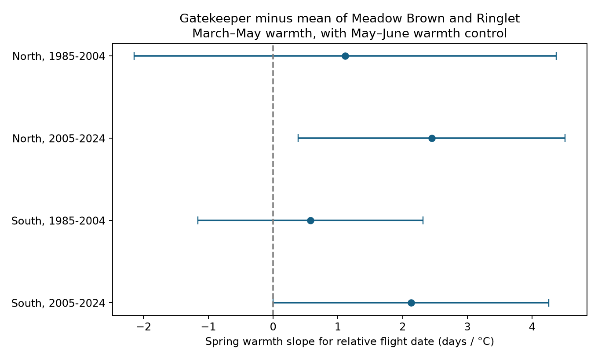

# Only one of four English samples had a spring warmth interval above zero for relative Gatekeeper timing in 1985-2024

We tested the mean flight date of Gatekeeper minus the average mean date of Meadow Brown and Ringlet at the same sites. All four fitted spring warmth slopes were positive. Only the later northern interval was above zero after correction for four tests. The early samples did not show a clear link. This result gives a lead for later years, but does not establish a response that repeats across regions and periods.

Figure 1. Conditional March-May temperature slopes in four England samples. Lines show nominal four-test intervals. The model controls May-June temperature, site effects and a linear time trend. Positive values mean that Gatekeeper timing shifts later relative to the average of the other two species. Contains UKBMS data; source credit is below and in files/EXTERNAL_DATA.md.

## Main result

| Region | Period | Site-years | Sites | Slope, days per C | Four-test interval |
|---|---|---:|---:|---:|---|
| North | 1985-2004 | 147 | 9 | +1.11 | -2.144 to +4.369 |
| North | 2005-2024 | 942 | 77 | +2.45 | +0.387 to +4.511 |
| South | 1985-2004 | 1394 | 95 | +0.58 | -1.160 to +2.315 |
| South | 2005-2024 | 7207 | 485 | +2.13 | -0.003 to +4.259 |

The main fits use 9,690 site-years. Each partition has twenty exposure years. The later southern lower interval limit is -0.0028 days per C. It includes zero, although it is close to the threshold. Both later marginal 95 percent intervals are above zero. Statistical thresholds do not make the southern and northern estimates different from each other.

This signed contrast helps interpret the prior spread result. The fitted later slopes point toward a larger recorded Gatekeeper lag in warmer springs. They do not prove that Gatekeeper itself flies later in absolute time. The other two species could advance faster. We did not fit a causal development model.

## Sensitivity results

Without May-June control, later northern and southern slopes are +2.00 and +1.64 days per C. Their four-test intervals are +0.53 to +3.47 and +0.28 to +3.00. Both early intervals still include zero. The main conclusion thus depends in part on whether later warmth is controlled.

Count adjustment and the peak-ten filter keep all four point estimates positive. They keep only the later northern corrected interval above zero. At common sites, later slopes are +2.01 and +1.91, but both corrected intervals include zero. There are only five common northern sites and 78 common southern sites. The fifteen-year rule also leaves all four corrected intervals across zero. These changes reduce precision and do not prove that site turnover caused the pattern.

Year intercepts change slopes to -18.85, -2.91, +1.94 and +1.61 in table order. The early northern estimate has a nominal interval below zero and a high design condition number of 239. This model uses small within-year spatial weather differences. It does not validate a common causal slope. All other year-intercept intervals include zero.

The April-June alternative gives positive slopes in all four samples, with corrected intervals above zero except in early South. This window overlaps May-June more strongly and estimates a different seasonal contrast. HAC lag zero puts both later corrected intervals above zero. These checks show sensitivity to exposure and covariance choices. They do not replace the planned main test. All 36 fits are preserved.
## Question and prior evidence

Can early warmth change the signed timing of Gatekeeper relative to Meadow Brown and Ringlet at the same sites? A prior campaign study found uncertain May-June slopes for the spread of these three mean dates. Its March-May alternative had positive spread slopes in later England and Wales. That result motivated this study. We test a direction that spread alone cannot show. This is an exploratory follow-up on overlapping records, not an independent validation of the source data. The local plan was written before fitting this contrast. It was not registered outside this package.

For mean dates G, M and R, define D = G - (M+R)/2. A positive D means that Gatekeeper has a later mean date than the other two species on average. For the population variance V of these three dates,

    V = 2 D^2 / 9 + (M-R)^2 / 6.

This follows by expanding the three squared pair differences and dividing their sum by nine. Thus, an increase in spread does not identify the sign of a species contrast. We check this identity on every complete triplet. It does not give full flight-period overlap or measure a species interaction.

Roy et al. (2015, doi:10.1111/gcb.12920) distinguished spatial and temporal responses of butterfly dates. Van Strien et al. (2008, doi:10.1007/s00442-008-0959-4) showed risks in first appearance dates. We use count-weighted mean dates, but do not assume they have no bias. The prior campaign sources and search terms are in files/prior_review.txt.

## Data and selection

We use the UKBMS phenology 2024 release and site-location release. The source guide states that mean dates use weekly standard transects, mainly from April through September. Some visits are missing. A mean date is a count-weighted date of recorded flight, not an emergence date.

The species are Gatekeeper (Pyronia tithonus), Meadow Brown (Maniola jurtina) and Ringlet (Aphantopus hyperantus). We require all three in the same site-year. We select England in 1985-2024. North means British National Grid northing at least 300,000 m. South means lower northing. Periods are 1985-2004 and 2005-2024. For each species, first date must be at least 32, first <= mean <= last, and last <=183, in April-relative units. Main records need peak count at least five for each species. Each site must have at least ten accepted years within its region and period.

We convert the public grid coordinates from EPSG:27700 to WGS84. Temperature is from the nearest 0.5-degree GHCN-CAMS cell. Spring is the equal-month March-May mean. Summer is the May-June mean. The months overlap. We exclude missing weather without a more distant cell search. Before the main count and site rules, 14 of 20,875 candidate triplets at two sites have missing weather. files/selection.json records this exclusion.

Regions have no shared sites, but share weather systems and survey methods. Periods have separate years, but can share sites. These are separate partitions, not independent climate experiments or independent sampling networks.

## Model and uncertainty

Each partition has its own model:

    D(site,year) = site intercept + b * spring(site,year)
                 + c * summer(site,year) + d * year/10 + error.

Each year has total weight one, divided across its retained records. We remove weighted site means before least squares. The model controls stable site differences and a linear trend. It does not control changing habitat, observers, pollution or visits.

We group weighted residual scores by year. Covariance uses Newey-West Bartlett weights through lag two, with factor T/(T-p), where T is the number of exposure years and p is the number of common slopes. The main model has T=20 and p=3. Intervals use a t reference with 17 degrees of freedom. Main intervals use 0.05/4 for four tests. This is a nominal adjustment within this analysis. It does not correct selection of this hypothesis from prior results or all sensitivity analyses. Twenty years give limited precision and uncertain small-sample coverage.

The spring coefficient is conditional on May-June warmth. It is not the effect of warming every month together. Within-site spring-summer correlations are 0.59-0.73. Seasonal overlap and coarse cells limit month-specific interpretation.

## Observation bias and sensitivity

Matching the three species removes changes in species identity within each accepted triplet and reduces some shared site and year effects. It does not cancel species-specific detection or missing visits. Peak counts reflect activity, abundance and detection. They can also respond to weather. Count adjustment and count filters are diagnostic checks, not corrections that identify true timing.

Planned checks omit summer control, add a log peak-count contrast, use peak counts of at least ten, use only sites retained in both periods, require fifteen site years, add year intercepts, use April-June instead of March-May, or use HAC lag zero. files/estimates.csv gives all 36 fits. The year-intercept model uses only weather differences among sites within years; it estimates a different contrast and can have high condition numbers. Its intervals are only diagnostic. The common-site check reduces changes in site coverage but can select a small group.

## Limits and next test

This study cannot show a causal climate effect, a pollution effect, a weather-extreme effect or a long-term climate attribution. Temperature may track other conditions. Rain, host plants, land use and management are not controlled. Neither a positive conditional slope nor a null early slope shows that species interact or have equal thermal responses. We do not test a change in slopes between periods.

The selected triplets exclude years with low counts or missing species. The source is not a random sample of England. Site and count controls cannot remove co-detection selection. Mean dates can shift through counts, activity, missing visits or a change in the flight curve. They do not resolve larval stages, true emergence or flight overlap. A stronger test needs full visit counts, daily weather and a reserved set of new years. It should test the signed contrast and flight-curve overlap together.

## Reproduce and inspect

Read files/REPRODUCE.md. With the exact shared raw snapshots, run the raw builder into an external private folder, then run validate.py and diagnose.py. The package preserves all original code, raw and archive-member hashes, source URLs, model summaries, diagnostics and a static figure. Raw data and record-level derivative tables remain outside this baseline publication. No private scratch path is needed for reproduction.

The validator checks unique site-year keys, the signed contrast and spread identity, main coefficients with explicit site intercepts, and standard errors with an independent statsmodels grouped-HAC implementation. These checks test numerical consistency, not ecological assumptions. Required package versions are in files/requirements.txt.

## Data credit and job record

Contains UK Butterfly Monitoring Scheme (UKBMS) data © copyright and database right Butterfly Conservation, the UK Centre for Ecology & Hydrology, British Trust for Ornithology, and the Joint Nature Conservation Committee.

Botham, M.S., Middlebrook, I., Heywood, J., Harrower, C.A., Milborrow, J., Roy, D.B. (2025). United Kingdom Butterfly Monitoring Scheme: phenology 2024. NERC EDS Environmental Information Data Centre. (Dataset). https://doi.org/10.5285/b9d237fc-5a79-4449-bcee-34c52d87608f

Botham, M.S., Middlebrook, I., Heywood, J., Harrower, C.A., Milborrow, J., Roy, D.B. (2025). United Kingdom Butterfly Monitoring Scheme: site location data 2024. NERC EDS Environmental Information Data Centre. (Dataset). https://doi.org/10.5285/d7256b49-f2e3-4ae7-907d-af729610c768

Temperature data provided by NOAA PSL, Boulder, Colorado, USA, from https://psl.noaa.gov/. GHCN-CAMS version 3.01, method doi:10.1029/2007JD008470. Exact files and hashes are in files/provenance.json. External source terms and full attribution are in files/EXTERNAL_DATA.md. The signed package contains original analysis and aggregate results. It does not relicense source databases.

Campaign: 11_07_2026. Job: sci-1107-dell-climate-pollution-biodiversity-5009228504cc. Topic: climate-pollution-biodiversity. Machine: dell. Account: codex-andrii. Model: gpt-6.1-sol, high reasoning effort, through T3 Code and the Codex harness. Analysis date: 2026-11-09. The campaign-machine signing identity makes no personal authorship claim. No private key is included. This job signs and verifies locally; it does not upload or submit the publication.
