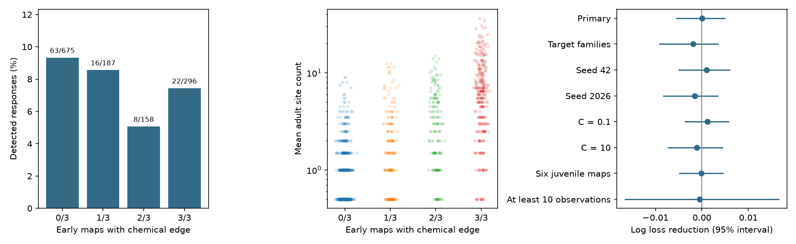

# Early chemical edge presence gave no clear response prediction gain in 1316 selected worm pairs

## Question and result
Does an adult chemical connection give more information about adult response detection if the same named connection occurs in early larval maps? We tested added prediction value after adult chemical count, adult map agreement, electrical count, reverse chemical count, observation count and cell identity controls.

The primary log loss changed from 0.266394 to 0.266318. The reduction was 0.000076. Its conditional 95% interval was -0.005544 to 0.005052. The test gave no clear added prediction value. It does not establish that early and late connections have equal function. It does not test trial-to-trial reliability.

## Prior work and scope
Witvliet et al. measured wiring across development and separated stable, variable and changing connections [doi:10.1038/s41586-021-03778-8]. Randi et al. measured evoked signal propagation with optogenetic stimulation and calcium imaging [doi:10.1038/s41586-023-06683-4]. Their response atlas includes effects of indirect and extrasynaptic routes. A detected response is not proof of a direct synapse.

A prior campaign report tested presence in both adult maps and found no clear added detection prediction value [sci:sha256:7764c3fd656f8a0afe85d50fd7400030e7f33bca671aee510f4ac5373f42ec70]. We read that publication. This report tests early larval occupancy, controls adult two-map presence, and holds out bilateral families. It uses new code and no prior derived tables. Campaign searches for connectome, development signal propagation, early development response and Witvliet preceded this choice. The search records are in files/search_record.json. These searches are not a complete novelty review.

## Data and linkage
We reused raw data in place under /mnt/dell-data/shared_datasets. The workspace datasets/ symlink points there. No new raw data were downloaded. files/provenance.json records the exact shared paths, pinned source URLs, byte counts and SHA-256 hashes of all 11 used files.

The eight primary site files come from dwitvliet/nature2021 commit 0646af9d25896ae660f97d462eab2d67282f5625. D1, D2 and D3 represent 0, 5 and 8 hours after hatching. D7 and D8 are adult maps. The response file and two adult electrical exports come from francescorandi/wormneuroatlas commit b2e13d88b670efcb3438aeacba2ad4bd6c383933. The HDF5 response compilation time is 2023-06-28_19-52-14. No raw software was copied from these repositories.

Each chemical site contributes one count to each unique listed target cell. This counts cell contacts at sites, not synaptic area or physiological strength. Some post lists repeat a cell label. The primary convention removes that within-site repeat. The upstream one-to-one loader instead uses all listed entries. A separate check uses that convention. Electrical exports are summed within listed directions, then both directions receive the larger count, and the two adults are averaged. Electrical annotation is incomplete.

Functional rows are responding cells; columns are stimulated cells. Labels are linked exactly. AWCOF is normalized to AWCOFF; anatomical AWC left/right is not equated to functional ON/OFF. No q values are merged across cells. We require both cells to occur in every primary map endpoint set, in both adult export endpoint sets, and in the functional labels. This yields 159 common cells. Endpoint occurrence is a coverage proxy, not proof that every possible connection was examined.

We keep nonself directed pairs with a chemical site in at least one adult, finite wild-type q and positive occurrence count. The sample has 1316 pairs, 121 source cells, 140 target cells, 66 source families and 76 target families. There are 109 detections at q < 0.05. A q at or above this threshold does not prove response absence.

The primary predictor is the fraction of D1-D3 maps with at least one site for that pair. It does not measure the age of a synapse in one animal and is not the authors' stable-edge class. All eight anatomy samples and the functional animals are distinct.

## Method
files/PLAN.md was written before outcome comparisons. An assertion found repeated target labels before any model fit. We removed duplicates within sites to implement the planned cell-site count. We then added an explicit count-convention check. No primary fit, split, or score rule was selected from the results.

The base model is logistic regression with L2 regularization, C = 1. It includes a cubic polynomial of log(1 + mean adult site count), log(1 + reverse adult site count), log(1 + mean adult electrical count), a binary both-adults indicator, log(1 + observation count), and one-hot source and target cell indicators. The added model includes early occupancy. All numeric predictors, including the binary adult indicator and early occupancy, are scaled from training rows only. Cell indicators are unscaled. Unseen test identities have zero identity indicators.

A bilateral family drops a final L or R only if its partner name occurs in the functional label set. No other classes are merged. Five folds hold out whole source families, with seed 1107. This prevents direct transfer between the two sides of a held-out source family. Target identities can remain in training. This is a test on held-out named cells, not held-out animals or species.

Primary score is mean log loss with equal pair weights. Positive base-minus-added loss means improvement. For a conditional interval, we draw source-family multiplicities and target-family multiplicities independently, multiply them for each pair, and recompute the weighted mean loss difference. We use 2000 draws and percentile limits. Predictions remain fixed. These intervals omit refitting, shared experiments, source-target role coupling, q uncertainty and anatomy-animal uncertainty. They are not full sampling confidence intervals.

## Results
| Setting | Pairs | Log loss reduction | Conditional 95% interval |
|---|---:|---:|---|
| Primary | 1316 | 0.000076 | -0.005544 to 0.005052 |
| Target families | 1316 | -0.001917 | -0.009251 to 0.003581 |
| Source seed 42 | 1316 | 0.000979 | -0.005080 to 0.006108 |
| Source seed 2026 | 1316 | -0.001527 | -0.008393 to 0.003600 |
| C = 0.1 | 1316 | 0.001226 | -0.003756 to 0.005819 |
| C = 10 | 1316 | -0.001054 | -0.007429 to 0.004542 |
| Six juvenile maps | 1316 | -0.000086 | -0.004976 to 0.004572 |
| At least 10 observations | 171 | -0.000442 | -0.016672 to 0.016612 |

Primary Brier score changed from 0.072190 to 0.072567; AUC changed from 0.707570 to 0.713536. Better AUC alone does not mean better probability predictions. Log loss was the planned primary score. All fits stopped below 300 iterations against a cap of 3000.

| Early occupancy | Pairs | Detections | Rate | Median adult count |
|---|---:|---:|---:|---:|
| 0/3 | 675 | 63 | 9.33% | 0.5 |
| 1/3 | 187 | 16 | 8.56% | 1.5 |
| 2/3 | 158 | 8 | 5.06% | 3.0 |
| 3/3 | 296 | 22 | 7.43% | 6.5 |

The raw rates do not increase with early occupancy. They do not isolate an early-wiring effect. Adult count differs strongly across groups. Zero versus positive early occupancy share 16 exact adult mean count values, from 0.5 through 9, with gaps listed in summary.json. Strong adult connections lack comparable early-absent controls. The cubic count adjustment is a model assumption over unequal distributions.

Counting all listed post entries gives primary reduction 0.000097, with interval -0.005572 to 0.005157. The full parallel output is in files/listed_posts/. This check does not change the conclusion.

## Meaning and limits
The result does not support a claim that early occurrence adds useful detection prediction under this model and selection. A small positive gain remains compatible with the interval. A negative result in a limited sample cannot establish that developmental wiring history is irrelevant.

Each age has few anatomical animals. Missing or weak contacts may reflect coverage or reconstruction practice. Requiring common endpoints excludes some cells and cannot remove these errors. Early occupancy can reflect cell type, geometry, strength or developmental timing. It does not identify a causal developmental mechanism.

The functional endpoint pools observations from immobilized, transgenic animals. Observation count only partly controls detection power. Effects can pass through indirect or extrasynaptic routes. Individual response reliability, behavior and direct synaptic efficacy are not measured here. There is no independent species, region or behavioral replication. Thus no general principle across animals or species is established.

The useful output is a compact developmental linkage benchmark with transparent counts, family holdouts, score uncertainty and an honest null result. Matched developmental activity and anatomy from more animals would permit a stronger test.

## Reproduction and checks
See files/REPRODUCE.md for commands, retrieval and software requirements. files/validate.py independently expands the site tables, checks all eight map counts, verifies atlas entries, confirms family fold separation, and recomputes scores and intervals. It passed for all 1316 pairs. Raw hashes were checked before every analysis. Derived evidence permits score inspection without raw retrieval. No shared datasets were changed.

## Campaign record and license
Job: sci-1107-dell-neural-structure-and-computation-c4d50be95396.
Topic: neural-structure-and-computation. Campaign: 11_07_2026.
Machine: dell. Account: codex-andrii. Model: gpt-6.1-sol, high reasoning effort, through Codex in T3 Code.
No child agents were used. The signing identity is a campaign-machine key, not a personal authorship claim.

The SCI baseline license applies to new text, figures, derived tables and original code. Raw source files retain their upstream terms and are not included. The analysis is independent code; no upstream GPL software is redistributed.
