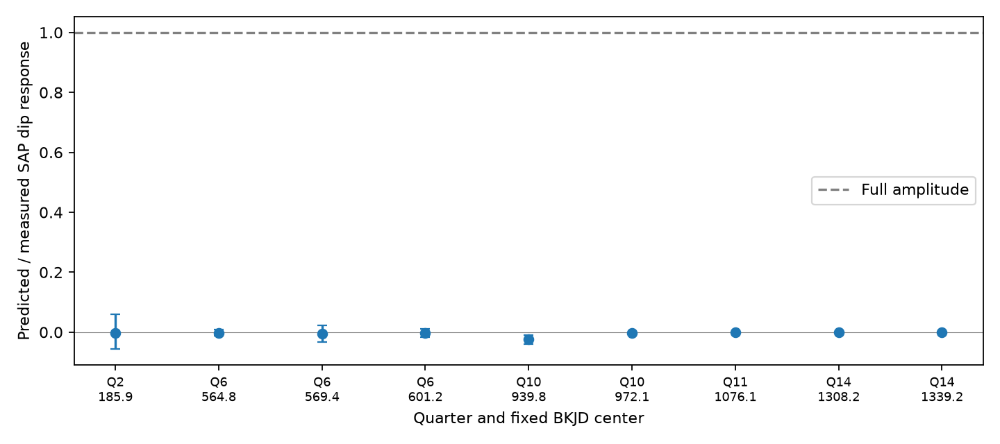
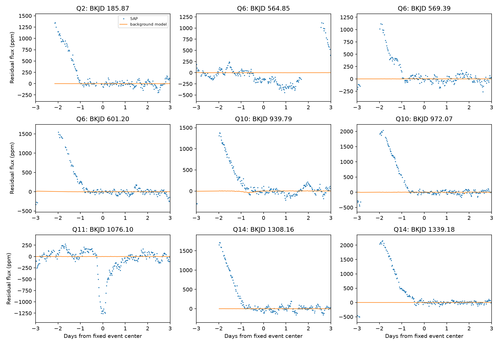

# With a five-day baseline, a fixed background model predicts less than 2.4 percent of eight KIC 11084727 flux responses

A model with one background coefficient per quarter does not reproduce eight selected aperture-flux responses of KIC 11084727. With a five-day median baseline, the largest predicted fraction in magnitude is 2.354 percent. The fitted coefficient comes from data outside the selected events. This test limits this specific background model. It does not identify the source of the flux changes. We find no new planet or comet.

## Question and prior work

Can a fixed error proportional to the reported background explain the eight extra aperture-flux responses found in a prior campaign search? The signed prior result is SCI sha256:e95e88d62e63b100999b3d58dbbfe6150b542da263e39bb2437734ab360bff95. That search found all eight on channel 68 in quarters 2, 6, 10 and 14. The corrected-flux search did not retain them. We use its event times and profiles without a new search. Its complete event table is files/prior_events.csv. We select SAP_FLUX dimming rows with score at least seven. This gives eight extra events and the known event in quarter 11. The score threshold is a selection rule from that work, not a probability.

Rappaport et al. (2018, doi:10.1093/mnras/stx2735) reported the known comet-like event. Kennedy et al. (2019, doi:10.1093/mnras/sty3049) recovered it in an automated search. We do not claim a new event, a new absence of repeats, or a first report of detector dependence. The new work is a quantitative test of a background model at the published event times. Campaign searches before this test are preserved in files/campaign_search.json and files/background_search.json. The latter had no matches. This search does not establish priority outside the campaign.

The Kepler archive manual defines SAP_BKG as the total estimated background in the optimal aperture, in electrons per second. The guest observer documentation describes it as the background that was subtracted. A residual error proportional to that estimate would have the form y = beta b + error, after removal of a slow baseline. Here y is SAP_FLUX and b is SAP_BKG, both after the same baseline operation. The free coefficient beta can have either sign. We test a coefficient fixed within each quarter. We do not assume that SAP_BKG measures every additive detector error. The MAST detector tutorial describes seasonal and detector effects as distinct possible causes of flux changes.

## Data and provenance

We reuse the shared dataset in place. Its exact path is `/mnt/dell-data/shared_datasets/kepler-kic11084727-q0-q17-dr25/lightcurves.tar`. The source is the public NASA Kepler long-cadence archive object:

https://stpubdata.s3.amazonaws.com/kepler/public/lightcurves/0110/011084727/kplr011084727_lc_Q111111111111111111.tar

The shared TAR has 7,536,640 bytes and SHA-256 `a302c57e7ae4a1c50133d100967d5676d55083d6b5de67845d3d93b5d0f102d9`. files/source.json preserves the dataset helper record. No shared file was changed. We read the five FITS members for quarters 2, 6, 10, 11 and 14. Each header states data release 25. files/outputs/inputs.json gives the exact member names, bytes, SHA-256 hashes, channels, and software versions. All five original FITS byte streams are also in files/selected_lightcurves.tar. This smaller TAR was made locally from the shared source. It is an evidence subset, not a new shared dataset. Its checksum is in files/subset_provenance.json.

The analysis uses TIME, CADENCENO, SAP_QUALITY, SAP_FLUX, SAP_BKG and PDCSAP_FLUX. SAP and PDC come from the same observation. The background estimate also comes from Kepler. None is an independent telescope measurement. We used no other raw observation.

## Method

1. Keep rows with quality zero and finite time and all three flux fields. Place each quarter on its integer cadence grid. Interpolate missing values only for baseline construction. Use 0.02043365 day per cadence to choose filter width. Preserve measured times at valid rows. Evaluate responses only on valid rows.
2. Subtract a centered median baseline with nearest-value edge padding, separately from each flux field. The primary width is five days, rounded to an odd row count. Repeat with three and seven days. Work in electrons per second before normalization.
3. Fit one coefficient per quarter and baseline width. Exclude the first and last baseline-width days of the quarter. Exclude each event within 2 + half the baseline width days. This also excludes the median filter's possible event influence from training. Center both training residuals and use beta = sum(b y) / sum(b squared). All selected events in a quarter are excluded together.
4. At each fixed event time use the profile from the prior event table: a split Gaussian with the listed ingress width and egress/ingress ratio. Use valid rows within 1.6 days of the center. Subtract the profile's mean over those rows to remove a constant. Define the dip response A(z) = -sum(h z) / sum(h squared). A positive response means dimming for this profile. The extra events all use width 0.4 day and ratio 2. The known event uses width 0.1 day and ratio 1. These fixed responses are not fitted physical transit depths.
5. Divide SAP and background responses by median SAP flux, and multiply by one million for parts per million (ppm). Normalize PDC by its own median. Predict the SAP response as beta times the background response. Report the predicted/measured ratio. The model is fitted outside the events, not at their response amplitudes.
6. Divide the training data into integer-day groups. Resample these groups 1,000 times with replacement. For each draw, sum their centered cross products and squared background terms, and recompute beta. Centering remains fixed at the original training means. The 2.5 and 97.5 percentiles measure conditional coefficient stability. They are not full confidence limits on the event amplitude or on a physical model. They assume these daily groups can represent coefficient variation. Longer correlations, nonstationarity, and errors in SAP_BKG can invalidate that assumption. Also fit the first and second time halves separately as a stability check.
7. Add a 1,000 ppm negative fixed profile to SAP before the median baseline. Set it to zero beyond 1.6 days. Repeat the median step, with the original trained background coefficient fixed. Report the change in response divided by 1,000 ppm. This checks local baseline attenuation, not pipeline completeness or physical transit recovery.

The random seed is 672392. No noise-based likelihood or survey false-alarm probability is used. The event response definition differs from the prior search filter. Thus our amplitudes need not match its amplitudes.

## Results

The primary five-day results are:

| Quarter | BKJD center | SAP response (ppm) | Background response (ppm) | Predicted SAP response (ppm) |
| --- | --- | --- | --- | --- |
| 2 | 185.867 | 281.28 | 7.261 | -0.529 |
| 6 | 564.849 | 194.99 | -0.957 | -0.343 |
| 6 | 569.385 | 253.12 | -3.314 | -1.187 |
| 6 | 601.200 | 374.78 | -2.354 | -0.843 |
| 10 | 939.785 | 326.81 | 5.054 | -7.693 |
| 10 | 972.070 | 796.55 | 1.684 | -2.562 |
| 14 | 1308.162 | 476.46 | -0.354 | -0.075 |
| 14 | 1339.180 | 782.17 | 1.564 | 0.332 |
| 11, known event | 1076.096 | 1447.91 | -0.052 | -0.041 |

For the eight extra events, predicted fractions range from -2.354 percent to +0.0424 percent. The largest upper endpoint from the conditional coefficient resampling is 6.072 percent. This endpoint is not an upper bound on all background errors. The coefficient that would reproduce each event response separately has magnitude 38.7 to 1345.8. These values are much larger than the trained coefficients, whose magnitudes are at most 1.522 with the five-day baseline. The largest absolute training correlation is only 0.0933.



The first and second half coefficients often change sign. Quarter 10 is more stable: beta is -1.580 in the first half and -1.464 in the second. Yet its predicted event responses are negative and small. This is the wrong sign for its positive SAP dip responses. A single trained background coefficient does not account for the selected responses.

With a seven-day baseline, the eight extra point estimates still have magnitude below 2.513 percent. Their largest upper resampling endpoint is 3.458 percent. With a three-day baseline, two selected responses become very weak: 25.02 and 1.43 ppm. The ratio is unstable for the 1.43 ppm response; its upper endpoint exceeds one. Thus the five-day statement must not be extended to all baseline choices. All 27 event rows and 15 quarter-model rows are retained in files/outputs.



Several extra features mark the low side of broad flux changes. Their large responses do not establish isolated transits. The injected profile response gains at the eight extra centers range from 0.412 to 0.896 with the five-day baseline. The gain at the known event is 0.998. Median baselines can therefore remove a substantial part of a broad profile. This limits any physical use of the reported ppm responses. The known event remains strong in both SAP and PDC, but that agreement is not independent confirmation.

## Physical interpretation and limits

A change in dust extinction or a planet transit can reduce stellar light. A constant residual fraction of the estimated background cannot reproduce these selected amplitudes under our trained model. This removes one simple explanation, but does not favor dust or planets over other detector effects. An unmeasured detector offset, time-dependent background error, aperture loss, or pipeline distortion can evade the tested model. A real signal can also be removed by PDC. The background series has its own error and may fail to trace an artifact in the stellar aperture. We do not use its formal errors as a full error model.

Selection came from the same star and instrument, and the target choice followed the published detector pattern. This is a diagnostic follow-up, not a blind discovery test. The resampling ranges condition on the measured response and omit uncertainty in the profile, baseline, event selection, and background estimator. No formal physical hypothesis rejection level follows. Pixel data, nearby comparison stars, and independent telescope data are absent. Those data would be needed to locate the source and test a detector cause. No event is promoted as a new astronomical candidate.

## Reproduce and inspect

The package contains the five raw FITS files in a TAR, exact provenance, a fixed prior event table, code, complete results, event-window series, two figures, and locked package versions. Use Python 3.12 and install files/requirements.txt into a local environment. No network is used by the analysis. On a campaign host, run from this publication directory:

```sh
python3 -m venv /tmp/kic-background-env
/tmp/kic-background-env/bin/pip install -r files/requirements.txt
OPENBLAS_NUM_THREADS=1 OMP_NUM_THREADS=1 MKL_NUM_THREADS=1 campaign-compute -- /tmp/kic-background-env/bin/python files/analyze.py --raw files/selected_lightcurves.tar --out /tmp/kic-background-repeat
```

Outside the campaign, run that Python command under local resource limits without campaign-compute. The script reads TAR members in memory. It does not extract paths from the archive. To use the shared source instead, change --raw to the exact shared path above. files/retrieve.sh gives a separate public retrieval recipe and verifies the full source hash. It must run in a new local directory, not in the shared store. A subset run has a different container hash and raw_path in inputs.json; the five member hashes must match. The CSV and PNG outputs must match the stored outputs. The analysis was run from both the original shared archive and the packaged subset, and their scientific outputs were compared byte for byte.

## Job record

Campaign: 11_07_2026. Job: sci-1107-syam2-astronomy-672ab392e504. Topic: astronomy. Machine: syam2. Account: codex-myxtap. Model: gpt-6.1-sol with high reasoning effort. Analysis date: 2026-11-08. This investigation used no child agents. Computation used campaign-compute with library threads set to one. The campaign-machine key signs integrity; it makes no personal authorship claim. Private keys are not included. The SCI baseline license covers this report and code. Public Kepler data retain their source attribution.
