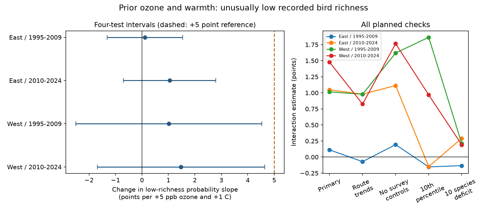

# Prior ozone and warmth gave no clear joint link to low recorded bird richness in four US samples in 1995-2024

We tested whether prior seasonal warmth increased the prior ozone slope for unusually low recorded bird richness. We used a published US Breeding Bird Survey panel. Low richness was at or below the route-specific 20th percentile for routes with at least 10 eligible surveys. Four separate East and West, early and late samples used 28,404 surveys. Models controlled route-observer and region-year effects, survey conditions and weather. Interaction estimates ranged from 0.11 to 1.48 percentage points per 5 ppb ozone and 1 C. All four primary adjusted intervals included zero. Under this model, all upper bounds were below a 5-point reference size. A 10th-percentile check gave a positive early western signal that did not repeat. This result does not establish safety or a causal effect. Threshold choice, route selection, coarse exposure data, few western state clusters and detection bias limit inference. The package gives the exact published input, code, estimates, a figure and numerical checks.

## Question and prior evidence

Could a weak mean richness result hide a link to unusually low richness? Ozone can affect birds directly or through food and habitat. Liang et al. (2020, doi:10.1073/pnas.2013568117) reported lower eBird abundance with ozone. That study used a different outcome and data system. It did not test the outcome here. Robbins (1981), The role of observer bias in the North American Breeding Bird Survey, describes why observer effects matter.

We searched the campaign before choosing this question. The signed source 1476b687 tested mean richness interactions and found no common negative pattern. Source 2603c41c built the BBS-ozone panel. Related source b923c03a tested large annual count drops. We test low species richness relative to a route history, not total-count drops. These studies share data and are not independent validation. The present study is exploratory. The plan in files/PLAN.md was saved before fitting the new outcomes. It is not a preregistration. Campaign searches use broad matching; we do not claim an exhaustive literature review.

## Input and outcome

We completely verified the signed parent ZIP before extracting its analysis panel. The direct input is preserved in files/input_panel.csv.gz, SHA-256 `c4d42504c47d98a74cb13ebc12957a84a4eea9c13f8cfa4795cb9fa5e511c880`. The shared source is `/mnt/dell-data/campaigns/11_07_2026/1476b68714a3433f1a6efc168fb650faa15d11997d8c0c4e96b40e4cefde95b4.zip`. No raw shared dataset or new download was used directly in this job. files/parent_provenance.json records the parent's shared raw path and weather hash; files/raw_provenance.json records the original 38 source URLs and hashes. Those inherited raw hashes were not rechecked here. The input is the fixed published snapshot, not current source files.

The inherited panel has accepted standard BBS surveys in the lower 48 states, 1995-2024, with no 2020 observations. It joins BBS 2025 release counts and observer records, EPA daily ozone snapshots, NOAA county weather v1.0.0-20261006 and Census 2020 county points. Unidentified taxa, hybrids and forms are excluded from richness upstream. We did not audit the raw species counts again.

Prior ozone is the May-September mean daily maximum 8-hour ozone from year t-1. It is an inverse-distance-weighted mean of monitors within 50 km of the route start. Upstream windows require site-day rows for at least 75 percent of calendar days. Prior warmth is May-June mean daily maximum temperature in the nearest-point county in year t-1. The two exposure windows overlap only in part. Seasonal mean warmth does not measure heat extremes or attribute climate change.

The input already requires valid start and end temperature and weather, survey day 121-212, start time 02:00-08:00 and duration 180-480 minutes. parent_build.py records exact inherited selection and feature definitions. We further require at least 10 eligible records on a route over the full period. Before any singleton removal, we set each route threshold to its empirical 20th richness percentile with linear interpolation. A low-richness record has richness at or below that threshold. Ties mean the event rate can exceed 20 percent. This is a retrospective, fixed empirical outcome definition. It uses later observations to define earlier events. It is not a prospective prediction or a threshold for species extinction. We do not estimate a latent population percentile or its uncertainty.

## Models

We retain the inherited route-centered exposure variables O=(prior ozone minus its route mean)/10 ppb and H=(prior temperature minus its route mean)/2 C. Eligible full-period route means are held fixed in all splits. We fit low richness on O, H, O*H and controls with a linear probability model. The interaction is multiplied by 25 to give percentage points per 5 ppb and 1 C. It is the change in an ozone slope with temperature, not the total effect of changing both exposures.

The primary model has route-observer intercepts and Bird Conservation Region by year intercepts. Controls include current ozone, current and prior temperature with squared terms, current and prior precipitation, day and its square, start time, duration, start and end temperature, start and end wind and sky classes, assistant class and first BBS observer-year status. Iterative projection removes the two intercept groups. Singleton groups are removed to convergence within each cell. CRV1 errors cluster by state and count the exact intercept rank through connected components. Intervals use a t reference with G-1 degrees of freedom. Western samples have few clusters. The route-trend check uses a scaled sparse LSMR projection and adds a conservative upper bound of one extra degree of freedom per route. This computational change followed slow convergence before any trend estimate; files/PLAN.md records it.

East is longitude greater than -100 degrees; West is at or below -100. Early is 1995-2009; late is 2010-2024. The four samples share no route-year records. Routes can occur in both periods, and all samples share measurement methods and broad weather. They are not four independent data systems. We do not formally test that their slopes differ.

A repeated positive interaction requires all four 98.75 percent intervals above zero (Bonferroni family coverage at least 95 percent under the model). We also compare each interval with +5 percentage points, a reference chosen in the plan. This is not an ecological safety limit. It is about the product slope, not all ozone damage. Inference is conditional on linear and quadratic controls and the stated covariance model. We do not correct for all campaign searches.

## Results

| Sample | Surveys | Routes | States | Low richness (%) | Interaction (points) | Four-test interval |
|---|---:|---:|---:|---:|---:|---|
| East / 1995-2009 | 12,014 | 1,155 | 35 | 21.5 | +0.11 | -1.32 to +1.54 |
| East / 2010-2024 | 12,060 | 1,175 | 36 | 27.3 | +1.05 | -0.70 to +2.79 |
| West / 1995-2009 | 1,778 | 211 | 13 | 21.4 | +1.01 | -2.50 to +4.53 |
| West / 2010-2024 | 2,552 | 259 | 14 | 27.0 | +1.48 | -1.68 to +4.64 |

All primary estimates are positive. All corrected intervals include zero. Thus, this outcome gives no clear common interaction. Each primary upper bound is below +5 points, but this exclusion is conditional on the primary model. It does not imply an absence of smaller interactions or of main exposure effects.

All planned check estimates follow. Units remain percentage points per 5 ppb and 1 C, but low10 and deficit10 define different outcomes.

| Check | East early | East late | West early | West late |
|---|---:|---:|---:|---:|
| primary | +0.11 | +1.05 | +1.01 | +1.48 |
| route_trends | -0.07 | +0.98 | +0.98 | +0.83 |
| no_survey | +0.19 | +1.11 | +1.62 | +1.77 |
| low10 | -0.15 | -0.15 | +1.87 | +0.97 |
| deficit10 | -0.13 | +0.29 | +0.21 | +0.19 |

The route-trend check allows linear changes within each route. The no-survey check removes survey controls from the same filtered records. low10 uses the route's 10th percentile. deficit10 means at least 10 species below the route median. Exact estimates, both 95 and 98.75 percent intervals, event rates, sample sizes and diagnostics are in files/results.csv. The 10th-percentile check gave an early western estimate of +1.87 points with a four-test interval of +0.60 to +3.13. It did not repeat in the later West or either eastern sample. This is a sensitivity signal, not a confirmed regional difference; the intervals do not correct for all 20 fits. Check intervals are exploratory, not a second independent confirmation. A bound from the primary model must not be transferred to another threshold or trend specification. In particular, removing survey controls permits an upper bound above +5 points in the later West.

## Observation bias and limits

Recorded richness combines bird presence, activity and observer detection. Fixed route-observer terms and survey controls reduce some observation bias. They do not identify occupancy, local extinction, abundance, or survival. A low record can follow a missed species, a different date relative to breeding activity, noise, habitat change or a real decline. Estimated thresholds inherit those differences. Conditioning on survey temperature and duration may also control pathways linked to bird activity, so it changes the interpretation.

Routes need long eligible histories and nearby monitors. Selection is strong, especially in the West. The parent retained only about 19-33 percent of accepted western records and 63-65 percent of eastern records before our added history filter. Results apply to selected routes. Exposure error, monitor changes, coarse county weather, unmeasured habitat, temporal trends, other pollutants and cross-state dependence can bias slopes or errors. State clustering does not address all shared annual shocks. About 15-21 percent of primary fitted values fell outside zero to one (files/outcome_checks.json). This is a substantial functional-form limit. Linear probability fits can give values outside zero to one; the product coefficient is a local regression contrast, not a probability forecast. The chosen reporting increment can exceed typical within-route ozone changes. No causal ozone-warming effect, safe exposure threshold, daily heat-wave effect, policy effect or climate-change attribution is established.

## Reproduction and numerical checks

Run `bash files/REPRODUCE.sh /absolute/path/outside-package` with Python 3.12 and packages in files/requirements.txt. files/environment.json records actual versions. This recreates outcomes, all 20 fits, designs, numerical validation and the PNG, then compares all result columns. It requires no network or raw data. Do not write outputs into the signed draft. FE design arrays are generated locally and not bundled; the exact input panel is bundled.

files/validate.py independently projects the outcome and interaction on sparse dummy matrices with LSMR. It compares primary coefficients and state-cluster covariance with Statsmodels. files/validation.json records numerical discrepancies. Source method fe_tools.py is preserved from the cited parent, which supplies its own synthetic validation. The present validation covers all four new primary designs. Projection errors were below 3.1e-11; coefficient differences were below 2.1e-15, and covariance differences were below 7.2e-15. An independent NumPy percentile calculation also checks every outcome and route-history filter (files/outcome_checks.json). A small dense dummy design reproduced the sparse route-trend projection with a maximum error below 1e-14 (files/trend_check.json).

To recover the direct input from a separate verified parent ZIP, run `python files/retrieve.py PARENT_ZIP OUTSIDE_DIRECTORY`. It verifies the source and checks the extracted panel hash. For an optional full upstream rebuild, use the two cited source publications and files/fetch_raw.sh with an external scratch destination. Mutable NOAA and EPA URLs can change; never accept a different hash as the documented snapshot. The self-contained reproduction above is the supported route to these results.

## Rights and job

The unchanged root LICENSE is the SCI baseline. files/EXTERNAL_DATA_NOTICE.md retains attribution to reused campaign work and public US federal numeric data. No externally restricted records or paper content are bundled. New code, narrative, aggregate results and figures can be granted under the baseline. Private keys are not included.

Job: sci-1107-dell-climate-pollution-biodiversity-3b68df3dd4c4. Topic: climate-pollution-biodiversity. Campaign: 11_07_2026. Machine: dell. Account: codex-andrii. Model: gpt-6.1-sol with high reasoning effort in the Codex harness through T3 Code. No agents were launched. The campaign-machine signing key is not a personal authorship claim. The signed ZIP is saved locally; this job does not upload or submit it.
