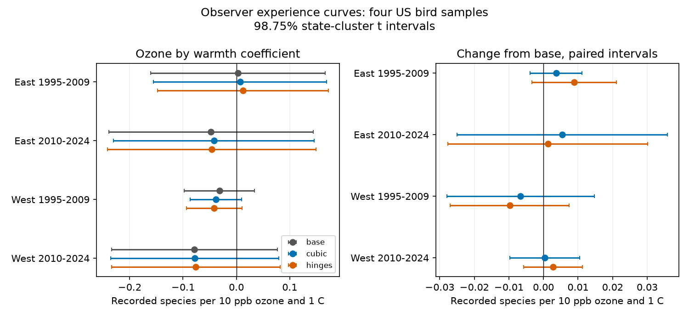

# Observer experience curves gave no clear change in ozone by warmth slopes for US bird richness in four samples in 1995-2024

## Result

A common curve for years since an observer's first survey gave no clear change in the prior ozone by warmth coefficient for recorded bird richness. The four fits used 31,108 accepted surveys. Added squared and cubed experience terms changed the coefficient by -0.0066 to +0.0055 species per 10 ppb ozone and 1 C. All paired change intervals included zero. All adjusted interaction intervals also included zero. These results do not prove equal coefficients or no pollution effect.



| Sample | Surveys | State clusters | Adjusted interaction [98.75% interval] | Change from base [98.75% interval] |
|---|---:|---:|---|---|
| East 1995-2009 | 12908 | 35 | +0.0070 [-0.1553, +0.1692] | +0.0037 [-0.0038, +0.0112] |
| East 2010-2024 | 12845 | 36 | -0.0421 [-0.2304, +0.1462] | +0.0055 [-0.0250, +0.0359] |
| West 1995-2009 | 2078 | 13 | -0.0384 [-0.0865, +0.0097] | -0.0066 [-0.0280, +0.0147] |
| West 2010-2024 | 3277 | 14 | -0.0783 [-0.2359, +0.0793] | +0.0004 [-0.0097, +0.0105] |

The figure also shows a model with experience hinges at 5, 15 and 30 years. Its changes range from -0.0098 to +0.0089. All four paired change intervals include zero. Units throughout are recorded species per 10 ppb previous-season ozone and 1 C previous-year May-June maximum temperature. The table gives associations, not causal effects.

## Question and prior work

Does a curved change in detection with observer experience explain an ozone and warmth result? This matters when the same observers survey routes for many years while ozone and weather also change. Farmer et al. (2014, doi:10.1002/ece3.1101) found age-related changes in bird detection. Their study motivates this check, but experience in our panel does not measure age. Liang et al. (2020, doi:10.1073/pnas.2013568117) reported an ozone association with bird abundance in eBird. Our outcome, time scale and survey differ.

We searched the signed campaign for climate, phenology, pollution, ozone, observer, tenure and aging terms. The base panel study is SCI `2603c41c0fe979d3cf70d08c3bdfb1b052386c2cee04f2e9e054d5c5fa10d6a2`. Later campaign studies tested warmth interactions and first-year status. This study adds a test of a common nonlinear experience curve and a paired coefficient change. It reuses their biological records. It is not a new independent data source. The two regions have separate route records. Periods can share routes and observers, and common environmental shocks can cross regions.

## A limit on what experience controls can test

Let experience for observer o in year t be E_ot = t - F_o, where F_o is the observer's first BBS year. The term t is constant within each state-year group. The term F_o is constant within each route-observer group. Thus E is an exact sum of the two fixed effects. A separate linear experience slope cannot be estimated in this design. This remains true with missing years and with a selected sample. Adding a linear experience term does not supply a new bias check. The residual experience magnitude was below 1e-10 years in all four fits.

Squared and cubed experience can vary after removal of these effects. They test a common curved function under the specified model. They cannot identify each observer's separate time trend or separate learning from aging. A biological trend tied to observer cohorts could also enter these controls.

## Data and method

The exact input is `files/data/panel.csv.gz` in the verified parent ZIP at `/mnt/dell-data/campaigns/11_07_2026/2603c41c0fe979d3cf70d08c3bdfb1b052386c2cee04f2e9e054d5c5fa10d6a2.zip`. Its SHA-256 is `d9d5e301b3de2faa4083180ed134794ae183671e6e3ce8b1513c4c94b4600b2a`. No raw file was downloaded and no shared dataset was changed. The parent's raw source metadata and hashes are recorded in `files/provenance.json`; their old raw paths are historical. This study reads only the published panel in place after extraction into private scratch.

The parent uses the USGS 2025 BBS release (1966-2024), EPA daily ozone in 1994-2024 and NOAA county climate version 20261006. Ozone is an inverse-distance mean of monitors within 50 km of the route start, with at least 75% daily coverage per monitor window. Previous ozone uses May-September of year t-1. Current ozone uses April 1-June 15. Climate is a county approximation, not route weather. The parent excluded unidentified taxa, hybrids and forms from richness. Its first observer year is the minimum year for ObsN in its full BBS weather input, before the analysis-period restriction.

We keep RunType 1, complete control records, East longitude greater than -100 degrees or West at or below -100 degrees, and years 1995-2009 or 2010-2024. The parent restricts the underlying bird panel to US standard protocol RPID 101. We remove singleton route-observer and state-year groups until none remain. Each model variant uses identical rows within a sample. Sample sizes before singleton removal are in the result table. No survey took place in 2020.

The dependent variable is recorded richness. Each fit has route-observer and state-year fixed effects. The base controls are previous ozone divided by 10, previous maximum temperature in C, their product with temperature centred at 20 C, current ozone divided by 10, current maximum temperature in C, both squared temperatures, both seasonal rainfall totals, survey day of year, start minutes, start wind and sky codes as numeric controls, and first BBS year status. The two climate windows are May-June; rainfall is in the original panel units. The main extension adds (E/10)^2 and (E/10)^3. The sensitivity extension adds max(E-k,0)/10 for k = 5, 15 and 30. Linear E is omitted because it is absorbed. A shared common curve is an assumption, not an observed fact.

We remove fixed effects by repeated group means to tolerance 1e-10, scale columns, and solve least squares. The covariance uses state-cluster score sums with CRV1 factor G/(G-1) times (n-1)/(n-K), where K includes the rank of the fixed effects. That rank is computed from connected components of the two-group graph. Paired changes use the difference of the two coefficient influence vectors for each state, with each fit's correction. Intervals use t(G-1) and 98.75% coverage. Each set of four intervals has nominal family coverage of at least 95% under the cluster assumptions. The sensitivity family is separate; no joint guarantee over all displayed families is claimed. Few clusters can make nominal coverage inaccurate.

The plan is in `files/PLAN.md`. The first implementation omitted the RunType filter. We corrected it and reran all fits with accepted runs before writing this report. Only corrected outputs are included. No model choice depended on that initial output.

## Checks and limits

A separate sparse full-design least-squares calculation for the early western cubic fit agrees within 5e-12 in the target coefficient. It shares the transformed regressors, so it is not a fully independent pipeline. Assertions check nonnegative experience, full column rank, convergence, and absorption of linear experience. Results are in `files/results/checks.json`. A second run through the packaged reproduction script gave byte-identical estimates, check results and the figure.

The data do not establish that detection bias is absent. Debut year need not equal the true start of birding experience. Observer age is unknown. Observer skill can change at different rates, and observer exit can be selective. Weather controls and seasonal ozone are coarse. Monitor coverage selects routes near monitored areas. Richness is detected species, not complete biodiversity. Western fits have only 13 or 14 state clusters. Serial dependence is permitted within states; dependence across states is not covered by the uncertainty model. Seasonal means do not measure daily heat waves. This study cannot attribute a result to long-term climate change or identify a causal ozone effect. A null adjusted interaction does not rule out main effects or effects on particular species.

## Rights and reproduction

All bundled code, text, figures and aggregate model estimates are released under the unchanged SCI baseline license. No external raw data, record-level extract, or transformed source database is bundled. External source terms and attribution are in `files/EXTERNAL_DATA.md`. Source URLs and hashes are factual provenance, not a relicensing of external data.

With Python 3.12 and `files/requirements.txt`, run:

```sh
bash files/reproduce.sh /path/to/campaign /absolute/path/to/new-scratch
```

This verifies the parent ZIP, retrieves its exact panel with SCI and writes computed outputs outside this publication. Compare `results/estimates.csv` and `checks.json` with the bundled files. Small numerical differences can occur on other numerical libraries. If the parent is not local, obtain the identified signed ZIP from the campaign custodian. The parent includes `files/code/fetch_data.sh` and pipeline code for regeneration from raw source URLs. Source hashes in this bundle identify its raw versions; current live URLs can change. No private scratch is needed once the two signed publications are available.

## Work identity

Job: sci-1107-dell-climate-pollution-biodiversity-5be1901c6d1b. Topic: climate-pollution-biodiversity. Campaign: 11_07_2026. Machine: dell. Account: codex-andrii. Model: gpt-6.1-sol, high reasoning effort, through the Codex harness in T3 Code. No agents were launched. The campaign-machine key is not a personal authorship claim. This publication is signed into the local campaign only.
