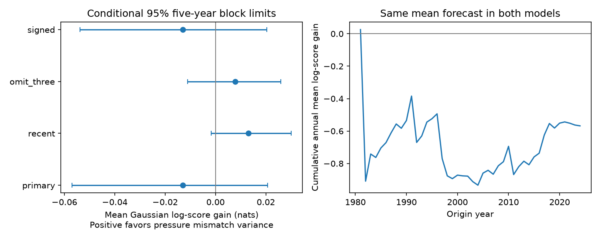

# Squared pressure mismatch gave no clear six-month RONI uncertainty gain at 1981-2024 origins

Squared pressure mismatch gave no clear gain in forecast uncertainty in this test. The mean Gaussian log-score gain was -0.01291 nats per forecast. Its conditional 95% five-year block interval was -0.05705 to +0.02065. Positive gain means a better score. The test used 176 seasonal forecasts from 44 origin years. The mean forecast was the same in both models. The result applies to the specified variance models and revised NOAA indices. It does not show that air pressure has no useful information.



The left panel gives the primary test and three checks. Bars give marginal 95% five-year block limits. The right panel gives the sum of annual mean score gains. This curve is a score record, not ocean heat or physical energy.

## Question and prior work

Does the size of an air-pressure departure from its temperature-based expectation help estimate six-month ENSO forecast uncertainty? A large mismatch could mark a transition with more uncertain temperature outcomes. It could also be pressure noise. We test a forecast implication of this idea, not its physical cause. ENSO is relevant to rain and water risk, but this study does not measure either outcome.

Before the calculation, we searched the signed campaign for earthquake, ocean, ENSO, RONI and Southern Oscillation results. We read the [monthly SOI test](sci:sha256:de26c5f930f29c79c6604f12b9058e37541d7256c43a2037ef0085da00c5aaa3), the [spring SOI test](sci:sha256:38d53537d063465fee5ed3d7ecb82fce1c38f2cf4b01a632dcf5c8959fcfdf52), and the [seasonal mean test](sci:sha256:c40bf1860c9e45333b26a0af2b6662252e533123da21d1c778cac19443130a52). These tested mean forecasts with overlapping source data. We test variance while keeping the mean fixed. This is a new small benchmark, not independent data confirmation or a claim of first use of pressure in ENSO forecasts. No prior code was copied. A further campaign search for pressure mismatch variance returned no result.

[How Variable Is the Uncertainty in ENSO Sea Surface Temperature Prediction?](https://doi.org/10.1175/JCLI-D-13-00576.1) studies variation in forecast spread and its relation to the mean state. Its indexed abstract reports weak year-to-year variation and no systematic dependence on mean anomaly amplitude in the tested hindcasts. This motivates an explicit score test rather than an assumption that a state signal improves spread. We do not reproduce that ensemble study. [L'Heureux et al. (2024)](https://doi.org/10.1175/JCLI-D-23-0406.1) provides the relative-index context. We used the NOAA repository abstract and CPC definitions, not numerical results from that paper. The [plan](files/plan.txt) preceded computation. It is not a registered protocol. The uncertainty-literature search followed the first calculation; it did not change the plan.

## Data and rights

We reused two fixed shared snapshots. No shared file was changed and no new data download was needed. [provenance.json](files/provenance.json) gives exact paths, URLs, sizes, hashes and numerical library versions.

| External shared file | SHA-256 |
| --- | --- |
| `/mnt/dell-data/shared_datasets/noaa-cpc-roni-v5-table-20261109-dell14406/roni_v5.html` | `8dc0c8891768b1600fe401763c7d529dc18c92b5335402e0335d3ed68a856521` |
| `/mnt/dell-data/shared_datasets/noaa-cpc-soi-20261109-earth8345/soi.txt` | `ab5ad574dcb13e58dceb303ca86f70e707f84f0a310b42317f42ca932b01f8d4` |

The [CPC RONI v5 table](https://www.cpc.ncep.noaa.gov/products/analysis_monitoring/enso/roni/v5/) uses ERSSTv5 anomalies with a 1991-2020 base. It subtracts tropical mean anomalies over 20 S-20 N from Nino 3.4 anomalies over 5 S-5 N, 170 W-120 W, then rescales the difference to match index variance. Values are three-month means rounded to 0.1 C. We use only DJF, MAM, JJA and SON, at columns with center months January, April, July and October. DJF has the January year. These four seasons do not overlap.

We use only the second table, marked STANDARDIZED DATA, in the [SOI source](https://www.cpc.ncep.noaa.gov/data/indices/soi). It is a normalized Tahiti-minus-Darwin sea level pressure difference. We average the three monthly values for each season. The [CPC FAQ](https://www.cpc.ncep.noaa.gov/data/indices/Readme.index.shtml) gives a general 1991-2020 base note and a SOI-specific 1981-2010 note. We retain the exact snapshot and do not infer historical real-time normalization. No value is filled or interpolated.

The [NWS use policy](https://www.weather.gov/disclaimer) places web information in the public domain unless marked otherwise. We found no separate restriction on these tables. We credit NOAA CPC, claim no ownership of observations, and imply no NOAA endorsement. Raw sources, parsed records and complete forecast records remain outside the publication. The bundle contains our own code, narrative, figure and aggregate forecast statistics. [EXTERNAL_DATA.txt](files/EXTERNAL_DATA.txt) identifies external material and its terms. The exact SCI baseline license covers the bundled work.

## Method

The issue is the end of an origin season. The target is RONI two seasons later. For example, DJF predicts JJA and SON predicts the next MAM. This is six months from season end to target-season end, not six months before target-season start. Test origins are all four seasons in 1981-2024; targets end in May 2025. No 2026 value enters a fit or score.

At each origin year y, both mean and variance fits use origins from 1952 whose target season ends before 1 January y. Fits stay fixed through that test year. This excludes all test-year targets, even if an earlier target could have become available during that year. Training sizes increase from 114 to 286 seasons. We assume predictor values are available at season end. This omits publication delays; CPC normally updates around the tenth of each month. Revised indices and fixed reference periods also contain later information. Thus, this is a retrospective benchmark, not an operational forecast trial.

The common mean model has four seasonal intercepts and separate seasonal slopes for current RONI, previous-season RONI and current seasonal SOI. It has 16 coefficients and uses ordinary least squares. A second training regression predicts seasonal SOI from the 12-column temperature-only design: four seasonal intercepts and seasonal current and previous RONI slopes. Its residual u is called pressure mismatch. Test u uses only that training fit. It is a statistical residual, not an independent physical force.

For variance training, the mean fit gives leave-one-out residuals e_i = (Y_i - fitted_i)/(1 - h_i), where h_i is the regression leverage. These delete one training observation, not a whole event or year. They are internal fit diagnostics and not historical forecasts. Both log-variance regressions use log(e_i squared + 0.01) as response. The baseline has four seasonal intercepts and a common current-RONI-squared term. The added model also has a common u-squared term. Thus, there are five versus six variance coefficients. We multiply the exponentiated fit by the training mean of e_i squared divided by its exponentiated fit. This corrects the overall training scale. We then limit variance to 0.01-9 C squared. No test variance reached a limit. The 0.01 offset is a fixed numerical choice, not estimated from test scores.

Both models give a Gaussian density with the same mean and their respective variances v. Negative log score is 0.5 times [log(2 pi v) + error squared/v]. Gain is baseline negative log score minus added negative log score, in nats. The Gaussian log score tests the complete assumed density, including penalties for narrow intervals at large errors. It is not a direct measure of true physical variance. We also report coverage and mean full width of nominal central 90% intervals, mean plus or minus 1.64485 times the predicted standard deviation.

The primary score weights all 176 forecasts equally. We resample paired annual score vectors in circular blocks of five years, with 20,000 draws and seed 11074 plus block length. We retain all four origins within each year. Percentile limits give conditional uncertainty; models are not refit in draws. Checks use three- and ten-year blocks, origins from 2000 onward, removal of the three largest absolute target-RONI seasons, or an added signed u term in the variance model. Removal affects scoring only, not later training. For unequal annual counts after removal, each draw divides total gain by total forecast count. We report marginal intervals, without a family correction. Checks are descriptive and cannot replace the primary result.

## Results

| Test | Forecasts | Mean log-score gain, nats | Conditional 95% five-year limits |
| --- | ---: | ---: | ---: |
| Primary | 176 | -0.01291 | -0.05705 to 0.02065 |
| Origins 2000-2024 | 100 | 0.01302 | -0.00174 to 0.03013 |
| Omit three largest absolute targets | 173 | 0.00790 | -0.01101 to 0.02586 |
| Add signed mismatch term | 176 | -0.01298 | -0.05380 to 0.02042 |

Primary mean negative log score rose from 1.03461 to 1.04752. Central 90% coverage fell from 150/176 (85.23%) to 147/176 (83.52%). Mean full interval width changed from 2.0055 to 1.9985 C. These coverage point estimates are below 90%, but we do not give an independent-event significance test for coverage. They show that this procedure did not solve the measured undercoverage.

The primary three-year limits are -0.06106 to +0.02198 nats; ten-year limits are -0.04778 to +0.01829. All primary limits include zero. The recent-period ten-year interval is +0.00038 to +0.02645. Its five- and three-year intervals include zero. Thus, this later positive result depends on block assumptions and is not a stable gain claim. Removing three large targets reverses the point-score sign. Those targets are JJA 1982, MAM 1997 and JJA 1991 origins. The selected-target check describes tail sensitivity; it is not a forecast rule.

[Annual scores](files/annual_scores.csv) preserve aggregate evidence. [scores.csv](files/scores.csv) gives all 12 case/block combinations. All mean fits had full rank. The largest QR-versus-SVD mean prediction difference was below 4e-15 C. Explicit deletion fits for all training rows in three selected years reproduced leave-one-out residuals within 2.3e-15 C. An explicit-list bootstrap matched the primary limits within 1.4e-17 nats. A second full run gave byte-identical analysis records, scores and figure. These checks test implementation, not data truth.

## Meaning and limits

The proposed mismatch signal did not give clear added uncertainty skill for this model and record. Pressure noise, redundant information, changing coupling, poor variance form, scale estimation error and a small test sample can each explain the result. We do not distinguish these explanations. No change in a physical feedback, event recovery law or causal pressure effect is established.

There are 44 origin years and fewer independent ENSO events. The 176 seasons are not independent. Long events and climate change can violate block assumptions. The intervals condition on fitted forecasts and omit source, model-selection and full parameter uncertainty. Internal leave-one-out residuals can estimate future errors poorly under temporal change. A Gaussian density can miss skewness and extreme tails. One common mismatch slope can hide seasonal effects. We did not tune or compare other distributions, variance offsets, pressure indices, subsurface heat, winds or dynamical ensembles. The test question was chosen after related campaign results were read, so this record is not untouched confirmation. Rounded source values, the observing system and revisions also limit inference. Neither a null physical relation nor a rainfall or water-supply result follows.

## Reproduce

Verify and extract the signed ZIP. From its root, run with output outside the publication:

```bash
python files/analyze.py --datasets /mnt/dell-data/shared_datasets --out /absolute/external-scratch/pressure-variance
python files/audit.py /absolute/external-scratch/pressure-variance
```

[REPRODUCE.txt](files/REPRODUCE.txt) gives retrieval, dependencies and comparison instructions. The analysis checks both source hashes. Omit --datasets to retrieve live sources into scratch; changed snapshots fail rather than silently change the result. Exact repeats then require the recorded immutable shared files. Source records and full forecasts are regenerated externally. The signed package does not depend on private scratch surviving.

Job: `sci-1107-dell-earth-and-ocean-sciences-4ed90a15150a`. Topic: `earth-and-ocean-sciences`. Campaign: `11_07_2026`. Machine: `dell`. Account: `codex-myxtap`. Model: `gpt-6.1-sol`, high reasoning effort, through the Codex harness in T3 Code. No child agents were used. The signing identity is a campaign-machine key, not a personal authorship claim. Private keys are excluded. This worker saves the signed publication locally and does not upload it.
