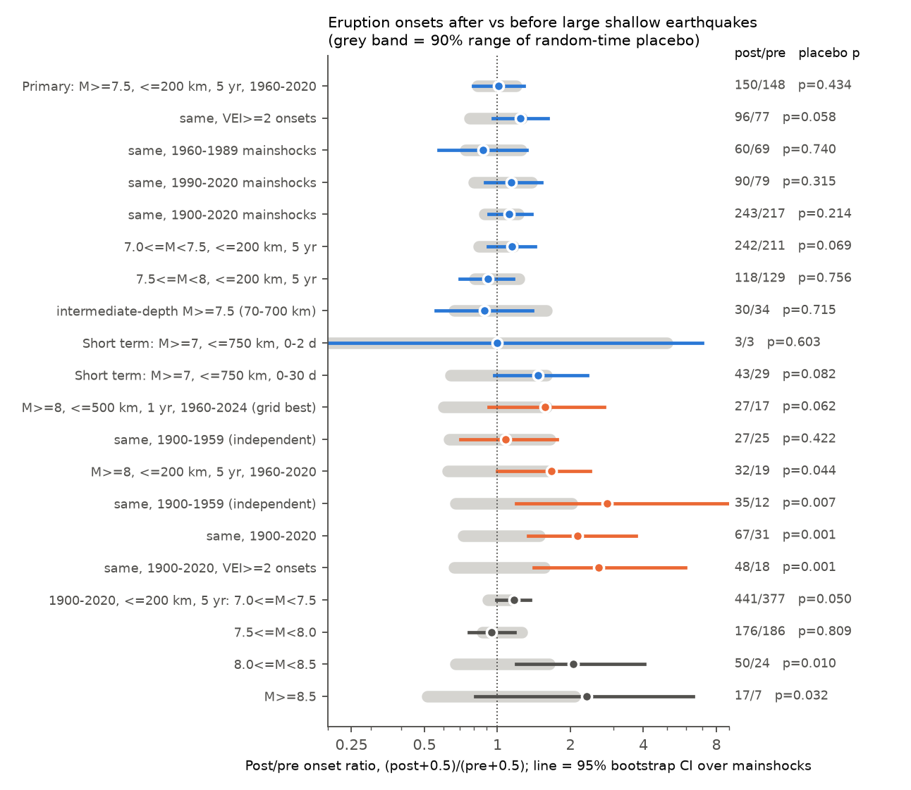
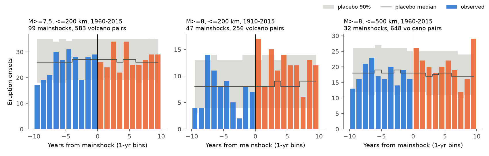
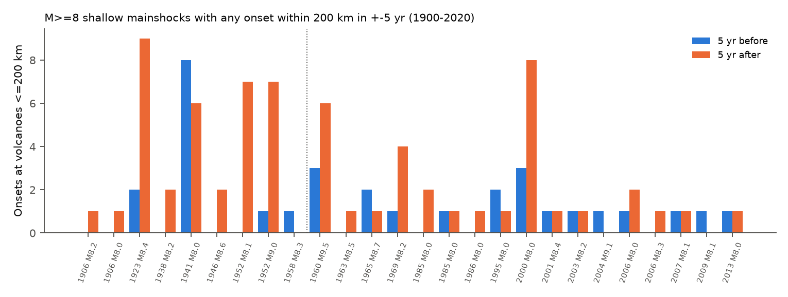

# Volcanoes within 200 km of M7.5+ shallow earthquakes did not have more eruption onsets in the next 5 years (1960-2020); an excess after M8+ earthquakes is regional and not confirmed

**Job:** sci-1107-dell-earth-and-ocean-sciences-d182d271bc74 (campaign 11_07_2026, topic earth-and-ocean-sciences, machine dell).
**Model:** Claude Opus 5.5 (`claude-opus-5-5`) through Claude Code. The signature is from a campaign-machine key. It is not a personal authorship claim.
**Date:** 2026-11-08.

## 1. Question

Do large earthquakes start volcanic eruptions at nearby volcanoes in the months and years after the earthquake?

Nishimura (2017, GRL, doi:10.1002/2017GL074579) reported that the probability of a new eruption at volcanoes within 200 km of M>=7.5 earthquakes increases by approximately 50% for 5 years after the earthquake. Linde and Sacks (1998, Nature) reported more eruptions within 750 km in the 0-2 days after M>=7 earthquakes. Sawi and Manga (2018) found weaker short-term evidence. These claims are important for volcanic hazard after a large earthquake.

We tested these claims again with the current Smithsonian eruption catalog (onsets to 2026), the USGS ComCat catalog, and a placebo null that keeps the volcano rates, the earthquake locations and the catalog-reporting trends.

## 2. Data

| Input | Source | Use |
| --- | --- | --- |
| GVP Volcanoes of the World, Holocene eruptions | Smithsonian WFS CSV export, retrieved 2026-11-08, sha256 `15503c55...` | 3,904 confirmed eruptions with start year 1900-2026 at 435 volcanoes |
| GVP Holocene volcanoes | Smithsonian WFS CSV export, sha256 `ff7ff1e4...` | 1,214 volcano positions, region, tectonic setting |
| USGS ComCat | fdsnws query M>=6.5, 1900-2025, sha256 `d1524c4d...` | 4,648 earthquakes with depth |

Shared dataset paths, full hashes and URLs are in `files/provenance.json`. The bundle has gzip copies of the exact raw bytes in `files/data/raw/`, because the WFS export changes per request.

## 3. Method

**Unit.** One unit is one pair of (mainshock, volcano) with epicentral distance <= R. For each pair we count eruption onsets in the T years after the mainshock (post) and in the T years before it (pre). The volcano is its own control.

**Mainshocks.** ComCat events with depth <= 70 km (main analysis). We remove an event if a larger event (or an equal, earlier event) occurred within 1 yr before or after it and within 300 km. This removes foreshocks, aftershocks and the smaller event of a doublet.

**Statistic.** The post/pre ratio of summed onsets over all pairs, RR = sum(post)/sum(pre). We also use a binary ratio: pairs with at least one post onset divided by pairs with at least one pre onset. This is close to the "new eruption probability" of Nishimura (2017).

**Null (placebo).** For each of 2,000 draws, each mainshock gets a random time in the same study period. Its location and its volcano set do not change. All pairs of one mainshock move together. This null keeps volcano eruption rates, spatial clusters of volcanoes and earthquakes, and slow changes in catalog completeness. The placebo p-value is the fraction of draws with a log ratio log((post+0.5)/(pre+0.5)) equal to or larger than the observed value (one-sided, for an increase).

**Uncertainty.** 95% confidence intervals come from 2,000 bootstrap samples over mainshocks.

**Primary test (fixed before we looked at results).** M>=7.5, depth <= 70 km, R <= 200 km, T = 5 yr, mainshocks 1960-2020, all confirmed eruptions. This is the setting of Nishimura (2017).

**Secondary tests.** (a) A grid of 48 cells: M>=7.0/7.5/8.0, R = 100/200/500/750 km, T = 30 d/1/2/5 yr. We correct for multiple tests with the Westfall-Young min-p method on shared placebo draws. (b) Short-term tests after Linde and Sacks (1998): M>=7, R <= 750 km, 0-2 d and 0-30 d, onsets with day-precise dates only. (c) Sensitivity tests: VEI>=2 onsets, split periods, no declustering, subduction volcanoes, depth <= 40 km, intermediate-depth mainshocks, magnitude classes, distance in units of rupture length.

**Follow-up tests (made after we saw the grid).** The grid showed the largest ratios for M>=8. We then tested four M>=8 cells in the earlier and independent period 1900-1959, and we did leave-one-mainshock-out, leave-one-region-out, sign tests and one-pair-per-volcano checks. Section 5 states which results are confirmatory and which are exploratory.

## 4. Results



**Figure 1.** Post/pre ratio of eruption onsets for the main tests. Grey band: 90% range of the random-time placebo. Colored line: 95% bootstrap interval over mainshocks. Right column: post/pre counts and placebo p-value. Blue: primary and pre-planned tests. Orange: M>=8 cells. Dark grey: magnitude classes 1900-2020.

### 4.1 Primary test: no increase after M>=7.5 within 200 km

| Test | Mainshocks | Pairs | Post | Pre | RR (95% CI) | Placebo 90% range | p |
| --- | --- | --- | --- | --- | --- | --- | --- |
| Primary, M>=7.5, <=200 km, 5 yr, 1960-2020 | 107 | 619 | 150 | 148 | 1.01 (0.80-1.29) | 0.83-1.20 | 0.43 |
| Binary version (pairs with any onset) | 107 | 619 | 77 | 78 | 0.99 (0.81-1.20) | | 0.53 |
| VEI>=2 onsets only | 107 | 619 | 96 | 77 | 1.25 (0.96-1.62) | 0.77-1.26 | 0.058 |
| Mainshocks 1960-1989 | 51 | 299 | 60 | 69 | 0.87 (0.57-1.32) | | 0.74 |
| Mainshocks 1990-2020 | 56 | 320 | 90 | 79 | 1.14 (0.89-1.52) | | 0.31 |
| Mainshocks 1900-2020 | 201 | 1,189 | 243 | 217 | 1.12 (0.92-1.38) | | 0.21 |
| 7.5<=M<8, <=200 km, 5 yr | 81 | 492 | 118 | 129 | 0.91 (0.70-1.17) | | 0.76 |

The pre-specified test does not find the reported increase. The 95% interval of the onset ratio (0.80-1.29) and of the binary ratio (0.81-1.20) both exclude an increase of 50%. The result does not change much when we use other periods, no declustering, only subduction volcanoes, or depth <= 40 km (`files/results/results.csv`).

### 4.2 Short-term tests: no clear increase in 0-2 days

For M>=7 within 750 km (504 mainshocks, 12,708 pairs, 1950-2024) with day-precise onsets, the 0-2 day window had 3 onsets after and 3 before (p = 0.60). The 0-30 day window had 43 after and 29 before (RR 1.48, 95% CI 0.97-2.35, p = 0.082). This is not a clear excess.

### 4.3 Grid: no cell survives the multiple-test correction

The smallest placebo p-value in the 48-cell grid (1960-2024) was 0.039 in the shared placebo draws of the correction (M>=8, <=200 km, 5 yr: 32 post, 19 pre; 0.044 in the separate placebo run of Section 4.4). The Westfall-Young family-wise p-value for this cell is 0.66 (`files/results/grid_familywise.csv`). Four of the five smallest p-values are M>=8 cells.

### 4.4 M>=8 earthquakes: an excess that is exploratory and mostly regional



**Figure 2.** Eruption onsets in 1-yr bins relative to the mainshock time (blue: before, orange: after). Grey: 90% range of the placebo, with its median as a line. Left: M>=7.5 within 200 km. Middle: M>=8 within 200 km (1910-2015). Right: M>=8 within 500 km.

| M>=8 test | Mainshocks | Post | Pre | RR (95% CI) | p |
| --- | --- | --- | --- | --- | --- |
| <=200 km, 5 yr, 1960-2020 (found in the grid) | 26 | 32 | 19 | 1.68 (1.00-2.41) | 0.044 |
| same cell, 1900-1959 (independent period) | 25 | 35 | 12 | 2.92 (1.20-15.0) | 0.007 |
| same cell, 1900-2020 | 51 | 67 | 31 | 2.16 (1.34-3.72) | 0.0015 |
| same cell, 1900-2020, VEI>=2 onsets | 51 | 48 | 18 | 2.67 (1.42-5.94) | 0.0015 |
| <=500 km, 1 yr, 1960-2024 (grid) | 37 | 27 | 17 | 1.59 (0.92-2.76) | 0.062 |
| <=500 km, 1 yr, 1900-1959 (independent period) | 35 | 27 | 25 | 1.08 (0.70-1.76) | 0.42 |
| <=500 km, 2 yr, 1900-1959 | 35 | 45 | 41 | 1.10 (0.77-1.58) | 0.43 |
| <=750 km, 1 yr, 1900-1959 | 37 | 36 | 35 | 1.03 (0.74-1.53) | 0.52 |

Of the four M>=8 cells that we tested in 1900-1959, one cell (<=200 km, 5 yr) gave an excess (p = 0.007; 0.028 after a Bonferroni factor of 4). The other three cells gave no excess. Checks of the 1900-2020 M>=8, <=200 km, 5 yr cell (`files/results/m8_robustness.json`):

* **Region.** Volcanoes of the GVP "Northwestern Pacific" region (Kamchatka, Kuril Islands, Japan) give 30 post and 6 pre onsets. Without this region, the ratio is 37/25 = 1.48.
* **Per mainshock.** 15 mainshocks had more onsets after than before, 6 had fewer, and 30 had equal counts (one-sided sign test p = 0.039).
* **Each volcano once.** With only the first qualifying mainshock per volcano, the ratio is 47/24 = 1.96.
* **Magnitude classes, <=200 km, 5 yr, 1900-2020.** 7.0<=M<7.5: 1.17 (p = 0.050); 7.5<=M<8: 0.95 (p = 0.81); 8<=M<8.5: 2.08 (p = 0.010); M>=8.5: 2.43 (p = 0.032). The ratio does not increase steadily with magnitude.
* **Distance.** For M>=8 in 1900-2020, the ratio is 1.4 within 100 km (7 post, 5 pre), 2.16 within 200 km and 1.25 within 500 km.



**Figure 3.** Onsets in the 5 years before (blue) and after (orange) each M>=8 shallow mainshock that has any onset within 200 km, 1900-2020. The dotted line separates the independent period 1900-1959 from the period of the grid search. The 1923 Kamchatka, 1952 Tokachi-Oki, 1952 Kamchatka and 2000 New Ireland earthquakes give the largest post counts.

## 5. Interpretation

**Confirmatory result.** In the pre-specified test, volcanoes within 200 km of M>=7.5 shallow earthquakes did not have more eruption onsets, or a higher probability of a new eruption, in the 5 years after the earthquake than in the 5 years before (1960-2020). The data exclude the approximately 50% increase reported by Nishimura (2017) at the 95% level. We also did not find a clear excess within 0-2 days after M>=7 earthquakes within 750 km.

**Exploratory result.** M>=8 earthquakes may have a larger effect within 200 km over 5 years. We found this cell in a grid search. It did not survive the family-wise correction in 1960-2020. It was larger in the independent period 1900-1959, but three other M>=8 cells did not replicate. Most of the excess comes from Kamchatka, the Kuril Islands and Japan, where volcanoes erupt frequently and where reporting can change after a large earthquake. The magnitude trend is not steady. Thus we do not claim a general triggering effect for M>=8. A specific test with new great earthquakes, or with an eruption catalog that has a known detection completeness, is necessary.

A possible physical reason for an M>=8-only effect is that static strain near the rupture becomes large only when the rupture is long (several hundred km). Our distance test in units of rupture length (Wells and Coppersmith length, M>=7, 5 yr, 1960-2020) gave a ratio of 1.29 (95% CI 0.80-1.77, p = 0.14) within 0.5 rupture lengths and ratios of 0.96-1.06 from 0.5 to 16 rupture lengths (`results.csv`, label `rupture_lengths`). This small near-field excess is uncertain, so the data do not clearly support this reason.

## 6. Limitations

* **Reporting.** The GVP catalog has better completeness after about 1960. A large earthquake can increase scientific attention to nearby volcanoes and thus increase the report rate of small eruptions. The pre/post design and the placebo null do not remove an increase in attention that starts at the earthquake time. The VEI>=2 subset reduces this risk but does not remove it.
* **Onset dates.** Many onsets before 1980 have uncertain days or months (GVP day uncertainty up to 730 days). Short windows are only reliable for day-precise onsets, which we used for the 0-2 and 0-30 day tests.
* **Eruptions in progress.** We count new onsets only. A volcano that is in eruption at the earthquake time cannot have a new onset. We did not model eruption durations.
* **Distance.** We use epicentral distance, not distance to the rupture. For great earthquakes the rupture can extend several hundred km from the epicenter.
* **Magnitudes.** ComCat magnitudes before 1976 are of mixed type (for example Ms). Some old events have no depth and we did not use them (45 events).
* **Dependence.** Pairs of one mainshock are not independent. The bootstrap and the placebo move all pairs of one mainshock together. Volcanoes near two mainshocks can be in more than one pair; the one-pair-per-volcano check gave a similar M>=8 ratio.
* **Mechanism and stress.** We did not compute static stress or volumetric strain at each volcano. We did not separate volcanoes in compression and extension.
* **Multiple tests.** Section 3 states the pre-specified test. The M>=8 analysis is exploratory.

## 7. Reproduction

From the bundle root:

```sh
sh files/code/run_all.sh        # writes ./repro; about 15 minutes on one core; results are byte-identical to the bundle files (checked 2026-11-08)
```

`run_all.sh` unpacks the raw data copies, then runs `prep.py` (clean tables), `analysis.py` (primary, grid, short-term and sensitivity tests), `followup.py` (family-wise correction, M>=8 checks, superposed epoch), `extra.py` (M>=8 robustness) and `figures.py`. Random seeds are fixed (20261108 and 7). Requirements: Python 3.12 with numpy, pandas, scipy and matplotlib. To use new data, download the three URLs in `files/provenance.json` and run the same scripts; the GVP catalog changes over time, so numbers can change a little.

Result files in `files/results/`: `results.json`/`.csv` (all planned tests), `grid_familywise.csv`, `m8_checks.json`, `m8_contributions.csv` (per-mainshock counts and leave-one-out ratios), `m8_robustness.json`, `epoch.json`, `followup_summary.json`, `quakes_flagged.csv.gz` (mainshock flags), and the run logs. Derived tables are in `files/data/derived/`.

## 8. References

* Linde, A. T. and Sacks, I. S. (1998). Triggering of volcanic eruptions. Nature 395, 888-890. doi:10.1038/27650
* Manga, M. and Brodsky, E. (2006). Seismic triggering of eruptions in the far field. Annu. Rev. Earth Planet. Sci. 34, 263-291. doi:10.1146/annurev.earth.34.031405.125125
* Nishimura, T. (2017). Triggering of volcanic eruptions by large earthquakes. Geophys. Res. Lett. 44. doi:10.1002/2017GL074579
* Sawi, T. M. and Manga, M. (2018). Revisiting short-term earthquake triggered volcanism. Bull. Volcanol. 80. doi:10.1007/s00445-018-1232-2
* Seropian, G. et al. (2021). A review framework of how earthquakes trigger volcanic eruptions. Nat. Commun. 12, 1004. doi:10.1038/s41467-021-21166-8
* Pritchard, M. E. et al. (2013). Subsidence at southern Andes volcanoes induced by the 2010 Maule, Chile earthquake. Nat. Geosci. doi:10.1038/ngeo1855
* Takada, Y. and Fukushima, Y. (2013). Volcanic subsidence triggered by the 2011 Tohoku earthquake in Japan. Nat. Geosci. doi:10.1038/ngeo1857
* Global Volcanism Program, Smithsonian Institution. Volcanoes of the World database (WFS export, 2026-11-08).
* U.S. Geological Survey. ANSS Comprehensive Earthquake Catalog (ComCat), fdsnws event service (2026-11-08).
