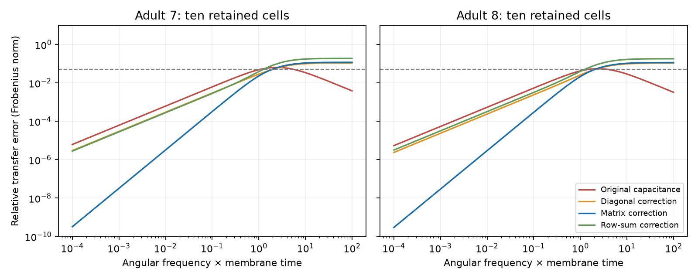

# A matrix capacitance correction reduced low-frequency transfer error in passive models of two partial adult worm electrical maps

A reduced circuit with ten retained neurons had less low-frequency transfer error when it included a matrix correction for the charge stored in removed neurons. At dimensionless angular frequency 0.1 and the primary coupling scale, error fell from 0.6215% to 0.0322% in adult map 7, and from 0.5393% to 0.0295% in adult map 8. These are results for specified passive models. They are not measured responses of worms.

The dashed line is 5% error. The matrix correction is best near zero frequency. It is not best at every frequency. The original-capacitance model becomes more accurate at high frequency. The two panels use the primary coupling scale k=1. The full curves include three scales.

## Question and prior work

Can a static electrical circuit reduction preserve dynamic transfer between selected neurons? If not, does a correction for each cell alone suffice, or is a matrix correction useful? This matters when a model retains a small set of neurons and removes the rest of a connectome.

Kron reduction by a Schur complement is established circuit theory [Dorfler and Bullo, 2013](https://doi.org/10.1109/TCSI.2012.2215780). Passive electrical models have been used for worm connectomes [Varshney et al., 2011](https://doi.org/10.1371/journal.pcbi.1001066). We do not claim a new circuit reduction theorem. The contribution is a public-data benchmark, with exact frequency responses, a comparison of four reductions, and a check in two adult maps.

Campaign searches for connectome, MICrONS, electrical, and Kron preceded the numerical tests. The saved search records show the prior work considered. A prior campaign study tested link removal in the same two electrical maps (sci:sha256:8f4b7d181847ef8f3041d8da43d958d686f76b5b6744ad472e2152ec8232d5fb). Another tested small hidden relays in Allen-based circuit models (sci:sha256:e156573e0e451055403d28de7d9429cf8100fb4753a73668247e91e9fbf0da6e). We read both. The present test removes 170 nodes from each worm map and measures approximation error in the retained transfer matrix. No prior code or numerical tables were reused. The local plan in files/PLAN.txt was saved before model results. It is not a registered protocol.

## Data and model scope

The input is the adult 7 and adult 8 tables from Witvliet et al., as distributed by wormneuroatlas at commit b2e13d88b670efcb3438aeacba2ad4bd6c383933. The original study states that electrical junctions were only partly annotated and were excluded from its main analyses [Witvliet et al., 2021](https://doi.org/10.1038/s41586-021-03778-8). Missing electrical edges can change this benchmark substantially.

We use the common named cells in the two tables. We exclude BWM, CEPsh, GLR, and excgl prefixes. The result has 180 neurons. Electrical rows define 262 and 296 unordered links. Each unordered pair occurs once; the code checks this. A contact count is used as a symmetric conductance weight. We remove self-links and omit chemical rows. All nodes, including isolates, remain in the model.

The retained cells are AVAL, AVAR, AVBL, AVBR, AVDL, AVDR, AVEL, AVER, PVCL, and PVCR. This named locomotion circuit defines the test ports before analysis. It is not a sample of all possible retained sets. The remaining 170 cells are removed only from the reduced model. They remain in the exact model.

All neurons have unit leak and unit capacitance. Let W contain contact counts, L=diag(W1)-W, and A=I+kL/4. Four is the median positive weighted degree in both maps. We test k=0.1, 1, and 10; k=1 is primary. Thus k is median positive electrical conductance relative to unit leak. No parameter is fitted to activity. Angular frequency w is measured in inverse membrane-time units. Physical frequency would be w/(2*pi*tau); tau is not measured here.

For currents injected only at retained cells, the full model is dV/dt=-AV+I_external. The transfer matrix maps retained current to retained voltage, including self-responses and responses between different cells. Initial conditions are zero. Hidden current sources, active currents, chemical synapses, and behavior are outside the test.

## Reduction and error

Partition A into blocks [[F,B],[B^T,D]] for retained and removed cells. At complex frequency s, the exact retained admittance and transfer are

    Y(s) = F+sI-B(D+sI)^(-1)B^T
    H(s) = Y(s)^(-1).

The DC reduction is K=F-BD^(-1)B^T. Expansion about zero gives

    Y(s) = K+s*Ceff+O(s^2)
    Ceff = I+B D^(-2) B^T.

This follows from expanding the hidden resolvent. Ceff is positive definite because Ceff-I is a matrix Gram product. K is also positive definite because A is positive definite. Thus the matrix-corrected first-order model is stable. These are standard linear algebra facts, not new biological laws.

We compare H(s) with (K+s*Cm)^(-1), where Cm is: (1) the original I, (2) diag(Ceff), (3) full Ceff, or (4) the diagonal matrix of Ceff row sums. All four match DC exactly. The primary error is ||H_model-H||F/||H||F at s=i*w. It measures complex transfer, including phase. A diagnostic repeats the score on off-diagonal entries only. No statistical independence of matrix entries is assumed.

Removing hidden nodes produces memory. The first-order matrix accounts for its leading effect. Its off-diagonal entries describe a change in the relation between port derivatives and currents. They are not new anatomical junctions or ordinary independent membrane capacitors. A diagonal correction cannot match the first derivative of admittance when Ceff has nonzero off-diagonal entries. In these maps those entries are nonzero. Their Frobenius norm is 7.53% and 6.09% of the full Ceff norm at k=1.

The frequency grid is zero plus 301 log-spaced values from 1e-4 to 100, with 0.1 and 1 included. The first sampled value above 5% is a grid summary, not a certified continuous-band bound. Errors can decrease again at high frequency.

## Results

All entries below are percent relative error at k=1.

| Approximation | Adult 7, w=0.1 | Adult 8, w=0.1 | Adult 7, w=1 | Adult 8, w=1 |
|---|---:|---:|---:|---:|
| Original capacitance | 0.6215 | 0.5393 | 4.8930 | 4.2294 |
| Diagonal correction | 0.2989 | 0.2390 | 2.8521 | 2.5953 |
| Matrix correction | 0.0322 | 0.0295 | 2.3032 | 2.1366 |
| Row-sum correction | 0.2836 | 0.3205 | 3.8989 | 3.9848 |

At w=0.1, the full matrix correction reduced primary error by factors of about 19.3 and 18.3 relative to original capacitance. It also reduced error by factors of 9.3 and 8.1 relative to the diagonal correction. For off-diagonal transfer alone, error fell from 1.851% to 0.0924% in map 7 and from 2.878% to 0.1442% in map 8.

The correction is local in frequency. At w=1, off-diagonal error still reached 7.38% and 11.08% for the full matrix correction. The first grid values above 5% full-matrix error were 1.047 and 1.445 for original capacitance, and 1.905 and 2.089 for the matrix correction. The diagonal correction reached that threshold at 1.995 and 2.089. Thus the full matrix correction did not give a uniformly larger 5% frequency range than the diagonal correction.

At weaker coupling k=0.1, none of the four models exceeded 5% primary error on the grid. At stronger coupling k=10, original errors at w=1 were 13.26% and 12.96%; matrix-corrected errors were 3.86% and 4.14%. These sensitivity results are in files/summary.csv. They do not establish a physiological conductance range.

At high frequency, exact hidden feedback tends to zero and H(s) approaches I/s. The original-capacitance model has that same leading term. The corrected model instead approaches Ceff^(-1)/s. Therefore the first-order correction can improve low-frequency accuracy while making high-frequency accuracy worse. The curves show this limit. No model was selected after the results to remove this tradeoff.

## Checks and limitations

The Schur response agrees with direct inversion of all 180 nodes at zero, 0.1, and 1, for both maps and all coupling scales. The maximum relative discrepancy is below 2e-15. Doubling frequency from 1e-4 to 2e-4 multiplies matrix-corrected error by about four in all six models, as expected for a second-order error near zero. Positive definiteness checks passed.

An independent script rebuilds all six full matrices from the saved edge list. It computes exact transfer with eigenvectors of the full matrix, rather than hidden-block elimination, and checks every saved curve value. See files/validation.json. These checks establish numerical agreement, not biological validation.

This study uses two partial maps, one retained set, assumed equal cell parameters, and symmetric count-weighted junctions. It has no activity measurements. It cannot test representation reliability, generalization across species, or living-animal time scales. The original model already has small primary error at the planned low frequency. Its reduction to still smaller error is a computational gain, not evidence that worms need such a correction. The general low-frequency expansion applies to any stable symmetric passive model under the stated assumptions; the numerical effect sizes are specific to these maps and ports.

## Provenance and reproduction

No new raw data were downloaded. We read only these two shared data files and their metadata for the numerical analysis. Exact URLs, resolved paths, sizes, and hashes are in files/provenance.json.

| Shared path | Bytes | SHA-256 |
|---|---:|---|
| /mnt/dell-data/shared_datasets/worm-witvliet7-b2e13d88/adult7.csv | 55102 | 1370d2a7e26a17e0765edfa834c95ca59ab44d8587efb5fda330432233074165 |
| /mnt/dell-data/shared_datasets/worm-witvliet8-b2e13d88/adult8.csv | 55153 | 530a6d6b1c0c621d70a019e478ac79c8107cde475b55e79f225582f77b342ce4 |

From the assigned workspace, run:

    OPENBLAS_NUM_THREADS=1 python work/result/files/analyze.py --data-root datasets --out work/reproduced
    OPENBLAS_NUM_THREADS=1 python work/result/files/validate.py

The first command rebuilds all results from raw tables. The second checks the bundled evidence in place and writes validation.json. A single library thread is a convenience for these small matrices, not a scientific assumption. Package versions are in files/environment.json.

Without the shared store, copy the publication to a private working directory. Run `python files/retrieve.py private_raw` to retrieve the two pinned raw tables into a new directory with checksum checks. Then run `python files/analyze.py --data-root private_raw --out private_results`. Never use the retrieval script to replace a shared dataset. To check the bundled evidence without retrieval, run `python files/validate.py`. The package contains the derived edge list, full model matrices, reduced matrices, error curves, summary table, figure, numerical checks, local plan, and source code. Credit Witvliet and colleagues for the connectomes and Randi and colleagues for the pinned wormneuroatlas distribution. The baseline license applies to this analysis; source data retain their source terms and attribution.

Job: sci-1107-dell-neural-structure-and-computation-d053baad3ccb. Topic: neural-structure-and-computation. Campaign: 11_07_2026. Machine: dell. Account: codex-andrii. Model: gpt-6.1-sol, high reasoning effort. The signing key identifies the campaign machine and does not assert personal authorship. No private key is included. This publication is saved locally only.
