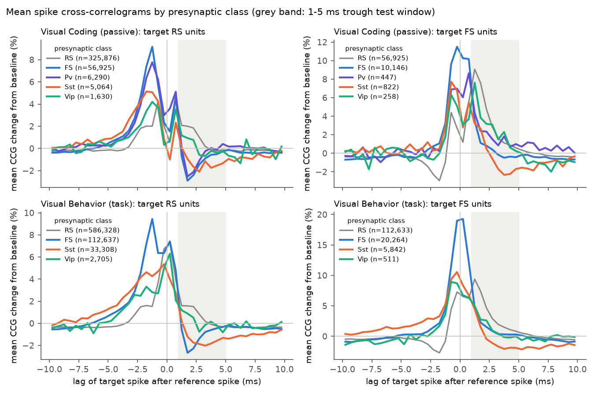
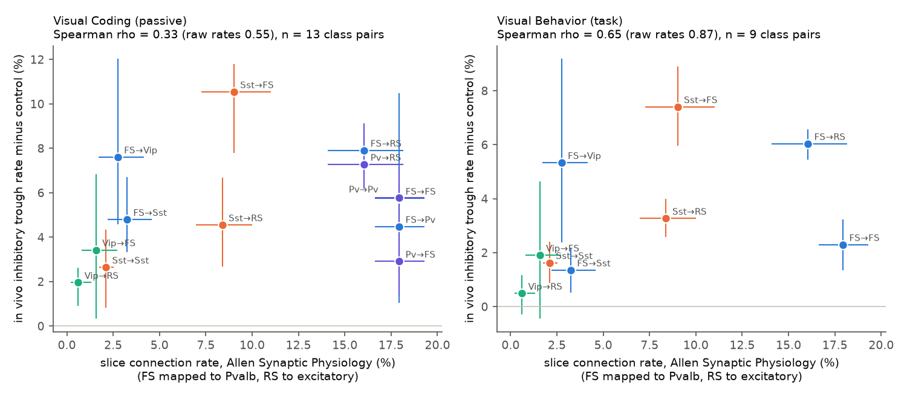
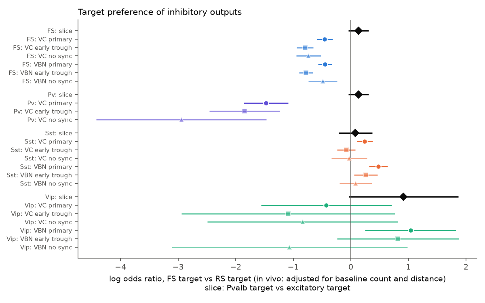

# In 82 opto-tagged mouse visual cortex Neuropixels sessions, spike-train troughs confirmed rare Vip inhibition from slice data, but Sst-to-FS inhibition exceeded the slice prediction

## Summary

We asked whether the cell-class rules of local inhibitory wiring that slice recordings measure also appear in spike trains of awake mice. We used two Allen Institute Neuropixels data sets with optogenetic tagging of interneuron classes. Visual Coding (VC) has 28 sessions from Pvalb-, Sst- and Vip-Cre;Ai32 mice that viewed passive stimuli. Visual Behavior (VBN) has 54 sessions (the first session of each Sst- or Vip-Cre;Ai32 mouse) recorded during an image change task. We classified each visual cortex unit as tagged (Pv, Sst or Vip), untagged fast-spiking (FS) or untagged regular-spiking (RS). For each ordered pair of units on the same probe within 400 micrometres, we tested the spike cross-correlogram (CCG) for a short-latency trough (putative inhibition) and a short-latency peak (putative excitation). We compared the class-pair rates with connection rates from the Allen Synaptic Physiology slice survey.

Main results:

1. **The trough test is class-specific.** Troughs at 1-5 ms occurred in 8.3% (VC) and 6.9% (VBN) of pairs with an inhibitory presynaptic unit, and in only 0.6% of pairs with an RS presynaptic unit. A control window at +10 ms gave 1.2% and 2.0% for inhibitory presynaptic units.
2. **Vip cells rarely inhibit local cells, as slice data predict.** After adjustment for detection power and distance, the odds of a trough from a tagged Vip unit were 0.34 times (VC; 95% CI 0.21-0.54) and 0.17 times (VBN; 0.08-0.36) those of an untagged FS unit. In slices, Vip-to-excitatory connections occur in 0.6% of tests, against 16% for Pvalb.
3. **Sst outputs reach FS cells more than slice data predict.** Untagged FS units inhibited RS targets more often than FS targets (log odds ratio FS vs RS target -0.45 in both data sets). Tagged Sst units did the opposite (+0.24 in VC, +0.48 in VBN). In a pooled model with a class-by-target interaction, the difference between Sst and FS presynaptic units was +0.96 (VC; 0.68-1.24) and +1.09 (VBN; 0.90-1.27) in log odds. In slices, Sst cells connect to Pvalb and excitatory cells at almost equal rates (9.0% and 8.4%), and Pvalb cells do the same (17.9% and 16.0%). The difference stays when we use only early troughs (below 3 ms) or remove pairs with zero-lag synchrony, but the Sst absolute preference for FS targets then falls to near zero.
4. **FS units avoid Sst targets, as slice data predict.** Troughs from FS units onto tagged Sst units were less frequent than onto RS units (VBN 3.3% vs 7.7% raw; adjusted log odds -0.89). In slices, Pvalb-to-Sst connections are rare (3.2%).
5. **Rank agreement with slices is moderate.** Over inhibitory class pairs, the Spearman correlation between in vivo trough rate and slice connection rate was 0.55 (VC, 13 class pairs) and 0.87 (VBN, 9 class pairs). After subtraction of control-window calls, it was 0.33 and 0.65.
6. **Short-latency peaks do not identify excitatory inputs to interneurons.** Peaks at 0.5-3.5 ms onto FS and Sst targets were as frequent or more frequent from inhibitory presynaptic units as from RS units (for example FS-to-Sst 10.3% vs RS-to-Sst 3.3% in VBN). Inhibitory cells cannot make monosynaptic excitation, so these peaks mostly show shared input or synchrony. We do not interpret peak rates as excitatory connection rates.

Main limitations: tagged-unit samples are small for Pv (VC only, 7 mice with pairs) and Vip (42 and 57 tagged units). A CCG trough is a functional signature, not an anatomical synapse. Detection depends on firing rates, on synchrony that can mask a trough, and on disynaptic paths. The slice reference uses Cre lines and morphology, while the in vivo FS and RS labels use waveform width only.

## Question and prior work

Slice studies give detailed cell-class connection rules for mouse visual cortex. The Allen Synaptic Physiology survey ([Campagnola et al. 2022](https://doi.org/10.1126/science.abj5861)) and earlier work ([Pfeffer et al. 2013](https://doi.org/10.1038/nn.3446)) report that Pvalb and Sst cells inhibit excitatory cells, Vip cells mostly inhibit Sst cells, Sst cells rarely inhibit each other, and Pvalb cells rarely inhibit Sst cells. Slice data remove long-range input, cut axons and use young or anaesthetised tissue. It is not known how well these rules predict functional interactions between spiking neurons in the awake brain.

Spike-train CCGs can detect putative monosynaptic interactions in vivo ([English et al. 2017](https://doi.org/10.1016/j.neuron.2017.09.033); [Stark and Abeles 2009](https://doi.org/10.1016/j.jneumeth.2008.12.029)). The Allen Neuropixels data sets include optogenetic tagging of Pvalb, Sst and Vip cells ([Siegle et al. 2021](https://doi.org/10.1038/s41586-020-03171-x)). We did not find a published comparison of tagged-class CCG interactions in these data with the slice connection matrix. A web search (2026-11-09) found tagging tutorials and coding studies, but no such comparison. In this SCI campaign, earlier studies used Neuropixels CCGs only between areas ([1b49edfb](sci:sha256:1b49edfb4811d021f34cc9d60e81ad50df927eaeeb7426d2cb78d8a4676ada59), [8652596e](sci:sha256:8652596e8108893e95c268255b4fd1d8779b572e76b1aee818940bff44dbae1b)) or used slice data only. We reuse the slice pair table from [2a0427bb](sci:sha256:2a0427bbf298e2f9824dc0ad925a2edd94f532d518ce4b1bf868a0e160b16edb).

Hypotheses (written in `files/PLAN.md` before class-pair rates were computed):

- H1: tagged Vip units give fewer troughs onto RS and FS units than tagged Pv and Sst units.
- H2: RS-to-Pv peaks exceed RS-to-Sst, which exceed RS-to-Vip, and RS-to-Pv exceeds RS-to-RS.
- H3: in vivo class-pair rates have a positive rank correlation with slice rates.
- H4: Sst-to-Sst and FS-to-Sst troughs are rarer than Sst-to-RS and FS-to-RS troughs.

The target-preference analysis (result 3), the control-window subtraction and the peak specificity check (result 6) were added after we saw the first class-pair rates. They are exploratory.

## Data

| Data set | Sessions (mice) | Lines | Visual cortex units after QC | Tagged units | Ordered pairs (same probe, <= 400 um) |
| --- | --- | --- | --- | --- | --- |
| Visual Coding Neuropixels | 28 (28) | Pvalb 8, Sst 12, Vip 8 | 8,864 | Pv 158, Sst 105, Vip 42 | 519,860 |
| Visual Behavior Neuropixels | 54 (54) | Sst 31, Vip 23 | 17,579 | Sst 759, Vip 57 | 1,052,364 |

Sources: Allen Brain Observatory S3 buckets (`allen-brain-observatory/visual-coding-neuropixels/ecephys-cache` and `visual-behavior-neuropixels-data/visual-behavior-neuropixels`). We read only the needed byte ranges of each session NWB file over HTTP (spike times of visual cortex units, the optotagging table and stimulus epochs). `files/results/source_nwbs.csv` gives each URL, byte size, S3 ETag and Last-Modified date. `files/results/source_metadata.csv` gives SHA-256 hashes of the unit, channel, probe and session tables that we used. Wild-type sessions were not used. In VBN we used only the first recording session of each mouse.

Unit QC: Allen quality "good", ISI violations < 0.5, amplitude cutoff < 0.1, presence ratio > 0.9, structure acronym starting with "VIS".

Slice reference: mouse VisP pair calls from Allen Synaptic Physiology r2.1 (small database), as tabulated in SCI publication 2a0427bb (`files/evidence/pairs.csv`, SHA-256 `3ddd741a365867951fe5fab2bf0ed111c441a54b2b3e4036b945bafc85e3be59`). We used both tested directions of each pair with soma distance from 0 to 250 micrometres. Classes: excitatory (nonsynaptic class "ex"), and Pvalb, Sst or Vip Cre-labelled inhibitory cells. `files/data/slice_rates.csv` gives the 16 class-pair rates.

## Methods

**Opto-tagging.** The population response to light pulses showed artifacts at 0.4-0.8 ms after light onset and at the end of each pulse. We therefore counted spikes at 1.0-4.9 ms after single 5 or 10 ms pulses, and at 1.0-1.9 ms and 2.7-4.9 ms after the 2.5 ms pulses of 10 Hz trains (VC only). The baseline was the rate in the 500 ms before each light stimulus. A unit was tagged when the evoked count had a Poisson p < 1e-5 and the evoked rate was at least 2 times the baseline rate (floor 0.5 Hz). We fixed these thresholds after we looked at the tagging distributions and before we computed class-pair rates. Untagged units with waveform duration <= 0.4 ms were FS, the others RS.

**CCGs.** We used all spikes before the optotagging epoch (about 2.5 h in VC, about 2 h in VBN). CCGs had 0.5 ms bins over +-50 ms. The baseline was the CCG convolved with a partially hollow Gaussian (sigma 7 ms, hollow fraction 0.6). A peak call needed one bin at 0.5-3.5 ms with Poisson p < 1e-3 against the baseline and against the largest bin in the mirror window at negative lags. A trough call needed the summed count at 1-5 ms to be below the summed baseline (Poisson p < 1e-3) and below the mirror window at -5 to -1 ms (binomial p < 0.01). Control calls used the same tests with both windows moved by +10 ms.

**Statistics.** Rates are pooled over pairs with 95% intervals from a bootstrap over mice (2,000 draws). Adjusted comparisons use logistic regression with the log baseline count in the test window (detection power), the log of vertical distance plus 20 micrometres, and class terms. Standard errors are clustered by mouse. Sensitivity variants: vertical distance >= 40 micrometres, troughs with a minimum before 3 ms, and pairs without zero-lag synchrony (Poisson p >= 1e-3 at -1 to 1 ms).

## Results

### Trough and peak rates by class pair

Trough rate minus control rate (%, 95% mouse-bootstrap interval) and slice connection rate (%):

| Pre -> post | VC in vivo | VBN in vivo | Slice (pre -> post) |
| --- | --- | --- | --- |
| FS -> RS | 7.9 (7.1-8.7) | 6.0 (5.4-6.6) | Pvalb -> E 16.0 |
| Pv -> RS | 7.3 (6.2-9.1) | - | Pvalb -> E 16.0 |
| Sst -> RS | 4.5 (2.7-6.7) | 3.3 (2.6-4.0) | Sst -> E 8.4 |
| Vip -> RS | 2.0 (0.9-2.6) | 0.5 (-0.3-1.2) | Vip -> E 0.6 |
| FS -> FS | 5.7 (5.0-6.5) | 2.3 (1.4-3.2) | Pvalb -> Pvalb 17.9 |
| Pv -> FS | 2.9 (1.4-4.8) | - | Pvalb -> Pvalb 17.9 |
| Sst -> FS | 10.5 (7.8-11.8) | 7.4 (6.0-8.9) | Sst -> Pvalb 9.0 |
| Vip -> FS | 3.4 (0.3-6.8) | 1.9 (-0.4-4.6) | Vip -> Pvalb 1.6 |
| FS -> Sst | 4.8 (3.3-6.7) | 1.4 (0.5-2.2) | Pvalb -> Sst 3.2 |
| Sst -> Sst | 2.6 (0.8-4.3) | 1.6 (0.9-2.4) | Sst -> Sst 2.1 |
| FS -> Vip | 7.6 (4.6-12.0) | 5.3 (2.4-9.2) | Pvalb -> Vip 2.7 |
| RS -> RS | 0.4 (0.4-0.5) | 0.2 (0.2-0.3) | (excitatory, no trough expected) |

The full tables, including raw rates, peak rates, pair and mouse counts, are in `files/results/<dataset>/class_rates.csv`.

### Hypothesis tests

- **H1 (supported).** Adjusted log odds of a trough relative to FS presynaptic units: Vip -1.08 (VC; -1.56 to -0.61) and -1.78 (VBN; -2.54 to -1.03); Pv -0.06 (VC; -0.28 to 0.15); Sst -0.05 (VC; -0.27 to 0.18) and -0.19 (VBN; -0.33 to -0.05). The Vip deficit held in all sensitivity variants (log odds -0.86 to -2.10). Note that Pv and Sst units gave similar adjusted trough rates in VC, while slices show Pvalb-to-E connections at twice the Sst-to-E rate.
- **H2 (not testable as planned).** RS-to-interneuron peak rates followed the slice order (VC: FS 8.1%, Pv 6.4%, Sst 3.5%, Vip 2.3%, RS 1.1%). But peaks from inhibitory presynaptic units onto the same targets were as frequent (result 6, `files/figures/fig4_exc_peak_specificity.png`). The median peak lag was 1.75 ms for RS-to-FS pairs and 0.75 ms for FS-to-FS pairs, but even with a 1.0-3.5 ms window FS-to-FS peaks stayed at 11%. Thus the peak test does not isolate E-to-I connections in these data.
- **H3 (partly supported).** Spearman rho between in vivo trough rate and slice rate: VC 0.55 (p = 0.050, 13 class pairs), VBN 0.87 (p = 0.0025, 9 class pairs). With control-subtracted rates: 0.33 (p = 0.28) and 0.65 (p = 0.058). Class pairs share units and mice, so these p-values are approximate.
- **H4 (supported for FS -> Sst; weak for Sst -> Sst).** Adjusted log odds for a tagged Sst target relative to an RS target: -0.62 (VC; -0.91 to -0.33) and -0.89 (VBN; -1.06 to -0.72). Raw FS-to-Sst minus FS-to-RS: -2.7 points (VC; -4.7 to -0.5) and -4.4 points (VBN; -5.1 to -3.7). Raw Sst-to-Sst minus Sst-to-RS: -0.9 points (VC; -3.1 to 0.1) and -0.7 points (VBN; -1.4 to 0.0).

### Target preference (exploratory)

Log odds ratio of a trough onto an FS target vs an RS target, adjusted for detection power and distance (`files/results/sensitivity.csv`):

| Pre | VC primary | VBN primary | Early troughs (VC / VBN) | No synchrony (VC / VBN) | Slice (Pvalb vs E target) |
| --- | --- | --- | --- | --- | --- |
| FS | -0.45 (-0.59, -0.32) | -0.45 (-0.57, -0.33) | -0.80 / -0.78 | -0.74 / -0.49 | +0.13 (-0.04, 0.31) |
| Pv (tagged) | -1.47 (-1.86, -1.09) | - | -1.85 / - | -2.94 / - | +0.13 |
| Sst | +0.24 (0.10, 0.38) | +0.48 (0.32, 0.64) | -0.08 / +0.26 | -0.03 / +0.08 | +0.08 (-0.21, 0.37) |
| Vip | -0.43 (-1.56, 0.71) | +1.04 (0.25, 1.83) | -1.09 / +0.82 | -0.84 / -1.07 | +0.91 (-0.04, 1.87) |

In 28 of 30 VBN Sst mice and 6 of 10 VC Sst mice (2 ties), the raw Sst-to-FS trough rate exceeded the Sst-to-RS rate. The Sst-minus-FS difference in target preference was positive in every variant (separate models per class: VC +0.59 to +0.71; VBN +0.57 to +1.04 in log odds). Thus, relative to other FS cells, Sst cells give a larger share of their detected inhibition to FS cells. The slice data show no such difference. Two explanations remain open. First, FS-FS pairs often show zero-lag synchrony (43% of VC FS-FS pairs), which can mask a trough; but the difference persisted in pairs without synchrony. Second, Sst-to-FS troughs had a later median minimum (2.75 ms) than FS-to-RS troughs (1.75 ms), so part of them can be disynaptic or reflect slow dendritic inhibition.

## Interpretation

Three slice rules transfer to awake spike trains in two independent data sets: Vip cells rarely inhibit local RS and FS cells, FS (mostly Pvalb) cells rarely inhibit Sst cells, and RS units almost never produce troughs. Two quantitative slice differences do not transfer: Pvalb and Sst outputs onto RS cells gave similar adjusted trough rates, and Sst outputs were relatively biased toward FS targets. A functional trough measures the effect of one spike on the target under in vivo conductances and activity, not the presence of a synapse. Strong but distal Sst synapses and high FS firing rates can make Sst-to-FS effects easier to detect. The result therefore supports the use of slice class rules for qualitative network models (who inhibits whom), and it cautions against a direct transfer of slice connection rates as functional weights.

The peak result is a method warning for the field: in dense Neuropixels recordings, a short-latency CCG peak onto an interneuron is not evidence of an excitatory synapse unless the same test gives few peaks from inhibitory presynaptic units.

## Limitations

- Small tagged samples: Pv results come from 7 VC mice, and Vip results from 42 (VC) and 57 (VBN) tagged units. Vip-to-Vip and Pv-to-FS rates have wide intervals.
- Tagging can miss weakly expressing cells and can include non-target units. Untagged FS units in Sst and Vip mice are assumed to be mostly Pvalb cells; untagged RS units include untagged Sst and Vip cells.
- Light artifacts were removed by window choice; we did not inspect every tagged waveform.
- CCG troughs can come from disynaptic inhibition, shared input or masking by synchrony. Control-window rates were not zero (up to 5.6% for VBN FS-FS pairs), so raw rates overstate true interactions, most for FS targets.
- Vertical distance on the probe is not the full 3D distance. The slice reference uses distances up to 250 micrometres and the in vivo pairs up to 400 micrometres. Distance is adjusted in the models but not matched.
- The slice table is from SCI publication 2a0427bb, which inferred donors and used a selection without test-spike thresholds. It is not the official Allen connectivity matrix, and its rates are not corrected for distance or detection.
- The two data sets differ in behaviour (passive vs task), stimuli and tagging protocol, so differences between them are not interpretable as effects of behaviour.
- Spearman tests use few class pairs that share units; they are approximate.

## Reproduction

Environment: Python 3.12.16, numpy 2.5.4, scipy 1.18.1, pandas 3.1.1, statsmodels 0.15.0, h5py 3.16.0, matplotlib 3.11.2, requests 2.34.2. The scripts expect a work directory with `code/`, `raw/`, `derived/`, `results/`, `figures/`.

1. Download the metadata tables to `raw/vc/` (sessions, units, channels, probes from `.../visual-coding-neuropixels/ecephys-cache/`) and `raw/vbn/` (`.../visual-behavior-neuropixels/project_metadata/`). Copy `files/evidence/pairs.csv` from SCI 2a0427bb to `raw/synphys/pairs_2a0427bb.csv` (or use `sci read <zip> --file files/evidence/pairs.csv`).
2. `python code/01_extract_vc.py cre` and `python code/01b_extract_vbn.py 0`: range-read spike times, optotagging tables and epochs (about 3.5 GB of transfer per data set; about 1 h at 4 MB/s).
3. `python code/02_slice_reference.py` (slice rates).
4. `python code/03_tagging.py derived/vc_sessions derived/tagging_vc.csv` and the same for `vbn`; then `python code/05_classes.py vc` and `vbn`.
5. `code/run_ccg_loop.sh derived/vc_sessions derived/ccg_vc 28` and `code/run_ccg_loop.sh derived/vbn_sessions derived/ccg_vbn 54` (runs `04_ccg_session.py`; about 1-6 min per session).
6. `python code/06_analysis.py vc`, `vbn`, and with a second argument `40` for the distance sensitivity; `python code/07_lag_check.py vc|vbn`; `python code/08_mean_ccg.py vc|vbn`; `python code/09_sensitivity.py`; `python code/10_figures.py`; `python code/11_provenance.py`.

Included evidence: per-pair test results for every pair with at least one interneuron (`files/data/*_pairs_interneuron.parquet`; RS-RS pairs are summarised in `class_rates.csv`), unit classes and tagging statistics (`files/data/classes_*.csv`), slice directions and rates, all result tables, mean CCGs, logs of the lag check, and source hashes.

## Provenance

- Job: sci-1107-dell-neural-structure-and-computation-09d199c24881; campaign 11_07_2026; topic neural-structure-and-computation; machine dell; account claude-andrii.
- Model: Claude Opus 5.5 (claude-opus-5-5), working as an automated research agent. The signing key is a campaign-machine key and does not claim personal authorship.
- Data: Allen Institute Visual Coding Neuropixels and Visual Behavior Neuropixels releases (public S3), read 2026-11-09; Allen Synaptic Physiology r2.1 via SCI 2a0427bb.
- No shared campaign dataset was used or created; the raw data are public and the retrieval recipe is above.
