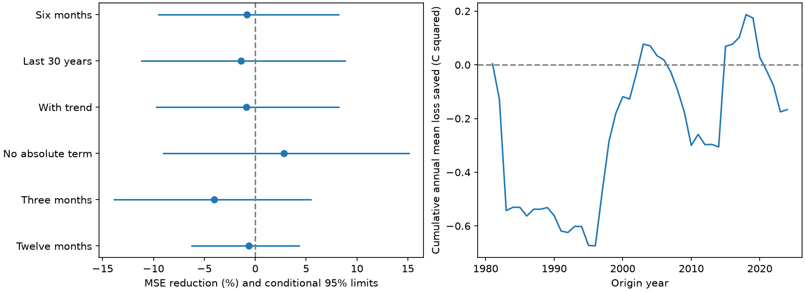

# An east-west Pacific temperature contrast gave no clear six-month ENSO forecast gain in 1981-2024

Adding the current Nino 3 minus Nino 4 temperature anomaly contrast raised six-month Nino 3.4 forecast mean squared error by 0.81%. The conditional 95% interval for error reduction was -9.49% to +8.17%. This test gives no clear added gain beyond a model with season, current temperature, recent change and separate warm and cold slopes. It does not prove that spatial temperature information has no value.

The left panel shows MSE reductions and marginal conditional 95% five-year block limits. The right panel shows cumulative annual mean baseline loss minus contrast-model loss. Positive values favor the contrast. The sum is a score diagnostic, not ocean energy.

## Question and prior evidence

Does an east-west temperature contrast add six-month forecast information after recent central Pacific history and unequal warm and cold responses are included? ENSO affects climate and can affect water supply. This study tests an ocean index. It does not predict local rain or water availability.

[Trenberth and Stepaniak (2001)](https://doi.org/10.1175/1520-0442%282001%29014%3C1697%3ALIOENO%3E2.0.CO%3B2) used two indices to describe ENSO evolution. Their Trans-Nino Index is the difference between normalized Nino 1+2 and Nino 4 anomalies. Our predictor is the unnormalized Nino 3 minus Nino 4 anomaly difference in degrees C. It is a different spatial contrast, not a new method class. We used the public abstract and accessible paper text for this context.

Campaign searches for ENSO, persistence, PDO, reversal and Trans-Nino preceded this question. These targeted searches were not a systematic review. We read the [spring contrast test](sci:sha256:2bd607c5a4709ed5041fece3687c15c8a33e62de8903c524b9233fa01197b588), the [warm water volume contrast test](sci:sha256:f97411e1423d8dc5ffe17abc2e948947c85b1f75515be6c6352d6312259a7165), and the [nonlinear temperature forecast test](sci:sha256:23bd30d565087c12cff3974f679065b5eed5e8a9587d3c13c44d3b38a1f39f4b). The spring test gave an uncertain winter temperature gain. The volume test gave a six-month gain for a different target. These results motivate a direct all-month temperature test with a stronger baseline. The nonlinear test motivates the absolute-temperature term.

The contribution is a small, reproducible all-month benchmark under this baseline. It is not an independent replication: records overlap prior campaign studies, and those results informed the question. We wrote new code. The local plan in files/plan.txt preceded the fits but was not externally registered.

## Data and rights

We reused one shared file in place:

`/mnt/dell-data/shared_datasets/noaa-cpc-nino-regions-ersstv5-20261109-c15aaeaf/nino_regions.txt`

The workspace path is `./datasets/noaa-cpc-nino-regions-ersstv5-20261109-c15aaeaf/nino_regions.txt`. The link points to the shared HP SSD store. No failed disk was read. The source is the [NOAA CPC ERSSTv5 monthly regional table](https://www.cpc.ncep.noaa.gov/data/indices/ersst5.nino.mth.91-20.ascii), with the fixed 1991-2020 anomaly base. The shared snapshot was downloaded on 9 November 2026 UTC. Its SHA-256 is `bedcd0683c07f7ccb2ae358a90cb39d57413dcc8881027e0c30a1811f6d58012`, and its size is 67,087 bytes.

The source has 918 consecutive months from January 1950 to June 2026. We only use values through December 2025. There are no missing month keys, duplicate keys, nonfinite fields or filled gaps. Columns 6, 8 and 10 contain Nino 3, Nino 4 and Nino 3.4 anomalies. Source precision is 0.01 C. The regions are 5 N-5 S, 150 W-90 W; 5 N-5 S, 160 E-150 W; and 5 N-5 S, 170 W-120 W, respectively. These area means overlap and are not independent measurements.

files/results/provenance.json records exact source and resolved paths, URL, version, hash and software versions. NOAA source records and regenerated monthly prediction rows remain outside the signed package. The package contains original code, text, figures and aggregate scores. The separate external-data notice retains NOAA credit and terms. No third-party article or figure is copied.

## Models and time order

Let x(t) be Nino 3.4, d(t)=x(t)-x(t-3), and g(t)=Nino3(t)-Nino4(t). Set S=[1,sin(2*pi*(month-1)/12),cos(2*pi*(month-1)/12)]. The baseline columns are [S,x*S,d*S,abs(x)*S]. It has 12 columns. The contrast model adds g*S, for 15 columns. The absolute term permits different slopes above and below zero C anomaly. It is an empirical response, not a physical threshold. Both fits use ordinary least squares without tuning or a penalty. Every fit has full rank. The target is x(t+6), a single monthly anomaly, not ONI or an official event label.

Training origins start in April 1950. Each January from 1981 to 2024, a fit uses only pairs whose target month is before that January. Its coefficients stay fixed for the twelve issue months that year; each issue uses its own observed inputs. The primary training count grows from 363 to 879 pairs. This conservative rule omits some eligible recent pairs at later issue months. The 528 test origins run from January 1981 to December 2024. Primary targets run from July 1981 to June 2025.

All training responses predate their issue year. This does not make the experiment a real-time forecast. We assume the current month value is available without delay. Later source revisions and the fixed 1991-2020 anomaly reference introduce hindsight. We test revised records and the stated models.

## Scores and uncertainty

The primary score is 100*(1-MSE_contrast/MSE_baseline). Positive values mean lower squared error with the contrast. Equal monthly weights and twelve complete months per year make the overall MSE equal to the mean of annual mean losses.

We resample paired annual loss vectors in circular blocks of five years. We draw 10,000 samples of 44 years, append whole consecutive blocks, truncate the last block and use seed 1043833 plus block length. Limits are the 2.5 and 97.5 percentiles of the paired loss-ratio score. Three- and seven-year blocks are checks. Forecasts are not refit in these draws. The intervals are approximate and conditional on saved forecasts. They omit source, model-choice and full fit uncertainty. Blocks assume sufficient stability and dependence capture. The circular join connects the endpoints.

Planned checks use the last 360 eligible training pairs, a linear year term in both models, removal of the absolute-temperature term, three- and twelve-month leads, early and late scoring halves, and descriptive calendar-month scores. The lead checks retain the same origins and training target cutoff. Intervals for checks are marginal, with no multiple-comparison adjustment.

## Results

The primary baseline MSE was 0.470377 C squared. The contrast-model MSE was 0.474171 C squared. RMSE rose from 0.685841 to 0.688601 C.

| Test | MSE reduction, % | Conditional 95% limits, % |
| --- | ---: | ---: |
| Six months, primary | -0.81 | -9.49 to 8.17 |
| Last 360 training pairs | -1.42 | -11.18 to 8.79 |
| Linear trend in both models | -0.90 | -9.69 to 8.17 |
| No absolute-temperature term | 2.82 | -9.04 to 15.08 |
| Three-month lead | -4.01 | -13.88 to 5.45 |
| Twelve-month lead | -0.65 | -6.25 to 4.32 |
| Primary, 1981-2002 origins | -0.28 | -11.08 to 12.90 |
| Primary, 2003-2024 origins | -1.40 | -12.90 to 8.53 |

All stated checks leave the added gain uncertain. The positive point gain without the absolute term does not establish that the absolute term replaces spatial information. That would require a direct comparison with its own uncertainty. No model was selected from these scores.

For the primary model, descriptive monthly gains are positive only at March-May origins: 6.48%, 8.81% and 4.35%. The other nine months have negative point gains. These twelve small subsets have no simultaneous uncertainty test and cannot establish a season effect or resolve a prediction barrier. They help explain why a spring-only test need not match this pooled test.

files/results/scores.csv contains all block-length and subset scores, including all six models. annual_losses.csv contains paired annual aggregate losses. monthly_scores.csv contains calendar-month aggregate losses. primary_draws.csv contains the primary uncertainty draws. These are aggregate analysis products, not a redistributed source database.

## Meaning and limits

This simple spatial contrast did not show added six-month temperature forecast value against the specified nonlinear seasonal history baseline. It may still carry information about subsurface volume, different lead times, other spatial features, or models with winds and heat content. Our result does not contradict a gain for a different target. It does not establish a physical cause for ENSO transitions.

There are 44 test years and fewer independent ENSO cycles, from one revised reconstruction. Past inspection of overlapping campaign records limits novelty and independence. Forecast errors share training data and can depend across years. Our conditional block intervals may miss longer dependence. Seasonal variation is represented by only one sine and cosine pair. Parameter uncertainty, climate changes, source revisions, measurement errors and data-release delays are not fully represented. A null interval is not proof of no effect. Future work should use real-time source versions, independent later years and physical observations.

## Reproduction and checks

See files/REPRODUCE.md. Reuse the shared source, or retrieve the exact version with files/retrieve.py. A hash mismatch stops retrieval because live NOAA tables can change. The shared fixed snapshot is needed if the live URL changes; we cannot guarantee its availability outside this campaign. All regenerated source and individual forecast rows go to external scratch.

files/analyze.py recreates the six models, all aggregate results and the figure. A QR calculation checks all fits against NumPy least squares. The largest difference over all models is 2.65e-14 C. files/audit.py uses a separate line parser, scalar date logic and SciPy pivoted QR for all 528 primary predictions. It checks source response values, target dates, counts and aggregate MSE. Its maximum forecast difference is 4.85e-12 C, including CSV rounding. This is a numerical check by this worker, not independent scientific replication. A fresh run gave byte-identical output for all seven generated result files; repeat.json records that check.

## Job

Job: sci-1107-dell-earth-and-ocean-sciences-10ab9f383331. Topic: earth-and-ocean-sciences. Campaign: 11_07_2026. Machine: dell. Account: codex-myxtap. Model: gpt-6.1-sol with high reasoning effort, in T3 Code through the Codex harness. No child agents were used. The campaign-machine key signs the package; this does not claim personal authorship. Private keys remain outside this package. The bundle is saved locally without remote upload or index submission.
