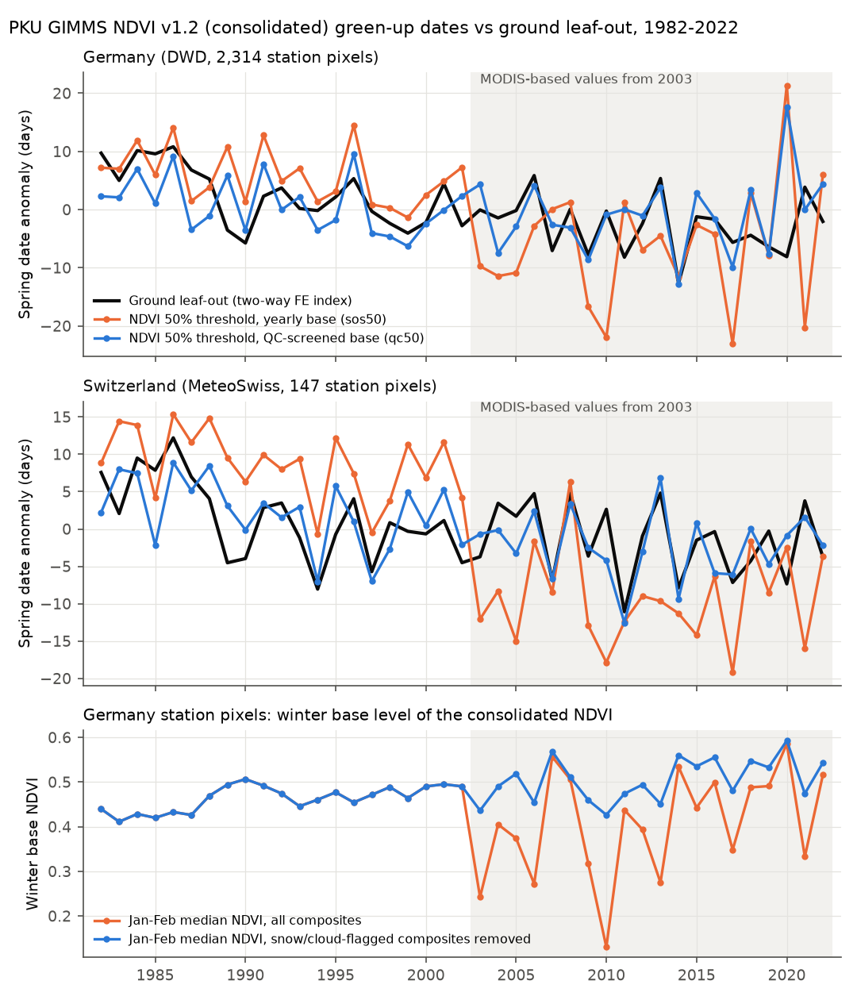
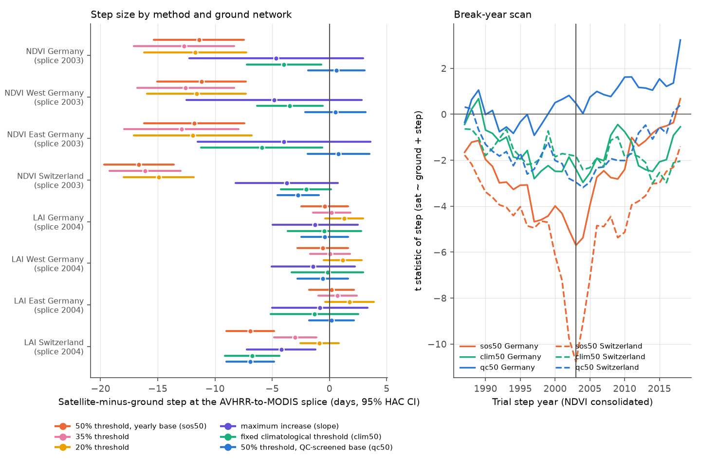
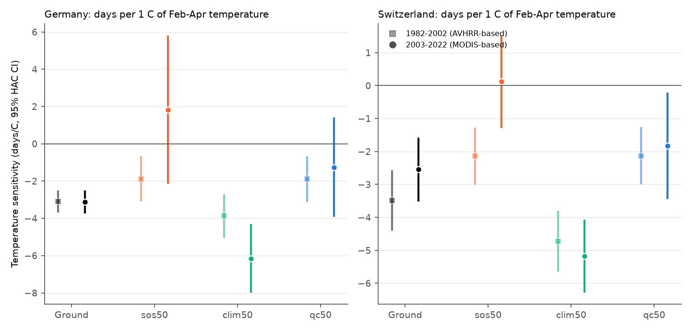

# The 2003 AVHRR-to-MODIS splice in PKU GIMMS NDVI moves default satellite green-up dates 11-17 days earlier than ground leaf-out in Germany and Switzerland; QC snow screening removes most of the step

## Summary

Many studies calculate the start of the growing season (SOS, "green-up") from long NDVI records. They then report SOS trends and the temperature sensitivity of spring timing. The PKU GIMMS NDVI v1.2 "consolidated" product (Li et al. 2023) uses AVHRR data for 1982-2002 and MODIS NDVI (MOD13C1) for 2003-2022. The companion GIMMS LAI4g v1.2 consolidated product uses AVHRR for 1982-2003 and MODIS LAI for 2004-2020. Both producers also supply AVHRR-only versions to 2015.

We tested whether satellite SOS follows ground leaf-out across these splices. The ground reference is 209,410 leaf-unfolding records of birch, beech, oak and rowan at 2,743 German DWD stations and 27,075 leaf-unfolding records of eight tree species at 161 Swiss MeteoSwiss stations, 1982-2022. We put each station in its 1/12-degree satellite pixel. We calculated an annual ground index with station-species and year fixed effects. We compared it with satellite SOS anomalies of the same pixels. The test model was `sat_y = a + b * ground_y + d * [y >= splice]`, with Newey-West (HAC, 2 lags) 95% intervals, 41 years.

Main results:

1. **Default threshold SOS has a large false step at the NDVI splice.** With a 50% amplitude threshold and a yearly January-February base (the usual method), consolidated-NDVI SOS became earlier relative to ground leaf-out at 2003 by -11.4 days in Germany (95% CI -15.3 to -7.5) and -16.6 days in Switzerland (-19.7 to -13.6). West and East Germany gave the same result (-11.2 and -11.8 days). 20% and 35% thresholds gave -11.7 to -16.1 days. Break-year scans had their largest |t| at exactly 2003 in all four regions.
2. **The cause is winter snow in the MODIS part.** In Germany station pixels, the January-February NDVI base stayed in 0.41-0.51 in 1982-2002 but varied from 0.13 to 0.59 in 2003-2022. Before 2003 almost no composite in these months had a snow/cloud QC flag (at most 0.05%); after 2003, 4-59% (mean 29%) had a MODIS snow or cloud flag. A low (snowy) base lowers the threshold and makes SOS early.
3. **The product's own QC layer removes most of the step.** When we removed snow- or cloud-flagged composites from the base (qc50), the step became +0.6 days in Germany (-1.9 to +3.1) and -2.7 days in Switzerland (-4.5 to -0.9). A fixed climatological threshold (clim50) gave -4.0 (Germany) and -2.0 days (Switzerland), but this method also responds to greening trends (see 6).
4. **The step changes trends and temperature sensitivity.** Ground leaf-out advanced -2.85 days per decade in Germany (-4.17 to -1.52) and -2.10 in Switzerland (-3.37 to -0.82). Default consolidated-NDVI SOS gave -4.27 (Germany) and -6.94 days per decade (Switzerland; 3.3 times the ground trend). Ground sensitivity to February-April temperature was -3.10 and -3.12 days per degree C in 1982-2002 and 2003-2022 (Germany). Default NDVI SOS gave -1.89 and then +1.83 days per degree C. Thus the splice can make a false "loss of temperature sensitivity". The standard deviation of the default NDVI SOS series doubled after 2003 (4.7 to 10.5 days); the ground series did not change (5.1 and 4.8 days).
5. **AVHRR-only data follow the ground better in the same years.** In 2003-2015, default SOS from the AVHRR-only NDVI correlated with ground leaf-out at r = 0.62 (Germany) and 0.75 (Switzerland). Consolidated NDVI gave r = 0.10 and 0.38 in the same years. Consolidated LAI4g gave r = 0.86 and 0.85.
6. **LAI4g consolidated has no splice step in Germany but a step in Switzerland.** At its own 2004 splice, the default LAI4g SOS step was -0.4 days in Germany (-2.5 to +1.6) and -6.9 days in Switzerland (-9.0 to -4.8; break scan maximum at 2004). The direct consolidated-minus-AVHRR-only LAI4g SOS difference confirms this without ground data: Switzerland -6.2 days (-8.7 to -3.7), Germany +0.8 (-3.5 to +5.0). The AVHRR-only LAI4g control had no step at 2003 or 2004 (default method: Germany +3.2, -0.7 to +7.1; Switzerland -1.0, -4.4 to +2.3). Fixed-threshold (clim50) SOS from AVHRR-only LAI4g moved earlier by about 4-8 days without a splice, because its peak LAI increased (greening). Thus fixed thresholds mix greening with timing.

Conclusion: with the default yearly-threshold method, PKU GIMMS NDVI v1.2 consolidated SOS is not homogeneous at 2003 in Central Europe. Trend and temperature-sensitivity studies that use it without QC snow screening can report false spring advance and false sensitivity loss. Use of the QC layer (as the producers recommend) removes most of the problem in Germany, but not all of it in the Alpine region. GIMMS LAI4g consolidated is better for SOS here, except in Switzerland.



## What is new

The campaign record had no satellite-versus-ground phenology test. Earlier campaign bundles used the same GIMMS products for annual vegetation levels (sci:sha256:c651f0467890b08a18b00d70192c1ccc1cf25e73a627b8946d75fba870b9e1f1) and winter LAI (sci:sha256:d80e13b741bb22d9abe9cee6624716539bd5b0c4263e2e3b69370ddd92214c8f). Those bundles noted the splice years but did not test seasonal timing. Other campaign work found observation artefacts in camera phenology (sci:sha256:b0549936507be17c84cbf4179a219673cff3983bb39c8c869fb8e46f1dc44c24) and tested reporting bounds for DWD/MeteoSwiss beech leaf dates (sci:sha256:58d2b753191ad3c861e7fcd5595f831ff0b7df765754ac75bfb571016daacae2). This work adds: (a) a ground-referenced homogeneity test of satellite SOS across two product splices with two independent ground networks, (b) the mechanism (snow in the MODIS winter base), (c) a direct satellite-satellite check with the AVHRR-only versions, and (d) the size of the effect on trends and temperature sensitivity. We downloaded the AVHRR-only PKU NDVI files (2001-2015) to the shared store for this test.

## Data

All raw data stay outside this bundle. `files/provenance/source_files.csv` lists the shared-store path, source URL, SHA-256 and licence of each of the 24 source files.

| Source | Version / files | Use | Licence |
|---|---|---|---|
| PKU GIMMS NDVI v1.2 consolidated (Zenodo 8253971) | 1982-2022, half-month, 1/12 degree, 4 zips | main satellite series | CC BY 4.0 |
| PKU GIMMS NDVI v1.2 AVHRR-only (Zenodo 8253971) | 2001-2010, 2011-2015 zips | satellite control | CC BY 4.0 |
| GIMMS LAI4g v1.2 consolidated and AVHRR-only (Zenodo 8281930) | 1982-2020 / 1982-2015, 8 zips | second product, control | CC BY 4.0 |
| DWD phenology, annual reporters, wild plants, historical | birch, beech, pedunculate oak, rowan files to 2024; station list | German ground leaf-out (phase 4) | CC BY 4.0, source DWD |
| MeteoSwiss phenology (phaeno_previous.csv, station list, parameters) | download 2026-11-09 | Swiss ground leaf-out (params 601, 606, 609, 611, 617, 620, 630, 642) | CC BY 4.0, source MeteoSwiss |
| NOAA PSL GHCN-CAMS monthly air temperature | air.mon.mean.nc, download 2026-11-05 | February-April temperature | public NOAA data |

The window was 44-56 N, 4-17 E (144 x 156 pixels). The QC definitions come from the product readme files (Zenodo, 2023-08). For NDVI the QC code has three digits: consolidation method, AVHRR QC (2 = possible snow/cloud; 9 = not applicable from 2003) and MODIS QC (2 = snow/ice, 3 = cloudy; 9 = not applicable before 2003). The LAI4g consolidated QC layer stops in 2003.

## Methods

- **Satellite SOS** (`files/code/sos.py`, `compute_sos.py`). Each half-month composite is placed at day 8 or 23 of its month. Base = median of the four January-February composites; peak = maximum of May-August composites. Methods: `sos50`, `sos35`, `sos20` = first upward crossing (with one-composite persistence) of base + 50/35/20% of the yearly amplitude, linear interpolation; `clim50` = crossing of a fixed level from the pixel's mean base and peak over all years; `slope` = middle date of the largest increase between successive composites in March-June; `qc50` = `sos50` with a base from composites without a snow or cloud QC flag (fallback: the pixel's mean QC-screened base). Pixels needed valid SOS in at least 80% of years and median amplitude of at least 0.1 NDVI or 0.5 LAI. Satellite anomalies are pixel-demeaned and averaged over the pixels that contain ground stations (Germany 2,314 pixels; Switzerland 147; West 1,722; East 595).
- **Ground index** (`prep_ground.py`, `common.py`). DWD phase 4 (beginning of leaf unfolding), quality byte 1; MeteoSwiss 50% leaf unfolding. Each station x species unit needed at least 10 years. Year effects from a two-way fixed-effects model (unit + year) by alternating projections. Variants: all quality bytes; a fixed panel of units with at least 30 years and at least 8 years on each side of 2003; one index per German species. The fixed panel gave the same steps (for example -11.5 days for Germany `sos50`), so the decrease of the DWD network from about 3,100 to 1,000 stations does not explain the step.
- **Tests** (`analyze.py`). Step regression with and without a linear trend term; break-year scan 1987-2018; trends (days per decade) and temperature sensitivity (days per degree C of February-April GHCN-CAMS temperature at the station pixels) in 1982-2002 and 2003-2022; satellite-satellite step of the consolidated-minus-AVHRR-only difference; correlation with ground per period.

## Results tables

Step at the own splice year, satellite minus ground (days, 95% HAC CI; NDVI splice 2003, LAI splice 2004):

| Region | NDVI sos50 | NDVI clim50 | NDVI qc50 | NDVI slope | LAI sos50 | LAI clim50 |
|---|---|---|---|---|---|---|
| Germany | -11.4 (-15.3, -7.5) | -4.0 (-7.2, -0.7) | +0.6 (-1.9, 3.1) | -4.7 (-12.2, 2.9) | -0.4 (-2.5, 1.6) | -0.4 (-3.7, 2.8) |
| West Germany | -11.2 (-15.0, -7.3) | -3.5 (-6.3, -0.6) | +0.5 (-2.1, 3.2) | -4.9 (-12.5, 2.8) | -0.6 (-2.8, 1.6) | -0.2 (-3.3, 3.0) |
| East Germany | -11.8 (-16.2, -7.4) | -5.9 (-11.2, -0.6) | +0.8 (-1.9, 3.5) | -4.0 (-11.5, 3.6) | +0.2 (-1.8, 2.1) | -1.3 (-5.2, 2.5) |
| Switzerland | -16.6 (-19.7, -13.6) | -2.0 (-4.2, 0.2) | -2.7 (-4.5, -0.9) | -3.7 (-8.2, 0.7) | -6.9 (-9.0, -4.8) | -6.7 (-9.1, -4.4) |

With an added linear trend term, NDVI `sos50` steps were -12.8 (Germany) and -16.4 days (Switzerland); NDVI `qc50` steps were -2.1 (-6.5, 2.3) and -3.5 (-6.6, -0.4). Full results: `files/results/step_tests.csv`.

Temperature sensitivity (days per degree C, February-April) in 1982-2002 / 2003-2022:

| Series | Germany | Switzerland |
|---|---|---|
| Ground leaf-out | -3.10 / -3.12 | -3.49 / -2.55 |
| NDVI sos50 (default) | -1.89 / +1.83 | -2.14 / +0.12 |
| NDVI clim50 | -3.87 / -6.14 | -4.72 / -5.17 |
| NDVI qc50 | -1.89 / -1.25 | -2.13 / -1.83 |
| LAI4g sos50 | -1.96 / -2.84 | -2.24 / -3.60 |

Linear trends 1982-2022 (days per decade): ground -2.85 (Germany), -2.10 (Switzerland); NDVI sos50 -4.27, -6.94; NDVI clim50 -5.11, -3.52; NDVI qc50 -0.75, -2.15; LAI4g sos50 (1982-2020) -1.95, -4.39. Intervals: `files/results/trend_sensitivity.csv`.





Supplementary figure `files/figures/fig4_consolidated_minus_avhrr.png` shows the satellite-satellite differences. The consolidated LAI4g SOS was already about 13 days earlier than the AVHRR-only SOS before 2004 (its pixel-wise fusion changes the seasonal shape), so only the change at the splice is interpreted.

## Limitations

- Satellite SOS (a pixel-wide greenness change of forest, grassland and crops) and tree leaf unfolding are different events. We compare year-to-year anomalies, not dates. The ground slope `b` absorbs a scale difference, but a change of land use or crop mix in the pixels at the splice would also change `b` or the step.
- Half-month maximum-value composites limit date precision to about 15 days for single pixel-years. The regional means reduce this noise.
- The NDVI satellite-satellite test has only two pre-splice years (2001-2002); the AVHRR-only NDVI before 2001 was not downloaded. Its result is weak (Germany -5.8, CI -12.9 to 1.3; Switzerland -14.0, -20.2 to -7.7).
- Steps are tested with 41 annual values. The HAC intervals assume short-memory residuals. The break scans test many years; we interpret only the pre-specified splice years and use the scans as a pattern check.
- We tested only Central Europe (44-56 N, 4-17 E). Regions with less snow may show smaller steps. Regions with more snow (boreal, Alpine) may show larger steps. The Swiss steps that remain after QC screening (NDVI -2.7, LAI4g -6.9 days) are not explained here; mountain snow and terrain in coarse pixels are possible causes.
- QC screening fixes the base only. We did not test other uses of the product (annual NDVI integrals, autumn dates).
- GHCN-CAMS temperature is a 0.5-degree interpolated product; station temperature changes can affect sensitivity values for ground and satellite in the same way.
- Pollution, extreme events and species distributions were not tested. This is a test of an observation system that ecology studies use to measure spring timing.

## Open items for the next worker

1. Repeat the test where long ground records exist in snow-free regions (for example Japan JMA phenology, UK, Iberia) and in boreal regions.
2. Download the AVHRR-only PKU NDVI 1982-2000 to get a full satellite-satellite NDVI test.
3. Explain the Swiss residual steps (elevation strata, snow-cover products, MODIS pixel geometry).
4. Test autumn (end-of-season) dates and growing-season length across the same splices.
5. Check published SOS trend and sensitivity results that used PKU GIMMS NDVI consolidated without QC screening.

## Reproduce

Python 3.12 with numpy, pandas, xarray, rasterio, statsmodels, matplotlib. Run from a work folder that has `result/files/code` and a `scratch` folder:

```
bash result/files/code/fetch_data.sh SCRATCH_RAW          # or use the shared-store paths in source_files.csv
python -I result/files/code/extract_window.py scratch/extract/ndvi_cons  <PKU consolidated zips>
python -I result/files/code/extract_window.py scratch/extract/ndvi_avhrr <PKU AVHRR-only 2001-2010, 2011-2015 zips>
MONTHS=1-8 python -I result/files/code/extract_window.py scratch/extract/lai_avhrr <LAI4g AVHRR-only zips>
MONTHS=1-8 python -I result/files/code/extract_window.py scratch/extract/lai_cons  <LAI4g consolidated zips>
python -I result/files/code/compute_sos.py scratch/extract/ndvi_cons scratch/sos/ndvi_cons.npz   # same for ndvi_avhrr, lai_cons, lai_avhrr
python -I result/files/code/prep_ground.py DATASETS_DIR scratch/ground/ground.csv
python -I result/files/code/prep_temp.py DATASETS_DIR/psl-ghcncams-air-mon-mean-20261105/air.mon.mean.nc scratch/temp.nc
python -I result/files/code/analyze.py
python -I result/files/code/make_figures.py
```

`prep_ground.py` expects the shared-store folder names in `source_files.csv`. Extraction reads GeoTIFFs inside the zips with GDAL `/vsizip/`; it took about 1-8 seconds per file on the shared NFS store. Analysis takes less than 2 minutes.

## Files

- `files/code/` - all analysis code and the retrieval script.
- `files/results/` - aggregate annual indices and test tables: `ground_index.csv` (annual ground indices, all variants), `satellite_index.csv` (annual regional SOS anomalies per product and method, QC flag shares, consolidated-minus-AVHRR differences), `winter_base.csv`, `temp_feb_apr.csv`, `step_tests.csv`, `break_scan.csv`, `sat_minus_avhrr_steps.csv`, `trend_sensitivity.csv`, `ground_tracking_skill.csv`, `satellite_npix.json`.
- `files/figures/` - Figures 1-4.
- `files/provenance/source_files.csv` - source URLs, shared-store paths, SHA-256, licences; `product_readmes.csv` - the two product readme files that define QC codes and splice years.
- `files/NOTICE_EXTERNAL_DATA.md` - attribution for the external data that the aggregate tables come from.

## Provenance of this work

Campaign 11_07_2026, job sci-1107-dell-climate-pollution-biodiversity-153f7344e175, topic climate-pollution-biodiversity, machine dell, model Claude Opus 5.5 (claude-opus-5-5), 2026-11-12. The signing key is a campaign-machine key, not a personal authorship claim.
