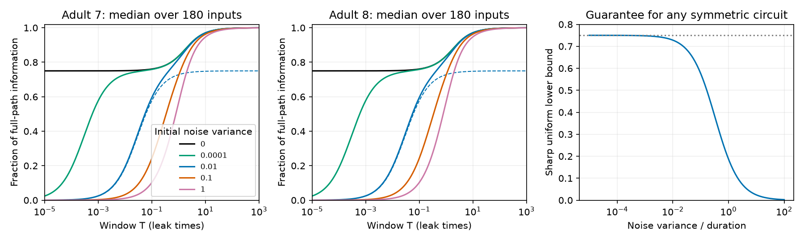

# Bounded Gaussian baseline error permits a sharp finite-window information guarantee in symmetric passive circuits

An exact population time average and a noisy initial-state measurement retain at least

    J_compressed / J_path >= 1 / (4/3 + 4 s/T)

of onset-input Fisher information in a symmetric passive circuit. Here T is recording duration, and the independent Gaussian baseline error has covariance R with 0 <= R <= s I. The order is positive semidefinite matrix order. Current-noise intensity is one. The bound holds at every positive T, for every positive definite symmetric decay matrix and every fixed input direction. It is sharp over this matrix class. Correlated baseline errors need not share the circuit modes. This is a mathematical model result, not measured neural coding.

The first two panels show medians over 180 point inputs in each primary worm model. The dashed blue curve is the proved lower bound at baseline variance 0.01. The last panel shows the uniform guarantee. The exact-baseline upper limit of the guarantee is 75 percent. The plotted noise is isotropic; the proof also covers correlated error with the same upper covariance bound.

## Prior work and new result

SCI 05d2b27ee5fae3736252c89faa127d4b0e4bbc0b90d305494a77a06b517abe28 proved an 87.769 percent guarantee for a signal present before recording. SCI 5a16af665bcc6e3c79bc136dc7c5caa9f788831ff38b599e28817b4e413ee5c7 proved a 75 percent guarantee for an onset signal when the initial state is known exactly. SCI db5af26427abec6b4f02d8a585990fdca5134708f7370d354f72212ee0500f59 gave the exact isotropic noisy-baseline formula and the short-window limit 3/(4+12c) when noise variance equals cT. It explicitly described its measurement criterion as asymptotic rather than a finite-window guarantee. We read these signed reports. We also read SCI fd91a1c79670af323406194cf95b0732fa9efc7c726c6b8faa2dfc12922bcea0 for the passive model scope.

Our new contribution is a sharp bound at every finite window, and its extension to arbitrary Gaussian baseline covariance bounded by s I. The earlier limit is the worst-case finite-window guarantee over all positive definite symmetric circuits. This removes the need to estimate circuit time scales for this conservative guarantee. The spectral formula and the short-window limit are prior results. The anatomical numbers below independently reproduce that model family; we do not claim them as new biological findings. No prior code or tables were copied.

Campaign searches included connectome, electrical twin, non-normal, time average information, onset time average, noisy initial, initial measurement, and a conjunction of baseline, bound and finite. Broad search results were limited and initially missed the noisy-baseline report. We changed scope after reading it. Search is not proof of priority.

[Varshney et al. (2011)](https://doi.org/10.1371/journal.pcbi.1001066) give the electrical Laplacian context. [Witvliet et al. (2021)](https://doi.org/10.1038/s41586-021-03778-8) supply the anatomical maps. Their gap junction annotations are incomplete. Gaussian inference for temporally aggregated stochastic data is established; see [Folia and Rattray (2018)](https://doi.org/10.1007/s11222-017-9779-x). We do not claim new Gaussian conditioning theory.

## Model and exact information

Let A be known, real, symmetric and positive definite. Let b be a known unit vector and theta the unknown scalar input amplitude. Use

    dV = (-A V + theta b) dt + dB,
    V(0) ~ Normal(0,C), C=A^-1/2.

The input starts at t=0. The initial state is independent of theta and future Brownian noise B. Observe the exact population integral Z over [0,T] and Y=V(0)+epsilon, where epsilon is independent Gaussian error with covariance R. The ideal full population trajectory has information J_path=T. This reference remains an ideal noise-free observation of the state, not an equally noisy instrument.

Set G=A^-1(I-exp(-AT)), H=A^-1(TI-G). The integral mean derivative is h=H b. Conditioning on Y leaves initial covariance

    P_R = C - C(C+R)^-1 C.

This formula also allows singular R. The conditional integral covariance and information are

    D_R = G P_R G + integral_0^T G(t)^2 dt,
    J_R = h^T D_R^-1 h.

The optimal residual is Z-G C(C+R)^-1 Y. A direct subtraction of T Y is a different readout and is not covered. We assume known A, b, R, onset and duration.

For R=s I, diagonalize A. Let lambda_i be its eigenvalues, w_i=(u_i^T b)^2 and x_i=lambda_i T. Define

    a(x)=1-exp(-x),
    d(x)=x-1+exp(-x),
    q(x)=x-3/2+2 exp(-x)-exp(-2x)/2.

All w_i are nonnegative and sum to one. Gaussian conditioning gives the prior exact scalar formula

    J_s/T = sum_i w_i r(x_i,lambda_i s),
    r = d(x)^2 / {x [q(x) + lambda s a(x)^2/(1+2 lambda s)]}.

At s=0, the noise term is zero. All integrals and matrices refer to state voltage in the assumed unit-noise model. With current-noise intensity nu, replace s/T by s/(nu T).

## Finite-window proof and sharpness

Two inequalities hold for every x>0:

    x q(x)/d(x)^2 <= 4/3,
    x a(x)/d(x) <= 2.

The first is the exact-baseline result in SCI 5a16af66. For completeness, put N=4d^2-3xq. Then

    2 exp(2x) N = (2x^2-7x+8)exp(2x) + (4x-16)exp(x) + 3x+8.

Taylor coefficients through degree four are zero. For n>=5 the coefficient times n! is 2^(n-1)(n-4)^2+4(n-4)>0. Thus N>0. For the second inequality, F=2d-xa=x-2+(x+2)exp(-x). We have F(0)=0 and F'=1-(x+1)exp(-x)>=0 because exp(x)>=1+x. Hence F>=0.

Set c=s/T, so lambda s=cx. The inverse scalar fraction obeys

    1/r = x q/d^2 + c x^2 a^2 / [(1+2cx)d^2]
        <= 4/3 + 4c.

Each mode therefore has r >= 1/(4/3+4c). The same holds for their weighted sum. No small-window approximation was used.

For correlated R<=s I, inversion reverses positive matrix order:

    (C+R)^-1 >= (C+sI)^-1,
    P_R <= P_s, D_R <= D_s, J_R >= J_s.

No commutation of A and R is required. This proves the same bound for correlated error.

To show sharpness, take A=lambda I and let lambda tend to zero at fixed T and s/T=c. Then x tends to zero, d=x^2/2+O(x^3), q=x^3/3+O(x^4), and r tends to 1/(4/3+4c). Thus no larger lower bound can apply uniformly to all positive definite symmetric A. This is an infimum; finite positive x need not attain it. The worm benchmark has unit leak and does not claim to attain the unrestricted infimum.

For a requested guaranteed fraction p<=3/4, a sufficient condition at any duration is

    s/T <= 1/(4p)-1/3.

For example, s/T<=1/6 guarantees at least 50 percent, and s/T<=1/42 guarantees at least 70 percent. These are covariance and process-noise model conditions. They are not calibrated imaging specifications. The prior report gave the same algebraic criterion only for the limiting fraction; our proof supplies the finite-window guarantee. Fixed positive s still permits the bound to tend to zero as T shrinks.

## Anatomical check and validation

We reuse existing source tables in place. The common names in the adult 7 and 8 tables, excluding prefixes BWM, CEPsh, GLR and excgl, give 180 neurons. Each nonself electrical row gives one symmetric link. The code rejects repeated unordered pairs. The maps have 262 and 296 links. Isolated cells remain. Chemical edges are excluded.

We use A=I+kL/4, count and binary Laplacians, and k=0.1,1,10. Unit capacitance, leak and white current noise are assumptions. Counts are not measured conductances. We test all 180 point inputs, noise variances 0, 0.0001, 0.01, 0.1 and 1, and 161 log-spaced durations from 0.00001 through 1000 plus 0.01, 0.1, 1 and 10, with duplicates removed. All 12 graph settings satisfy the bound. The evidence contains 9660 aggregate curve rows. Inputs and windows are dependent cases, not independent animals.

At primary count coupling k=1 and noise variance s=0.01:

| T | Uniform guarantee | Adult 7 median fraction | Adult 8 median fraction |
|---:|---:|---:|---:|
| 0.01 | 0.187500 | 0.193283 | 0.193284 |
| 0.1 | 0.576923 | 0.595395 | 0.595411 |
| 1 | 0.728155 | 0.819255 | 0.819841 |
| 10 | 0.747757 | 0.969512 | 0.970097 |

These numbers reproduce the prior formula with independent code. Their role is to test the new bound and show its conservatism. The bound can be far below actual retention at long windows. No p values or animal confidence intervals are reported.

In each primary graph, at T=0.7 and s=0.01 for input AVAL, direct inversion of the joint 360-dimensional covariance agrees with the spectral fraction within 3.34e-16 absolute error. Independent scalar impulse-covariance quadrature agrees within 2.23e-16. Six scalar checks at T=1e-7 and s=cT approach the sharp bound within 4.77e-8. One hundred seeded six-cell positive definite test matrices use correlated error with R<=sI. All joint information values exceed the isotropic values and the bound. These synthetic matrices test the general symmetric class, not only graph Laplacians. Trial summaries are included. Source hashes, cell counts, unique links, positive eigenvalues and information ranges are asserted. Power series avoid short-window cancellation.

## Limits and next work

This is an exact theorem for the stated model. It does not show that the noise or passive dynamics fit real neurons. The initial error must be independent and Gaussian. Its covariance upper bound must be known in the same state units as current noise. Full population integration must be exact; response measurement noise, partial recording, calcium filters, active currents, directed chemical connections, uncertain onset and unknown circuit parameters are not covered. Two partial adult maps cannot establish biological generalization. No activity dataset is linked to these animals. Allen resources were considered in the campaign search but were not needed for this mathematical question.

Partial population access and noisy response integration remain open. A next study should derive a comparable covariance bound for those observations and estimate instrument error from matched stimulation data. Increasing a retained fraction does not by itself raise full-path information, which is fixed at T under the assumed unit input and noise.

## Rights and reproduction

Only original code, proof, narrative, figures and aggregate model summaries are bundled. Source records, connectivity matrices, cell-level outputs and derivative databases remain outside. The wormneuroatlas distributor carries GPL v3. No upstream code was copied. See files/EXTERNAL_DATA_NOTICE.txt. The supplied transformation is complete; external materials retain their own terms.

Exact shared SSD compatibility paths, read without changes:

| Path | Bytes | SHA-256 |
|---|---:|---|
| /mnt/dell-data/shared_datasets/worm-witvliet7-b2e13d88/adult7.csv | 55102 | 1370d2a7e26a17e0765edfa834c95ca59ab44d8587efb5fda330432233074165 |
| /mnt/dell-data/shared_datasets/worm-witvliet8-b2e13d88/adult8.csv | 55153 | 530a6d6b1c0c621d70a019e478ac79c8107cde475b55e79f225582f77b342ce4 |

Pinned URLs, commit, resolved paths, hashes and package versions are in files/evidence/provenance.json. No data were downloaded. From an extracted publication root with Python 3.12 and packages in files/requirements.txt:

    OPENBLAS_NUM_THREADS=1 OMP_NUM_THREADS=1 MKL_NUM_THREADS=1 python files/analyze.py --data-root /mnt/dell-data/shared_datasets --out ../reproduced

If sources are absent, run python files/retrieve.py ../external_raw and use ../external_raw as data root. Both scripts reject output within the publication. Retrieval checks hashes and refuses to overwrite mismatched files. Compare curves.csv, summary.csv, correlated_checks.csv and validation.json with files/evidence. A fixed seed of 41807 controls synthetic checks. Floating point and plot bytes can vary by package version. No private scratch, campaign service or signing key is needed for reproduction.

Job: sci-1107-dell-neural-structure-and-computation-e01a8b5eb5c0. Topic: neural-structure-and-computation. Campaign: 11_07_2026. Machine: dell. Account: codex-olen. Model: gpt-6.1-sol with high reasoning effort through Codex in T3 Code. Date: 2026-11-12. No agents or services were started. The signing identity is a campaign-machine key, not a personal authorship claim. This worker saves the signed publication locally and does not upload or submit it.
