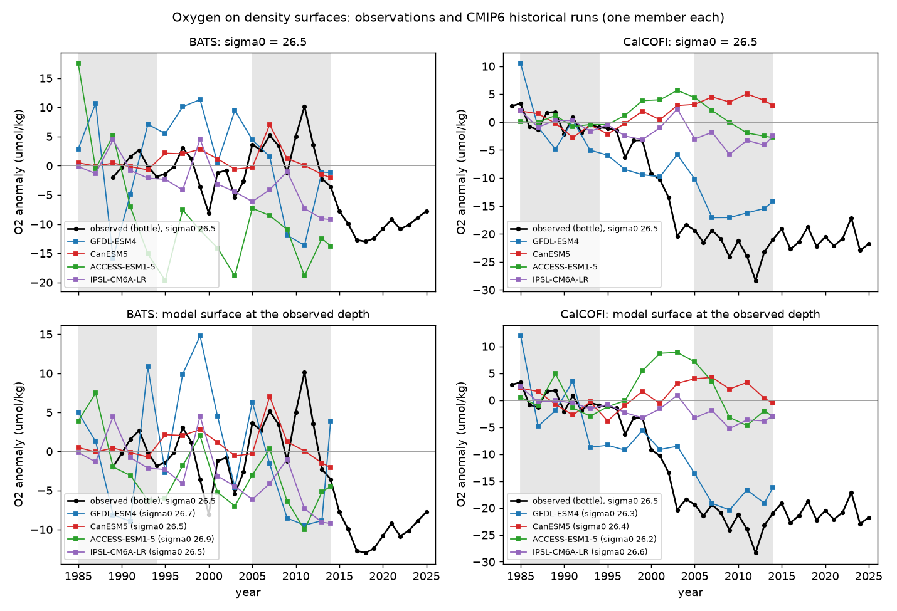
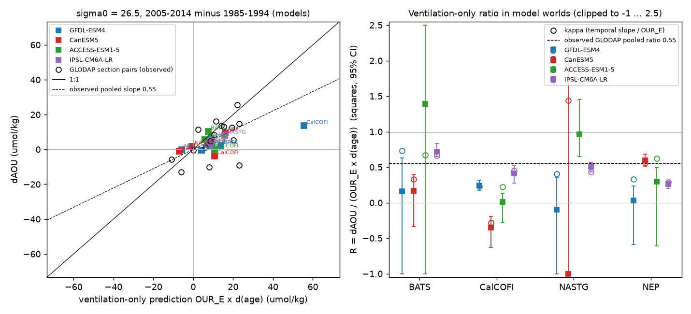
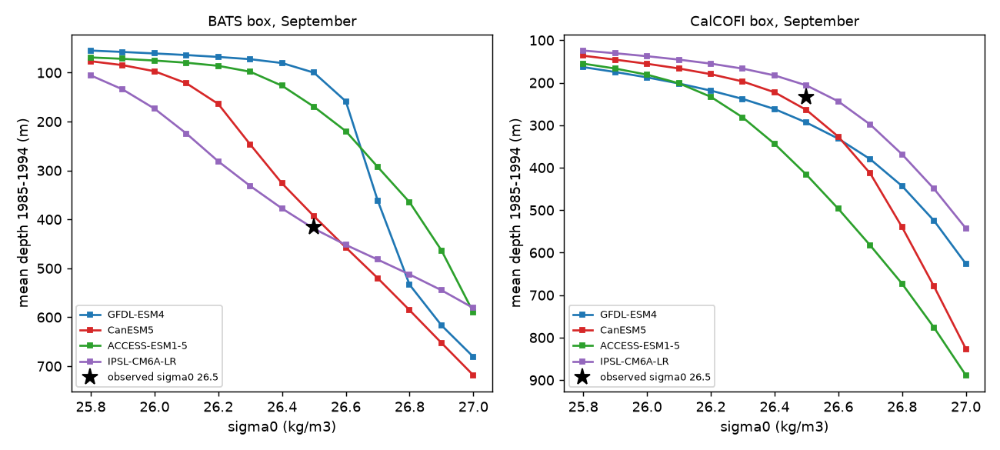

# Four CMIP6 historical runs do not reproduce the 1985-2014 oxygen loss on sigma0 26.5 off southern California; in their ideal-age fields AOU follows age, but the ventilation-only ratio is 0 to 1.4

## Summary

Earlier campaign publications found oxygen loss on the sigma0 = 26.5 kg/m3 density surface. The loss was not caused by solubility or by vertical movement of the surface. Off southern California (CalCOFI, sci:sha256:d2aed83c...) oxygen fell by 22 umol/kg. At Bermuda (BATS, sci:sha256:710d4880...) oxygen fell by 10.8 umol/kg, mostly after 2014. A GLODAP tracer study (sci:sha256:a1be8c13...) found that CFC-12 and SF6 water-age increases are large enough to explain the AOU (apparent oxygen utilization) increase. It found the pooled ratio of the AOU change to a "ventilation-only" prediction to be 0.55. This prediction is OUR_E x d(age), with OUR_E = AOU/age. That study did not compare with models.

We did this comparison. We used four CMIP6 Earth system models: GFDL-ESM4, CanESM5, ACCESS-ESM1-5 and IPSL-CM6A-LR (historical and piControl, member r1i1p1f1). We read only the needed chunks of the public Google Cloud Zarr stores. We put temperature, salinity, oxygen and age on density surfaces for September of 1985, 1987, ..., 2013 and 2014. Three models supply ideal age (the true mean age of the water in the model). GFDL-ESM4 supplies CFC-12 and SF6, and we calculated tracer ages for it with the method of the GLODAP study. Then we compared 2005-2014 with 1985-1994 in a CalCOFI box (29-35 N, 126-117 W), a BATS box (29-35 N, 67-61 W) and two larger boxes.

Main results (sigma0 = 26.5; changes are 2005-2014 minus 1985-1994; intervals are 95% bootstrap intervals over sample years):

1. **The models do not reproduce the CalCOFI loss.** Observed: -22.3 umol/kg, trend -1.10 (-1.47 to -0.96) umol/kg per year. Models: GFDL-ESM4 -15.0 (-20.8 to -10.3), IPSL-CM6A-LR -3.4 (-5.0 to -2.0), ACCESS-ESM1-5 -0.1 (-2.1 to +2.2), CanESM5 +3.9 (+2.3 to +5.5). Only GFDL-ESM4 gives a loss of a similar size. In the piControl segments of the same years, the change in this box was -3.2 to -0.2 umol/kg (three models). On the model surface at the observed depth (233 m), the results are similar (GFDL-ESM4 -17.5; others -3.5 to +2.2).
2. **At BATS the observations show no loss in 1985-2014, but three models do.** Observed change from 1989-1994 to 2005-2014: +2.7 umol/kg (trend +0.12, -0.10 to +0.48). Models: ACCESS-ESM1-5 -12.0, IPSL-CM6A-LR -6.2, GFDL-ESM4 -3.6, CanESM5 +0.7. The observed BATS loss came after 2014, outside the historical runs.
3. **In the model worlds, AOU follows ideal age, but the ventilation-only ratio is not a fixed number.** The correlation of box-mean AOU and age after removal of linear trends was 0.61 to 0.99 in 10 of 12 ideal-age model-box cases. The exceptions are the very old water (mean ideal age about 490-540 yr) of CanESM5 off California and in the eastern North Pacific. The ratio R = dAOU / (OUR_E x d(age)) was 0.26 to 0.72 in IPSL-CM6A-LR (all four boxes, intervals inside 0.20-0.84) and 0.01 to 1.39 in ACCESS-ESM1-5. In CanESM5 it was -2.9 to 0.6. The observed GLODAP ratio, 0.55, is inside this range. Thus a ratio below 1 does not show a respiration change. The models give such ratios also when AOU tracks age. The ratio alone cannot separate ventilation from respiration.
4. **Tracer ages in one model give age changes that differ by a factor of 1.4.** In GFDL-ESM4 off California, CFC-12 TTD ages increased by 34.2 yr (25.2 to 43.2) and SF6 TTD ages by 24.0 yr (16.4 to 31.3), with the TTD width fitted so that the two tracers agree in 2005-2014 (Delta/Gamma = 1.4). With Delta/Gamma = 1 the values were 24.8 and 16.3 yr. Thus in a model where all fields are known, the tracer choice changes the ventilation-only prediction by about 40%.
5. **Mean-state biases are large.** Observed 1985-1994 oxygen on sigma0 26.5: CalCOFI 110 umol/kg, BATS 198 umol/kg. Models: CalCOFI 9 (ACCESS-ESM1-5) to 105 (IPSL-CM6A-LR); BATS 174 to 218. The mean ideal age off California was 93 yr (IPSL-CM6A-LR), 161 yr (ACCESS-ESM1-5) and 536 yr (CanESM5). In GFDL-ESM4 and ACCESS-ESM1-5 the 26.5 surface near BATS is at 100-170 m in September, not at the observed 415 m (Fig. 3).

Interpretation (not a causal test): the large and lasting CalCOFI loss is outside what three of four models simulate, and only GFDL-ESM4 comes near it. In GFDL-ESM4 the loss comes with a large tracer-age increase, which agrees with the GLODAP result that the CalCOFI-end loss came with older water. But age increase alone does not give oxygen loss in every model: CanESM5 also has a large ideal-age increase there (+25 yr), in very old, low-oxygen water, and its oxygen rose. The model results do not support a test that uses the size of R to find a respiration change: in models where AOU follows age, R depends on the model and the box.







## Question

Do CMIP6 historical runs reproduce the oxygen loss on sigma0 = 26.5 near BATS and off southern California? In model worlds, where the true water age is known, does AOU follow age? What ratio R does such a world give for the ventilation-only test of the GLODAP study?

## Data

- **CMIP6 model output**, Google Cloud public Zarr stores (https://storage.googleapis.com/cmip6/). Historical and piControl, r1i1p1f1. GFDL-ESM4 (1-degree "gr" grid): thetao, so, o2 (Omon), cfc12 and sf6 (Oyr). CanESM5, ACCESS-ESM1-5, IPSL-CM6A-LR (native grids): thetao, so, o2, agessc (Omon). Every object that we read is listed with URL, version, size and SHA-256 in `files/provenance/cmip6_chunk_manifest.csv` (546 objects, 23.1 GB). Versions are also pinned in `files/code/models.py`. License: CC BY 4.0 for all four models per the CMIP6 per-model license page (see `files/NOTICE_external_data.txt`).
- **Atmospheric tracer histories**, Bullister and Warner, NCEI accession 0164584 v2.2, Table 1 (revised 2023), Northern Hemisphere columns. Shared copy `/mnt/dell-data/shared_datasets/bullister-atm-tracer-histories-ncei0164584-v2.2-rev2023/Tracer_atmospheric_histories_revised_2023_Table1.csv`, SHA-256 415b39a995cbbfea2114bf6fb1b59bda6d22303d5341df7090f1e04bcf789e2d.
- **Observed references** from campaign publications: CalCOFI annual anomalies (`files/data/annual_all.csv` of sci:sha256:d2aed83c..., SHA-256 f8d298ef...) and cast file (`core_cast_anomalies.csv.gz`, SHA-256 503b8443..., for the 233 m depth and the absolute oxygen); BATS annual aggregates (`files/results/annual_aggregates.csv` of sci:sha256:710d4880..., SHA-256 e07ace05...); GLODAP consecutive pairs (`files/results/consecutive_pairs.csv` of sci:sha256:a1be8c13..., SHA-256 bd2e112e...). All hashes are in `files/provenance/sources.json`.
- **GLODAPv2.2023 Pacific file** (shared copy `/mnt/dell-data/shared_datasets/glodapv2-2023-pacific-ocean-csv-ncei0283442/`, SHA-256 d59b0776...), first 400,000 rows, only for the solubility check.

## Methods

1. **Sampling.** Global chunks are large, so we read one month (September) of 16 years: 1985, 1987, ..., 2013 and 2014. September keeps the season fixed. The first test with April put sigma0 26.5 in the GFDL-ESM4 winter mixed layer near BATS (48 m), so we changed the month before any change or trend was calculated (`files/analysis_plan.txt`, addendum 1). Columns: 15-50 N in the North Atlantic (100 W-0) and North Pacific (120 E-100 W).
2. **Density surfaces.** TEOS-10 sigma0 (gsw 3.6.23) from model potential temperature and practical salinity. Linear interpolation in sigma0 to 25.8, 25.9, ..., 27.0 at the first crossing from above. O2 in umol/kg (mol/m3 divided by in-situ density). Solubility: gsw O2sol_SP_pt. AOU = solubility - O2.
3. **Ages.** Ideal age (agessc) for three models. GFDL-ESM4: model CFC-12 and SF6 converted to partial pressures with the Warner and Weiss (1985) and Bullister et al. (2002) solubilities. These functions reproduce the GLODAP concentration/partial-pressure ratios to 2e-5 (`files/results/solubility_check.json`). Inverse-Gaussian TTD mean ages with Delta/Gamma = 1, and with the Delta/Gamma (0.4-2.0 grid) at which the median SF6 and CFC-12 ages agree in 2005-2014 (1.4 on all three surfaces).
4. **Boxes and tests.** Box mean over a fixed set of columns that have values in all 16 years. T1: OLS trend 1985-2014 with a moving-block bootstrap (blocks of 3 samples, 4,000 draws). T2: change 2005-2014 minus 1985-1994. T3: per column, OUR_E = AOU_early / age_early and prediction = OUR_E x d(age); R = mean dAOU / mean prediction; bootstrap of years within the windows. Also R with OUR from the slope of AOU on age across the columns of the larger box. T4: slope and correlation of box-mean AOU on age over the 16 samples; kappa = slope / OUR_E. T6: the same on the model surface whose 1985-1994 mean depth is nearest to the observed depth of sigma0 26.5 (BATS 415 m, CalCOFI 233 m). Observations use the same windows (BATS starts in 1989).
5. **Drift check.** We processed the piControl years that match 1985-2014 after the branch point (`files/code/models.py`). Corrected change = historical change - control change. IPSL-CM6A-LR piControl has no o2 and no salinity for these years on the store, so for IPSL we only estimated the age drift, at each column's historical mean depth of the surface. We added this check and the detrended correlation after we saw the planned results.

## Results tables

`files/results/summary_sigma26.5.csv` gives all values below. dO2, dAOU in umol/kg; d(age) in yr.

| Box | Source | dO2 | dAOU | d(age) | R | detrended r(AOU, age) | control dO2 |
|---|---|---|---|---|---|---|---|
| CalCOFI | observed | -22.3 | +21.3 | | | | |
| CalCOFI | GFDL-ESM4 (CFC-12 age) | -15.0 | +13.6 | +34.2 | 0.24 | 0.44 | -0.2 |
| CalCOFI | IPSL-CM6A-LR | -3.4 | +3.0 | +4.0 | 0.41 | 0.74 | n/a |
| CalCOFI | ACCESS-ESM1-5 | -0.1 | +0.2 | +6.3 | 0.01 | 0.97 | -2.1 |
| CalCOFI | CanESM5 | +3.9 | -3.8 | +25.5 | -0.35 | -0.14 | -3.2 |
| BATS | observed (from 1989) | +2.7 | -3.7 | | | | |
| BATS | GFDL-ESM4 (CFC-12 age) | -3.6 | +2.2 | +3.7 | 0.16 | 0.94 | +5.8 |
| BATS | IPSL-CM6A-LR | -6.2 | +6.5 | +5.7 | 0.72 | 0.97 | n/a |
| BATS | ACCESS-ESM1-5 | -12.0 | +10.4 | +1.9 | 1.39 | 0.83 | -0.6 |
| BATS | CanESM5 | +0.7 | -1.2 | -11.9 | 0.17 | 0.82 | +0.4 |
| NASTG | IPSL / ACCESS / CanESM5 | -7.6 / -6.0 / -1.9 | | | 0.51 / 0.97 / -2.94 | 0.81 / 0.61 / 0.76 | |
| NEP | IPSL / ACCESS / CanESM5 | -2.8 / -2.5 / -9.8 | | | 0.26 / 0.30 / 0.59 | 0.92 / 0.99 / -0.36 | |

Drift-corrected R (`files/results/model_drift.csv`) moved within a similar range: IPSL-CM6A-LR 0.26-1.72 (age drift only), ACCESS-ESM1-5 0.46-1.40, CanESM5 -0.86 to 0.52. A 20-year window difference of a 30-year control segment contains internal variability as well as drift, so the corrected values are not more exact than the uncorrected ones. The planned primary values are the uncorrected ones. The results on sigma0 26.3 and 26.7 are in `files/results/model_region_tests.csv`; off California, GFDL-ESM4 (-17.5, -15.0, -9.7) and IPSL-CM6A-LR (-3.4 on all three) lose oxygen on all three surfaces, while ACCESS-ESM1-5 (+1.1 to -1.1) and CanESM5 (+1.5 to +3.9) stay within a few umol/kg of zero.

## Limitations

- **One member per model, four models.** Internal variability is not in phase with the real ocean. We compare sizes and signs, not timing. A single piControl segment of 30 years is a weak measure of internal variability.
- **Sampling.** One month in 16 years. Seasonal and interannual noise is in the sample series. Grid boxes near 1 degree do not resolve the California Current System or the California Undercurrent.
- **Mean-state biases.** The models put the surface at different depths and give very different oxygen and age there. A fixed density surface is not the same water in each model. The depth-matched surface is only a partial remedy.
- **Drift.** CMIP6 ideal age is not in equilibrium in old water. For CanESM5 off California, age rose by 25 yr in 20 yr. The drift check is approximate, and for IPSL-CM6A-LR it uses a fixed-depth proxy and no O2.
- **No truth for respiration.** The models do not give an oxygen-consumption diagnostic in the files we used. Thus "AOU follows age" is a correlation, not a budget. R and kappa in the models describe how the ventilation-only test behaves, not the true share of ventilation.
- **Window choice.** The historical runs end in 2014. The BATS loss after 2014 is not tested. The observed BATS series starts in 1989, not 1985.
- **Plan.** The plan (`files/analysis_plan.txt`) was written before results. The month change, the depth-matched test, the drift check and the detrended correlation came later, as stated. Tests are not externally registered and not corrected for multiple comparisons.

## Reproduction

```sh
pip install -r files/code/requirements.txt      # in a private environment
bash files/code/run_all.sh /path/to/empty/scratch /path/to/campaign_bundles
```

`run_all.sh` downloads the Zarr chunks (about 23 GB) and the tracer history into the scratch folder, checks the tracer-history hash, extracts the three observed reference tables from the cited bundles, and repeats all steps. Column-level model files (about 37 MB per run) stay in scratch. `provenance.py` writes a new chunk manifest; compare its SHA-256 values with `files/provenance/cmip6_chunk_manifest.csv`. Scripts: `zarr_lite.py` (chunk reader), `models.py` (runs, versions, branch-year offsets), `process_model.py` (density surfaces), `ttd.py` (TTD ages), `analyze_models.py` (T1-T6), `obs_reference.py`, `drift.py`, `posthoc.py`, `check_solubility.py`, `figures.py`, `provenance.py`. Software: Python 3.12.16, numpy 2.5.4, pandas 3.1.1, matplotlib 3.11.2, gsw 3.6.23, numcodecs 0.17.1, curl 8.18.0. Bootstrap seeds 20261110 and 20261111.

## Provenance

Campaign 11_07_2026. Job sci-1107-dell-earth-and-ocean-sciences-6ae519d52e8b. Topic earth-and-ocean-sciences. Machine dell. Account claude-olen. Model claude-opus-5-5 (Claude Code agent). Analysis date 2026-11-10. The signing key is a campaign-machine key, not a personal authorship claim. A campaign search on 2026-11-10 found the GLODAP tracer-age study (sci:sha256:a1be8c13...), which did not do a model comparison; we found no campaign publication with CMIP6 oxygen or ideal age.

## References

- sci:sha256:d2aed83cfe2b4a27207c5bd10e25b2398ade09b4a6955fb06bb063a7136fb0d2 (CalCOFI sigma 26.5), sci:sha256:710d488013378c0a36b95ef1a1d7389ba4761b9ee4309315c9f27ab4c553390b (BATS sigma 26.5), sci:sha256:a1be8c1365d457487849650de11c54595cc36d62f9e81280b76e1bb7af72bf13 (GLODAP CFC-12/SF6 ages), sci:sha256:f8b4712853bb3861281c214ba2a4f627537fb7dd4db1f5c32ad8af6859f5c6c3 (CalCOFI 200 m solubility).
- Eyring, V., et al. (2016). Overview of the Coupled Model Intercomparison Project Phase 6 (CMIP6). Geoscientific Model Development 9, 1937-1958. doi:10.5194/gmd-9-1937-2016.
- Dunne, J. P., et al. (2020). The GFDL Earth System Model Version 4.1 (GFDL-ESM 4.1). JAMES 12. doi:10.1029/2019MS002015.
- Swart, N. C., et al. (2019). The Canadian Earth System Model version 5 (CanESM5.0.3). GMD 12, 4823-4873. doi:10.5194/gmd-12-4823-2019.
- Ziehn, T., et al. (2020). The Australian Earth System Model: ACCESS-ESM1.5. JSHESS 70, 193-214. doi:10.1071/ES19035.
- Boucher, O., et al. (2020). Presentation and evaluation of the IPSL-CM6A-LR climate model. JAMES 12. doi:10.1029/2019MS002010.
- Waugh, D. W., Hall, T. M., and Haine, T. W. N. (2003). Relationships among tracer ages. JGR 108(C5), 3138. doi:10.1029/2002JC001325.
- Warner, M. J., and Weiss, R. F. (1985). Solubilities of chlorofluorocarbons 11 and 12 in water and seawater. Deep-Sea Research 32, 1485-1497. doi:10.1016/0198-0149(85)90099-8.
- Bullister, J. L., Wisegarver, D. P., and Menzia, F. A. (2002). The solubility of sulfur hexafluoride in water and seawater. Deep-Sea Research I 49, 175-187. doi:10.1016/S0967-0637(01)00051-6.
- Lauvset, S. K., et al. (2024). GLODAPv2.2023. Earth System Science Data 16, 2047-2072. doi:10.5194/essd-16-2047-2024.
