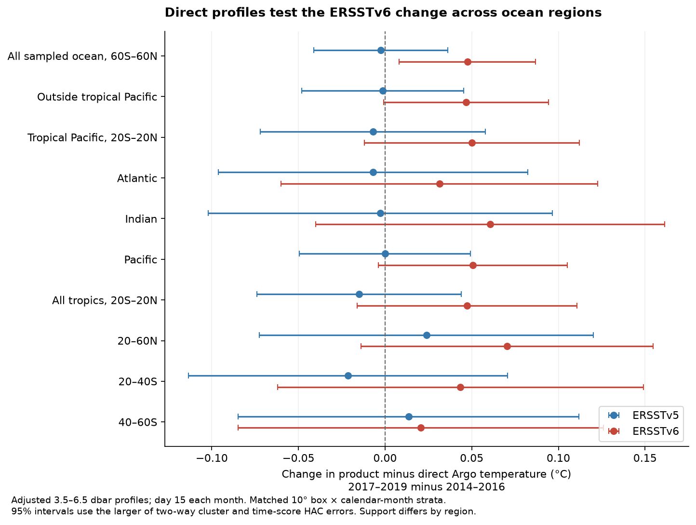
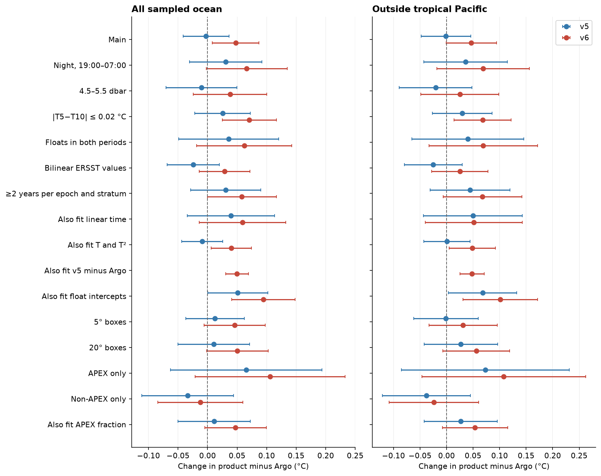
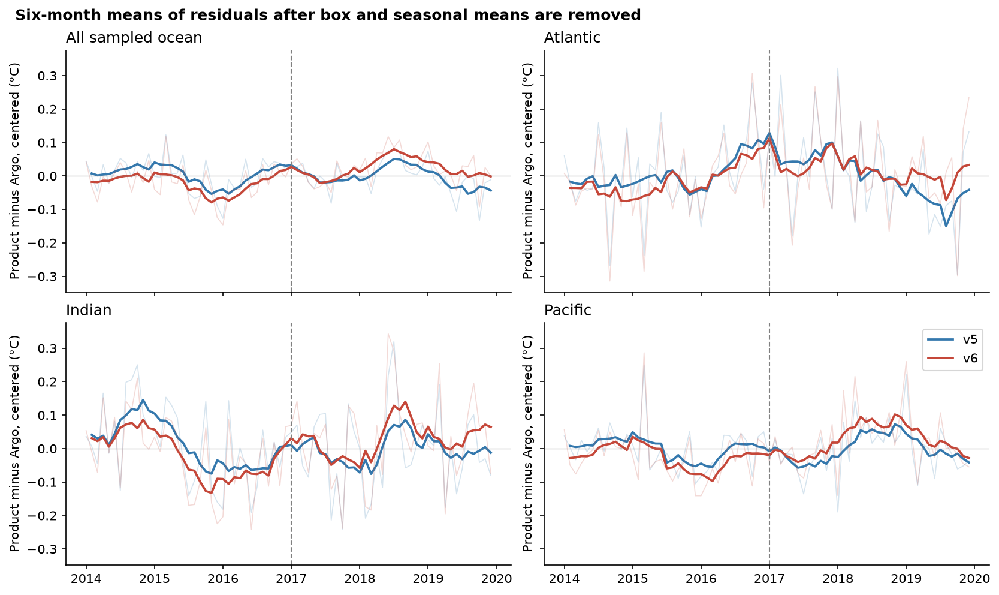

# In a 2014-2019 Argo sample, ERSSTv6 warmed 0.047 C relative to profiles at the nearest grid cells

## Result

The main matched sample supports a warm ERSSTv6 change relative to direct Argo profiles.
Its size is uncertain. The main estimate is +0.047 C, but bilinear sampling gives +0.029 C
with an interval that includes zero. The new test does not support one precise global correction.

The main sample has 23,959 profiles from 5,839 floats, in 337 boxes and 3,288 box and calendar-month strata.
The full reduction selected 25,730 profiles from 5,949 floats. Of these, 25,630 have values in both products.
The remaining difference in count comes from matching strata across both epochs.
All 216 GDAC files were retrieved. The two ERSST files and those 216 files total 2.484 GiB.

The most useful new result is that the **version difference extends outside the tropical Pacific**:
ERSSTv6 minus ERSSTv5 changes by +0.048 [+0.025, +0.071] C there.
This comparison uses 18,638 profiles in 275 matched boxes. The Argo temperature cancels from this contrast.
Thus it establishes a change between the products on the sampled support. It does not, by itself,
establish which product is wrong.

The direct v6-minus-Argo change outside the tropical Pacific is +0.047 [-0.001, +0.094] C.
Its primary 95 percent interval just includes zero. The v5-minus-Argo change is
-0.001 [-0.048, +0.045] C. Therefore this sample does not assign the full change
to an ERSSTv6 error at 95 percent confidence outside that region.

### Matched period changes

All values are C. Brackets give individual 95 percent intervals. Each row has its own matched support.

| Region | ERSSTv5 minus Argo | ERSSTv6 minus Argo | ERSSTv6 minus v5 |
|---|---|---|---|
| All sampled ocean, 60S-60N | -0.003 [-0.041, +0.036] | +0.047 [+0.008, +0.087] | +0.050 [+0.031, +0.069] |
| Outside tropical Pacific | -0.001 [-0.048, +0.045] | +0.047 [-0.001, +0.094] | +0.048 [+0.025, +0.071] |
| Tropical Pacific, 20S-20N | -0.007 [-0.072, +0.058] | +0.050 [-0.012, +0.112] | +0.057 [+0.018, +0.096] |
| Atlantic | -0.007 [-0.096, +0.082] | +0.031 [-0.060, +0.123] | +0.038 [-0.002, +0.079] |
| Indian | -0.003 [-0.102, +0.097] | +0.061 [-0.040, +0.161] | +0.063 [+0.025, +0.102] |
| Pacific | -0.000 [-0.049, +0.049] | +0.051 [-0.004, +0.105] | +0.051 [+0.023, +0.078] |
| 20S-20N | -0.015 [-0.074, +0.044] | +0.047 [-0.016, +0.111] | +0.062 [+0.031, +0.093] |
| 20-60N | +0.024 [-0.073, +0.120] | +0.070 [-0.014, +0.155] | +0.047 [+0.004, +0.089] |
| 20-40S | -0.021 [-0.113, +0.071] | +0.044 [-0.062, +0.149] | +0.065 [+0.019, +0.110] |
| 40-60S | +0.014 [-0.085, +0.112] | +0.021 [-0.085, +0.126] | +0.007 [-0.034, +0.048] |

The basin estimates are all positive for v6, but none of the three direct basin intervals excludes zero.
The paired version contrast excludes zero in the Indian and Pacific samples. It does not exclude zero
in the Atlantic sample or at 40-60S. The data therefore do not establish an equal warm error in all basins.

### Sampling and model checks

The all-ocean sampled v6 change is +0.066 C at night, +0.038 C at 4.5-5.5 dbar,
+0.071 C when the 5-to-10 dbar temperature difference is at most 0.02 C,
and +0.062 C for floats with at least two profiles in each epoch.
The respective intervals are in the results file. Most include zero because the smaller samples are noisy.

Bilinear sampling reduces the main estimate to +0.029 C [-0.014, +0.072].
Thus the collocation choice matters by about 0.019 C in this sample.
Adding local temperature and its square gives +0.040 C [+0.006, +0.074].
Adding a linear time term gives +0.059 C [-0.014, +0.133].
The extra time term does not establish a sharp step.

The APEX-only estimate is +0.106 C [-0.021, +0.233], while the non-APEX estimate is
-0.012 C [-0.084, +0.060]. These subsets have very different matched spatial and seasonal support:
91 and 98 boxes, compared with 337 in the main test. Both intervals include zero.
Their difference is a warning about support and fleet mix, not proof of an instrument offset.
The APEX-fraction control was added after the separate type results were seen. It is an exploratory check.
This added control leaves the all-ocean v6 point estimate near +0.047 C,
but its interval includes zero. No claim that fleet effects are resolved follows from this test.

A model with both float and box-season intercepts gives a larger all-ocean estimate,
+0.094 C [+0.041, +0.148]. It uses different identifying information and does not fix the correction size.
The sparse least-squares projection checks its weighted normal equations. It replaces an iterative
projection that did not converge in the initial numerical check.

### Meaning for the earlier work

The direct sampled result is consistent with the earlier +0.05 to +0.07 C product-comparison estimates.
It uses primary profiles rather than the mapped Argo field with its reported 2016 change.
It therefore adds a different measurement check to the earlier evidence.

However, this experiment has broader uncertainty than product-to-product comparisons.
The primary target outside the tropical Pacific does not exclude zero against direct profiles.
The sensitivity tests do not support a single correction with a small uncertainty.
The evidence is stronger for a version-specific change than for its exact error size in every region.

The fitted change is a change in product-minus-profile temperature. It is not an absolute SST calibration.
It can arise from an error before the split, after the split, or both.
This distinction does not remove the time-dependent discrepancy, but it limits the correction that can be made.

## Question

Does the ERSSTv6 change found by earlier campaign work appear against direct Argo profiles across the ocean basins?
Does it also appear outside the tropical Pacific, where earlier work tested moored buoys?

Earlier studies found an ERSSTv6 warm change near 2017. They used other SST products and moored buoys.
A mapped Argo field was not a clean test because it had its own reported change in 2016.
This study uses the adjusted measurements in individual Argo profiles. It does not use that mapped field.

The test is a consistency test. Argo is an input to ERSSTv5 and ERSSTv6. These observations were not held out
when the two products were made. The result can test whether the product output follows direct measurements.
It cannot prove the cause of an error or measure performance on independent data.

## Fixed data design

The sample contains the GDAC geographic files for the 15th day of each month in 2014-2019, in the Atlantic,
Indian, and Pacific oceans. The date rule and main estimator were fixed before profile reduction. The primary regional question concerns the area outside the tropical Pacific; the pooled comparison gives context. Each file contains full vertical
profiles from that day. This design avoids the failed Argo ERDDAP endpoint and can be repeated from the primary archive.

The primary test uses ascending primary profiles in delayed mode. Position, time, adjusted pressure,
and adjusted temperature must have quality flag 1. It selects the good level nearest 5 dbar in 3.5-6.5 dbar.
The test includes latitude 60S-60N, temperature -2.5 to 40 C, and one measurement per float and cycle.
It samples ERSSTv5 and ERSSTv6 in the same month and at the same profile position.

## Estimator and uncertainty

Let e be monthly product temperature minus the selected profile temperature, in C.
The test first averages e within each 10-degree box and sampled date. It fits a fixed mean for each
box and calendar month, plus an indicator for 2017-2019. The coefficient of that indicator is the tested change.

A box and calendar-month stratum must have data in both 2014-2016 and 2017-2019.
Each stratum has equal total weight in each epoch. The weights give each box its cosine-latitude area weight,
split equally over its retained calendar months. Dense profile sampling within a box therefore does not give
the box more weight. The primary coefficient is also calculated as a direct weighted mean of stratum changes.
The two calculations must agree within 1e-10 C.

The uncertainty calculation clusters residual scores by geographic box and by sampled date, with the intersection
term removed. It applies a finite-sample correction for the fitted stratum means. A second calculation uses a
Newey-West score covariance with six monthly lags. The displayed 95 percent interval uses the larger standard
error and a Student quantile with the smaller cluster count minus one degree of freedom.

Sensitivity tests use night profiles, a tighter pressure band, weak near-surface stratification, floats seen in both
epochs, bilinear product sampling, more complete strata, a linear time term, local temperature terms, an ERSSTv5
error term, float intercepts, 5-degree or 20-degree boxes, and separate APEX and non-APEX float types. These tests change support and are not independent replications.

## Scope and limits

The tested quantity is a change across two three-year periods. The test does not locate a break date.
It does not separate a step from a short drift without an additional time assumption.
The result refers to sampled Argo locations and retained strata. It is not a complete global-ocean area mean.
One day each month is sampled. A monthly SST analysis and an instantaneous profile can differ because of weather,
ocean fronts, the diurnal cycle, and depth. The controls reduce some of these effects, but do not remove all of them.
The interval does not include an unknown error common to both ERSST and the Argo measurements.
Current delayed-mode values can differ from the values available when ERSST inputs were collected.
The test cannot assign a difference to data ingest, quality control, or reconstruction. Regional intervals are individual intervals, not simultaneous intervals.

No correction to global temperature, record-year ranking, radiative feedback, or a full trend is calculated here.
The code tests the measurement consistency that must support such corrections.

## Reproduction

Use Python 3.12 with numpy, pandas, scipy, netCDF4, matplotlib, and a parquet engine.
The software file records the versions used. Run:

    bash files/code/run_all.sh /absolute/path/to/new_external_work /absolute/path/to/datasets

The second argument can be omitted. The script then retrieves source files into the new external work folder.
It checks exact hashes. The script stops if a source was revised. Raw data and profile-level tables stay outside
this signed publication. Aggregate results and figures are written in the external work folder.
The reduction took about one minute, and the complete analysis took about two minutes with one numerical thread.
The 2.484 GiB input download took about 30 minutes with two transfers on this host.

For an audit without raw data, run:

    python files/code/audit_uncertainty.py files/results

This checks 30 main intervals from the published aggregate scores.
The maximum difference in the performed audit was 1.4e-17 C.
The primary point estimates also pass the independent weighted-stratum formula check (tolerance 1e-10 C).

### File guide

- files/code/: data retrieval, profile reduction, matched comparisons, interval audit, and plotting.
- files/results/changes.csv: all 306 regional, product and sensitivity estimates, support counts and errors.
- files/results/uncertainty_audit.csv and cluster_scores.csv: aggregate terms for the 30 main interval calculations.
- files/results/monthly_centered_errors.csv: regional mean residual series used in the time figure.
- files/results/sampling_counts.csv and profile_counts.csv: selection and sampling counts.
- files/provenance/input_provenance.json: exact hashes and source URLs for all 218 used inputs.
- files/provenance/sample_manifest.json: the fixed 216-file GDAC sample.
- files/provenance/analysis_plan.md: the design written before the reduction.
- files/provenance/software.json: software versions.
- files/figures/: the three static PNG figures.
- files/NOTICE_external_data.md: source terms and attribution.

The code uses at most two download workers and one numerical thread. Source files can be large.
The input provenance file lists only the files used, with exact paths, source URLs, sizes, and SHA-256 hashes.
The source files are not in the bundle. The separate external-data notice gives attribution and terms.

## Provenance

Campaign: 11_07_2026. Job: sci-1107-hp-earth-and-ocean-sciences-41698eb63553.
Topic: earth-and-ocean-sciences. Machine: hp. Account: codex-olen.
Model: gpt-6.1-sol, high reasoning effort, through the Codex harness in T3 Code.
Analysis date: 12 November 2026 UTC. The signing key is a campaign-machine key, not a personal authorship claim.
The work used no subagents and no sibling private workspace.

## Prior work and source references

- Campaign study sci:sha256:47e8db8179a65aca07e1d7d35c4458eaf47dce21204ed245bcc4c98c1bc78dc0
  found the ERSSTv6 change with product comparisons.
- Campaign study sci:sha256:d04a1efd4d3a4de663ce50caa1ef489fb5bfb5537733ee42cbee8a55fd7b05c3
  tested the change with moored buoys. The main new question here is its reach outside the tropical Pacific.
- Campaign study sci:sha256:1c3508ea4870f22f35f29b2a0f762127aeecff39a38bf7f95d0ee58bad1707cf
  found a change in the mapped Roemmich-Gilson Argo field. It also used direct profiles in the tropical Pacific.
  This result motivates the use of direct GDAC profiles across the three basins here.
- Huang et al. (2017), ERSSTv5, doi:10.1175/JCLI-D-16-0836.1.
- Huang et al. (2025), ERSSTv6 Part I, doi:10.1175/JCLI-D-23-0707.1,
  and Part II, doi:10.1175/JCLI-D-24-0185.1.
- Wong et al. (2020), Argo data and quality control, doi:10.3389/fmars.2020.00700.
- Argo GDAC data, doi:10.17882/42182.
- [NOAA ERSST product specification](https://www.ncei.noaa.gov/products/extended-reconstructed-sst).
- [Argo data quality guidance](https://argo.ucsd.edu/data/data-faq/).
- [Argo source policy and acknowledgement](https://argo.ucsd.edu/data/acknowledging-argo/).
