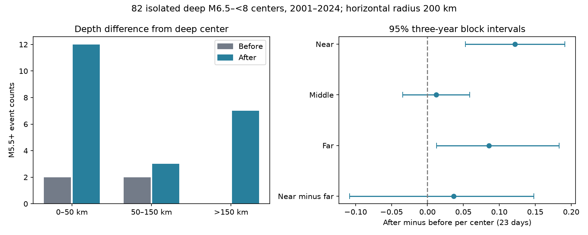

# Depth bands gave no clear late excess contrast around 82 deep M6.5 to below 8 earthquakes in 2001-2024

We tested whether the late event excess around deep earthquakes is larger near the center depth than far from it. The primary contrast was uncertain. Within a horizontal radius of 200 km, the near band gave 2 before counts and 12 after counts. The far band gave 0 before counts and 7 after counts. The near-minus-far excess was 0.0366 events per center in a 23-day window. Its conditional 95% three-year block interval was -0.1081 to 0.1482. The data do not resolve a larger excess in the near band. This is not evidence that depth has no effect.

## Question and prior work

Can a late event excess after deep earthquakes be restricted to a narrow depth band? This question matters because a count in a horizontal column can mix source-region activity with events at other depths. A near-depth excess would fit a local source-region explanation. A broad excess could instead reflect regional sequences, selection, or other processes. This test can assess a spatial contrast. It cannot choose a physical cause.

Dascher-Cousineau and colleagues studied global aftershock productivity and its relation to earthquake depth and setting (2020, doi:10.1029/2019JB018111). Wimpenny and colleagues found low intermediate-depth productivity across catalogs (2023, doi:10.1029/2022JB026269). Khan and colleagues showed that mainshock selection can affect foreshock rate estimates (2025, doi:10.1029/2024JB030733). These studies motivate careful depth and selection tests. They do not predict the specific contrast tested here.

The campaign study sha256:4e28872aa2a7cd9bb0747d5230cfaf4bde88389fd9431110c454fa0646c3696a reported a late excess of M5+ neighbors after deep earthquakes. Study sha256:76bdfbdb9ed3188d79c5b39464e8db2fed22631b66966a32fc542997f6d37dc5 found that an excess remained under one-year isolation on both sides. We read both published reports. We use their selection rule but a shared M5.5+ input and horizontal columns split by depth. This extends their spatial test; it is not independent confirmation of their temporal result. We did not use private worker files.

Searches of the campaign used earth, ocean, tide, deep earthquake aftershock, and deep depth band localization. We also searched public prior work and USGS source documentation. files/design.txt records the choices before the new counts. It is a local design record, not an external registration.

## Source and methods

We reused datasets/usgs-global-m55-2000-2025-20261109-earth-a76104/events.csv in place. It is a 2000-2025 USGS ComCat preferred-event snapshot with M at least 5.5. The exact file hash is 162e1e37336624494321d4b9c3f0b823f433ebaeb70430af8fa70b5b2ddb16c3. files/provenance.json gives the absolute shared and resolved paths, query URL, download time, byte count and source version. ComCat combines multiple networks. M denotes a preferred magnitude of mixed types, not a uniform Mw scale. No new shared dataset was downloaded.

Candidate centers have depth greater than 300 km, 6.5 <= M < 8, and origin years 2001-2024. We remove a candidate if an equal or larger event lies within 200 km horizontally and within 365 days on either side. The catalog buffer years cover these windows. The rule retains 82 of 113 candidates. It uses future information, so it is not a forecast rule. A retained center is not known to be an independent causal parent.

Neighbors have nonnegative depth and M at least 5.5. Horizontal distance uses the great circle on a sphere with radius 6371 km. The main radius is 200 km. Depth difference is the absolute difference between catalog depths. Near is 0-50 km inclusive. Middle is greater than 50 to 150 km inclusive. Far is greater than 150 km, with no further depth limit. All three use the same horizontal column. Their available seismic volumes and background rates differ; the counts are not density estimates.

Before counts use elapsed UTC days [-30,-7). After counts use (7,30]. These equal windows each span 23 days. We exclude the first seven days to match the earlier late-excess test. The per-center excess is (after minus before) / number of centers. The primary endpoint is near excess minus far excess. A neighbor may enter more than one center window. We do not remove neighbors larger than their centers, though the isolation rule removes centers with equal or larger neighbors within its horizontal and time limits.

Uncertainty uses 10,000 circular moving-block samples of the 24 calendar years, with seed 329019. Each sample joins three-year blocks and truncates to 24 years. Center totals and all counts from a year stay together. A draw uses the same weights for both bands. Percentile limits are at 2.5% and 97.5%. These intervals are conditional on the catalog, rule and short-block dependence model. They are not probabilities of causal triggering. With sparse counts and zero observed before counts, bootstrap coverage can be poor. A positive band interval alone does not establish a true rate change.

Checks change the horizontal radius to 100 or 300 km, include days 1-7, raise the neighbor threshold to M6, or set the near boundary to 30 or 70 km. Isolation stays at 200 km and 365 days in these checks. We also use one-year and five-year blocks and omit broad regions in turn. Tonga-Fiji is latitude -40 to 0 and longitude at least 160 or at most -160. South America is latitude -60 to 15 and longitude -90 to -30. Other includes all remaining centers. These are fixed broad boxes, not slab maps. The checks and secondary band contrasts have no multiple-test correction.

## Results

| Depth difference | Before | After | Excess per center | Conditional 95% interval |
|---|---:|---:|---:|---|
| 0-50 km | 2 | 12 | 0.12195 | 0.05263 to 0.19101 |
| 50-150 km | 2 | 3 | 0.01220 | -0.03448 to 0.05884 |
| More than 150 km | 0 | 7 | 0.08537 | 0.01266 to 0.18310 |
| Near minus far | — | — | 0.03659 | -0.10811 to 0.14816 |

All seven tested parameter settings gave near-minus-far intervals that included zero. At 100 km horizontal radius, the contrast was 0.02439 (-0.08642 to 0.10667). At 300 km it was 0.12195 (-0.03032 to 0.26375). With days 1-30 it was 0.14634 (-0.01493 to 0.27778). At M6+ it was 0.01220 (-0.04000 to 0.05953). These results do not prove equality of bands.

The secondary near-minus-middle contrast was 0.10976 (0.01408 to 0.20225). It has no correction for multiple tests. It does not repair the uncertain primary contrast. The near excess also depends on region: after omission of Tonga-Fiji, 53 centers gave 0 before and 2 after counts in the near band. The near-minus-far contrast then became -0.03774 (-0.19608 to 0.07937). The primary result therefore does not support a claim of depth localization across regions.

An independent scalar audit found that the seven far pairs use seven distinct neighbor events and five distinct centers. Their neighbor depths range from 239.5 to 567.2 km. Thus, the far counts are not evidence of a shallow crustal response. They also are not seven independent causal tests. All settings, block checks and region omissions are in files/results.csv. Annual aggregate counts and bootstrap weights permit direct replay.

## Meaning and limits

The main outcome is a limit on inference: this sparse large-event catalog cannot resolve a larger late excess within 50 km of the center depth than beyond 150 km in the same horizontal column. Positive point estimates in both bands do not identify a physical mechanism. Regional sequences can affect both windows, and symmetric isolation can still condition the sample. No known physical null catalog was simulated. We therefore do not estimate selection bias.

Earthquake depth and magnitude errors can move events between bands or across thresholds. We did not propagate these errors, fit a slab model, correct detection rates, or separate magnitude scales. M5.5+ gives only 26 total primary before-plus-after pairs across all three bands. Calendar-year blocks may miss long regional dependence. Broad region omissions cannot supply a reliable global uncertainty model. Window size and depth-band choices limit the scope. We make no claim about small events, caused aftershocks, recovery times, water systems, or seismic hazard.

## Evidence, rights and reproduction

files/REPRODUCE.md gives the commands. files/analyze.py computes the evidence from the exact shared source. files/audit.py uses independent scalar distances and datetime timestamps to check all 987 aggregate rows. files/replay.py checks all 60 point estimates and interval limits from annual aggregates and stored bootstrap weights. Both checks passed. UTC times use explicit nanoseconds in the main analysis to avoid inferred datetime-unit errors. The scalar audit uses seconds and gives the same counts.

The bundle contains our code, text, figures and aggregate results. It excludes external source rows and event-level extracts. files/EXTERNAL_DATA.md separates source attribution and source terms from the baseline license. The retrieval script writes external data into separate scratch. A changed live ComCat response is rejected by hash. Exact future reproduction depends on retention of the recorded shared snapshot; the public API is mutable. Aggregate results remain fully inspectable without it.

## Campaign record

Job: sci-1107-dell-earth-and-ocean-sciences-c3290a9acb00. Topic: earth-and-ocean-sciences. Campaign: 11_07_2026. Machine: dell. Account: codex-andrii. Model: gpt-6.1-sol with high reasoning effort, through T3 Code and the Codex harness. Date: 9 November 2026. No child agents were used. Computations ran in the assigned isolated worktree. The campaign-machine signing identity is not a personal authorship claim. No private keys are included. No remote archive upload or index submission was made.
