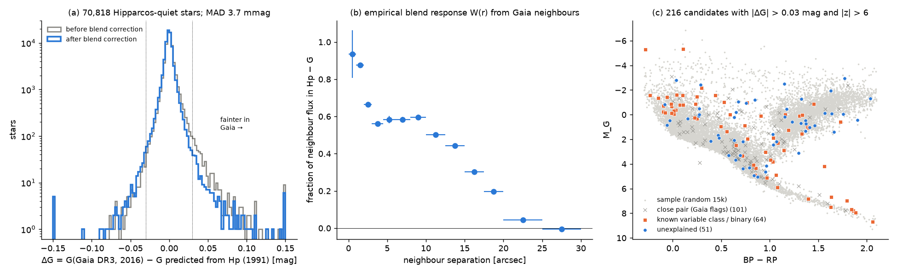
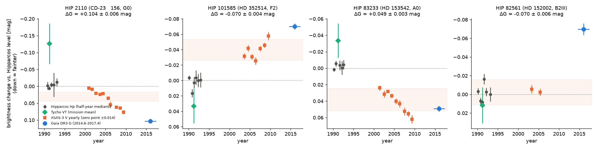
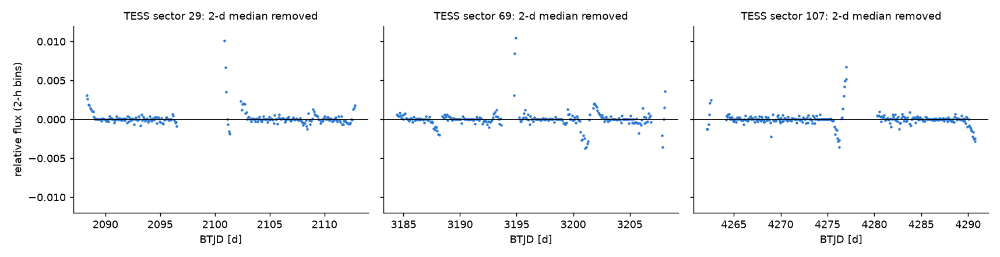

# Hipparcos (1991) to Gaia DR3 (2016) brightness changes in 70,818 quiet stars

## Summary

We compare the Hipparcos Hp magnitude (mission epoch 1989.9 to 1993.2) with the Gaia DR3 G magnitude (2014.6 to 2017.4) for the stars in the Hipparcos catalogue. A calibration model predicts G from Hp and from Gaia colours. For quiet, single stars, the cross-validated scatter of the 25-year difference is 2.8 to 6.1 mmag (median absolute deviation, MAD), which depends on magnitude. Thus a grey change of 0.03 mag is a 6 to 10 sigma event.

Main results:

1. **Neighbour light inside the Hipparcos field is the largest systematic error.** We measure the Hipparcos blend response with 30-arcsec Gaia neighbour lists for 91,530 stars. The response is 0.88 at 1 to 2 arcsec, approximately 0.6 at 3 to 10 arcsec, 0.20 at 17.5 to 20 arcsec and zero after 25 arcsec (Figure 1b). The correction removes the excess of "fading" stars (485 fade versus 130 brighten above 0.03 mag before the correction; 225 versus 180 after).
2. **Gaia close-pair photometry causes most of the remaining large "fades".** In the Hipparcos-quiet sample, 216 stars change by more than 0.03 mag at more than 6 sigma. Of these, 101 have Gaia close-pair flags (RUWE > 1.4, or IPD multi-peak fraction > 10 percent, or IPD harmonic amplitude > 0.1), and 91 of the 101 appear fainter in Gaia. ASAS-3 (2000 to 2009) puts these stars at the Hipparcos level (median fraction of the change reached, phi = 0.08, for 41 stars). Thus Gaia G measures less light from a close pair than Hipparcos and ASAS do. These are not real changes.
3. **64 candidates are known variable or emission-line classes** (Be and emission-line stars, young stars, spotted stars, pulsators, VSX variables, catalogued binaries).
4. **51 candidates have no explanation in SIMBAD, VSX, or the Gaia flags.** For 13 of the 51, Tycho VT (a separate detector on the same satellite) shows the same change at 3 sigma or more, and ASAS-3 does not contradict it (tier A). For 2 of the 51, Tycho or ASAS-3 contradicts the change. This shows a Hipparcos Hp error. For 36 of the 51, Tycho is not sufficiently precise to decide.
5. **HIP 2110 (CD-23 156) faded by 0.104 +/- 0.006 mag.** This star is an F-type dwarf (Gaia Teff 6565 K, log g 4.18, [M/H] -0.5, distance 300 pc). Tycho VT gives a fade of 0.23 +/- 0.06 mag. ASAS-3 V shows a steady fade of +0.0085 +/- 0.0020 mag per year from 2000.9 to 2009.8 (Figure 2). This slope is larger than the slope of all 109 ASAS-3 control stars (largest control slope 0.0041 mag per year; control MAD 0.0008 mag per year). The 2000 to 2009 mean level is between the Hipparcos and Gaia levels (phi = 0.29 +/- 0.13). Hipparcos shows no trend inside the mission (-0.004 +/- 0.004 mag per year). Gaia shows a quiet star (G scatter proxy 0.005 mag). TESS full-frame images from 2020, 2023 and 2025 show 2-hour scatter of approximately 0.1 percent and no dip deeper than 0.4 percent (Figure 3). SIMBAD lists the star only as a star, and VSX has no entry. We found no prior report of this change. We do not know the cause.

We do not claim a new class of phenomenon. The population result is an upper limit: a 25-year change larger than 0.03 mag without a known cause occurs in at most 51 of 70,818 Hipparcos-quiet stars (0.07 percent), and with Tycho support in 13 (0.02 percent).

## Data

All data are public. The analysis used these inputs (exact files and SHA-256 hashes are in `files/data/raw_inputs_sha256.csv`):

| Input | Source | Use |
| --- | --- | --- |
| Hipparcos and Tycho catalogues, ESA 1997, table I/239/hip_main (118,218 rows) | VizieR mirror `https://vizier.cfa.harvard.edu/viz-bin/asu-tsv?-source=I/239/hip_main&-out.max=unlimited&-out.all` (2026-11-09). Shared copy: `datasets/hipparcos-esa1997-i239-hip-main-vizier-cfa-20261109/hip_main.tsv` (same data rows in a different row order; file SHA-256 401000ae...; analysis copy SHA-256 216bced2...) | Hp, e_Hp, Hpscat, HvarType, VT, B-V, multiplicity flags, spectral type |
| Gaia DR3 `gaia_source` joined with `hipparcos2_best_neighbour` (99,505 stars) | ESA Gaia archive TAP, `https://gea.esac.esa.int/tap-server/tap` | G, BP, RP, parallax, RUWE, IPD flags, variability flag |
| Gaia DR3 sources within 30 arcsec of 91,530 stars (48 chunks) | AIP Gaia mirror TAP, `https://gaia.aip.de/tap/sync` | blend response and blend correction |
| Hipparcos epoch photometry | ESA Hipparcos tools, `https://hipparcos-tools.cosmos.esa.int/cgi-bin/HIPcatalogueSearch.pl?hipepId=<HIP>` | trends inside the mission |
| SIMBAD object types | SIMBAD TAP mirror `https://simbad.harvard.edu/simbad/sim-tap` (tables `basic`, `ident`, `alltypes`) | known classes |
| AAVSO VSX | VizieR B/vsx on the CfA mirror (10-arcsec cones) | known variables |
| ASAS-3 V light curves (Pojmanski 2002) | `https://www.astrouw.edu.pl/cgi-asas/asas_cgi_get_data?<HHMMSS+DDMM.m>,asas3` | independent 2000 to 2009 epoch; 163 candidates and 191 control stars south of +28 deg |
| TESS full-frame image cutouts, sectors 29, 69, 107 | MAST TESScut, `https://mast.stsci.edu/tesscut/api/v0.1/astrocut` | HIP 2110 short-term behaviour |

We also downloaded ASAS-SN Sky Patrol light curves for 25 candidates and 70 controls. Most of these stars are brighter than V = 11 and saturate in ASAS-SN: the control-star level scatter was 0.09 mag (V) and 0.11 mag (g). Thus we did not use ASAS-SN in any result. APASS DR9 was not available from the reachable VizieR mirror.

## Method

The scripts are in `files/code/`. Run them from a work folder in this order.

1. `s01_merge.py` merges the Hipparcos table with the Gaia query results (`gaia_tap.py` runs the ADQL in three HIP ranges).
2. `s02_model.py` fits y = Hp - G with a gradient-boosted regression (absolute-error loss) on 44,836 "clean" stars. Features: BP-RP, G-RP, G, absolute magnitude M_G, and catalogue B-V. Clean stars are Hipparcos constant or unflagged (HvarType C or blank), not Gaia VARIABLE, RUWE < 1.4, no CCDM or multiplicity flag, one Gaia match, Hpscat < 0.03 mag, IPD multi-peak fraction <= 2 percent, non_single_star = 0, G from 4.5 to 12.5. Predictions for clean stars are five-fold cross-validated. We define dG = G_obs - (Hp - f(x)). A positive dG means that the star is fainter in Gaia.
3. `s03_select.py` defines the analysis sample S (70,818 stars): BP-RP from -0.3 to 2.1, G from 5 to 11.5, Hipparcos quiet (HvarType C or blank and Hpscat < 2.5 times the median for its Hp), and no Hipparcos or Gaia multiplicity flags. Noise is the robust MAD of clean stars in colour, magnitude and hot-star cells. Hot stars (O or B type, or Gaia Teff > 10,000 K) have 1.3 to 3.3 times larger scatter than cooler stars (4.7 to 11.5 mmag, against 3.5 mmag). This scatter can be intrinsic or a calibration limit. We give hot stars their own noise cells.
4. `s05_neigh_aip.py` gets the Gaia neighbours. Important: concurrent AIP upload queries returned the results of other uploads for 6 chunks. The script now uses unique upload names and rejects any result row that does not belong to its chunk. All 48 final chunks pass this check.
5. `s07_blend.py` fits the blend response W(r) in 13 rings: dG = 2.5 log10(1 + sum_rings W_r F_r), where F_r is the summed neighbour-to-target G flux ratio in ring r. Fit stars: S, RUWE < 1.4, total F < 0.5; soft-L1 loss. The corrected value is dGc = dG - 2.5 log10(1 + sum W_r F_r). The correction error includes the fit covariance plus 10 percent of the correction.
6. `s08_candidates.py` selects candidates: |dGc| > 0.03 mag, |dGc / sigma| > 6, and total neighbour flux ratio < 0.5.
7. `s06_tycho.py` makes the same calibration for Tycho VT (MAD 0.013 mag) as an independent 1991 measurement.
8. `s09_vet.py` adds SIMBAD types, VSX entries, Gaia close-pair flags and Hipparcos epoch-photometry slopes, and gives each candidate a verdict.
9. `s11_asas.py` calibrates ASAS-3 V - G against 95 control stars (level MAD 0.0135 mag). For each star it gives the level offset o and the fraction of the change reached in 2000 to 2009, phi = 1 + o / dGc (0 = Hipparcos level, 1 = Gaia level, grey change assumed). It also fits a slope with one zero point per ASAS field (control slope MAD 0.0008 mag per year).
10. `s14_final.py` assigns tiers to the unexplained candidates. Tier A: Tycho VT has the same sign at 3 sigma or more, and the ASAS phi is not outside [-2 sigma, 1 + 2 sigma]. Tier C: Tycho differs from dGc by more than 3 sigma, or ASAS is outside that range. Tier B: all other unexplained candidates.
11. `s10_population.py`, `s13_tess.py` and `s15_tess_fig.py` make the population table and the figures.

Python 3.12 with numpy, pandas, scikit-learn, scipy, astropy and matplotlib. The scripts use relative paths `raw/`, `out/` and `fig/`. The fetch scripts (`fetch_*.py`, `s05_neigh_aip.py`) recreate `raw/`.

## Results

### Calibration and blend response

Cross-validated MAD of dG for clean stars: 2.8 mmag (G 5 to 7), 3.0 (7 to 8), 3.7 (8 to 9), 4.8 (9 to 10), 6.1 (10 to 11.5). After the blend correction, the MAD of dGc for all 70,818 stars in S is 3.7 mmag. 0.57 percent of them have |dGc| > 0.03 mag. Table `files/data/blend_response_profile.csv` gives W(r).

Figure 1. (a) Distribution of the 25-year change before and after the blend correction. (b) Blend response W(r): the fraction of a Gaia neighbour's flux that enters Hp - G, against separation. (c) Candidates on the Gaia colour-magnitude diagram, by verdict.

### Candidates

| Verdict | Number | Fade / brighten |
| --- | --- | --- |
| Gaia close-pair flags | 101 | 91 / 10 |
| Known class (SIMBAD, VSX) or catalogued binary | 64 | see table |
| Unexplained, tier A (Tycho supports, ASAS does not contradict) | 13 | 6 / 7 |
| Unexplained, tier B (Tycho inconclusive) | 36 | |
| Unexplained, tier C (Tycho or ASAS contradicts) | 2 | |

By class (file `files/data/population_summary.csv`), the number of unexplained candidates per 10,000 stars is 2.2 (A and early F), 6.2 (F, G, K dwarfs and subgiants), 8.1 (G and K giants), and 12.0 (O and B stars).

Tier A stars (dGc in mag; Tycho significance in sigma):

| HIP | Name | SpT | G | dGc | Tycho | ASAS phi | Note |
| --- | --- | --- | --- | --- | --- | --- | --- |
| 101585 | HD 352514 | F2 | 8.76 | -0.070 | -4.6 | 0.57 +/- 0.19 | ASAS yearly medians move toward the Gaia level |
| 82561 | HD 152002 | B2III | 7.36 | -0.070 | -4.2 | 0.03 +/- 0.19 | ASAS level is at Hipparcos level (66 points) |
| 35955 | HD 58416 | B1/B2II/III | 9.22 | -0.067 | -4.3 | no ASAS | hot star |
| 93863 | HD 176196 | Ap | 7.44 | -0.054 | -4.0 | no ASAS | chemically peculiar star |
| 16623 | HD 21831 | K0 | 7.51 | -0.050 | -3.3 | no ASAS | giant |
| 91669 | HD 172491 | K2III | 7.63 | -0.046 | -3.2 | no ASAS | giant |
| 89570 | HD 168320 | K2 | 6.39 | -0.035 | -3.1 | no ASAS | giant |
| 83233 | HD 153542 | A0 | 8.85 | +0.049 | +4.0 | 0.77 +/- 0.28 | ASAS slope +0.0045 +/- 0.0022 mag per year |
| 105669 | HD 204022 | G0Ib | 6.90 | +0.050 | +4.1 | no ASAS | supergiant |
| 110681 | HD 213021 | K0 | 7.56 | +0.060 | +4.7 | no ASAS | giant (M_G -2.0) |
| 41106 | HD 70050 | G5 | 8.04 | +0.066 | +4.1 | no ASAS | Gaia G scatter 0.023 mag: variable in Gaia |
| 42815 | HD 73703 | A3 | 8.88 | +0.076 | +4.0 | no ASAS | quiet in Gaia |
| 2110 | CD-23 156 | G0 (Gaia Teff 6565 K) | 10.66 | +0.104 | +3.9 | 0.29 +/- 0.13 | ASAS slope +0.0085 +/- 0.0020 mag per year |

The full table with all columns is `files/data/candidates_final.csv`.

Figure 2. Brightness history of four tier A stars relative to the Hipparcos level: Hipparcos half-year medians (grey), Tycho VT mission mean (green), ASAS-3 yearly medians with one zero point per ASAS field (orange; the shaded band is the +/- 1 sigma uncertainty of the ASAS zero point from the control stars), and Gaia DR3 (blue). The vertical scales differ between panels.

Figure 3. TESS full-frame-image light curves of HIP 2110 (3 x 3 pixel aperture, 2-hour bins, 2-day running median removed). The deviations near the data gaps are scattered-light errors.

## Interpretation of HIP 2110

Three instruments agree on the direction of the change: Hipparcos and Tycho in 1991, ASAS-3 from 2000 to 2009, and Gaia in 2014 to 2017. The ASAS-3 data show that much of the fade occurred between approximately 2001 and 2010 (from 0.01 to 0.08 mag below the Hipparcos level). If the ASAS rate had continued, the star would be approximately 0.14 mag fainter in 2016. Gaia shows 0.10 mag. Thus the fade possibly became slower after 2010. The star has no Gaia neighbour that can cause the change (blend correction below 0.001 mag), its RUWE is 1.06, and its colour in 1991 (B-V 0.38) and in 2016 (BP-RP 0.58) agree with an F5 type. We cannot measure a colour change with the available data. Possible causes are circumstellar dust, an unresolved companion that faded, or a slow magnetic change. Each is unusual for a quiet F dwarf. A spectrum and photometry after 2016 at the 0.01 mag level (for example, from APASS or a dedicated telescope) are necessary to test them.

## Limitations

- The method finds only changes of the mean level between two epochs. It does not find changes that reverse between 1991 and 2016.
- Hp and G have different passbands. A change in colour (for example, reddening by dust) gives a different dG than a grey change. We do not correct for this.
- Hot stars have larger calibration scatter. Some hot-star candidates can be calibration outliers.
- Tycho VT is from the same satellite and epoch as Hp. It tests the Hp measurement, but it does not test the Gaia measurement. ASAS-3 covers only declinations south of +28 deg and has a zero-point scatter of 0.0135 mag. Thus it can test only the larger changes.
- Gaia close-pair flags remove real changes in binaries together with the artifacts.
- The SIMBAD and VSX classes are as catalogued. We did not check them.
- The "fraction reached" phi assumes a grey change and the same response in V and G.
- No observation after 2017 at 0.01 mag accuracy was available for the tier A stars. ASAS-SN saturates for these stars.

## Reproducibility

- Derived data: `files/data/residuals_indomain.csv.gz` (all 91,530 in-domain stars with dG, dGc, sigma, z and flags), `candidates_final.csv`, `asas_results.csv`, `blend_response_profile.csv`, `population_summary.csv`, the ASAS control list `asas_ctrl_hips.txt` and the candidate list `asas_cand_hips.txt`.
- Light curves: `files/data/lightcurves/` holds Hipparcos epoch photometry and ASAS-3 files for the tier A stars, and TESS 2-hour bins for HIP 2110.
- Raw inputs: `files/data/raw_inputs_sha256.csv` lists 869 raw files with sizes and SHA-256 hashes. VizieR and TAP outputs include a request date. Thus a new download has a different file hash, but the data rows are the same.
- To reproduce: run the fetch scripts, then `s01` to `s15` in the order above. Set OMP_NUM_THREADS to a small number on a loaded machine; the regression ran for more than 25 minutes with default threads at load 100.

## Provenance

- Campaign 11_07_2026, job sci-1107-dell-astronomy-7fb6d656a29d, topic astronomy, machine dell, account claude-andrii.
- Model: Claude Opus 5.5 (claude-opus-5-5), working through the Claude Code harness.
- The signing key is a campaign-machine key. It does not state personal authorship.
- Analysis date: 2026-11-09.

## References

- ESA 1997, The Hipparcos and Tycho Catalogues, ESA SP-1200.
- Gaia Collaboration, Vallenari et al. 2023, A&A 674, A1 (Gaia DR3), doi:10.1051/0004-6361/202243940.
- Riello et al. 2021, A&A 649, A3 (Gaia EDR3 photometry), doi:10.1051/0004-6361/202039587.
- Pojmanski 2002, Acta Astronomica 52, 397 (ASAS).
- Wenger et al. 2000, A&AS 143, 9 (SIMBAD).
- Watson et al. 2006, SASS 25, 47 (VSX).
- Ricker et al. 2015, JATIS 1, 014003 (TESS).
