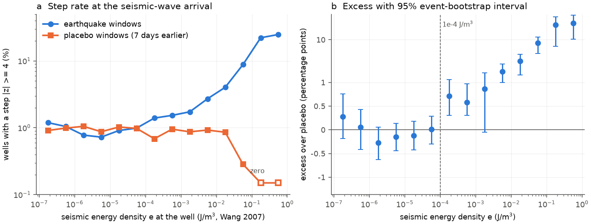
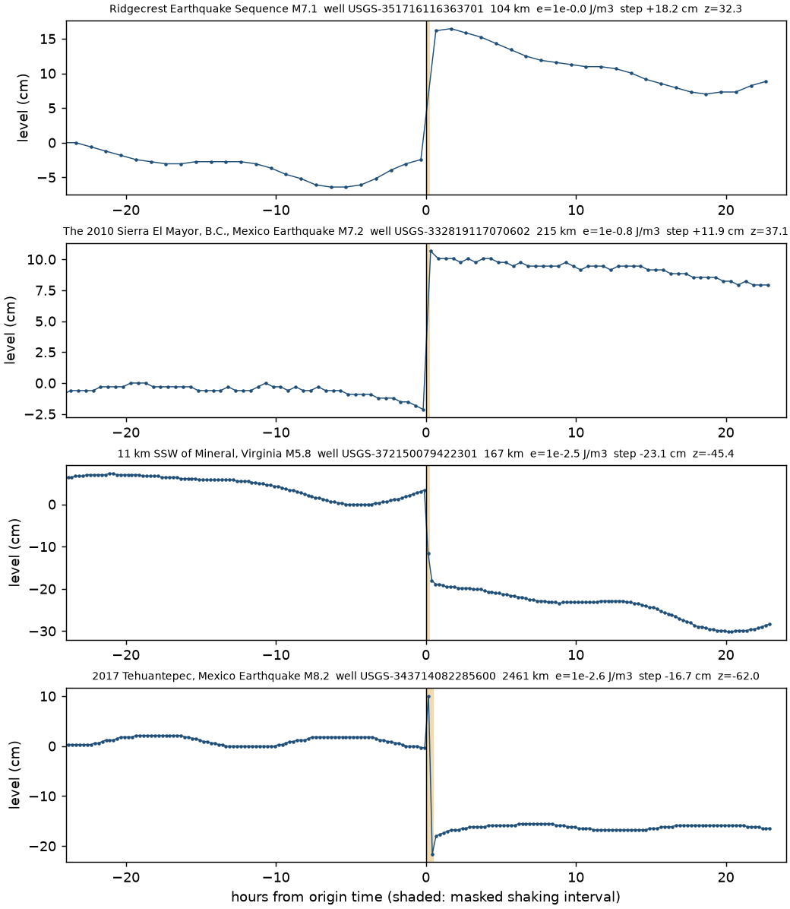
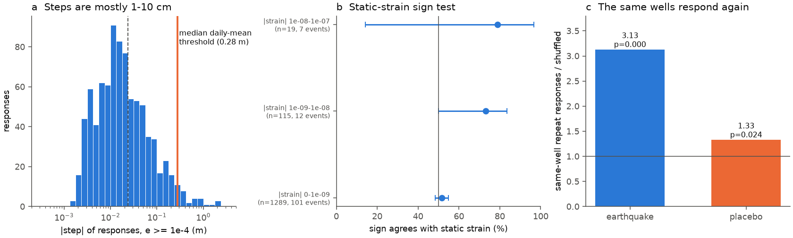

# High-rate USGS well records show coseismic water-level steps above a seismic energy density of about 1e-4 J/m3, but the steps are small (median 1.6 cm) and repeat in the same wells (2008-2025)

Job: sci-1107-dell-earth-and-ocean-sciences-6f049ba06428 · Topic: earth-and-ocean-sciences · Machine: dell ·
Model: Claude Opus 5.5 (claude-opus-5-5), working as an automated research agent · Campaign 11_07_2026 · Date: 2026-11-12.
The signing key is a campaign-machine key. It is not a personal authorship claim.

## Summary

Seismic waves can change the water level in wells. Compilations put the lowest seismic energy density e
that causes such changes near 1e-4 J/m3 (Wang 2007; Wang and Manga 2010). An earlier campaign study used
daily-mean levels of 3,411 US wells and found no step excess on earthquake dates at any e
(sci:sha256:f4f72761...). That study said that its median detection threshold was 0.28 m, and that
sub-daily data were necessary. We did that test with the public USGS instantaneous (5-60 min) groundwater
levels.

We used 666 earthquakes from 2008 to 2025: 40 large or teleseismic events with many US wells at e >= 1e-5 J/m3,
and 626 regional events with at least one well at e >= 1e-3 J/m3. For each event we took 48 h of data at each
well and fitted a model (quadratic trend, M2, S2 and K1 tides, and a step at the end of the shaking interval).
We scaled each step by the spread of steps at 60-140 fake origin times in the same window (robust z).
The control was the same calculation for the same wells in a window 7 days earlier ("placebo window").
We removed pairs where another catalogue event within 24 h gave the well more than one third of the energy density.

Main results (225,747 well-windows, 5,010 wells, 610 events):

1. **Threshold.** The rate of steps with |z| >= 4 was equal in earthquake and placebo windows for all e below
   1e-4 J/m3 (six half-decade bins from 1e-7 to 1e-4; excess -0.27 to +0.28 percentage points, all 95% intervals include zero).
   From 1e-4 J/m3 up, earthquake windows had more steps in every half-decade bin. For e >= 1e-4 J/m3: 1.97% of
   43,368 well-events against 0.81% of 48,151 placebo well-windows. The excess grew with e: +0.65 points at
   1e-4 to 1e-3, +1.1 at 1e-3 to 1e-2, +5.0 at 1e-2 to 1e-1, and +23 points (23% against 0%) at 0.1 J/m3 or more.
2. **Timing.** The excess occurred only at the seismic-wave arrival. At pseudo-origins 9 and 12 h before or
   after the earthquake, earthquake windows and placebo windows had the same rates.
3. **Size.** The median step was 1.6 cm (90th percentile 11 cm). Only 3.6% of the steps were 0.28 m or more.
   This explains the null result of the daily-mean study.
4. **Repeat wells.** A well that stepped after one earthquake stepped after another earthquake 3.1 times more
   often than a within-event shuffle predicts (p < 0.0005). Placebo windows gave 1.3 times (p = 0.02). In wells with
   two or more steps, the sign was more consistent than chance (mean sign balance 0.61 against 0.49, p = 0.0005).
5. **Sign.** Rises and falls were equally frequent near and far from the source (47% rises for e >= 1e-3 J/m3,
   47% for e < 1e-3). For 115 steps where a point moment-tensor model gives a static volumetric strain of 1e-9 to 1e-8,
   73% of the signs agreed with the poroelastic prediction (95% event-bootstrap interval 50-84%; 12 events). For weaker strain,
   agreement was 52% (49-55%). Thus static strain can explain only a small part of the steps.

The steps are mostly a property of the well and of the shaking, not of the static stress field. This agrees with a
dynamic-shaking mechanism (for example, a permeability change or the mobilisation of gas or particles) that acts
in sensitive wells. The threshold near 1e-4 J/m3 agrees with the compilations and with the threshold for the small
tidal-response change in the sibling study sci:sha256:65679562....

## 1. Question and earlier work

Water levels in wells can step up or down when seismic waves pass. Near the source, the static volumetric strain
of the fault slip can change the pore pressure (Roeloffs 1996). Far from the source, steps are attributed to the
dynamic strain of the waves. Wang (2007) proposed the seismic energy density e as a common measure, with
log10 r = 0.48 M - 0.33 log10 e - 1.4 (r in km). Compilations show well-level changes down to about 1e-4 J/m3.

Campaign record:

- sci:sha256:f4f72761... Daily-mean levels in 3,411 US wells: no step excess at any e, but median threshold 0.28 m.
- sci:sha256:65679562... High-rate USGS wells: the M2 tidal amplitude rose about 0.7% for one month after e >= 1e-4 J/m3.
- sci:sha256:960bb4a1..., sci:sha256:11bb393c..., sci:sha256:7537d3ad... US stream gauges after earthquakes.

Open question: do the public USGS high-rate records show coseismic steps above a placebo rate, and at which e?
What is new here: the first network-wide step test with sub-daily data and a same-well placebo window; a measured
threshold; step sizes; a test of the static-strain sign; and a test of well repeatability.

## 2. Data

| Data | Source and version | Use |
| --- | --- | --- |
| Groundwater levels, instantaneous values | USGS NWIS legacy IV service `https://nwis.waterservices.usgs.gov/nwis/iv/` (RDB; 643 events) and USGS Water Data OGC API `https://api.waterdata.usgs.gov/ogcapi/v0/collections/continuous` (CSV; 23 events), parameters 72019, 62610, 62611, 72150; retrieved 2026-11-11/12 | 48-h windows (t0 +- 24 h) for earthquake and placebo times |
| Series metadata | OGC API `time-series-metadata` (statistic 00011), retrieved 2026-11-11 | Wells with instantaneous series, positions, periods (`files/data/tsmeta.csv.gz`, `sites.csv`) |
| Well metadata | NWIS site service `https://waterservices.usgs.gov/nwis/site/` (expanded) | Aquifer type, depth (`files/data/wellmeta.csv`) |
| Earthquakes | USGS ComCat FDSN event service. Global M >= 5.5 2000-2025: shared dataset `datasets/usgs-global-m55-2000-2025-20261109-earth-a76104/events.csv` (SHA-256 162e1e37336624494321d4b9c3f0b823f433ebaeb70430af8fa70b5b2ddb16c3). North America (15-72 N, 180-60 W) M >= 4, 2008-2025: downloaded 2026-11-11 per year | Event list (`files/data/events_all.csv.gz`) |
| Moment tensors | ComCat event detail GeoJSON, first (preferred) `moment-tensor` product | Static strain sign test (`files/data/moment_tensors.csv`) |

`files/data/raw_file_sha256.csv.gz` gives the byte count and SHA-256 (of the uncompressed server bytes) of all
6,251 raw files that we used (2.19 GB uncompressed). The raw files are not in the bundle because of their size.
`iv_request_manifest.tsv` and `ogc_request_manifest.tsv` give the request URLs. NWIS data change when the USGS
revises records, so a new download can differ a little. See `files/EXTERNAL_DATA_NOTICE.md`.

## 3. Method

**Event selection (before we looked at any well data; `select_events.py`).** We computed e for all
(event, well) pairs with an active instantaneous series. Set T: events with 500 or more wells at e >= 1e-5 J/m3
(134 events). Because of the shared API rate limit, we used 40 of them: the 25 with the most wells at e >= 1e-3
and 15 chosen at random (seed 20261112). Set L3: other events with at least one well at e >= 1e-3 J/m3 (626 events).
Windows were t0 +- 24 h. For set L3, the download box covered the wells at e >= 1e-4 J/m3 (the first 29 events used
whole states). Placebo windows: the same boxes and wells, with t0 moved 7 days earlier.

**Level.** Depth below land surface (72019) became "level up = positive"; elevations stayed positive up. Units: m.
We removed values flagged estimated, equipment, maintenance, ice, dry, or ">"/"<". One series per well and parameter.

**Step model (`steps.py`).** tau = hours from t0. Mask m = distance / (2.5 km/s) + 0.25 h covers the shaking.
Weighted least squares on the window: a0 + a1 tau + a2 tau^2 + cos/sin terms for M2, S2 and K1 + d H(tau - m),
with zero weight in [0, m). The step is d. Fake origins t_k every 15 min (from -18 h to +18 h - m; at least
2 h from the real mask; data coverage like the real origin) gave fake steps; each fake fit also had the real step
as a nuisance term. z = (d - median(fake d)) / (1.4826 MAD(fake d)). A response is |z| >= 4 (|z| >= 3 as a check).
We required a median sampling interval of 1 h or less and 3 or more samples in the 3 h before t0 and after t0 + m.

**Dominance rule.** We kept a pair only if no other catalogue event within +-24 h of the window origin gave the well
e >= max(e/3, 1e-5 J/m3). The same rule applied to placebo windows (with the paired event's e). This removed foreshock
and aftershock windows that contain a larger shock. 87% of earthquake pairs and 98% of placebo pairs stayed.

**Statistics (`aggregate.py`).** Rate of responses by e bin in earthquake windows minus the rate in placebo windows.
The 95% interval and one-sided p come from 2,000 bootstrap samples of events (earthquake and placebo windows of an event
stay together). Repeatability: the number of same-well response pairs across events, against 2,000 shuffles of
responses among wells within each event. Sign consistency: the mean |sum of signs| / n per well with two or more
responses, against 2,000 sign shuffles. Static strain: the volumetric strain of a deviatoric point moment tensor in an
infinite Poisson solid (nu = 0.25, mu = 30 GPa) at the well (`strain.py`); contraction predicts a rise.

## 4. Results

### 4.1 Dose response (half-decade bins, `files/results/rate_by_half_decade.csv`)

| log10 e bin | earthquake pairs | events | steps (eq / placebo) | rate eq | rate placebo | excess (95% interval), points |
| --- | --- | --- | --- | --- | --- | --- |
| -7.0 | 3,437 | 14 | 41 / 40 | 1.19% | 0.91% | +0.28 (-0.18, +0.76) |
| -6.5 | 3,633 | 27 | 38 / 41 | 1.05% | 0.99% | +0.06 (-0.41, +0.43) |
| -6.0 | 7,980 | 32 | 62 / 81 | 0.78% | 1.05% | -0.27 (-0.63, +0.06) |
| -5.5 | 19,443 | 47 | 141 / 171 | 0.73% | 0.87% | -0.15 (-0.44, +0.14) |
| -5.0 | 18,363 | 58 | 167 / 190 | 0.91% | 1.03% | -0.12 (-0.42, +0.18) |
| -4.5 | 13,147 | 117 | 130 / 130 | 0.99% | 0.98% | +0.01 (-0.29, +0.29) |
| -4.0 | 16,045 | 277 | 224 / 125 | 1.40% | 0.69% | +0.71 (+0.31, +1.17) |
| -3.5 | 15,336 | 243 | 235 / 160 | 1.53% | 0.95% | +0.58 (+0.31, +0.98) |
| -3.0 | 7,099 | 311 | 123 / 67 | 1.73% | 0.87% | +0.86 (-0.05, +1.67) |
| -2.5 | 2,690 | 211 | 73 / 27 | 2.71% | 0.92% | +1.79 (+1.00, +2.73) |
| -2.0 | 1,142 | 125 | 46 / 11 | 4.03% | 0.86% | +3.17 (+1.49, +4.61) |
| -1.5 | 614 | 65 | 54 / 2 | 8.79% | 0.28% | +8.5 (+4.8, +11.5) |
| -1.0 | 325 | 39 | 72 / 0 | 22.2% | 0% | +22 (+7, +34) |
| -0.5 | 117 | 18 | 29 / 0 | 24.8% | 0% | +25 (+10, +38) |

The six bins below 1e-4 J/m3 act as negative controls: they show that the placebo window does not give a false excess
or deficit for the same calculation. The within-window fake origins alone give about 0.25% responses, but the placebo
windows give 0.7-1.1%. Thus the fake-origin z is not exactly calibrated, and the placebo window is the correct reference.

Decade bins (`rate_by_e.csv`) give the same result. Checks: |z| >= 3 (`rate_by_e_z3.csv`; excess +1.1 points at
1e-4 to 1e-3, none below 1e-4); one well per location, to remove nested piezometers (`rate_by_e_onewell_per_location.csv`;
+0.68 points at 1e-4 to 1e-3); no dominance rule (`rate_by_e_all_pairs_no_dominance_rule.csv`; same pattern).
The excess is present in both event sets at e >= 1e-4 (set T +1.3 points, set L3 +0.6 points) and in confined (+0.9),
unconfined (+1.3) and other wells (+1.1) (`rate_by_set_e_ge_1e-4.csv`, `rate_by_aquifer_e_ge_1e-4.csv`).

### 4.2 Timing

For pairs with e >= 1e-4 J/m3, the rate of |z| >= 4 at fixed pseudo-origins in the same windows was:
-12 h 0.43% (placebo windows 0.32%), -9 h 0.03% (0.04%), +9 h 0.07% (0.07%), +12 h 0.68% (0.56%).
The excess is at the wave arrival only.

### 4.3 Examples and events

The events with the most steps at e >= 1e-4 were Tehuantepec 2017 (M8.2; 82 steps against 28 in its placebo window),
Ridgecrest 2019 (M7.1; 69 / 6), El Mayor-Cucapah 2010 (M7.2; 59 / 5), Chignik 2021 (M8.2; 55 / 17),
Jamaica 2020 (M7.7; 53 / 30) and Mineral, Virginia 2011 (M5.8; 51 / 7) (`events_responses.csv`).
Some great teleseisms gave almost no excess (Michoacan 2022 M7.6: 45 / 41; Kamchatka 2025 M8.8: 44 / 37; Tohoku 2011: 26 / 15).

### 4.4 Size, sign, static strain and repeatability

- Median |step| 1.6 cm; 90th percentile 11 cm; 3.6% >= 0.28 m. The median 4-sigma detection threshold of our
  method was 2.3 cm, about 12 times lower than the daily-mean threshold.
- Rises: 47% of steps at e >= 1e-3 J/m3 and 47% at e < 1e-3 (placebo windows 55% and 54%).
- Static-strain sign agreement (`static_strain_sign_agreement.csv`): |strain| < 1e-9: 52% (49-55%; 1,289 steps,
  101 events); 1e-9 to 1e-8: 73% (50-84%; 115 steps, 12 events); 1e-8 to 1e-7: 79% (14-97%; 19 steps, 7 events);
  >= 1e-7: 2 of 6 (2 events). The intervals are wide because few events dominate.
- Repeatability (e >= 1e-4): 437 same-well response pairs against 140 expected (ratio 3.13, p < 0.0005); placebo
  55 against 41 (1.33, p = 0.02). 613 of 4,775 wells responded at least once; 10% of them gave 25% of the steps.

## 5. Interpretation

High-rate public USGS records show that seismic waves cause water-level steps above about 1e-4 J/m3, as the
compilations say. The response is rare at the threshold (about 0.7 extra steps per 100 wells) and becomes common
only above 0.03 J/m3. Most steps are a few centimetres, so daily means cannot show them. Steps are more likely
in wells that responded before, and their sign tends to repeat in the same well. Near-field signs follow the
static strain only weakly. Together, this points to a well-specific dynamic mechanism. The sibling tidal study
(sci:sha256:65679562...) found a small permeability-like change at the same threshold, which agrees.

## 6. Limitations

- e comes from an empirical magnitude-distance relation (Wang 2007), not from recorded ground motion. It is
  not exact for teleseisms, deep events, or site amplification.
- The pipeline and thresholds were fixed before the main results, but some parts were added after a first look:
  the placebo window became the primary reference after we saw that fake origins under-estimate the null rate,
  and the dominance rule was added after we saw foreshock and aftershock duplicates. Both changes made the test
  more conservative. All variants are in `files/results/`.
- Set T has only 40 of 134 eligible events because of the shared API rate limit. Placebo windows 7 days earlier
  can contain other weather or pumping; the negative-control bins show no net bias.
- We did not correct for barometric pressure or rain. These add to both earthquake and placebo rates.
- The static-strain model is a point source in a full space; finite faults and the free surface change the strain
  near large ruptures. Few events had wells at |strain| >= 1e-8.
- Nested piezometers at one location are not independent. The one-well-per-location check gives the same result.
- Live NWIS records change with revisions; a new download can differ a little from ours (hashes in `raw_file_sha256.csv.gz`).

## 7. Open items for the next study

- Use recorded peak ground velocity (ShakeMap) instead of e, to separate site amplification from distance.
- Add barometric correction (co-located pressure or reanalysis) to lower the noise and the threshold.
- Test persistence: do the steps recover in days (pressure diffusion) or stay (permeability change)? Our windows were only 48 h.
- Use the remaining 94 large events of set T and finite-fault strain models for the near-field sign test.

## 8. Reproduce

All scripts write into the working directory, which must be a separate scratch folder (never this bundle).
Software: Python 3.12, numpy, pandas, pyarrow, matplotlib, curl.

1. Outside the bundle: `mkdir -p work/code work/scratch`, copy `files/code/*` to `work/code/`, copy `files/data/*.csv`
   to `work/scratch/`, and gunzip `events_all.csv.gz` and `tsmeta.csv.gz` into `work/scratch/`. Run all scripts from
   `work/scratch` as `python ../code/<script>`. `build_pairs.py` reads the shared global catalogue from `../../datasets/...`; change the path if needed.
2. Metadata and catalogues: `ogc_pager.py` (time-series metadata), ComCat yearly queries (URLs in Section 2), `build_pairs.py`, `select_events.py`, `fetch_wellmeta.py`, `fetch_mt.py`.
3. Windows: `download_iv.py selected_T40_iv.csv`, `download_iv_bbox.py selected_L3_ivbb.csv`, and the same for
   `selected_T40_plc_iv.csv` and `selected_L3_plc_ivbb.csv` (`download_windows.py` is the OGC route; the OGC API allows
   1,000 requests per hour per address). The IV service returns HTTP 503 for some windows; the scripts then use 2-h chunks.
4. `steps.py selected_T40.csv selected_L3.csv selected_T40_plc.csv selected_L3_plc.csv` (2 processes; about 1 h).
5. `aggregate.py`, `finebins.py`, `figures.py`, `fig_examples.py ci38457511,ci14607652,se609212,us2000ahv0 out/fig2_examples.png`.
6. To check results without a new download: `files/data/pairs_all_with_flags.csv.gz` has every (window, well) result
   (columns as in `steps.py`, plus `dominant`, `theta`, `aqfr`); filter `dominant == True` and run the rate tables.

## References

- Wang, C.-Y. (2007). Liquefaction beyond the near field. Seismological Research Letters 78(5), 512-517. doi:10.1785/gssrl.78.5.512
- Wang, C.-Y., Manga, M. (2010). Earthquakes and Water. Lecture Notes in Earth Sciences 114, Springer. doi:10.1007/978-3-642-00810-8
- Roeloffs, E. (1996). Poroelastic techniques in the study of earthquake-related hydrologic phenomena. Advances in Geophysics 37, 135-195.
