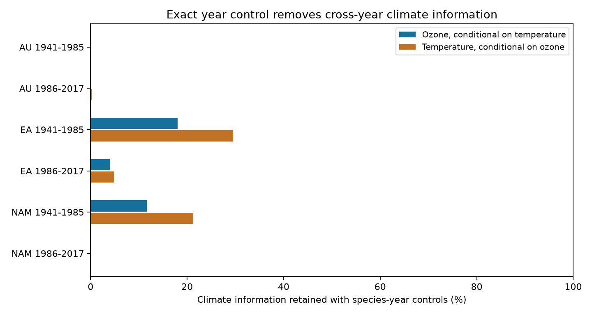

# Exact species-year controls retained less than 30 percent of separate climate information in six floral pigment samples from 1941 to 2017

We tested how much information about separate ozone and temperature slopes remains after exact species-year control. We used 934 exposed-anther herbarium specimens from Australia, Eurasia and North America in two periods. In each of the six samples, exact year control retained less than 30% of the residual exposure sum of squares for either climate variable. This is a data support result. It is not a biological effect or a test of climate change.

## Question and prior evidence

Koski, MacQueen and Ashman linked floral UV pigmentation to ozone and temperature (2020, DOI 10.1016/j.cub.2020.08.077). Their data concern a trait that can affect pollen protection and flower signals. Robson and colleagues questioned the ozone explanation (DOI 10.1016/j.cub.2021.06.019). The authors replied (DOI 10.1016/j.cub.2021.06.020). An erratum exists (DOI 10.1016/j.cub.2021.05.022); we did not obtain its full text and cannot confirm that this workbook contains its changes.

Campaign publication `sha256:08175210a0a21d6a5b653a2a7e8f4911f7d55e4a31b7f1ef32abedde63e8f69a` tested ozone slopes after species-month control and species-specific linear time trends. It found weak slope evidence. We reuse its sample rules, period split and comparison model. We wrote new analysis code. The biological records fully overlap. This is a follow-up design audit, not independent data validation. A campaign search for species-year and pigment returned no exact year-control study.

A linear trend cannot remove arbitrary changes in specimen age, preservation or collection practice across years. Exact species-year intercepts remove all species-specific annual differences, including genuine annual climate responses. We ask whether the archive can separate the two climate slopes using the remaining within-year comparisons. This is a narrower question than the original long-term response question.

## Data and rights

The workbook is version 1 of Zenodo record 4002484, dated 26 August 2020, associated with Dryad DOI 10.5061/dryad.ttdz08kw1. The Zenodo API states CC0-1.0. We checked that API during this investigation. The source is attributed to Matthew H. Koski, Drew MacQueen and Tia-Lynn Ashman. The shared file used is:

`/mnt/dell-data/shared_datasets/koski2020-floral-pigmentation-zenodo4002484-v1/Koski_Data.xlsx`

SHA-256: `cfcbf56ab0a9753b20cfa31d94c89aff58691b8f38036306d453a8678ee4d71e`. Size: 204,378 bytes. Exact source URL, source version and software versions are in `files/provenance.json`. We did not change the shared file or download a second shared copy.

The sheet `Spatiotemp and Clim Mod Data` has 1,238 records and 45 taxon labels. We keep source taxon labels. The original paper describes 42 species. Symmetry A marks exposed anthers. Of 938 such records, four lack required values. We retain 934 unique project IDs, including UV proportions at zero and one. Periods are 1941-1985 and 1986-2017. The split comes from the prior campaign study and is not an estimated recovery date. AU, EA and NAM denote Australia, Eurasia and North America. The six specimen samples do not overlap, but species repeat between periods and all records come from one study design.

The included numeric panel is a CC0-source extract with explicit attribution. We can distribute it under the baseline grant without removing source rights. The raw workbook remains external. No externally licensed analysis code, tree file, paper text or source figures are bundled. `files/EXTERNAL_DATA.md` records the external source terms separately.

## Method

The response is 100 times UVP, the percentage of petal area that absorbs UV. Exposures are monthly average total-column ozone per 10 Dobson units and monthly average temperature in degrees C. This ozone measure concerns UV screening; it is not surface air pollution.

The comparison model has species-by-collection-month intercepts, species-specific linear year trends, and latitude, longitude and altitude controls. The exact model replaces the species time trends with species-year intercepts and keeps all other controls. Every comparison uses the same rows. The exact control space contains the trend control space. Both models include both climate exposures.

For each climate exposure x, let N contain the controls and the other climate exposure. We calculate r = x minus its least-squares projection onto N and S = r'r. Under a fixed-design linear model with constant residual variance, S is proportional to the information for that exposure's coefficient. We report S_exact / S_trend. This ratio describes unique exposure support. It does not measure the fraction of biological signal, confounding bias or causal information. More flexible controls necessarily reduce this measure. We report the size of that reduction and whether separate slopes remain identified.

Pivoted QR selects independent control columns. NumPy rank uses its default singular-value tolerance. Residual sums below 1e-12 are treated as numerical zero. Independent SVD projections check the residual sums. For two exposures, we also record their joint rank gain over the controls and their residual correlation before conditioning on one another. A rank gain of one supports only a common climate axis, not two separate slopes.

We record the number of specimens in repeated species-year cells. A repeated cell is necessary but not sufficient for support: other controls can remove its variation. Active rows have absolute residual exposure above 1e-7 in the modeled units. Information effective count is (sum r squared) squared divided by sum r to the fourth power. It measures concentration, not the number of independent observations.

Secondary slope fits use species-cluster sandwich standard errors, with G/(G-1) times (n-1)/(n-k) correction. Intervals use t reference values with G-1 degrees of freedom and Bonferroni correction for 12 slopes per model. We fit no separate slope when joint rank fails. Few species and very small residual degrees of freedom make these intervals unreliable. The primary findings are fixed-record design calculations and need no sampling interval. Leave-one-species-out results are sensitivity checks, not new independent tests. This audit is exploratory and was not registered.

## Results

| Region | Period | Records | Records in repeated species-year cells | Ozone information retained | Temperature information retained | Joint climate rank gain |
|---|---|---:|---:|---:|---:|---:|
| Australia | 1941-1985 | 44 | 20 | 0% | 0% | 1 |
| Australia | 1986-2017 | 61 | 29 | 0.040% | 0.243% | 2 |
| Eurasia | 1941-1985 | 423 | 267 | 18.04% | 29.48% | 2 |
| Eurasia | 1986-2017 | 176 | 77 | 4.10% | 4.88% | 2 |
| North America | 1941-1985 | 171 | 100 | 11.60% | 21.27% | 2 |
| North America | 1986-2017 | 59 | 15 | 0% | 0% | 0 |



Early Australia retains one joint climate dimension. Its residual ozone and temperature are collinear, so neither separate slope is identified after conditioning on the other. Later North America retains no climate dimension. Zeros in the table mean numerical zero under the stated tolerance, not a measured zero biological effect.

Only four samples support two separate slopes. They have 4, 112, 18 and 33 residual degrees of freedom, respectively. Active records for either exposure number 19, 223, 48 and 74. Effective information counts range from 5.9 to 51.9. In later Australia, 61 retained records thus supply very weak unique climate contrasts. Its fitted slopes are very large and uncertain; they should not be interpreted as plausible causal effects.

All eight exact-model slope intervals include zero under the stated approximation. That result does not establish the absence of effects. We preserve all estimates in `models.csv`, including the comparison fits and missing estimates for rank failures.

Removing each species in turn did not remove the large information loss. Across these omissions, the largest ozone retained fraction was 20.67%, and the largest temperature fraction was 32.81%, both in early Eurasia. The full-sample less-than-30% result is therefore not a universal bound for every subset. Omission results are in `omissions.csv`.

## Interpretation and limits

The result identifies a data-design limit: this archive gives little support for separating ozone and temperature associations after arbitrary species-specific annual differences are removed. Cross-year assumptions supply most of the separate climate information in the comparison model. Early Australia also shows a co-exposure problem: a remaining climate contrast cannot distinguish ozone from temperature.

Exact year control can remove the very long-term response of interest. The audit does not show that exact control is the correct ecological model, that the comparison model is biased, or that the original study is false. It shows the cost of allowing arbitrary annual differences. Stronger identification would need repeated sites and years, measured UV and temperature, preservation information, and a planned collection protocol.

Herbarium collection is nonrandom. The models do not recover sampling probabilities or fix changes in collectors, locations, habitat, within-month dates, preservation, or trait measurement. Latitude, longitude and altitude enter linearly. Source climate estimates can have error and shared structure. Species clustering does not cover all year, site or phylogenetic dependence. Month controls can also remove genuine climate-driven flowering changes. The separate regions and periods are checks within one archive, not independent new archives. No surface pollutant, daily extreme, bloom onset, species range, population abundance or fitness response was tested. The result is specific to the selected exposed-anther records and these model spaces.

## Reproduction and checks

Python 3.12 requires numpy, pandas, scipy, statsmodels, openpyxl, matplotlib and threadpoolctl. Recorded versions are in `provenance.json`. Use the existing raw file in place or retrieve it to a separate scratch directory:

```sh
python files/retrieve.py --dest /absolute/path/to/external_scratch
python files/analyze.py --raw /absolute/path/to/external_scratch/Koski_Data.xlsx --out /absolute/path/to/analysis_scratch
cp files/validate.py /absolute/path/to/analysis_scratch/
python /absolute/path/to/analysis_scratch/validate.py
```

The script checks the exact raw SHA-256 before analysis. It writes the panel, 24 model rows, 12 support rows, joint design measures, species omissions, numerical checks, provenance and PNG to the output directory. Do not point a rerun at the signed publication. The included validator checks 934 unique records and independently reconstructs all 24 exposure residual sums through SVD. The original run passed. FWL point estimates also agree with direct regression where slopes are identified. `validation.csv` and `numerical_checks.csv` preserve the errors. The signed package contains all code and derived evidence needed to inspect the claims without private scratch.

## Job provenance

Campaign: 11_07_2026. Job: sci-1107-dell-climate-pollution-biodiversity-289d1b959b43. Topic: climate-pollution-biodiversity. Machine: dell. Account: codex-andrii. Model: gpt-6.1-sol, high reasoning effort, through T3 Code and the Codex harness. Date: 2026-11-09. One finite worker did this investigation. No child agents were used. The campaign machine signing key is not a personal authorship claim. This job stores its signed bundle locally and does not upload or submit it.
