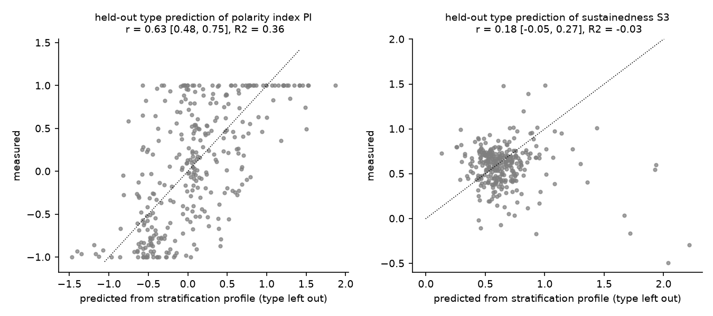
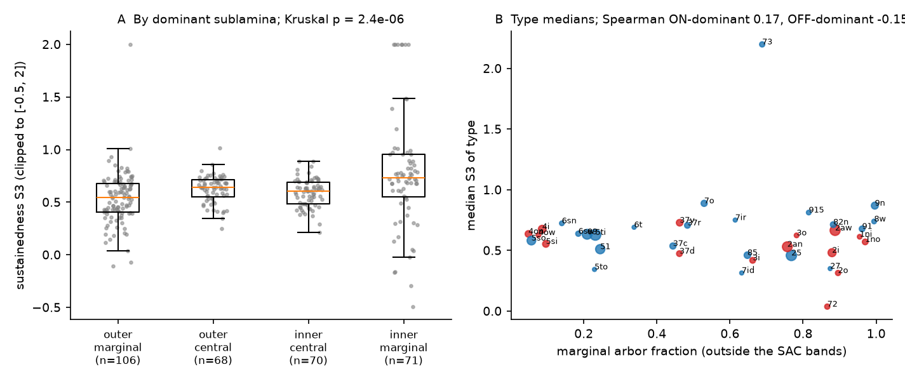
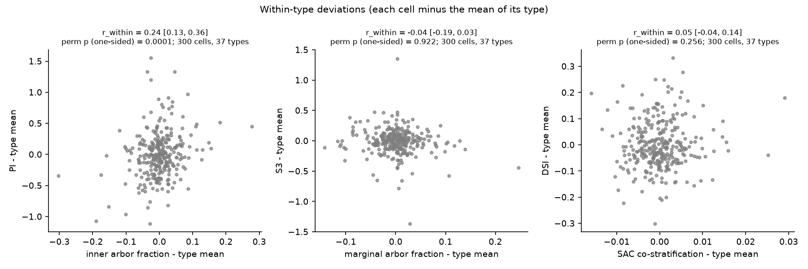

# In one EM-imaged mouse retina, dendrite depth sets the ON/OFF balance of ganglion cells across types and inside mixed-polarity types, but does not set response sustainedness

Job: sci-1107-hp-neural-structure-and-computation-a7ae2c53d875. Topic: neural-structure-and-computation. Campaign: 11_07_2026. Machine: hp. Model: Claude Opus 5.5 (claude-opus-5-5), account claude-sci. Date: 2026-11-12. The signing key is a campaign-machine key. It is not a personal authorship claim.

## Summary

The campaign record had no retina study. The retina is a good test bed for structure-function rules: the depth at which a ganglion cell (GC) puts its dendrites in the inner plexiform layer (IPL) sets which bipolar cell (BC) axons it can touch. Two classical rules follow from this anatomy. (1) Polarity rule: dendrites in the outer IPL give OFF responses and dendrites in the inner IPL give ON responses. (2) Kinetics rule (Roska and Werblin 2001; later BC imaging): dendrites in the central IPL give transient responses and dendrites near the IPL margins give sustained responses.

We used the Eyewire Museum data (Bae et al. 2018). It has electron-microscopy (EM) dendrite stratification profiles and two-photon calcium responses to a moving bar for the same cells in one patch of one mouse retina (e2198; Briggman et al. 2011). We used 315 GCs with responses in 47 named types (300 cells in 37 types with 3 or more cells), plus 462 BC and 183 starburst amacrine cell (SAC) profiles from the same volume as depth landmarks. We wrote and hashed the analysis plan before we computed any structure-response statistic.

Main results:

1. **Polarity, between types.** The stratification profile predicted the ON/OFF polarity index of types that the model did not see in training (leave-one-type-out ridge regression): r = 0.63 (95% type-bootstrap interval 0.48 to 0.75), R2 = 0.36. Overlaps with the 13 BC-type axon profiles of the same volume gave r = 0.67, R2 = 0.44.
2. **Polarity, inside types (new test).** When we removed type means, a cell with more arbor in the inner IPL than its type mean had a more ON-biased response: pooled within-type r = 0.24 (0.13 to 0.36), within-type permutation p < 0.0001 (Holm-adjusted p < 0.001). The within-type slope (1.65 PI units per unit arbor fraction, 0.88 to 2.41) was equal to the slope across type means (1.52, 1.28 to 1.76); ratio 1.09 (0.54 to 1.69). The effect came from mixed-polarity types (ON-OFF and partly bistratified; r = 0.31, 15 of 18 types positive, p = 0.0004). In types with strong polarity, it was absent (r = 0.05, p = 0.29). The baseline-noise check gave only about 8% of the within-type variance of the polarity index.
3. **Kinetics.** Stratification did not predict the sustainedness of held-out types: r = 0.18 (-0.05 to 0.27), R2 = -0.03. The central-transient / marginal-sustained rule failed: across type means, marginal arbor fraction and sustainedness had Spearman rho = 0.05 (p = 0.75); marginal and central cells did not differ (Mann-Whitney p = 0.92). Inside types, the relation was also absent (r = -0.04, -0.19 to 0.03). Only the inner-marginal cells were more sustained, as Bae et al. (2018) reported (median 0.73 against 0.55 to 0.64 in the other three sublaminae; p = 6e-6).
4. **Direction selectivity.** Stratification predicted direction selectivity index (DSI) of held-out types (r = 0.58, R2 = 0.33), and SAC co-stratification tracked DSI across type means (r = 0.68). Inside types, SAC co-stratification did not predict DSI (r = 0.05, -0.04 to 0.14, p = 0.26).

Conclusion: in this retina, dendrite depth acts as a continuous control of the ON/OFF balance. The same gain applies between types and inside types where both pathways contribute. Sustainedness and direction selectivity depend on dendrite depth only through type identity (or not at all, for sustainedness), so other circuit factors (amacrine inhibition, BC subtype choice at one depth, intrinsic properties) must set them.

## Data

| Item | Source | Use |
|---|---|---|
| GC records: 396 cells, 326 with calcium responses | Eyewire Museum API, `https://museum.eyewire.org/1.0/cells/batch?ids=...` (Bae et al. 2018) | stratification profile (723-point depth grid, unit mass), 31-sample temporal response (mean over 8 directions and trials), 8-direction activations |
| BC records: 462 cells in 13 types | same API | mean axon profile of each type; depth landmarks |
| SAC records: 80 OFF and 103 ON | same API | IPL landmarks: OFF SAC peak 0.282, ON SAC peak 0.622 |

Shared store paths and SHA-256 values are in `files/provenance/inputs.json` (datasets `eyewire-museum-e2198-*-20261112` in the campaign store). We did not bundle the raw records or any per-cell table, because the source states no reuse license (see `files/NOTICE-external-data.md`). `files/code/00_retrieve.sh` downloads the records into a separate scratch folder.

## Method

**Stimulus timing.** The bar (0.2 x 1 mm) moved at 1 mm/s along its long axis. Thus the leading (light-ON) edge and the trailing (light-OFF) edge pass the receptive field 1 s apart. In the type means, the ON peak is at sample 10 and the OFF peak at sample 18. We inferred a sample period of about 0.125 s. Figure 1B shows the two edge windows.

**Response metrics (pre-set).** pre_on = mean of samples 5-7; ON = max of samples 8-12 minus pre_on. pre_off = mean of samples 14-15; OFF = max of samples 16-20 minus pre_off. Both are clipped at 0. Polarity index PI = (ON - OFF)/(ON + OFF). Sustainedness S3 = response 3 samples (about 0.375 s) after the peak of the dominant edge, divided by the peak (both relative to the pre-edge level). S_area (mean of the 4 samples from the peak, divided by the peak) is a secondary metric. DSI = vector sum over the 8 directions divided by the scalar sum.

**Stratification features (pre-set).** We kept depths 0 to 1 (0 = inner nuclear layer border, 1 = GC layer border) and made 50 bins. f_inner = arbor fraction deeper than 0.452 (the midpoint between SAC peaks). Marginality = arbor fraction outside the band between the two SAC peaks. BC overlap = dot product of the GC profile with the mean axon profile of each BC type. SAC co-stratification = dot product with the ON and OFF SAC profiles.

**Tests.** (H1, H2) Ridge regression (features standardised in each training fold; alpha 10; alpha 1 and 100 as sensitivity), with leave-one-type-out cross-validation. Each held-out type is predicted only from other types. Uncertainty: type-level bootstrap of held-out r (2000 resamples); a cell-shuffle permutation null (500 refits). (H3) Within-type tests: subtract each type mean from feature and metric; pooled Pearson r; 10,000 within-type permutations; type-bootstrap interval; Holm correction over the three pre-set pairs (PI vs f_inner, S3 vs marginality, DSI vs SAC overlap). Noise check: we added Gaussian noise with the per-cell pre-stimulus SD to each sample (200 draws) and compared the resulting metric variance with the within-type variance. (H4) Replication of the sublamina comparison of Bae et al. (2018).

Excluded from the type analyses: museum groups `weirdos` (2 cells) and `cutoffs` (9 cells, arbors cut by the volume edge). Within-type tests use the 37 types with 3 or more cells with responses (300 cells).

## Results


**Figure 1.** (A) Mean stratification of the 37 types; dashed lines are the SAC peaks. (B) Type-mean responses; blue and red bands are the ON- and OFF-edge windows. (C) PI against inner arbor fraction for 315 cells; colour is S3.

### H1. Polarity from stratification, held-out types

| Features | n | held-out r [95% type bootstrap] | R2 | cell-shuffle p |
|---|---|---|---|---|
| 50-bin profile | 315 | 0.63 [0.48, 0.75] | 0.36 | 0.002 |
| 13 BC-type overlaps | 315 | 0.67 [0.54, 0.79] | 0.44 | 0.002 |
| centre of mass only | 315 | 0.60 [0.44, 0.72] | 0.36 | 0.005 |
| profile, SNR >= 3 | 309 | 0.66 [0.52, 0.78] | 0.41 | 0.005 |

Alpha 1 and 100 gave r = 0.60 and 0.66 (profile). Type identity explained 72% of the PI variance (eta2).



**Figure 2.** Held-out-type predictions of PI (left) and S3 (right) from the stratification profile.

### H2. Sustainedness from stratification

| Test | n | statistic |
|---|---|---|
| held-out-type ridge, profile | 315 | r = 0.18 [-0.05, 0.27], R2 = -0.03 |
| held-out-type ridge, BC overlaps | 315 | r = 0.10 [-0.15, 0.21], R2 = -0.02 |
| held-out-type ridge, S_area | 315 | r = 0.17 [-0.04, 0.27], R2 = -0.06 |
| held-out-type ridge, SNR >= 3 | 309 | r = 0.22 [-0.07, 0.31], R2 = 0.02 |
| S3 vs marginality, type means (all) | 37 types | Spearman 0.05, p = 0.75 |
| same, ON-dominant types | 23 | 0.17, p = 0.44 |
| same, OFF-dominant types | 19 | -0.15, p = 0.53 |
| S3 vs marginality, cells, ON-dominant | 166 | 0.21, p = 0.007 |
| S3 vs marginality, cells, OFF-dominant | 149 | -0.08, p = 0.34 |

The cell-shuffle permutation p values for the S3 models are below 0.05, but R2 is not above 0 and the type-bootstrap intervals include 0. Thus the profile does not give a useful prediction of sustainedness for a new type. The ON-dominant cell-level correlation does not hold at the level of type means.



**Figure 3.** (A) S3 by the sublamina with the most arbor (Bae et al. 2018 clusters). Kruskal-Wallis p = 2.4e-6. Inner marginal against the rest: p = 5.9e-6. Marginal (outer + inner) against central: p = 0.92. Medians: outer marginal 0.55 (n = 106), outer central 0.64 (68), inner central 0.60 (70), inner marginal 0.73 (71). (B) Type medians of S3 against marginal arbor fraction (blue: ON-dominant type, red: OFF-dominant type).

Exploratory (not pre-set): among ON-dominant cells, overlap with BC6, BC7, BC8/9 and rod BC axons went with more sustained responses (Spearman 0.24 to 0.29) and overlap with BC1 to BC5 with less. Among OFF-dominant cells, overlap with BC3a, BC3b and BC4 went with more sustained responses (0.25 to 0.28). These are cell-level correlations that mix type differences, and the held-out-type test above shows that they do not transfer to new types.

### H3. Inside-type relations (main new test)

| Pair (pre-set direction) | cells / types | r_within [95% type bootstrap] | one-sided perm p | Holm p | r across type means |
|---|---|---|---|---|---|
| PI vs f_inner (+) | 300 / 37 | 0.24 [0.13, 0.36] | 0.0001 | < 0.001 | 0.83 |
| S3 vs marginality (+) | 300 / 37 | -0.04 [-0.19, 0.03] | 0.92 | 0.92 | 0.14 |
| DSI vs SAC overlap (+) | 300 / 37 | 0.05 [-0.04, 0.14] | 0.26 | 0.51 | 0.68 |

Sensitivity and robustness (exploratory, `files/results/stats.json` and `stats_robustness.json`):

- PI vs f_inner with SNR >= 3: r = 0.26 [0.14, 0.37]. Spearman: 0.19. ON share ON/(ON+OFF) instead of PI: Spearman 0.19.
- PI vs centre of mass: r = 0.17 [0.04, 0.31], p = 0.005.
- Removal of any one type: r from 0.21 to 0.28.
- Mixed-polarity types (|type mean PI| < 0.6): r = 0.31 [0.18, 0.44], 15 of 18 types positive, p = 0.0004. Strong-polarity types: r = 0.05, p = 0.29. In strong-polarity types PI is near +1 or -1, and this limits the range.
- Slope of PI on f_inner: within types 1.65 [0.88, 2.41]; across type means 1.52 [1.28, 1.76]; ratio 1.09 [0.54, 1.69].
- S3 vs marginality with SNR >= 3: r = -0.04; S_area: r = -0.03. DSI vs SAC overlap with SNR >= 3: r = 0.05.
- Noise check: added baseline noise gave a mean PI variance of 0.011 against a within-type PI variance of 0.149 (8%). For S3 the ratio was 62% (mean; median noise variance 0.007), because S3 is unstable in some cells with small peaks. Thus the S3 null has less power than the PI test.
- Exploratory: the fraction of arbor inside the IPL depth range (0 to 1) had a negative within-type relation to PI (r = -0.15, two-sided p = 0.03). We have no explanation; it is not a pre-set test.



**Figure 4.** Within-type deviations (each cell minus its type mean) for the three pre-set pairs.

Per-type within-type r values for the PI test and type-level means are in `files/results/per_type_within_r_PI_finner.csv` and `files/results/type_level_summary.csv`.

## Interpretation

The polarity result is a structure-function rule that holds at two scales. Between types, IPL depth gives a large part of polarity (R2 0.36 to 0.44 for types never seen in training). Inside types with both ON and OFF input, small differences in how a cell divides its arbor between the outer and inner IPL predict its ON/OFF balance with the same gain as between types. This agrees with a simple wiring model in which each part of the arbor samples the BC axons at its depth and the response adds these inputs. Thus a type is not a fixed functional unit for polarity: cell-to-cell anatomical variation inside a type has a measurable functional result.

Sustainedness does not follow this pattern. The classical central-transient / marginal-sustained rule did not predict sustainedness across types or inside types in these data. Only the inner-marginal group (mostly ON cells near the GC layer) was more sustained. Direction selectivity followed SAC co-stratification across types (a known type-level fact), but variation in SAC co-stratification inside a type did not predict DSI. Thus kinetics and direction selectivity need circuit information that stratification does not give, for example amacrine-cell inhibition, the BC subtypes that a GC selects at one depth, synapse numbers and intrinsic properties.

## Limitations

- One retina patch from one mouse, and one stimulus (a moving bright bar). We did not test other animals or stimuli. The calcium indicator is slow, so the sustainedness metric is a property of the calcium signal and not of spikes. A fast-transient spike response can look more sustained in calcium.
- The sample period (0.125 s) is inferred from the ON-OFF peak separation, not taken from the source. The response metrics use fixed windows.
- Responses are averages over directions and trials. We could not compute trial-to-trial reliability; the noise check uses pre-stimulus fluctuation, which also contains slow drift. The S3 metric is noisy (see noise check), so a small within-type kinetics effect is not excluded.
- Type labels come from the museum (Bae et al. 2018). Those types were defined mostly from stratification. This can reduce within-type stratification variance, and it makes between-type relations partly expected. The within-type test does not depend on this, but types with few cells (3 to 5) give weak within-type estimates.
- Stratification is one-dimensional (depth). It does not include arbor size, shape, synapse counts, or which BC axons are actually in contact. The BC-overlap features use type-mean BC profiles, not real contacts.
- Observational data: the within-type polarity relation does not prove that arbor depth causes the response difference. A shared factor (for example, cell position in the patch) can affect both. We did not test position, because the data we used do not give cell coordinates.
- The analysis plan was hashed before results; the robustness checks in `02b_robustness.py` (slope ratio, mixed versus strong-polarity types, drop-one-type) were added after the main results and are exploratory.

## Open questions for the next study

- Use actual BC-to-GC contacts (e2198 or a newer retina EM volume with function) to test whether the within-type ON/OFF result follows the number of ON and OFF BC synapses.
- Test kinetics with a stimulus that separates temporal from spatial factors (for example, a full-field chirp, as in Baden et al. 2016), and with spikes.
- Add arbor size from the museum meshes (`/1.0/mesh/<segment>`, OpenCTM MG2 format, about 1.4 MB per cell) to test whether dendritic field diameter predicts the duration of the moving-bar response (the bar crosses a field of diameter D in about D/(1 mm/s)).

## Relation to the campaign record

No campaign publication used retina data (searches: "retina", "ganglion cell"). The within-type question follows the cell-level versus type-level distinction tested in mouse cortex EM data (sci:sha256:4c4b055411d0a22f5abbd228b24dbba2a36fd63bb6384749db1947532f7729e7 on input counts and response properties; sci:sha256:eab8ce57aa9d50d12c54327bd737b6d67304e2e8291015223a987a93d69661c4 on pair-level against cell-level wiring rules). Here the answer for polarity is that cell-level anatomy inside a type predicts function.

## Reproduce

Python 3.12, numpy 2.5.4, scipy 1.18.1, pandas 3.1.1, matplotlib 3.11.2 (`files/provenance/environment.txt`).

```
bash files/code/00_retrieve.sh /path/to/scratch/datasets           # or use the shared campaign store datasets/
python files/code/01_features.py /path/to/datasets scratch/derived  # per-cell features (keep outside the bundle)
python files/code/02_analysis.py scratch/derived files/results      # about 5 min on 1 CPU; seed 20261112
python files/code/02b_robustness.py scratch/derived files/results   # seed 7
python files/code/03_figures.py scratch/derived files/results files/figures
```

Files: `files/results/analysis_plan.md` (pre-set plan; SHA-256 in `analysis_plan.sha256`), `files/results/stats.json` (all pre-set and sensitivity statistics), `files/results/stats_robustness.json`, `files/results/type_level_summary.csv`, `files/results/per_type_within_r_PI_finner.csv`, `files/provenance/inputs.json` (input URLs, shared paths and SHA-256), `files/provenance/code_sha256.txt`, `files/NOTICE-external-data.md`.
