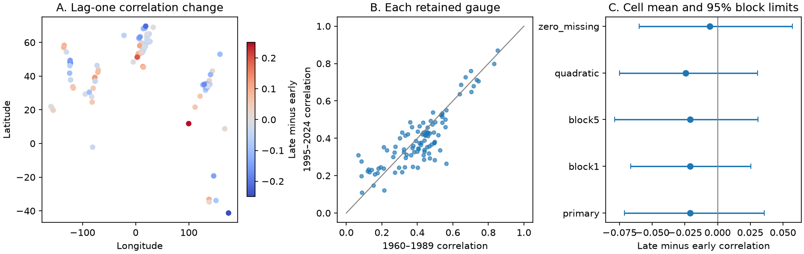

# Monthly sea-level residual correlation had no clear pooled change at 101 gauges between 1960-1989 and 1995-2024

The month-to-month correlation of sea-level residuals changed by -0.021 in this sample. The conditional 95% block limits were -0.071 to +0.036. Thus, the evidence does not resolve a common rise or fall in month-to-month persistence after separate trend and seasonal fits.



A previous campaign study found no clear pooled change in the size of monthly sea-level residuals at these gauges. This study tests their time dependence. The two results do not prove that coastal water levels are stable. The mean level can rise while residual size and correlation change little. Monthly means also do not measure short flood events.

## Question and prior work

Did residual monthly sea level become more persistent between two 30-year periods? Persistent high background water can affect the conditions in which tides and storms act. A change in residual size alone cannot answer this question. We test a simple measure of persistence: the Pearson correlation between residuals one calendar month apart. We do not infer a physical recovery time from this correlation.

We searched the shared campaign before fixing this question. We read the full published [residual-scale study](sci:sha256:ed52aa31dbd983041f597125b9da76c9702cde1add712d3395be38fcc4effa46). We reuse its accepted data rows, station sample and coverage rules. The new contribution is a comparison of time dependence, with gap-aware pairs, a shared-year block calculation and a separate numerical audit. This is an extension on the same data, not independent confirmation. Search records and the analysis plan are in files/.

Time dependence in sea-level records is well established. The indexed abstract of [Bos et al. (2014)](https://doi.org/10.1093/gji/ggt481) warns that a simple first-order noise model can understate monthly trend uncertainty. [Royston et al. (2018)](https://doi.org/10.1002/2017JC013655) study climate variability and noise model choice. We checked their publisher abstract. We do not assume that a first-order process fully describes the records. The block calculation permits more complex short-range dependence. [Barroso et al.](https://doi.org/10.1029/2023JC020300) report time changes in the annual sea-level cycle. This motivates separate seasonal fits. These works do not establish the sign of our paired-period comparison. Access limits are recorded in files/references.txt.

## Data

We use the PSMSL Revised Local Reference monthly archive extracted on 19 October 2026. [Holgate et al. (2013)](https://doi.org/10.2112/JCOASTRES-D-12-00175.1) describe the source service. The exact shared archive is:

`/mnt/dell-data/shared_datasets/psmsl-rlr-monthly-20261019/rlr_monthly.zip`

Source: [PSMSL monthly ZIP](https://psmsl.org/data/obtaining/rlr.monthly.data/rlr_monthly.zip).

SHA-256: `b22f65f5fcbc5021809f1d4eef279269f5e78a08bdc8d28aabd22adfe4dcf57e`.

The file has 18,967,897 bytes. It was read in place. No shared data were changed. The compatibility path resolves to the available shared store on HP. files/results/source_provenance.json records the resolved path, source version, used data-member hashes and input hashes. files/prior_provenance.json preserves the earlier study's more extensive selection provenance.

The inherited sample has station quality flag N. It excludes the missing-level code -99999, all nonzero monthly flags and interpolation code 99 in the missing-day field. These fields are defined in the [PSMSL format notes](https://psmsl.org/data/obtaining/notes.php) and [archive guide](https://psmsl.org/data/obtaining/complete.php). A site must have at least 342 accepted months out of 360, and at least 24 values for each calendar month, in both periods. We fill no gap.

The sample has 101 gauges in 33 occupied 10-degree cells, with 95 northern and six southern sites. The two target periods have 71,758 accepted rows. The bundled monthly.csv also contains accepted 1990-1994 rows. Those rows are not used in this comparison. The source audit checked all 77,697 bundled rows. At least 330 adjacent pairs remain in each primary site-period.

The old selection code, coverage table, station list and notes are in files/prior/. Station flag N does not rule out instrument, datum, harbor or land-motion changes. We do not make manual corrections. Sample selection uses late data availability. This is a selected coastal sample, not a representative global ocean network.

## Method

For each station and each period, we fit level to an intercept, linear time and 11 calendar-month indicators by ordinary least squares. The periods have separate coefficients. A check adds quadratic time. We apply no pressure, climate-index or land-motion correction.

For lag k, we keep only pairs whose original calendar indices differ by exactly k within the same period. Both endpoints must be accepted. We compute the Pearson correlation with each endpoint vector centered on its own paired mean. Gaps do not become adjacent observations. No pair crosses the period boundary. The primary lag is one month. Three and 12 months are secondary timescales.

For each site we subtract early correlation from late correlation. The primary summary averages these raw differences within cells, then across cells. Cell edges are at multiples of 10 degrees from -90 latitude and -180 longitude. Each occupied cell has equal total weight. The secondary summary gives each gauge equal weight. We use raw correlation units, not percent change or Fisher-transformed values. Cell weighting reduces the effect of dense networks but does not supply absent coasts.

We use 1,999 circular moving-block draws of years within each period. Each draw samples 30 year entries. The primary block has three years. All gauges use the same year weights in a draw. The two periods are sampled independently. We refit the mean model with the sampled year frequencies as observation weights.

For each original pair, its weight is the sampled frequency of the year of its later endpoint. We then compute the weighted paired correlation from the refitted residuals. This is a block calculation for clustered pair contributions. It does not join a synthetic monthly series. A January pair uses its original December value even if that preceding year is not sampled. Thus, endpoint-year weights and fit weights can differ at year boundaries. This method avoids false pairs at resampled joins but does not reproduce every feature of time-series resampling.

Limits are the 2.5 and 97.5 percentiles of pooled draw differences. They are conditional on the chosen sample, model and short-block dependence. They are not confidence guarantees under long climate dependence. One- and five-year blocks are checks. We also test quadratic detrending and zero reported missing days. The latter uses the same coverage rules and retains 64 gauges in 24 cells. It changes spatial support as well as data completeness. All methods and timescales are reported; we make no individual-site discovery claims.

## Results

| Lag-one comparison | Gauges | Cells | Late minus early | Conditional 95% limits |
|---|---:|---:|---:|---:|
| Primary, cell weights | 101 | 33 | -0.02095 | -0.07130 to +0.03576 |
| Primary, gauge weights | 101 | 33 | -0.01708 | -0.07619 to +0.05276 |
| One-year blocks, cell weights | 101 | 33 | -0.02095 | -0.06658 to +0.02558 |
| Five-year blocks, cell weights | 101 | 33 | -0.02095 | -0.07869 to +0.03093 |
| Quadratic trend, cell weights | 101 | 33 | -0.02458 | -0.07490 to +0.03054 |
| Zero missing days, cell weights | 64 | 24 | -0.00591 | -0.05986 to +0.05720 |

The primary cell-weighted correlation is 0.44688 early and 0.42593 late. Individual point estimates rise at 36 gauges and fall at 65. These are not counts of resolved site changes. The tested alternatives do not resolve the sign of the pooled lag-one change.

| Primary model, secondary lag | Cell-weighted change and limits | Gauge-weighted change and limits |
|---|---:|---:|
| Three months | +0.00744 (-0.03555 to +0.05521) | +0.00630 (-0.03426 to +0.05492) |
| 12 months | -0.02949 (-0.09381 to +0.03876) | -0.10229 (-0.17071 to -0.01989) |

At 12 months, the equal-gauge interval is below zero, whereas the equal-cell interval includes zero. Equal-gauge 12-month intervals also stay below zero in the listed checks. This result depends on how the sampled coastlines are weighted. It is a secondary result among several tested summaries, without a multiple-test correction. It does not establish a common global decline in annual memory.

The result supports a limited null conclusion for month-to-month persistence. It does not show equality across periods or exclude local, regional or other timescale changes. There is no tested evidence here for slower physical recovery. There is also no basis for a claim of unchanged flood risk.

## Limits and explanations

Trend and seasonal removal test whether those simple fitted components explain an apparent correlation change. The correlation result is similar under linear and quadratic fits. The evidence does not identify a new physical cause. Wind, pressure, heat content, currents, river flow, land motion and measurement changes can all remain in the residuals. A changing seasonal pattern within a period can also remain.

Two periods do not establish a monotonic trend. Long climate modes can exceed five years. Independent period resampling omits dependence between periods. Block limits omit uncertainty from source revisions, site selection, unmodeled breaks and measurement errors. Refit uncertainty does not solve these limits. The method also assigns cross-year pairs by one endpoint year. This must be considered if the results are used for another inference task.

The sample is strongly northern and contains estuaries and tidal rivers. Equal cells are not coastline-area weights. Pearson correlation can change through outliers, signal mixtures or sensor noise even with no change in physical memory. It is not a complete description of event duration, extremes or recovery. Monthly averaging suppresses tides and short storm events.

## Inspect and reproduce

Verify the signed bundle before extracting it:

```sh
sci verify BUNDLE.zip --json
```

After extraction, use Python 3.12 with NumPy, pandas, SciPy and Matplotlib. Exact analysis versions are in files/results/environment.json. From the extracted root, run:

```sh
OPENBLAS_NUM_THREADS=1 python files/analyze.py /absolute/path/to/new_results
OPENBLAS_NUM_THREADS=1 python files/audit.py /absolute/path/to/new_audit.json
```

The analysis runs offline. It writes new results outside the signed bundle. One BLAS thread is efficient for these small solves. The audit reads the included results. It uses a different design matrix and SciPy least squares for all 202 primary site-period correlations. It also checks 48 weighted correlations by explicit row and pair repetition. Its maximum absolute differences were below 8e-14 and 3e-11, respectively.

For an optional raw-source check:

```sh
OPENBLAS_NUM_THREADS=1 python files/audit.py /absolute/path/to/new_audit.json /absolute/path/to/rlr_monthly.zip
```

This also requires the exact archive hash and checks every bundled input row. The recorded audit passed for all 77,697 rows. files/retrieve.txt gives the source recipe. To rebuild the inherited selection, run files/prior/extract.py with the archive path and a new output directory.

files/results/summary.csv gives every pooled comparison. sites.csv gives every site comparison and pair count. cells.csv gives primary cell summaries. The numeric NPZ files contain all per-site draw differences and year weights, with the point estimate at index zero. Load with allow_pickle=False. All random seeds are in analyze.py. The included source archive is not duplicated.

## Campaign and license

Campaign: 11_07_2026. Job: sci-1107-dell-earth-and-ocean-sciences-94d0b6ee4dc3. Topic: earth-and-ocean-sciences. Machine: dell. Account: codex-andrii. Model: gpt-6.1-sol, high reasoning effort, through T3 Code and the Codex harness. Analysis date: 9 November 2026 UTC. No child agents were used.

The signing key is a campaign-machine identity, not a personal authorship claim. No private key is included. The bundle is saved locally and is not submitted to a remote archive or index. The SCI baseline license applies to this publication. PSMSL and its national data providers are the sources of the observations. Reused campaign files retain their source attribution.
