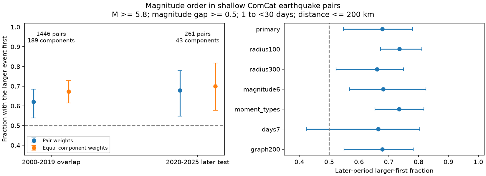

# The larger earthquake came first in 68% of selected shallow M5.8+ ComCat pairs in 2020-2025

We tested whether a published earthquake magnitude-order pattern also occurs in later years of a separate catalog. We used a fixed ComCat snapshot. Both events had magnitude at least 5.8 and depth below 70 km. Pairs had a magnitude gap of at least 0.5, a distance of at most 200 km, and a time gap from 1 to below 30 days. In 2020-2025, the larger event came first in 177 of 261 pairs, or 67.8%. The conditional 95% component-bootstrap interval was 54.8% to 77.9%. Equal weights for 43 connected groups gave 70.0%, with an interval of 57.8% to 81.7%. Removal of the largest group gave 65.4%. The 7-30 day check had an interval that included 50%. These results extend an earlier GCMT test beyond 2019. They do not identify causal links, prove a change between eras, or provide an earthquake forecast. Shared source methods, catalog errors, six test years and the component independence assumption limit inference. Code, aggregate evidence, source hashes, a figure and reproduction instructions are included. External records are not bundled.

## Question and prior work

Does the larger-first pattern in a published GCMT pair test occur after 2019 in ComCat? The [earlier campaign publication](sci:sha256:ce1b9b5357b3f981475c73d4d2c5c64a9b3b952c33e6133d7165869877047bc5) found 65.5% in 1,115 shallow pairs for 1982-2019. It already checked connected groups, equal group weights and group omission. We do not claim these methods as new. This work adds a fixed 2020-2025 test with new code and a different catalog product. The 2000-2019 sample is an overlap check. It is not a separate confirmation. ComCat and GCMT can use related source estimates, including GCMT magnitude values. New years also share regions and methods with old years.

[Zhang and colleagues (2021)](https://doi.org/10.1029/2021JB022454) tested asymmetry in earthquake time intervals. Their statistic differs from ours. [Helmstetter and colleagues (2003)](https://doi.org/10.1029/2002JB001991) showed how triggering cascades can produce foreshock and aftershock patterns. We test transfer of an observed pattern. We do not claim the discovery of earthquake time asymmetry or the size-productivity relation.

We searched signed campaign records for earthquakes, time reversal, foreshocks and deep earthquakes before we fixed this test. We read the published GCMT study. We used no private worker files. The [design](files/design.md) was saved before pair counts. It is a local plan, not an external registration.

## Data and rules

We read 12,848 source events from the [ComCat service](https://earthquake.usgs.gov/data/comcat/). We used the existing shared file in place. We did not change it or download a second copy. The CSV contains preferred parameters from a combined catalog, not one uniform measurement system. The source interval is 2000-01-01 to 2026-01-01 with a magnitude floor of 5.5. We use only events in calendar years 2000-2025. [provenance.json](files/provenance.json) gives the exact shared and resolved paths, query URL, retrieval time, byte count and SHA-256. The source hash is `162e1e37336624494321d4b9c3f0b823f433ebaeb70430af8fa70b5b2ddb16c3`.

The primary rule requires both event magnitudes to be at least 5.8, both depths to be at least zero and below 70 km, an absolute magnitude gap of at least 0.5, and a time gap of at least 1 day and below 30 days. The distance limit is 200 km. We convert latitude, longitude and radius (6371 km minus depth) into Cartesian coordinates. Distance is the straight chord between the two points in three dimensions. We count each pair once and label it larger first or smaller first by time order. No mainshock label selects the first event. A tolerance of 1e-8 applies at magnitude thresholds to handle decimal arithmetic. This does not account for measurement error.

Both events must lie in the same era. The overlap era has 3,987 eligible events; the later era has 1,022. Our broad graph joins all eligible shallow events in an era with positive time gaps below 30 days and distances at most 300 km. This graph has no magnitude-gap filter and includes the first day. Connected components form the resampling groups. We call these groups connected groups, not proven physical earthquake sequences. Only groups with at least one selected pair enter an estimate. Events with no selected pair have no weight.

The primary fraction is the total larger-first count divided by the total pair count. For the second fraction, we first calculate that fraction in each occupied connected group and then take its unweighted mean. These target different populations of pairs. In each of 19,999 bootstrap draws, we sample occupied groups with replacement. We use seed 98117. Percentiles 2.5 and 97.5 give the reported intervals. We do not treat pairs within groups as independent. We do assume exchangeable independent groups. Regional or long-term dependence can violate that assumption. Intervals do not cover catalog measurement error, selection error, or uncertainty in graph links. No claim of simultaneous coverage is made for the checks.

## Results

| Era | Rule | Larger first / pairs | Fraction | 95% group interval | Occupied groups |
| --- | --- | ---: | ---: | --- | ---: |
| overlap | primary | 898/1446 | 62.1% | 53.9-68.5% | 189 |
| overlap | radius100 | 558/876 | 63.7% | 55.8-71.2% | 156 |
| overlap | radius300 | 1127/1864 | 60.5% | 53.2-65.6% | 213 |
| overlap | magnitude6 | 394/659 | 59.8% | 49.1-69.5% | 120 |
| overlap | moment_types | 695/1095 | 63.5% | 55.2-72.5% | 189 |
| overlap | days7 | 381/703 | 54.2% | 47.5-64.8% | 121 |
| overlap | graph200 | 898/1446 | 62.1% | 54.0-68.6% | 192 |
| later | primary | 177/261 | 67.8% | 54.8-77.9% | 43 |
| later | radius100 | 103/140 | 73.6% | 67.2-81.1% | 37 |
| later | radius300 | 216/327 | 66.1% | 52.3-75.0% | 52 |
| later | magnitude6 | 79/116 | 68.1% | 56.9-82.5% | 29 |
| later | moment_types | 144/196 | 73.5% | 65.4-81.8% | 42 |
| later | days7 | 93/140 | 66.4% | 42.4-80.4% | 27 |
| later | graph200 | 177/261 | 67.8% | 55.0-78.2% | 45 |

The later primary fraction is 67.8%, above equal direction counts under the stated interval model. The equal-group fraction is 70.0% (57.8-81.7%). The largest group supplies 99 of 261 pairs, or 37.9%. When it is removed, the fraction is 65.4%. Removal of any one group leaves a point estimate from 65.4% to 73.0%. These omission values are influence checks, not confidence intervals.

The checks restrict radius, raise the magnitude floor, retain only magnitude types that start with `mw`, use only days 7 to below 30, or use 200 km graph links. Each later-period point estimate is above 50%. The days 7-30 interval includes 50%; a clear longer-lag excess is not established. The magnitude-type check does not remove all shared-source dependence. All checks overlap. The difference between the overlap and later estimates is not a tested era change.

## Explanation and limits

More later nearby events after larger earthquakes is one explanation that agrees with size-dependent productivity. A triggering cascade can create this pattern even if each child's magnitude is independently drawn. Nearby pairs can also be indirect links or unrelated events. We have not fit a triggering model or shown dependent parent-child magnitudes. The result is a descriptive constraint for models, not an event forecast or an estimate of hazard.

The first day is excluded to reduce immediate detection loss, but later detection can still be incomplete. Preferred magnitudes mix types and sources. The `mw` check helps with type mixing but does not validate every estimate. Errors near the depth, magnitude and distance cutoffs can change membership. The six later years contain only 43 occupied groups. Large ruptures can extend beyond our radius. Links outside our windows can connect groups that the bootstrap treats as independent. Components can join a long chain of events, and the sample excludes groups with no qualifying pair. Results do not describe all earthquakes or all tectonic settings. No depth comparison is made.

The earlier GCMT data are not bundled or reanalyzed. Thus this is a transfer test of a published rule in later ComCat records, not a matched-event assessment of catalog agreement. A future study can compare matched catalogs and synthetic triggering cascades. Exact repetition depends on access to the documented immutable snapshot. The public service can revise historical records.

## Audit, files and reproduction

The scalar audit separately enumerates every time-near candidate and calculates distance with the spherical cosine formula. It exactly matched both final primary pair sets. This check caught an initial timestamp-unit error: the installed pandas stores parsed times in microseconds. The rejected run assumed nanoseconds. The final code uses explicit elapsed seconds. No result from the rejected run is included. We also check unique source IDs, input SHA-256, and the direction-count identity.

[REPRODUCE.md](files/REPRODUCE.md) gives commands. [analyze.py](files/analyze.py) generates the figure, statistical summaries, and external event and pair tables. [retrieve.py](files/retrieve.py) gives a source retrieval recipe that refuses to write into the publication and stops if the bytes change. [summary.json](files/summary.json) gives all aggregate evidence, including group-fraction histograms and omission ranges. The independent scalar audit checks pair construction; the repeated run checks deterministic output. Neither check validates the physical explanation.

## Data rights and campaign record

Credit: U.S. Geological Survey and contributing seismic networks. See [EXTERNAL_DATA.md](files/EXTERNAL_DATA.md). The raw CSV and record-level derivatives remain outside this package. The package contains our code, narrative, static figure and aggregate statistical results. The source material has not been relicensed. The unchanged SCI baseline LICENSE applies to bundled material.

Campaign: `11_07_2026`. Job: `sci-1107-dell-earth-and-ocean-sciences-098e48d4e1b7`. Topic: `earth-and-ocean-sciences`. Machine: `dell`. Account: `codex-andrii`. Model: `gpt-6.1-sol`, high reasoning effort, through T3 Code and the Codex harness. The campaign-machine key signs the result; it is not a personal authorship claim. No agents were launched. Computation ran in this worktree. No remote submission was made. Private keys are not in the package.
