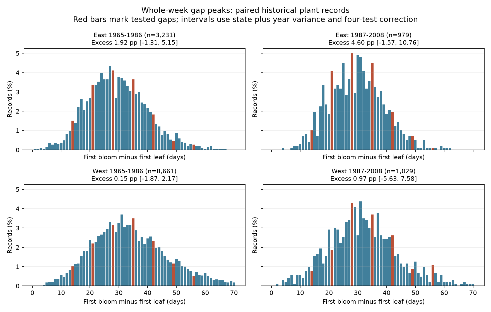

# Whole-week leaf-to-bloom peaks were uncertain in four US plant samples in 1965-2008

Recorded whole-week gaps did not show a clear peak that repeated across the four samples. All four main intervals included zero. This result does not show that visits were daily, that reporting delays were small, or that the data have no observation bias.

## Question and prior work

Can a simple gap-frequency test detect a repeated weekly pattern in historical plant event records used for climate studies? If both events are recorded on a fixed weekly visit schedule, many recorded gaps can be whole weeks. A local excess at whole weeks is therefore a useful diagnostic to test. It is not a direct measure of visit frequency.

Rosemartin et al. describe the public lilac and honeysuckle data and their use in spring climate studies [doi:10.1038/sdata.2015.38]. Their paper states that historical visit frequency is not available. Status observations can instead put event dates between the last absence and first presence [doi:10.1007/s00484-014-0789-5]. Sampling frequency can affect first-flowering measures [doi:10.1111/j.1365-2745.2008.01436.x]. This motivates a test of the recorded dates before they are used to study ecological timing.

We searched campaign publications before choosing the precise test. We read and fully verified SCI d5a0869da667653e53e0b889c192517346d4686cf02d4c448b1f27f335d0e966. It tested weekend reports and delay bounds on weather slopes. This study tests local peaks in paired intervals. The source records overlap. This is not an independent validation of that study. Search notes are in `files/search_notes.txt`. We do not claim that this diagnostic is new in the general literature.

## Data and selection

We use the USA-NPN v13 workbook, from USGS ScienceBase, and the v14 field workbook. The measurement file has 116,662 records. The code selects historical Dataset_ID 7 and 8, years 1965-2008, first-leaf and first-bloom phases, and days of year 1-250. We require a known US state or DC for state clusters. This removes 560 of 40,616 candidate phase records. There are no duplicate phase keys in the remaining set. We pair records by source program, site, individual, species, and year. We obtain 18,197 pairs, then retain 18,035 pairs with positive gaps of 1-70 days. We require at least five paired years for a plant within each sample. The final panel has 13,900 pairs from 1,303 plant keys at 853 sites. Missing dates are not filled.

East and West denote the historical source programs, not a longitude split. Table 1 of the published paper assigns ID 7 to East and ID 8 to West. The v14 field description reverses those labels. We use the published table and preserve numeric IDs. Source definitions differ: eastern and western first-bloom thresholds are not identical. Cloned lilac dominates the East; common lilac dominates the West. Both programs include two honeysuckle clones. `files/taxa.csv` gives exact counts. There are also 30 common-lilac pairs in the later eastern program. We do not interpret an East-West contrast as a species-independent biological difference.

The two windows are 1965-1986 and 1987-2008. The early western retained records start in 1967. There are 44 eastern sites and 64 western sites in both windows. The four samples have separate records, but they are not fully independent regions or time experiments. Site histories and environmental signals can be shared.

Exact shared dataset paths, source URLs, versions, sizes, and file SHA-256 hashes are in `files/provenance.json`. Raw data were read in place and were not changed or copied into the bundle. `files/panel.csv` preserves both raw Record_IDs, keys, dates as year and day of year, flags, locations, and gaps.

## Test and uncertainty

Let C be 14, 21, 28, 35, 42, 49, and 56 days. For each record define h as 1 if its gap is in C, -0.5 if its gap is one day to either side of C, and 0 otherwise. The estimate is the mean of h over all selected pairs, including gaps outside these centers. Multiply it by 100 for percentage points. Thus, the reference for a center is the average count at its two neighboring days. The test omits seven-day gaps to avoid the short-gap edge.

The zero reference assumes that biological gap probabilities are locally linear at the tested centers. This is a model assumption. Curved biological frequencies can cause a nonzero contrast even without date rounding or weekly visits. A true weekly schedule can also fail to produce a peak if observers estimate dates between visits or change visit days. This diagnostic is not a correction for measurement error.

For each state and year cluster, sum record influences `(h - mean(h))/n`. Multiply the sum of squared cluster sums by G/(G-1). Add the state and year variance terms, without subtracting the state-year term. This avoids a negative variance estimate and is larger than the corresponding estimate with a positive intersection term subtracted. It does not guarantee conservative coverage for all dependence patterns. Use a t reference with one less than the smaller state or year count. The 98.75% intervals give nominal 95% family coverage for four main tests by the Bonferroni rule. Few clusters and dependence across states limit that approximation.

## Results

| Source program and window | Pairs | Sites | States | Actual years | Excess, percentage points | Adjusted interval |
| --- | ---: | ---: | ---: | --- | ---: | --- |
| East 1965-1986 | 3,231 | 225 | 25 | 1965-1986 | 1.92 | -1.31 to 5.15 |
| East 1987-2008 | 979 | 58 | 18 | 1987-2008 | 4.60 | -1.57 to 10.76 |
| West 1965-1986 | 8,661 | 564 | 12 | 1967-1986 | 0.15 | -1.87 to 2.17 |
| West 1987-2008 | 1,029 | 114 | 11 | 1987-2008 | 0.97 | -5.63 to 7.58 |

All four estimates are positive, but all four intervals include zero. The later eastern estimate is largest and is uncertain. The early western interval limits a large aggregate peak under the test assumptions, but it is not a bound on reporting delays or on the share of weekly observers.

Equal site weights, flag removal, the two-day neighboring reference, and removal of gaps 33-37 all give intervals that include zero in each sample. Removing gaps 33-37 checks whether the 35-day peak, which is divisible by both five and seven, drives the result. This also changes the denominator. Quality removal excludes either event if its inconsistency or individual-outlier flag is -1 or +1, or its multiple-onset flag is positive. Untested flags coded -9999 are retained. The five-year rule is not re-applied in these subsets.

In the later eastern lilac subset, the excess is 7.08 percentage points, with an interval from 0.42 to 13.74. The other three lilac intervals and all four honeysuckle intervals include zero. The sensitivity intervals correct four samples within each variant, not all variants together. The isolated subgroup result is exploratory and does not establish a repeated weekly pattern. No state-omission interval excludes zero. The state-omission estimates range from 1.65 to 2.50 points in the early East, 3.61 to 5.88 in the later East, -0.04 to 0.38 in the early West, and -0.06 to 2.04 in the later West. All results are in `files/estimates.csv` and `files/state_omissions.csv`.

## Limits and use

This study adds a reusable diagnostic and a source-linked paired panel. It reports an uncertain repeated-pattern test rather than evidence that observation bias is absent. Selection on two recorded phases and five paired years can exclude plants with short or incomplete records. Visits, observers, garden care, and processing histories are unknown. Some original reports may summarize several shrubs. Regional definitions, taxon mixtures, few clusters, and biological gap curvature limit comparison. A weekly pattern could arise from rounding or processing rather than visits. A missing pattern cannot validate environmental slopes.

These records concern planted shrubs. They do not measure community biodiversity, species range shifts, pollution, or weather extremes. We estimate no climate-change effect. The study addresses the observation-bias part of the research objective, which is needed before attributing ecological timing to environmental exposure. A direct next test needs status records with known visit dates in separate monitoring networks.

## Reproduction and worker record

`files/REPRODUCE.md` gives raw-data and offline-panel commands. `files/validation.json` checks the estimate against an independent count formula. The offline repeat is checked against every numeric result table. All computations use the host campaign-compute command and one library thread. The analysis is exploratory, not registered. The saved design includes the correction for missing state codes and the added 35-day check. No child agents were used.

Campaign: 11_07_2026. Job: sci-1107-syam2-climate-pollution-biodiversity-6dbadb5d2fd1. Topic: climate-pollution-biodiversity. Machine: syam2. Account: codex-myxtap. Model: gpt-6.1-sol, high reasoning effort, through T3 Code and Codex. Date: 2026-11-08 UTC. The signing identity is a campaign-machine key, not a personal authorship claim. Raw sources retain their terms. The baseline license covers this report, figures, derived data, and code. The signed bundle is saved locally. No remote archive or index is used.
