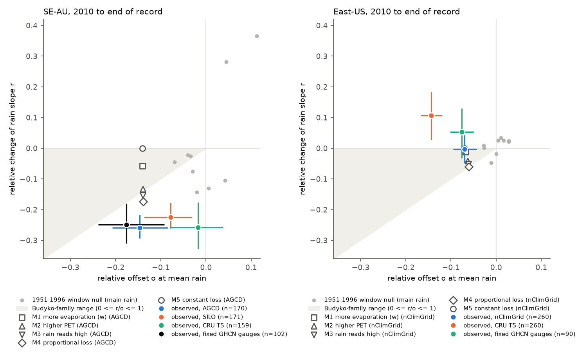
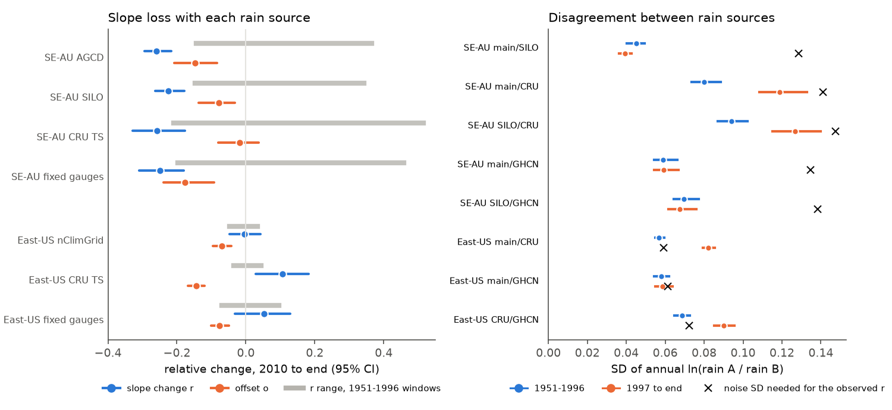
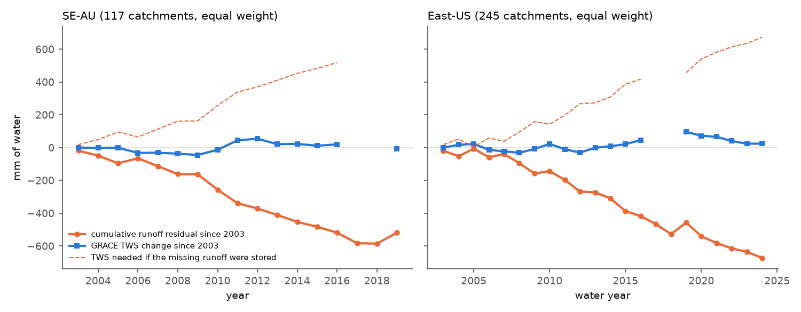

# Post-1997 runoff losses in south-east Australia and the eastern US were not stored and did not come from rain-gauge noise; their forms differed at equal aridity (CAMELS, GRACE, 1951-2025)

Job `sci-1107-hp-earth-and-ocean-sciences-6737eba16fa6`, campaign 11_07_2026, topic
earth-and-ocean-sciences, machine hp, account claude-olen. Model: Claude Opus 5.5
(`claude-opus-5-5`) in Claude Code (T3 Code). The signing key is a campaign-machine key. It is
not a personal authorship claim.

## Summary

**Background.** Earlier campaign bundles found that runoff in south-east Australia (SE-AU) and in
the eastern US (East-US, HUC-02 regions 01-08) fell below each catchment's 1951-1996
rainfall-runoff relation after 1997 and stayed low (7dedc5bb, df943002). Fixed rain-gauge networks
confirmed both deficits, about 40 mm per year after 2009 (20955da2). The two deficits have
different forms (871b2192): SE-AU lost about one quarter of its runoff response to rain (a slope
loss, largest in wet years), and East-US runoff had a constant offset. The physical causes were
open.

**Questions.** (1) Where did the missing water go: into storage, or out of the catchment?
(2) Can noise in the rain data after 1997 make the SE-AU slope loss? (3) Which mechanism forms
agree with each deficit: more evaporation for the same climate (Budyko parameter w), higher
evaporative demand (PET), rain that reads too high, a loss proportional to flow, or a constant
loss? (4) Can one change, seen through a water-limited and an energy-limited climate, give both
forms?

**Data and method.** Up to 171 SE-AU catchments (CAMELS-AUS v2.03, 1951-2021), 260 East-US and 262
West-US CAMELS catchments (USGS flow, water years 1951-2025), plus south-west Western Australia
(SW-WA) and northern Australia. We used the annual flow tables of bundle 871b2192 and its model:
Q = a + b P + c P(t-1) + d T, fitted on 1951-1996. The new inputs are four rain sources per
continent (AGCD, SILO, CRU TS 4.09 and fixed GHCN-Daily gauge networks in Australia; nClimGrid,
CRU and fixed gauges in the US), three PET products (CRU TS 4.09 PET, SILO FAO56 short-crop PET
and Morton wet-area PET), and CSR GRACE/GRACE-FO RL06.3 mascon water storage. For each mechanism,
the Fu form of the Budyko curve gives its "fingerprint": the ratio of the slope change r to the
offset o. We scaled each mechanism to give the observed mean deficit of each catchment and
compared the predicted slope change with the observed one. Intervals are 95% cluster-bootstrap
intervals over 2 x 2 degree cells. A time null uses 35 leave-12-year-window-out tests in
1951-1996. We wrote the plan (`files/ANALYSIS_PLAN.md`) before we calculated any new endpoint.

**Main results.**

1. **The missing runoff was not stored.** From 2010 to the end of the flow records, the
   cumulative runoff deficit was 484 mm in SE-AU (95% CI 282-700 mm; 125 catchments, mostly to
   2021) and 538 mm in East-US (304-743 mm; 247 catchments, to 2025). In the same years, GRACE
   total water storage at these catchments rose by only 82 mm in SE-AU (62-97 mm) and 28 mm in
   East-US (14-44 mm). Thus storage can hold at most 17% (12-27%) of the SE-AU deficit and 5%
   (3-11%) of the East-US deficit, even if all storage gain came from the deficit. The missing
   water left the catchments, most probably as evapotranspiration (or as water use), or it never
   fell. Fixed gauges (item 2, and 20955da2) make the last option unlikely.
2. **Rain-data noise does not make the SE-AU slope loss.** With fixed GHCN-Daily gauge networks
   (the same gauges in all years, 102 catchments), the SE-AU slope loss was 25% (r = -0.249,
   95% CI -0.310 to -0.180). It was 26% with AGCD, 22% with SILO and 26% with CRU. All four values
   were below all 35 time-null values (one-sided p = 0.028, the smallest possible value). Noise
   that would make a 26% slope loss needs a rain-error SD of about 0.13 (log units) after 1997.
   The observed disagreement between AGCD and SILO fell after 1997 (SD 0.045 to 0.040), and the
   AGCD-gauge disagreement did not change (0.059 to 0.059).
3. **East-US: a constant loss.** The East-US offset was -7.0% of predicted flow (CI -9.5 to -4.3%;
   below all 35 time-null values), with no slope change (r = -0.004, CI -0.048 to +0.043). This
   form agrees with a constant loss and with more evaporation for the same climate (Budyko w) in
   these energy-limited catchments (gap +0.008, CI -0.035 to +0.053). A loss proportional to flow
   and a rain product that reads too high predict a slope loss that did not occur (gaps +0.057 and
   +0.048; bootstrap intervals exclude 0; time-null p = 0.056 and 0.083). Fixed gauges gave the
   same result (offset -7.6%; proportional-loss gap +0.112, CI +0.029 to +0.184). Higher PET does
   not explain the start of the East-US deficit: PET (CRU) fell by 0.7% in 1997-2009 while the
   deficit was already -4.8%.
4. **SE-AU: a slope loss at least as large as a proportional loss.** A constant loss and more
   evaporation for the same climate (w) predict a slope loss much smaller than observed (gaps -0.26
   and -0.20 with AGCD; time-null p = 0.028 for both). A loss proportional to flow, higher PET or a
   rain product that reads too high come closer. The bootstrap intervals of their gaps exclude 0
   with all four rain sources (for example proportional loss: -0.086, CI -0.142 to -0.026, with
   AGCD; -0.057, CI -0.097 to -0.013, with fixed gauges). But these gaps were inside the time-null
   range (p = 0.08-0.56). Thus the data show that the SE-AU loss is at least proportional to flow.
   They do not show that it is larger than proportional.
5. **Higher PET explains only a part of the SE-AU loss, and the PET products disagree.** From
   1951-1996 to 2010-2021, SE-AU PET rose by 5.9% (CRU TS), 2.0% (FAO56 from SILO) or -0.3%
   (Morton wet-area). With a fixed Budyko w, these changes explain a runoff loss of 5.8%, 2.6% or
   0% of the 1951-1996 mean flow. The observed loss beyond the rain and PET changes was 12-18% with
   AGCD, 14% with fixed gauges, and 2-10% with SILO and CRU rain.
6. **The forms stayed different at the same aridity (exploratory).** The most humid third of the
   SE-AU catchments (median PET/P 0.83, runoff ratio 0.42) had a slope loss of 22% (CI 13-27%).
   The middle third of the East-US catchments (median PET/P 0.86, runoff ratio 0.41) had none
   (r = -0.04, CI -0.09 to +0.02). Thus a single evaporation change, seen through a water-limited
   and an energy-limited climate, does not explain the two forms. The two regions had different
   changes.

**Conclusion.** In both regions, about 34-41 mm per year of runoff did not reach the streams after
2009 and did not stay in the catchments as stored water. It most probably left as
evapotranspiration or as water use. Rain-gauge noise, rain-network changes, the rain product and
storage refill do not explain the two shifts. The East-US loss has the form of a constant extra
loss (for example more evaporation in energy-limited forests). The SE-AU loss scales at least with
flow and is concentrated in wet years. A higher PET can explain a part of the SE-AU loss only with
the CRU PET product. Wet-year water use by vegetation, or water that wet years put into dry deep
soils and that later evaporates, agrees with these results, but we did not test these causes
directly.

## Figures

**Figure 1.** Slope change r against offset o in 2010 to the end of the record (95% CI). Coloured
points: observed values with each rain source. Open markers: predicted (o, r) for each mechanism,
scaled to the observed mean deficit of each catchment (main rain product; CRU PET for the Budyko
fit). Grey points: nine leave-12-year-window-out values from 1951-1996 (no change expected).
Shaded: the range of forms that the Budyko mechanisms can make (0 <= r/o <= 1). SE-AU values lie
below this range; East-US values lie near the constant-loss line (r = 0).

**Figure 2.** Left: slope change r and offset o in 2010-end with each rain source, and the range
of r in the nine 1951-1996 window tests (grey). The SE-AU slope loss is the same with fixed gauge
networks. Right: SD of the annual log ratio between two rain sources, 1951-1996 and 1997-end. The
cross is the post-1997 rain-error SD that classical errors-in-variables needs to make the observed
slope change. For East-US, the observed r is near 0, so the needed noise equals the present
noise.

**Figure 3.** Group means over a fixed set of catchments with complete flow in 2003-2019 (SE-AU,
117) or WY2003-2024 (East-US, 245). Orange: cumulative runoff residual relative to the 1951-1996
relation since 2003. Dashed: the storage gain that would be needed if all missing runoff were
stored. Blue: GRACE TWS change since 2003 (no values for the 2017-2018 gap between the
missions).

## Tables

**Table 1. Form test, 2010 to end of record (CRU PET for the Budyko fit).** r = slope change,
o = offset, f = mean residual / mean predicted flow. G = observed r minus the r that each mechanism
predicts. p = one-sided time-null p (35 windows) for the gap in the direction of the observed gap.

| Group | Rain | n | r [95% CI] | o [95% CI] | G constant loss | G Budyko w | G higher PET | G rain reads high | G proportional | p (proportional) |
| --- | --- | ---: | --- | --- | --- | --- | --- | --- | --- | ---: |
| SE-AU | AGCD | 170 | -0.260 [-0.294, -0.217] | -0.147 [-0.207, -0.084] | -0.260 | -0.202 | -0.127 | -0.107 | -0.086 [-0.142, -0.026] | 0.33 |
| SE-AU | SILO | 171 | -0.224 [-0.262, -0.178] | -0.078 [-0.137, -0.032] | -0.224 | -0.183 | -0.155 | -0.150 | -0.149 [-0.194, -0.086] | 0.14 |
| SE-AU | CRU | 159 | -0.258 [-0.329, -0.176] | -0.018 [-0.080, +0.038] | -0.258 | -0.236 | -0.236 | -0.241 | -0.246 [-0.358, -0.121] | 0.17 |
| SE-AU | fixed gauges | 102 | -0.249 [-0.310, -0.180] | -0.176 [-0.238, -0.092] | -0.249 | -0.187 | -0.106 | -0.081 | -0.057 [-0.097, -0.013] | 0.56 |
| East-US | nClimGrid | 260 | -0.004 [-0.048, +0.043] | -0.070 [-0.095, -0.043] | -0.004 | +0.008 | +0.037 | +0.048 | +0.057 [+0.013, +0.096] | 0.056 |
| East-US | CRU | 260 | +0.106 [+0.028, +0.183] | -0.144 [-0.167, -0.119] | +0.106 | +0.128 | +0.181 | +0.201 | +0.216 [+0.139, +0.288] | 0.028 |
| East-US | fixed gauges | 90 | +0.054 [-0.032, +0.129] | -0.076 [-0.102, -0.049] | +0.054 | +0.063 | +0.091 | +0.104 | +0.112 [+0.029, +0.184] | 0.056 |

The median Budyko fingerprint ratios r/o were 0.35 (w), 0.77 (PET) and 0.88 (rain) in SE-AU
(median PET/P 1.14) and 0.21, 0.65 and 0.86 in East-US (median PET/P 0.86). Intervals of all gaps,
the 1997-2009 period, SW-WA, West-US, North-AU and the FAO56 and Morton PET variants are in
`files/results/forms.csv`; the time-null values are in `files/results/null_fine.csv`. With FAO56
or Morton PET, the SE-AU gaps changed by 0.03 or less.

**Table 2. Was the missing runoff stored? (2009 to last flow year).**

| Group | n | Cumulative runoff residual, mm | GRACE TWS change, mm | Largest stored fraction |
| --- | ---: | --- | --- | --- |
| SE-AU | 125 | -484 [-700, -282] | +82 [+62, +97] | 0.17 [0.12, 0.27] |
| East-US | 247 | -538 [-743, -304] | +28 [+14, +44] | 0.05 [0.03, 0.11] |
| SW-WA | 24 | -410 [-665, -268] | +20 [+12, +30] | 0.05 [0.03, 0.07] |
| West-US | 269 | +216 [+34, +397] | -40 [-54, -27] | - |

With the mean TWS of 2010-end minus the mean of 2003-2009 in place of the 2009 value, the largest
stored fractions were 0.09 (SE-AU) and 0.06 (East-US). SW-WA, the known case of groundwater
decline, behaves like the other two groups.

**Table 3. Rain-source disagreement (SD of annual ln(rain A / rain B)).**

| Group | Pair | n | 1951-1996 | 1997-end | Variance ratio [95% CI] | SD needed for the observed r |
| --- | --- | ---: | ---: | ---: | --- | ---: |
| SE-AU | AGCD/SILO | 363 | 0.045 | 0.040 | 0.76 [0.68, 0.90] | 0.129 |
| SE-AU | AGCD/fixed gauges | 217 | 0.059 | 0.059 | 1.01 [0.90, 1.11] | 0.135 |
| SE-AU | SILO/fixed gauges | 217 | 0.070 | 0.068 | 0.94 [0.84, 1.06] | 0.138 |
| SE-AU | AGCD/CRU | 363 | 0.080 | 0.119 | 2.21 [1.79, 2.73] | 0.141 |
| East-US | nClimGrid/CRU | 332 | 0.057 | 0.082 | 2.09 [1.90, 2.31] | 0.059 |
| East-US | nClimGrid/fixed gauges | 115 | 0.058 | 0.059 | 1.03 [0.90, 1.20] | 0.061 |

CRU at one 0.5-degree cell disagreed more with all other sources after 1997 in all regions,
including regions without a slope loss. This agrees with fewer CRU input stations, not with a
change in the catchments.

**Table 4. Budyko attribution of the change in mean flow, 2010-end versus 1951-1996 (fixed w;
fractions of the 1951-1996 mean flow).**

| Group | Rain | PET | PET change | Observed change | Rain part | PET part | Rest [95% CI] |
| --- | --- | --- | ---: | ---: | ---: | ---: | --- |
| SE-AU | AGCD | CRU | +5.9% | -19.8% | -2.2% | -5.8% | -12.0% [-17.5, -7.5] |
| SE-AU | AGCD | FAO56 | +2.0% | -21.4% | -2.0% | -2.6% | -16.8% [-22.8, -12.0] |
| SE-AU | AGCD | Morton wet | -0.3% | -19.5% | -2.1% | +0.2% | -17.6% [-23.1, -12.8] |
| SE-AU | SILO | CRU | +5.9% | -19.6% | -8.4% | -6.0% | -5.7% [-11.5, -1.4] |
| SE-AU | CRU | CRU | +5.9% | -20.0% | -13.3% | -5.0% | -2.3% [-8.8, +2.9] |
| SE-AU | fixed gauges | CRU | +6.0% | -24.0% | -4.4% | -6.2% | -13.7% [-20.4, -6.4] |
| East-US | nClimGrid | CRU | +3.9% | +6.6% | +12.2% | -2.7% | -2.7% [-4.9, -0.5] |
| East-US | fixed gauges | CRU | +4.0% | +8.7% | +15.0% | -2.7% | -3.3% [-6.3, -0.5] |
| East-US 1997-2009 | nClimGrid | CRU | -0.7% | -2.7% | +1.8% | +0.5% | -5.1% [-6.7, -3.4] |

The parts do not add exactly because the Fu curve is not linear. The Budyko rest is smaller than
the regression deficit of 871b2192 because the regression also uses previous-year rain and
temperature.

**Table 5. Form by aridity tercile, 2010-end, main rain product (exploratory).**

| Group | Tercile | n | Median PET/P | Runoff ratio | r [95% CI] | o [95% CI] |
| --- | --- | ---: | ---: | ---: | --- | --- |
| SE-AU | humid | 57 | 0.83 | 0.42 | -0.218 [-0.272, -0.127] | -0.084 [-0.134, -0.014] |
| SE-AU | middle | 56 | 1.14 | 0.28 | -0.280 [-0.337, -0.215] | -0.239 [-0.323, -0.158] |
| SE-AU | dry | 57 | 1.72 | 0.14 | -0.300 [-0.371, -0.214] | -0.243 [-0.358, -0.052] |
| East-US | humid | 87 | 0.71 | 0.56 | -0.008 [-0.097, +0.057] | -0.039 [-0.078, -0.004] |
| East-US | middle | 86 | 0.86 | 0.41 | -0.042 [-0.094, +0.017] | -0.108 [-0.128, -0.084] |
| East-US | dry | 87 | 0.99 | 0.31 | +0.048 [-0.013, +0.114] | -0.081 [-0.137, -0.018] |

## Relation to prior work

- Peterson et al. (2021, doi:10.1126/science.abd5085) and Saft et al. (2015,
  doi:10.1002/2014WR015348) found persistent shifts in the SE-AU rainfall-runoff relation. Fowler
  et al. (2022, doi:10.5194/hess-26-6073-2022) listed the candidate causes (changes in storage,
  vegetation water use, evaporative demand, rain characteristics and measurement). Our new
  contributions are: a water-balance bound with GRACE for both continents; an errors-in-variables
  test with fixed gauge networks and product disagreement; a fingerprint test of mechanism forms
  with a time null; and the comparison of forms at matched aridity across continents.
- Bundle 871b2192 suggested two causes for SE-AU: a storage deficit that wet years must fill, and
  more vegetation water use in wet years. Our GRACE result shows that the missing water did not
  accumulate in storage. A dynamic version (water enters dry storage in wet years and then
  evaporates) agrees with our result, but we did not test it.
- Bundle 20955da2 confirmed the level of both deficits with fixed gauges. We show that the
  SE-AU slope loss, the East-US offset form and the East-US absence of a slope loss are also the
  same with fixed gauges.
- Other GRACE bundles of the campaign (363ebf38, 97d8cdba) found that land water storage does not
  stay below a precipitation model after droughts. Our result agrees: in SE-AU and East-US the
  runoff deficit is not a storage deficit.

## Limitations

- **GRACE resolution.** We sampled the 0.25-degree CSR grid at each catchment. The real
  resolution of GRACE is about 300 km, so the value is a regional mean. The bound uses the
  whole storage change as an upper limit; part of this change came from the wet years 2010-2011
  and 2021 and has nothing to do with the deficit. The bound does not exclude short-term storage
  of wet-year water that evaporates in later years.
- **Evaporation is inferred, not measured.** We have no independent long ET record. "Not stored"
  plus "rain confirmed by fixed gauges" leaves evapotranspiration, water use (for example farm
  dams or pumping) or undetected flow-measurement changes. CAMELS catchments have small human
  influence, but farm dams in SE-AU were not tested.
- **Time null.** The 35 windows overlap, so the p-values are approximate. The smallest possible
  value is 0.028. The bootstrap intervals hold the fitted models fixed and resample space, not
  time, so they are too narrow for time-related uncertainty.
- **Budyko fingerprints** use the steady-state Fu curve at the 1951-1996 mean climate, and a
  first-order (linear) response. They do not include storage carry-over between years. Some
  catchments (4-18 per SE-AU product) have no Fu solution and are excluded from all mechanism
  tests.
- **Rain products.** The level of the SE-AU deficit depends on the rain product (the AGCD step
  near 1997, 871b2192). The slope loss does not. CRU at one 0.5-degree cell is a poor estimate of
  catchment rain. The GHCN-Daily station files were downloaded again for this work (2026-11-10);
  the fixed networks were rebuilt from the station lists of 20955da2 and can differ slightly.
- **PET products** disagree in SE-AU (-0.3% to +5.9%). We cannot tell which one is correct.
- **Records** end in 2014-2021 in Australia; the wet year 2022 is not covered. US data after
  2024 include provisional values.
- **Post hoc.** The 35-window time null (the plan had 9 windows; both are reported) and the
  fingerprint-ratio summary are post hoc. The aridity comparison is exploratory.

## Data and provenance

See `files/DATA_NOTICE.md` for terms and credit. Inputs and hashes:

| Input | Path or URL | Hash record |
| --- | --- | --- |
| Annual flow, rain and temperature tables (CAMELS-AUS, USGS NWIS) | signed bundle sci:sha256:871b2192..., `files/data/annual_AU.csv.gz`, `climate_AU.csv.gz`, `annual_US.csv.gz` | `files/provenance/intermediate_sha256.txt` |
| nClimGrid basin water-year P and T | bundle sci:sha256:664b208c..., `files/data/climate_wy.csv` | same |
| Fixed gauge network lists | bundle sci:sha256:20955da2..., `files/networks/{aus,us}_sta_f0.8_network.csv` | bundle manifest |
| CAMELS-AUS v2.03 hydrometeorology and master table | `/mnt/dell-data/shared_datasets/camels-aus-v2.03-zenodo14289037-{hydrometeorology,mastertable}` (used in place) | `files/provenance/shared_dataset_records.txt` |
| CAMELS-US camels_name.txt, camels_topo.txt (Zenodo 15529996) | `/mnt/dell-data/shared_datasets/camels-us-attr-{name,topo}-zenodo15529996` (added by this job) | same |
| CRU TS 4.09 pre (decades 1951-2020, shared) and 2021-2024 (new download), pet 1901-2024 (shared, added by this job) | `/mnt/dell-data/shared_datasets/cru-ts-4.09-pre-<decade>-complete-297`, `cru-ts-4.09-pet-1901-2024`; crudata.uea.ac.uk | `files/provenance/cru_sha256.txt`, `shared_dataset_records.txt` |
| GHCN-Daily by-station files, 511 stations | https://www.ncei.noaa.gov/pub/data/ghcn/daily/by_station/ , 2026-11-10 | `files/provenance/ghcnd_download_log.csv` |
| CSR GRACE/GRACE-FO RL06.3 mascons | `/mnt/dell-data/shared_datasets/csr-grace-rl0603-mascon-all-corrections-20261109` | `shared_dataset_records.txt` |

## Reproduce

1. Use Python 3.12 with the packages in `files/environment.txt` and the `sci` CLI.
2. Run `bash files/code/reproduce.sh <scratch_dir> <folder with the signed bundles 871b2192,
   664b208c and 20955da2>`. The script downloads all external sources into `<scratch_dir>`,
   builds the intermediate tables and runs all analyses and figures. It writes nothing into this
   publication folder.
3. Compare `<scratch_dir>/results` with `files/results`. Bootstrap seeds are fixed
   (20261110, 20261113, 20261114, 20261115). GHCN-Daily and USGS values can be revised by the
   providers, so small differences are possible.

Files: `files/code/` (all code; `common.py` loads the tables, `forms.py` T1/T2a/T4,
`rain_noise.py` T2b, `grace_budget.py` T3, `secondary.py` time null and aridity terciles,
`figures.py`), `files/results/` (all result tables; `forms_catchments.csv.gz` has the
per-catchment fitted statistics without rain and PET values), `files/figures/`,
`files/ANALYSIS_PLAN.md`, `files/provenance/`.
