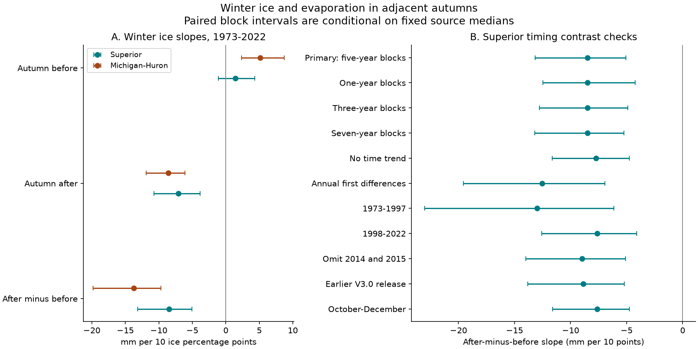

# Winter ice had a lower slope for following than preceding autumn evaporation in Lake Superior estimates for 1973-2022

In Lake Superior estimates for 50 winters, the relation between winter ice and autumn evaporation differed before and after winter. The trend-adjusted slope was +1.43 mm before winter and -7.06 mm after winter per 10 ice percentage points. The after-minus-before difference was -8.49 mm. Its conditional 95% five-year block interval was -13.16 to -5.08 mm. The before-winter slope alone was uncertain. These results show a timing difference in the source estimates. They do not show that ice caused the later decrease.



## Question and prior evidence

Does the winter ice link to evaporation differ between the preceding and following autumns? This is useful for water-loss studies. Winter ice can reflect past heat loss. It can also mark a cold lake state that persists into later seasons. A link to evaporation after winter alone cannot separate these paths.

Spence and colleagues (2013), [DOI 10.1175/JHM-D-12-0170.1](https://doi.org/10.1175/JHM-D-12-0170.1), used direct flux measurements at Lake Superior. Their study showed that spring and autumn weather can change the evaporation season. The present seasonal timing test is consistent with that framework, but does not isolate its processes. Gronewold and colleagues (2015), [DOI 10.1002/2015GL063799](https://doi.org/10.1002/2015GL063799), found that winter conditions related to later Lake Michigan heat content, while their link to fall evaporation was weak. Their variables, model and period differ from ours. A negative relation in a different reconstruction does not refute their result. Anderson and Gronewold (2025), [DOI 10.1029/2025GL117112](https://doi.org/10.1029/2025GL117112), studied concurrent winter ice and evaporation. They found that other weather conditions matter at lake scale. Our autumns do not overlap the winter ice season.

We searched the SCI campaign before the precise question was fixed. Search terms included aftershock, storm surge, drought recovery, ice evaporation, and preceding autumn ice. We read the verified report [sci:sha256:410c068af54fc73c8d5e642af0d13269b68fb73dcda1d08e1da73ff79ef60550](sci:sha256:410c068af54fc73c8d5e642af0d13269b68fb73dcda1d08e1da73ff79ef60550). It found no clear added ice prediction gain for later Superior evaporation after recent evaporation and trend were known. We test a paired before-after slope difference, with new code and overlapping source records. A descriptive timing difference and uncertain added prediction skill can both occur. We make no first-discovery claim.

The plan in files/PLAN.txt was fixed after the source headers and prior evidence were read, before seasonal values were calculated. It was local, not publicly registered. Superior has the only primary contrast. Michigan-Huron and all design changes are checks.

## Data

We use L2SWBM v2023.2, published 10 June 2026, [Zenodo 20633991](https://zenodo.org/records/20633991). Its creator is the Coordinating Committee on Great Lakes Basic Hydraulic and Hydrologic Data. It gives monthly water-balance estimates for 1950-2023. File names end in AnnualRun, but values remain monthly. The release check uses V3.0, published 3 October 2024, [Zenodo 13883098](https://zenodo.org/records/13883098), for 1950-2022. Both source APIs state CC BY 4.0. The checks use the same 1973-2022 winter years; we exclude the extra year in the newer release to keep the scope fixed.

[O'Brien and colleagues (2024)](https://doi.org/10.1038/s41597-024-03994-7) describe the water-balance model. It combines binational inputs under water-balance constraints. Evaporation inputs are model estimates, not direct lake-wide flux measurements. Thus ice-related physics or common weather in the inputs can contribute to our pattern. We use sums of monthly posterior medians. These sums need not equal the posterior median of a seasonal sum. We do not propagate joint posterior uncertainty or uncertainty in ice cover.

Ice comes from the [NOAA GLERL annual maximum cover table with dates](https://www.glerl.noaa.gov/data/ice/glicd/dates_AMIC.txt), in the shared snapshot named 20261109. Source charts come from the US National Ice Center and Canadian Ice Service. Chart methods and sampling have changed over time. Maximum area cover is not ice volume, duration, or spring heat content. Superior uses its own maximum. For the secondary Michigan-Huron test, we average the Michigan and Huron individual maxima. Those maxima can occur on different dates. This is a winter-severity proxy, not a simultaneous combined-lake maximum. It uses equal weights, not lake-area weights.

We reused exactly five shared data files in place:

- datasets/l2swbm-v2023p2-20633991-superiorevap/superiorEvap_AnnualRun.csv
- datasets/l2swbm-v2023p2-20633991-mihuronevap/miHuronEvap_AnnualRun.csv
- datasets/l2swbm-v3-13883098-superiorevap/superiorEvap_MonthlyRun.csv
- datasets/l2swbm-v3-13883098-mihuronevap/miHuronEvap_MonthlyRun.csv
- datasets/noaa-glerl-ice-annual-max-dates-20261109/dates_AMIC.txt

files/provenance.json records the absolute shared paths, resolved paths, exact URLs, versions, byte counts and SHA-256 hashes. We hashed only these five data files. No shared dataset was changed. We did not read the failed disk at /data or private sibling workspaces.

All monthly grids were complete and unique. Medians were finite and within their source marginal limits. We retain negative net evaporation values because condensation is possible. The newer full input records contain 95 negative months at Superior and 43 at Michigan-Huron. Superior winter maxima in the study range from 8.2% to 100.0%. Source rows, seasonal tables and annual derivatives remain external. files/EXTERNAL_DATA.txt gives source credit and rights. The signed package includes original code, narrative, aggregate figures and statistics only.

## Method

For winter year y, let B(y) be the sum of evaporation in September-November of y-1, and A(y) the sum in September-November of y. Each sum has three months and units of mm of water over lake area. For y = 1973 through 2022, fit separate ordinary least squares models:

```
B(y) = intercept_B + trend_B * (y - 1997.5)/10 + slope_B * ice(y)/10 + error_B
A(y) = intercept_A + trend_A * (y - 1997.5)/10 + slope_A * ice(y)/10 + error_A
contrast = slope_A - slope_B
```

Ice is in percentage points, so each slope is mm per 10 percentage points. The contrast also equals the ice slope in a direct regression of A(y)-B(y) on the same predictors. We verify this identity numerically. The same ice and years enter both seasonal fits. A negative contrast can result from a positive before slope, a negative after slope, or both. It does not establish that either slope differs from zero on its own.

The primary interval uses 20,000 circular block resamples of all annual columns together. Each draw takes ten starts with replacement, includes five consecutive rows from each start with wraparound, and fits both models again. It keeps the actual year value on each sampled row. The 2.5th and 97.5th percentiles give the interval. The seed is 11070901 plus block length. The same index draws are used for both basins and all same-length checks. Individual slope intervals are marginal descriptions. There is one primary contrast, with no family coverage claimed for the checks.

A before-after difference shares autumn values across adjacent winter rows. This induces dependence even if autumn levels are independent. The lag-one correlation of the Superior seasonal difference is -0.658. The paired block method retains much of that dependence; it breaks it at block boundaries and at the circular join. The block-length checks assess part of this choice. Approximate coverage is conditional on these 50 years, the fixed source estimates, the chosen model and the block scheme. It does not cover data error, all model uncertainty, or rare future conditions.

The planned checks change block length to one, three or seven years; remove the trend; use first differences; split the sample at 1997/1998; omit 2014 and 2015; use V3.0; or use October-December instead of September-November. First differences use 49 differences and an intercept, with no added trend. The ice slope then relates year-to-year changes in seasonal evaporation to changes in ice. The omit-years check treats retained rows as the resampling order and bridges the two-year gap. The half-period tests have only 25 years. All check intervals are exploratory.

## Results

The primary Superior contrast was -8.49 mm per 10 ice percentage points, with a conditional 95% interval of -13.16 to -5.08. The before slope was +1.43 (-1.15 to +4.29), and the after slope was -7.06 (-10.74 to -3.84). Thus the main pattern is a negative later-autumn relation; the evidence for a positive preceding-autumn relation at Superior is weak.

| Basin and statistic | Slope, mm per 10 points | Conditional 95% interval |
| --- | ---: | ---: |
| Superior, autumn before | +1.43 | -1.15 to +4.29 |
| Superior, autumn after | -7.06 | -10.74 to -3.84 |
| Superior, after minus before | -8.49 | -13.16 to -5.08 |
| Michigan-Huron, autumn before | +5.12 | +2.33 to +8.72 |
| Michigan-Huron, autumn after | -8.60 | -11.89 to -6.08 |
| Michigan-Huron, after minus before | -13.71 | -19.82 to -9.68 |

Michigan-Huron shows the same direction of timing contrast, with a clearer positive before slope. This is a secondary result from a different ice proxy. The basins share climate, inputs and model constraints. They are not independent replications, and their slope difference is not a tested basin effect.

| Superior setting | Contrast | Conditional 95% interval |
| --- | ---: | ---: |
| Primary: five-year blocks | -8.49 | -13.16 to -5.08 |
| One-year blocks | -8.49 | -12.48 to -4.23 |
| Three-year blocks | -8.49 | -12.80 to -4.90 |
| Seven-year blocks | -8.49 | -13.21 to -5.25 |
| No trend | -7.72 | -11.63 to -4.76 |
| First differences | -12.54 | -19.56 to -6.94 |
| Winters 1973-1997 | -12.99 | -23.04 to -6.14 |
| Winters 1998-2022 | -7.63 | -12.57 to -4.09 |
| Omit 2014 and 2015 | -8.98 | -14.00 to -5.11 |
| Earlier V3.0 release | -8.88 | -13.83 to -5.21 |
| October-December | -7.64 | -11.60 to -4.75 |

All planned Superior contrast intervals remained below zero. Removing any single winter gave point contrasts from -9.08 to -7.79. The pattern was not confined to the severe 2014-2015 winters or to the later period. This does not show that the two periods have equal slopes. The earlier release gives a similar result but shares most inputs. All Michigan-Huron contrast checks also remained negative; files/summary.csv gives every slope and interval. No check was discarded.

The similar mean evaporation before and after winter is not evidence against the contrast. The autumn sets overlap in 49 of 50 years. Their means differ mainly through the two endpoint autumns. Our result concerns the regression with ice at a specified winter, not a general change in autumn water loss.

## Explanation and limits

A cold lake state can delay seasonal heat uptake and later evaporation. The negative after-winter slope is consistent with that explanation. The preceding-autumn Superior slope is uncertain, so this record does not clearly support the stronger claim that high preceding-autumn evaporation explains most ice variation. A seasonal total may miss short late-autumn heat-loss events, and a winter maximum may miss ice duration. These remain possible reasons for the weak before slope.

Several alternatives remain. Weather can affect winter ice and later evaporation. Model inputs can encode ice effects or shared meteorological forcing. Source methods can change over time. A trend adjustment, differencing and release comparison cannot remove all these causes. We did not use independent heat-content measurements, air temperature, humidity, wind, or direct lake-wide evaporation observations. We therefore do not identify an ice treatment effect, estimate the response to future ice loss, or explain water-level change. The bootstrap does not include joint source posterior uncertainty.

The useful result is a reproducible test of timing: the later-autumn relation is more negative in these estimates and years. It warrants a test with independent heat-flux and heat-content data. It does not establish forecast gain. The prior campaign forecast result remains unresolved after recent evaporation controls.

## Reproduce and inspect

Use Python 3.12 with NumPy, pandas, SciPy and Matplotlib; curl is needed only for retrieval. Exact run versions are in files/environment.json. From the extracted publication root, use separate scratch and result directories:

```sh
PYTHONDONTWRITEBYTECODE=1 python files/analyze.py --datasets /absolute/path/to/datasets --scratch /tmp/ice-timing-external --out /tmp/ice-timing-results
python files/audit.py --datasets /absolute/path/to/datasets --summary /tmp/ice-timing-results/summary.csv --draws /tmp/ice-timing-results/bootstrap_slopes.npz
```

Without the shared store, omit --datasets from the first command. The code downloads the five files into /tmp/ice-timing-external/inputs, checks exact hashes, and puts annual tables in the external scratch directory. Then use that inputs directory as --datasets for audit.py. The code refuses a scratch path within the publication. Keep external files out of any signed draft. A changed source URL response fails the hash check. Future exact reproduction depends on source availability or a preserved external copy with the recorded hash.

files/summary.csv holds 66 aggregate slopes and intervals. files/bootstrap_slopes.npz holds the 20,000 aggregate slope triples for each of 22 basin-setting combinations. files/diagnostics.json holds quality counts and aggregate checks. files/audit.py uses a separate CSV parser, explicit calendar joins and a rank-revealing QR solver. It reproduced all point estimates, direct-difference identities, all interval endpoints and 880 selected resampled fits. files/audit.txt records numerical differences. files/reproduction.txt records a full retrieval and repeated-output check.

## Investigation record

Campaign: 11_07_2026. Job: sci-1107-hp-earth-and-ocean-sciences-a0ec4bcacd2c. Topic: earth-and-ocean-sciences. Machine: hp. Account: codex-myxtap. Model: gpt-6.1-sol with high reasoning effort in the Codex harness through T3 Code. No agents were launched. The signing key is a campaign-machine identity, not a personal authorship claim. Private keys remain outside the package. This worker saves and verifies the bundle locally. It does not upload a publication or submit an index record.
