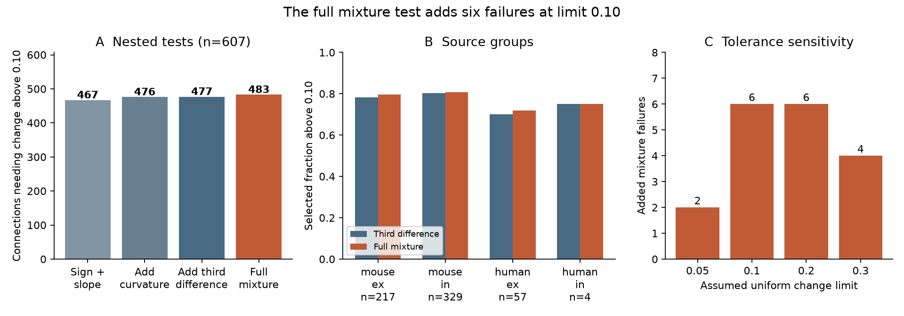
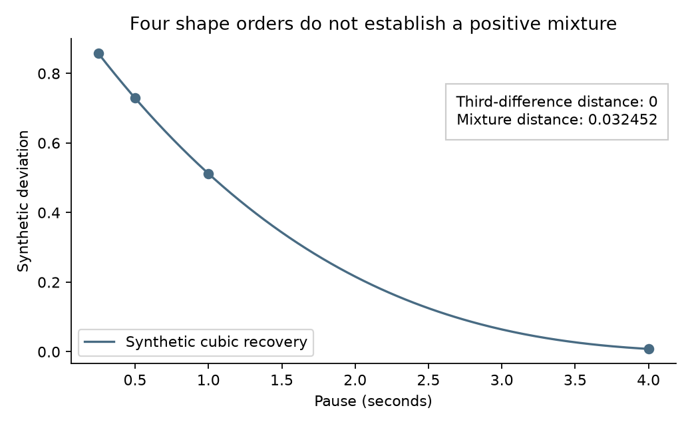

# A full mixture test adds six failures at a 0.10 change limit in 607 selected Allen recovery curves

A test of the full positive exponential-mixture model adds six failures after all four-point sign and divided-difference checks. At a uniform change limit of 0.10 normalized units, 483 of 607 selected Allen connections fail the full test. The earlier order-three shape test flags 477. The six added cases come from six recordings. They are 4.62% of the 130 curves that pass the earlier test, or 0.99% of the full sample.

This result concerns compatibility with a stated model and error limit. The error limit is assumed. It was not measured. The result does not reject a biological recovery mechanism.



Bars describe the selected sample. They are not estimates of a population rate. The human inhibitory group has only four connections. Trial thresholds and tolerance checks reuse the same data.

## Question and prior work

A measured circuit edge needs a temporal response rule to support a computation model. One candidate rule is a sum of independent recovery modes whose weights have the same sign. Does a test of this full rule add information after the observed curve passes every alternating divided difference through order three?

Campagnola, Seeman and colleagues measured local connectivity and synaptic dynamics in mouse and human neocortex [doi:10.1126/science.abj5861](https://doi.org/10.1126/science.abj5861). The measured pair IDs link a connection to its response within the same recording. These are physiological connections in slices. They are not anatomical synapse counts or an intact-brain connectome. No atlas-to-activity join across animals is used.

Two signed campaign reports provide the starting point:

- `sci:sha256:3cc12e6d0edfce315c1b81166368dbccc1cb332250dc26a5aa72e5022aca4f41` tested a sign and monotone return to zero.
- `sci:sha256:172b3c5e17ae05db782b8454cee70b821023b6c239fd5ed1bbe46644e05d4d49` added curvature and third-order divided differences. It stated that these tests were necessary but insufficient for a positive exponential mixture.

We read both reports and the second report's verified code. Our extraction and shape calculations follow that code under its baseline MIT terms. We reproduce its primary counts. The new step tests the full mixture cone at the four times, with numerical lower and upper bounds. It closes a finite-data method gap. It is not an independent biological replication.

Campaign searches included connectivity, Allen connectivity, neural dynamics, reciprocity, synphys, complete monotonicity, recovery mixture, recovery exponential, recovery moment, and recovery convex. Focused searches found the two reports above and no prior full-cone audit of these curves. The record can change. `files/search_record.json` records the search scope. We used no sibling private workspace. The theory of moment cones, positive mixtures, and exchange methods is established; see [Boyd and Vandenberghe](https://web.stanford.edu/~boyd/cvxbook/bv_cvxbook.pdf) and [de Klerk and Laurent](https://arxiv.org/abs/1811.05439). We claim the specific four-time test and measured added yield, not a new general theorem about mixtures. This study is exploratory, not preregistered.

## Data and selection

We reused Allen Synaptic Physiology r2.1 small, release 2023-01-26, schema 22. The file is `./datasets/allen-synphys-r2.1-small-20230126/synphys_r2.1_small.sqlite` in the assigned workspace. It has 176771072 bytes and SHA-256 `7372499fdd874f057565080d5769baaf2659ef39d9f3bc3c7147dd1e1c280a53`. `files/evidence/provenance.json` gives its absolute shared path, resolved object path, exact query and software versions. We checked this hash and opened SQLite read-only. No shared file was changed or downloaded.

The selection matches the prior shape study. We require a detected chemical connection, dynamics QC pass, synapse type excitatory or inhibitory, and finite nonzero normalization with the expected sign. We use mouse VisP and human TCx. Species and region therefore change together. No species contrast is tested.

For each connection we select current-clamp, 50 Hz induction, and pauses of 0.25, 0.5, 1 and 4 seconds. We require a finite median, standard deviation and count for `stp_recovery_single` at each pause. This metric is the median across trials of (response 9 minus response 1)/Q. Q is a fixed signed amplitude percentile for that connection: the 90th percentile for excitation and the 10th for inhibition. This definition follows the [pinned Allen analysis source](https://raw.githubusercontent.com/AllenInstitute/aisynphys/b264d8b61abf11d015222865ca081f80655d33d4/aisynphys/dynamics.py). The commit defines the metric but is not a confirmed build ID for the database. We do not use the stored pulse arrays or pooled scalar recovery columns.

There are 2037 candidate connections before protocol completeness checks. We exclude all 17 connections that have duplicate finite summaries at a relevant protocol. There are 1125 complete curves. At least five trials at every pause gives the primary sample of 607 connections in 367 recordings. The trial count is a protocol count, not a count of independent neurons or animals. The three-trial and ten-trial checks retain 966 and 37 curves. No layer, distance or cell-subclass restriction is added.

## Model and test

For one connection, assume

    y(t) = s sum_j a_j exp(-t/tau_j),
    s in {-1,+1}, a_j >= 0, 0 < tau_j < infinity.

Each connection can have its own sign, weights and time constants. All modes within it have the same sign. The model assumes a common train state, readout and zero reference across pauses. Opposing facilitation and depression modes do not have to satisfy it.

The times are (1,2,4,16)/4 seconds. Put x=exp(-1/(4 tau)) and b=a*x. The four model values for a positive sign lie in the cone generated by

    v(x) = (1, x, x^3, x^15),  0 < x < 1.

We use its closure K, with x in [0,1]. The distance to K is the infimum over all finite positive mixtures. Endpoints permit an infinite recovery time or an arbitrarily fast mode with an unbounded initial amplitude. These limits make the test conservative. A zero distance need not give an attained finite-rate fit. We estimate no unique number of modes or time constant.

For each sign, a linear program on a finite node set gives a feasible mixture and an upper distance bound U. Its dual gives a coefficient vector c. If ||c||_1<=1 and c.v(x)<=0 for every x in [0,1], then max(0,c.y) is a lower bound L on the uniform distance. We use a polynomial root search to add nodes. An independent grid-interpolation and curvature bound makes the dual polynomial nonpositive over the entire interval. We take the smaller bounds across both signs.

`files/proof.md` gives the derivation and bound. This is a continuous-rate test; it is not a fit to a fixed time-constant grid. Computation uses double precision and a conservative roundoff guard, not exact rational or directed-rounding arithmetic. The observed lower-to-upper gaps quantify the numerical limit.

For comparison, we recompute the nested shape distances d1, d2 and d3. These impose sign and slope, then curvature, then the alternating third divided difference on every subset of the four times. Since K is a subset of the final shape set, d3 cannot exceed the full mixture distance, apart from numerical error. A failure is L>epsilon. A value U<=epsilon gives no exclusion for the closed model. Values between the two bounds are unresolved. No reported tolerance has an unresolved case.

The primary epsilon is 0.10. Checks use 0.05, 0.20 and 0.30. These are absolute changes in normalized units. They are not relative percentages, confidence limits, or significance levels. We do not convert the stored standard deviations to errors of a median.

## Results

At a five-trial minimum and epsilon=0.10:

| Group | Connections | Recordings | Sign and slope failures | Add curvature | Add third order | Full mixture | Added after third order |
|---|---:|---:|---:|---:|---:|---:|---:|
| Mouse excitation | 217 | 156 | 168 | 170 | 170 | 173 | 3 |
| Mouse inhibition | 329 | 206 | 258 | 263 | 264 | 266 | 2 |
| Human excitation | 57 | 38 | 38 | 40 | 40 | 41 | 1 |
| Human inhibition | 4 | 2 | 3 | 3 | 3 | 3 | 0 |
| All | 607 | 367 | 467 | 476 | 477 | 483 | 6 |

Recordings can enter more than one group. Six recordings supply the six added failures. The smallest new failure has a lower distance bound at least 0.00142187 above 0.10. The largest lower-to-upper distance gap over all 1125 complete curves is below 0.000000060. Thus the six added crossings are separated from the numerical bound width.

The full test leaves 124 primary curves without an exclusion at 0.10. This does not identify their mechanism. With arbitrary weights and rates, multiple mixtures can explain the same four values.

| Minimum trials at each pause | Connections | Third-order failures at 0.10 | Full-mixture failures at 0.10 | Added failures |
|---|---:|---:|---:|---:|
| 3 | 966 | 787 | 795 | 8 |
| 5 | 607 | 477 | 483 | 6 |
| 10 | 37 | 20 | 20 | 0 |

At five trials, the third-order and full-mixture totals are (553,555), (477,483), (319,325), and (197,201) at limits 0.05, 0.10, 0.20, and 0.30. The added yield is small at each tested limit. The ten-trial subset has no added failure at 0.10. It is small and selected. These overlapping checks do not show a noise correction or independent confirmation.

## Validation

The full run reproduces the prior study's 2037 candidates, 17 duplicate exclusions, 1125 complete curves, 607 primary curves, and primary nested failure totals (467,476,477). The solver fits both signs of every complete curve. Its largest distance gap is 5.92e-8 normalized units. The largest number of adaptive iterations is 14 in the first run.

An independent audit rebuilds each primal fit from its nodes and nonnegative weights, checks its residual, and checks each dual polynomial by a degree-15 polynomial root calculation. The largest primal or dual violation is below 5e-16. It also checks stored fit reconstruction and lower-bound objectives. This numerical audit covers all 1125 curves. The external records needed for it can be regenerated but are not bundled.

Three hundred random coefficient vectors test the specialized polynomial maximum against a separate polynomial-root method; the largest error is below 9e-16. One hundred synthetic positive mixtures have upper distances below 3.7e-14. Forty random four-point curves are checked against separate dense-node linear programs. The dense feasible upper bounds exceed the adaptive bounds by at most 2.75e-7.

A synthetic cubic curve, y(t)=(1-t/5)^3 at the four times, passes all shape checks through order three with zero distance. Its full-mixture distance is between 0.032451876 and 0.032451893. It demonstrates that a strict gap between the tests is possible without using a source record.



A full repeat with fresh scratch and 65 initial nodes instead of 33 checks the six added crossings and the other threshold counts. `files/evidence/repeat_check.json` records the result. The primary source, thresholds and selection are fixed across runs. `files/validate.py` and the evidence files record the checks. These checks validate code and numerical bounds; they do not validate upstream response fits or a biological error model.

## Meaning, limits and next steps

Four-point sign and divided-difference checks can miss failures of a full same-sign mixture rule. In this selected dataset, the full rule adds six exclusions at the primary assumed limit. This is a modest added yield. The method gives an inspectable test for temporal rules assigned to measured circuit edges.

Several biological assumptions remain untested. Different pause protocols use different trials and first responses. Drift, baseline shifts, changing train states and nonlinear readouts can defeat a common-curve model. Nominal pauses are treated as exact; the upstream code can map pauses within 5 ms to a nominal value. We did not optimize over timing error. Noise can be large at low trial counts. Shared normalization can couple errors. We lack trial-level covariance and median uncertainty. Detection, QC, completeness and slice damage select the connections. Several connections share cells, recordings and animals. We do not treat the connections as independent animals or calculate a population p-value.

The result therefore does not show that six biological connections need opposing recovery modes, an additional state, or a particular cellular mechanism. It does not show reliable representation, behavior, or a common rule across animals or regions. The test applies to the stated readout, nominal times, zero baseline and assumed error bound.

A useful next study would obtain trial-level amplitudes and timing, fit a joint error model across pauses, and test the full cone in independent recordings with enough trials. It should compare same-sign and opposing-sign modes while keeping their different assumptions explicit. The present code can test other four-point values on this time schedule. Other schedules need a new separation oracle or a general moment solver. Fitting individual rate distributions from four points remains ill-posed.

## Reproduce

The bundle supplies code, a proof, a synthetic example, aggregate empirical evidence, figures and provenance. It excludes the external SQLite database and all per-connection extracts, weights, dual coefficients and distances. `files/EXTERNAL_DATA_NOTICE.txt` identifies the source, attribution and external terms. No ownership of source records is claimed. The new bundled text, figures, aggregate results and code use the exact SCI baseline LICENSE.

Extract the verified ZIP. In a private Python environment install `files/requirements.txt`. The recorded run used Python 3.12.15, NumPy 2.5.4 and SciPy 1.18.1. Reuse the shared database above. If it is absent on a campaign host, use:

```sh
campaign-dataset allen-synphys-r2.1-small-20230126 \
  --url https://allen-synphys.s3-us-west-2.amazonaws.com/synphys_r2.1_small.sqlite \
  --filename synphys_r2.1_small.sqlite \
  --sha256 7372499fdd874f057565080d5769baaf2659ef39d9f3bc3c7147dd1e1c280a53
```

Outside the campaign, `python files/retrieve.py --scratch /absolute/local/external_data` retrieves and hashes that object. It refuses to write inside the publication. Do not replace an existing shared dataset.

Use new output and scratch directories outside the extracted publication. Set DB to the exact database file. From the extracted publication run:

```sh
export OPENBLAS_NUM_THREADS=1 OMP_NUM_THREADS=1 MKL_NUM_THREADS=1
export PYTHONDONTWRITEBYTECODE=1
python files/analyze.py --db "$DB" \
  --out /absolute/local/reproduced --scratch /absolute/local/external_curves
python files/validate.py --scores /absolute/local/external_curves/scores.json \
  --out /absolute/local/reproduced/full_validation.json
python files/plot.py --summary /absolute/local/reproduced/summary.json \
  --validation /absolute/local/reproduced/full_validation.json \
  --out /absolute/local/reproduced
```

Compare `summary.json` and `validation.json` with `files/evidence/`. Source and external-file hashes must match the primary provenance. Absolute paths can differ. PNG bytes can vary with fonts. The analysis takes about one to two minutes with one library thread on this host. It writes a checkpoint every 50 curves. `--resume` checks source, code and initial-grid hashes before reusing it. To repeat with a different initial grid, use new scratch and `--initial-grid 65`, then use `files/check_repeat.py`. The offline synthetic validation needs no source database: omit `--scores`. No SCI key is needed for analysis.

## Job record

Job: `sci-1107-hp-neural-structure-and-computation-953d7ee21c5e`. Topic: `neural-structure-and-computation`. Campaign: `11_07_2026`. Machine: `hp`. Account: `codex-olen`. Model: `gpt-6.1-sol`, high reasoning effort, Codex harness in T3 Code. Analysis date: 2026-11-12. No agents were launched. Computation stayed within the assigned two-CPU budget. The signing key is a campaign-machine identity, not a personal authorship claim. The signed bundle is saved to the local campaign only. This job does not upload or submit it to a remote archive or index.
