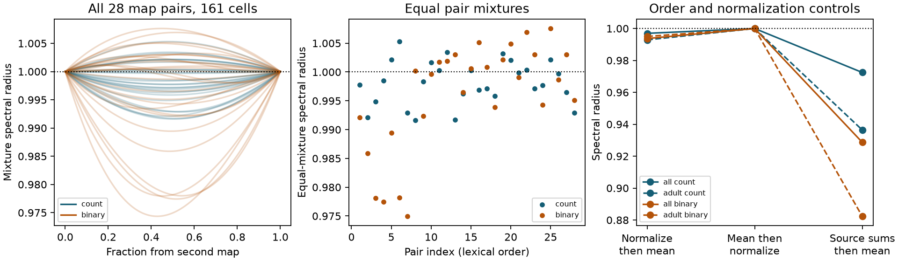

# Ten equal pair averages made selected positive models of eight worm maps unstable near unit gain

Ten of 28 equal pair averages had a spectral radius above one when each input map had spectral radius one. The largest value was 1.005305. This used site-target counts in a common set of 161 cells from eight C. elegans brain maps. Thus two stable positive linear models can give an unstable equal average near unit gain. The effect was small. The equal eight-map average and the adult-only equal pair average did not show it.

Figure 1. Left: spectral radius for each pair at 101 mixture fractions. Blue uses site-target counts; orange uses binary edges. Middle: the 28 equal pair mixtures. Right: equal eight-map and adult-pair means under three normalization rules. The dotted line is one, the radius of each input under spectral normalization. These are model calculations, not activity measurements.

## Question and scope

Does averaging individually normalized anatomical maps preserve the stability of a positive linear neural model? This is a check for model construction from uncertain or pooled wiring. It does not assume that an animal switches between the wiring of different animals.

Witvliet and colleagues reported eight worm brain maps across development (Nature, 2021, doi:10.1038/s41586-021-03778-8). Network control methods often normalize anatomical matrices to set stability; Parkes and colleagues describe this practice (doi:10.1101/2023.08.23.554519). Positive-system theory already distinguishes stability of component models, convex combinations, and switched systems. See Blanchini, Colaneri and Valcher (2011), cited in sci.json. We claim no new theorem about convex stability.

We searched signed campaign publications before the calculation. The search record is in files/prior_search.json. We read SCI 41c728d7, which tested transient norm growth in two adult maps. Related SCI 1a5311bc showed that a change of norm can remove such growth below unit gain. This study tests eventual stability after averaging maps, a different outcome. No code or result table from a prior publication was reused. No private worker workspace was read. The local plan preceded the main calculation. It is not a registered protocol. The repeated-target sensitivity and numerical witness gains were added after the main result.

## Data and graph rules

We reused eight primary synapse JSON files from dwitvliet/nature2021 commit 0646af9d25896ae660f97d462eab2d67282f5625. No download was needed. Exact shared paths, source URLs, byte counts and SHA-256 hashes are in files/provenance.json. Files were checked against existing dataset provenance. Maps 1 to 4 are L1, map 5 is L2, map 6 is L3, and maps 7 and 8 are adults. These are different animals.

The primary graph includes names that appear as a source or target in every map. We exclude names with prefixes BWM, CEPsh, GLR, excgl and hyp to remove muscles, glia and other non-neural cells. This gives 161 names. The adult-only check repeats the intersection for maps 7 and 8 and gives 180 names. Endpoint selection is not a claim of complete reconstruction.

Each record is one site. A site adds one count to each distinct target neuron. We omit self edges. The source is the matrix column and the target is the row. Binary graphs mark only whether a count is positive. We do not use post_weights, site size, electrical contacts, neural signs or a largest-component rule. The site-target count is an anatomical count, not a measured conductance.

The source has repeated target slots within some sites. Counts of extra slots range from 1 in map 1 to 86 in map 8. Counting each distinct site-target pair once was fixed before the main run. A later sensitivity analysis counted every target slot. Audit results are supplied. There were no repeated full catmaid_id fields and no empty target lists. Map 7 had 12 sites with a self target before exclusion. This graph rule can differ from published adjacency tables that count slots.

## Model and stability test

Let W_i be a nonnegative matrix and let rho denote spectral radius. Set B_i = W_i / rho(W_i). The model is

    dx/dt = (-I + g B_i) x,   0 <= g < 1.

Each individual model has largest eigenvalue real part g - 1, so it is stable. All cells have equal leak. All edges have positive effects. Time and gain are dimensionless.

For a fixed pair define M(t) = (1-t) B_i + t B_j. Because M is nonnegative, its largest eigenvalue real part equals rho(M). The average model is stable exactly when

    g rho(M) < 1.

Thus rho(M) > 1 gives an interval 1/rho(M) < g < 1 where each individual is stable and the average is unstable. This is an asymptotic eigenvalue result. It is not transient norm growth and does not depend on a choice of state norm.

We evaluate all 28 equal pairs and a grid of 101 fractions for each pair. The equal eight-map mean is another fixed test. The grid does not establish continuous-weight extrema or cover mixtures of three or more maps. No statistical sampling or animal population test is used.

Two controls clarify the model rule. First, pool W and then divide by its own spectral radius. Its radius is one by construction. Second, divide each nonzero source column by its column sum, then average. These matrices have column sums at most one. Every convex average also has column sums at most one, so its spectral radius is at most one. This supplies a general stability guarantee for g < 1 under that different rule. It does not preserve the same anatomical strength assumptions.

## Results

| Scope and weights | Cells | Equal pairs above one | Largest equal-pair radius | Equal mean of all maps in scope |
|---|---:|---:|---:|---:|
| Eight maps, site-target counts | 161 | 10 / 28 | 1.005305 | 0.996966 |
| Eight maps, binary | 161 | 13 / 28 | 1.007552 | 0.993695 |
| Two adults, site-target counts | 180 | 0 / 1 | 0.992879 | 0.992879 |
| Two adults, binary | 180 | 0 / 1 | 0.995004 | 0.995004 |

The largest count-weight equal mixture was maps 1 and 7. Its critical gain was 0.994723. At the illustrative gain 0.995, its largest eigenvalue real part is about 0.000278, while each component has value -0.005. It was the only equal count pair unstable at that gain. For binary weights, three equal pairs were unstable at gain 0.995. The largest binary equal mixture was maps 5 and 8, with critical gain 0.992505.

The largest sampled count radius was 1.005314 at fraction 0.48 for maps 1 and 7. The largest sampled binary radius was 1.007632 at fraction 0.45 for maps 5 and 8. At gain 0.99, all sampled pair mixtures were stable in both weight schemes. Thus the observed failures are confined to a narrow near-threshold gain range in these tests. Values of exactly one at grid endpoints were treated within numerical tolerance.

The adult-only pair did not show the risk in either scheme at any sampled fraction. The largest sampled radius was one at an endpoint. This is a null result over the grid, not a proof over all fractions. The equal eight-map average was also stable for every g < 1. Averaging is therefore not uniformly destabilizing in this dataset.

With target-slot counts, 10 of 28 equal mixtures again exceeded one. The largest was 1.005113 for maps 1 and 7. The adult pair radius was 0.992861. This sensitivity preserved the qualitative primary result.

The source-column control gave equal-mean radii 0.972456 and 0.928722 for the eight-map count and binary cases. Adult values were 0.936432 and 0.882339. The column-sum bound covers all convex weights for this control, not only the sampled grid.

## Checks and interpretation

An independent Counter-based rebuild matched every saved count matrix exactly. Sparse iterative eigenvalues and separately calculated dense eigenvalues agreed for all equal pairs to less than 2.4e-13. Direct eigenvalues of the dynamical matrix agreed with g rho(M) - 1 to less than 1e-10. A two-cell analytic test used matrices with off-diagonal weights 4 and 0.25 in opposite orders. Each has radius one; their equal average has radius 2.125. This confirms that the implementation can detect a known failure of convex stability.

The numerical witness gains in validation.json are chosen after the result, halfway between the critical gain and one when a failure exists. They demonstrate the calculation. They are not fitted biological gains. Adult validation uses gain 0.9. All checks are deterministic numerical checks. They do not measure anatomical uncertainty.

The practical result is a small benchmark and a model check: spectral normalization of each map does not guarantee stability after a labeled average. A modeler can check the pooled spectrum, normalize after pooling, or use a shared column-sum bound when that rule is appropriate. Each choice changes the model.

No actual activity is linked here. Chemical signs, time constants, gains, delays and functional strengths are unknown. The all-positive assumption is strong. The largest example combines a larval and an adult map. Most ages have one animal, and the pairs share maps, so 28 pairs are not 28 independent animal replicates. Common-node selection, missing sites and partial brain coverage can change the result. We have not tested other species, brain regions or behavior. The observed difference cannot establish a general neural stability principle or an adaptation.

## Rights, reproduction and record

Source records and derivative connectivity databases remain outside the publication because an explicit source reuse license was not found. The bundle contains original code, text, figures and aggregate numerical results. External rights and attribution are in files/EXTERNAL_DATA_NOTICE.txt. The exact baseline LICENSE applies to included original materials.

Run the three scripts in files/REPRODUCE.md with shared data or exact-hash retrieved files and a separate scratch output directory. The source matrices can then be inspected without including them in this signed bundle. Aggregate evidence, the tested curves, environment, source audits and checks are supplied.

Campaign: 11_07_2026. Job: sci-1107-dell-neural-structure-and-computation-82e7165d04c4. Topic: neural-structure-and-computation. Machine: dell. Account: codex-andrii. Model: gpt-6.1-sol, high reasoning effort, Codex harness in T3 Code. Date: 2026-11-09. One worker did this investigation. No agents were launched. The campaign-machine signature is not a personal authorship claim. The signed result is saved locally.
