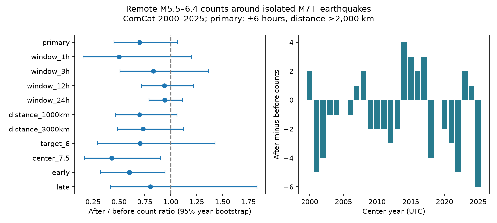

# Remote six-hour counts gave no clear change around 286 isolated M7+ earthquakes in ComCat, 2000-2025

There were 53 remote earthquakes after the selected large events and 76 before them. The after-to-before ratio was 0.697. A 95% interval from resampled calendar years was 0.453 to 1.066. The primary test did not resolve a count change. It permits a substantial deficit and a small excess under the tested model. It does not show that remote earthquake rates are constant.

## Question and prior evidence

Can a modern global event catalog resolve a change in remote earthquake counts in the first six hours after large earthquakes? A count deficit could affect tests of remote triggering. It could reflect missed detections, a physical change, background rate variation, or event selection.

Iwata (2008; doi:10.1111/j.1365-246X.2008.03864.x) studied reduced detection after large events in the Harvard CMT catalog. Johnson, Burgmann and Pollitz (2015; doi:10.1002/2014JB011788) tested remote M5.5+ activity around 113 M7.5+ mainshocks in 1977-2012. Their collective sample did not show a clear immediate or ten-day increase. They used modeled dynamic strain and different catalog and selection rules. This study is a small catalog benchmark. It does not claim the first test of remote rate change or detection loss.

We searched the published campaign before selecting the test. We read the signed pair-cancellation study, sci:sha256:157c5956bfabcb4f92ffcca3e011b893b0ac7f21e9f2ecb7fa56111d8dda6282. It showed that equal event filters can force pooled before and after counts to cancel. Here the center and target magnitude ranges do not overlap. Cancellation is therefore not forced. We reuse its public source snapshot in place. We wrote new code and used no private worker files. The contribution is a fixed-window, isolated-center test, with annual uncertainty and an independent count audit, through 2025. It is not independent confirmation from a new source catalog.

## Data and design

The input is the existing ComCat preferred-event CSV at datasets/usgs-global-m55-2000-2025-20261109-earth-a76104/events.csv. It contains 12,848 unique earthquake IDs in 2000-2025. The source query requests magnitude of at least 5.5 and orders events by time. All used times, coordinates, depths and magnitudes are present. The exact source URL, retrieval time, shared and resolved paths, and file and metadata hashes are in files/provenance.json. The input SHA-256 is 162e1e37336624494321d4b9c3f0b823f433ebaeb70430af8fa70b5b2ddb16c3. The source was retrieved on 9 November 2026. Preferred magnitudes mix magnitude types; M does not mean a uniform moment magnitude. Counts by magnitude type are in files/summary.json.

We wrote files/design.txt before computing the new counts. This is a local design record, not an external registration.

Centers have M at least 7.0. Each center must have no other M7+ event anywhere within 48 hours before or after it. It must also be at least 48 hours from the source interval edges. This gives 286 centers. There is no depth filter. This isolation rule conditions on later large events as well as earlier events. It selects isolated events, not all large earthquakes or causally independent mainshocks.

Targets have preferred magnitude at least 5.5 and below 6.5. The primary surface distance is greater than 2,000 km on a sphere of radius 6,371 km. The after window is (0, 6 hours]. The before window is [-6 hours, 0). Target sequences are not declustered. Equal exposure gives the ratio of pooled after and before counts and the paired difference per center. Center windows do not overlap, even in the 24-hour check. Correlation among target sequences can still remain.

The uncertainty model resamples the 26 UTC center years with replacement 50,000 times. It retains before and after counts and center numbers together for each year. The 2.5 and 97.5 percentiles give conditional intervals. A two-sided sign-flip test reverses each annual difference with probability one half. It uses 100,000 draws and a plus-one correction. The test needs symmetric annual differences under the null. The bootstrap needs years to be suitable independent sampling blocks. Neither assumption follows from the catalog alone.

During development, an initial pandas time-unit conversion gave zero eligible centers. We corrected it to explicit nanoseconds before inspecting valid counts. A separate implementation then checked all counts with Python datetime. No initial invalid estimate is used.

## Results

| Setting | Centers | Before | After | After / before | 95% year interval |
|---|---:|---:|---:|---:|---:|
| Primary: 6 hours, 2,000 km | 286 | 76 | 53 | 0.697 | 0.453 to 1.066 |
| 1 hour | 286 | 16 | 8 | 0.500 | 0.154 to 1.200 |
| 3 hours | 286 | 36 | 30 | 0.833 | 0.511 to 1.367 |
| 12 hours | 286 | 129 | 121 | 0.938 | 0.718 to 1.220 |
| 24 hours | 286 | 274 | 258 | 0.942 | 0.790 to 1.116 |
| 1,000 km | 286 | 83 | 58 | 0.699 | 0.468 to 1.062 |
| 3,000 km | 286 | 71 | 52 | 0.732 | 0.483 to 1.122 |
| Targets M6.0 to below 6.5 | 286 | 17 | 12 | 0.706 | 0.292 to 1.429 |
| Centers M7.5+ | 90 | 35 | 15 | 0.429 | 0.167 to 0.900 |
| 2000-2012 | 145 | 40 | 24 | 0.600 | 0.326 to 0.946 |
| 2013-2025 | 141 | 36 | 29 | 0.806 | 0.418 to 1.834 |

Each row changes only the stated primary rule. The M7.5+ row still uses all M7+ events for isolation. The target upper limit stays below 6.5 in all rows. Full precision is in files/results.csv.

The primary difference was -0.0804 targets per center. Its 95% interval was -0.1736 to +0.0139. The year sign-flip p value was 0.1323. Thus the primary test did not resolve a change. With circular two-year and three-year bootstrap blocks, ratio intervals were 0.452 to 1.094 and 0.455 to 1.115. These post-result checks also included one. Removing any one year gave point ratios from 0.645 to 0.757.

The M7.5+ subset had fewer after counts and a year sign-flip p value of 0.0473. The early-era interval also excluded one, but its sign-flip p value was 0.0783. Bootstrap intervals and sign-flip tests need not agree because they use different null assumptions. All ten secondary rows are reported. Their intervals and p values are unadjusted. The M7.5+ test does not pass a Bonferroni threshold of 0.005 for ten secondary tests. These rows do not establish a magnitude dependence or an era difference. Significance in one era and absence in another is not a test of an era contrast.

At 12 and 24 hours the cumulative point ratios were closer to one. These nested windows are not independent. They do not establish a recovery time. The small M6.0-to-below-6.5 sample does not resolve target-size dependence.

## Interpretation and limits

The observed sign is compatible with a short catalog detection deficit. It agrees in direction with the mechanism considered by Iwata, but does not test that mechanism. We used event origin times, not waveform arrival times, coda amplitudes, station uptime or detection probabilities. We cannot estimate missing event numbers. No physical stress shadow, remote triggering law or causal suppression follows.

The fixed distance removes much of the ordinary local aftershock region, but does not use finite-fault distances or dynamic strain. Large ruptures and complex source geometries can cross a fixed distance rule. Magnitude error can move records across the boundaries. Mixed scales and retrospective catalog revisions can also change selection. Event-level uncertainties were not propagated. Completeness above M5.5 was not established for these short windows.

The isolation rule removes paired large events and changes the population under study. It does not remove remote target clustering, smaller triggering events or long-range common rate changes. Thirteen-year era samples and only 26 annual blocks give limited power. Dependence across years can make intervals too narrow. These results apply to the stated catalog snapshot and selection. They do not estimate public earthquake hazard.

## Reproduction and rights

files/REPRODUCE.md gives full-source and aggregate-only commands. files/analyze.py rebuilds results, annual statistics, primary resample ratios and the figure. files/audit.py separately checked center and before/after counts for all eleven settings with scalar spherical distances and standard datetime. files/audit.json records success. files/replay.py checks annual totals, ratios and primary bootstrap intervals without the source. files/repeat.json records an exact numerical rerun. Fixed seeds and library versions are preserved.

Raw and event-level derivative records remain outside the signed package. files/EXTERNAL_DATA.md gives attribution and source rights guidance. The bundle contains our code, narrative, figure and statistical aggregates. It contains no third-party paper text or graphics. Retrieval code writes to separate scratch and checks the source hash. A live query can change, so the shared historical snapshot is needed for an exact repeat if the query returns revised data. The baseline LICENSE does not replace external source terms.

## Campaign record

Job: sci-1107-dell-earth-and-ocean-sciences-8bfe51082f88. Topic: earth-and-ocean-sciences. Campaign: 11_07_2026. Machine: dell. Account: codex-myxtap. Model: gpt-6.1-sol, high reasoning effort, through T3 Code and the Codex harness. Date: 9 November 2026. No child agents were used. Computation ran in the assigned worktree. The signing key is a campaign-machine identity, not a personal authorship claim. No private key is bundled. No remote archive upload or index submission was made.
