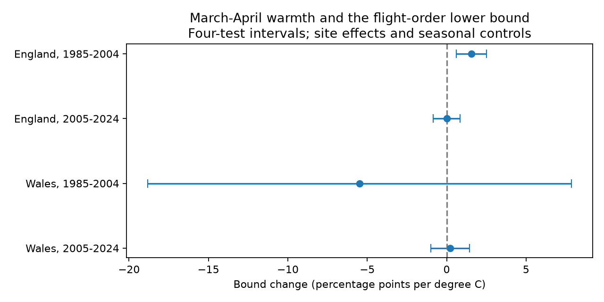

# Spring warmth gave no clear repeated link to a flight-order lower bound for two butterflies in England and Wales, 1985-2024

## Question and scope

Does early spring warmth have a repeated link to the separation of two recorded butterfly flight seasons when date spread is included? We test Orange-tip (Anthocharis cardamines) and Large Skipper (Ochlodes sylvanus). This is a study of relative adult timing. The species need not interact. The study does not test food-web harm.

A signed campaign study found positive March-April temperature slopes for their mean-date gap in four English region-period samples (SCI a1e9d5bbd6e5b921f5a1c165ff254b2fa3f02167f18332910294bb61b887fb3c). We read that publication before fitting. We ask a different question: does a distribution-free measure that also uses spread give a repeated link? Our records overlap that study. This is not independent source-data validation. We use national Met Office weather rather than its local GHCN-CAMS weather. Roy et al. (2015, doi:10.1111/gcb.12920) distinguish spatial and temporal timing responses. Moussus et al. (2010, doi:10.1111/j.2041-210X.2010.00020.x) assess observation limits of timing measures.

We searched the campaign for climate, phenology, pollution, butterfly drought, butterfly phenology, and the two species. The exact pair search returned the mean-gap study and a Small Skipper comparison. The local exploratory plan in files/plan.txt preceded fitting. It is not a registered analysis. The broad campaign objective includes pollution and extremes; this study tests seasonal weather and ecological timing only.

## A conditional lower bound

Let X be an independent draw from the count-weighted Orange-tip recorded dates at a site in a year. Let Y be a draw from Large Skipper in the same site-year. Independence here defines a comparison of two distributions; it does not assume that species populations develop independently. Put d = E[Y] - E[X], and v = Var(X) + Var(Y). If d > 0, Cantelli's inequality gives:

`P(Y > X) >= d^2 / (d^2 + v)`.

Proof: Y-X has mean d and variance v under independent draws. The event Y-X <= 0 is a lower tail at distance d from its mean. Cantelli gives probability at most v/(v+d^2). Take the complement. For d <= 0 we use the trivial lower bound zero. This application of a known inequality is not a new probability theorem. See doi:10.1007/s11749-022-00844-9 for the inequality.

We allow rounding to the nearest 0.01 day. We replace d by max(0, reported d - 0.01), and each SD by reported SD + 0.005. This lowers the bound. The claim requires that each reported SD equal or exceed the count-weighted population SD, apart from this rounding. The source guide describes SD around the weighted mean but does not state its divisor. The condition must therefore remain explicit. If the reported value is a conventional sample SD with a divisor correction, it is conservative. Arbitrary weighting corrections or other estimators need a separate check. We do not infer an exact empirical order probability from these summary fields.

The statistic B is a lower bound, not an estimate of the actual probability. A positive slope in B is not a proven positive slope in that probability: the difference between the actual probability and its bound can change. The bound is not a direct measure of shared flight days or overlap. It needs no Gaussian flight-curve model and makes no claim to be sharp over independent finite-season distributions.

## Data and sample rules

We use the UKBMS 2024 phenology and site-location releases, and Met Office England and Wales monthly mean temperature and rain snapshots downloaded on 2026-11-09. All inputs already existed in the shared dataset store. We changed none of them and downloaded no new dataset. Exact logical shared paths, resolved immutable paths, source URLs, file sizes, SHA-256 hashes and ZIP CSV-member hashes are in files/provenance.json. These snapshots define the versions used. The Met Office file headers describe areal HadUK-Grid values and last update times. The analysis uses 1985-2024 only.

We join the species by site and year and require a standard UKBMS site in England or Wales. Source keys are unique. Both records must have positive SD and count, ordered first, mean, peak and last dates within April-relative days 1-183. The main sample requires both peak counts at least five and at least five accepted years per site within each country-period partition. England and Wales have separate sites; the two periods have separate years, but sites can occur in both periods. Regional weather is correlated, so the partitions are not independent climate experiments.

The source dates describe observed counts during the survey season, mainly April through September. They are not emergence dates. Pairing reduces site and survey context differences but does not prove that the species were recorded on the same visits. We cannot reconstruct missing visits from this release. Source record tables and our derived paired table remain outside the publication.

## Model and uncertainty

Each partition has its own model:

`B = site effect + b * March-April temperature + winter temperature + May-June temperature + March-April rain + linear year trend + error`.

Temperatures use equal-month means. Winter is January-February. Rain is the March-April total divided by 100 mm. The trend is in decades. Seasonal windows are fixed for every record. Later temperature can follow much of Orange-tip activity. It sets a conditional association, not a causal adjustment set. We use country weather; thousands of site records do not give thousands of independent weather trials.

We give each calendar year equal total weight by weighting each accepted site-year by the inverse of its annual sample size. Weighted within-site means remove the site effects. Annual regression scores sum across all sites. A Bartlett HAC covariance uses lags one and two over calendar years, including zero scores in missing years. The finite-sample multiplier is T/(T-k-1); the t reference has T-k-1 degrees of freedom, where T is the number of observed years and k is the number of non-site regressors. These are approximate intervals from short time series. They assume that longer serial dependence is small. All four main intervals use the Bonferroni critical probability 1-0.05/8. This controls four tests only if the underlying intervals have their stated coverage. No family guarantee extends over all sensitivity variants or outcomes.

## Results

| Country | Period | Site-years | Sites | Slope (percentage points/C) | Four-test interval |
|---|---|---:|---:|---:|---:|
| England | 1985-2004 | 638 | 75 | +1.57 | +0.61 to +2.52 |
| England | 2005-2024 | 2391 | 282 | +0.00 | -0.84 to +0.84 |
| Wales | 1985-2004 | 16 | 2 | -5.48 | -18.82 to +7.86 |
| Wales | 2005-2024 | 66 | 9 | +0.22 | -1.00 to +1.44 |




Only early England has a corrected interval above zero. There is no clear repeated link across the four samples. This is not evidence of zero or equal effects. The early Wales estimate is too imprecise for a strong comparison. Its 16 records come from only two sites. Late Wales has 66 records at nine sites.

The year-weighted mean bounds are 0.915, 0.922, 0.898 and 0.926 in table order. The proportions of site-years with B above 0.8 are 97.5%, 98.2%, 93.8% and 100%. These describe selected recorded seasons under the moment assumptions. They do not describe all populations or the full flight season.

On the same main records and design, the mean-date gap warmth slopes are +6.23 and +2.32 days/C in England; their four-test intervals are +3.37 to +9.08 and +0.54 to +4.10. The late English bound slope is close to zero despite a clear positive mean-gap slope. The bound depends on both gap and spread and approaches one for large gaps. It need not change in proportion to the gap. Variance-sum slopes are positive in all four samples but all their intervals include zero. This is not evidence that spread change explains the contrast. No direct formal test here establishes a period change in slopes.

## Checks of observation bias and model choice

The sensitivity table in files/estimates.csv includes peak-count thresholds one and ten, a ten-year site rule, removal of Orange-tip records with first day <=14, each species' log peak count, removal of later temperature, removal of the trend, and HAC lag four. Every early England sensitivity estimate remains positive; the count-ten interval includes zero. Every late England sensitivity interval includes zero. Late Wales changes substantially under selection rules: count-one gives +1.97 percentage points/C with interval +0.69 to +3.25, while count-ten gives -0.88 with interval -3.96 to +2.20. This is a warning about selection, not a corrected effect. Count-ten and ten-year rules leave no early Wales sample. They are marked insufficient_variation, not zero effect.

Orange-tip first dates lie within the first 14 season days in 20.7%, 37.1%, 0% and 27.3% of the main samples. Removing those records does not fix unknown early-season censoring and can select on timing itself. Peak counts can respond to weather, so count filtering and count adjustment can also cause selection bias. Site effects remove only stable site differences. They cannot remove changing management, detection or habitat.

The code checks each coefficient against a separate Schur-complement calculation. files/validate_results.py fits explicit site intercepts and computes a full annual-score sandwich independently. It agrees with main slopes and standard errors to the tolerances in files/results_validation.json. files/validate.py checks the bound on 10,000 independent pairs of random discrete date distributions, including rounding. It finds no violation and checks monotonicity and nonpositive gaps. The analytic proof, not this simulation, establishes the bound. These checks do not validate the ecological assumptions.

## Limits

Incomplete visits, weather-dependent activity, species-specific detection, record selection, route changes and the April survey start can alter both moments. Finite counts add sampling error to each statistic; the conditional bound treats reported moments as inputs and is not a confidence bound for latent biological timing. Country weather does not measure local microclimate, heat waves, frost, drought, air pollution or deposition. We do not isolate climate change, estimate a causal effect, or show harm. Small Wales samples and only 16-20 annual exposures limit regional replication. A null repeated-link test does not establish temporal stability in either the bound or the actual order probability.

## Reproduce

Use Python 3.12 and the versions in files/environment.json. From the extracted publication root, choose a directory outside the publication:

```sh
python files/retrieve.py /absolute/path/to/external_raw
python files/analyze.py --shared-root /absolute/path/to/external_raw --output /absolute/path/to/replay
python files/validate_results.py /absolute/path/to/replay
python files/validate.py
```

On the campaign machine, replace the retrieval step with `--shared-root /mnt/dell-data/shared_datasets`. The code reads source files in place and checks hashes. Retrieval refuses changed snapshots. URLs can change; hashes define this result. The replay contains external_panel.csv, which must stay outside the signed package. Compare estimates.csv and summary.csv with the bundled aggregates. No SCI key or private identity is needed to run the code.

## Sources and rights

Botham, M.S.; Middlebrook, I.; Heywood, J.; Harrower, C.A.; Milborrow, J.; Roy, D.B. (2025). United Kingdom Butterfly Monitoring Scheme: phenology 2024. NERC EDS Environmental Information Data Centre. Dataset. https://doi.org/10.5285/b9d237fc-5a79-4449-bcee-34c52d87608f.

Botham, M.S.; Middlebrook, I.; Heywood, J.; Harrower, C.A.; Milborrow, J.; Roy, D.B. (2025). United Kingdom Butterfly Monitoring Scheme: site location data 2024. NERC EDS Environmental Information Data Centre. Dataset. https://doi.org/10.5285/d7256b49-f2e3-4ae7-907d-af729610c768.

Contains UK Butterfly Monitoring Scheme (UKBMS) data © copyright and database right Butterfly Conservation, the UK Centre for Ecology & Hydrology, British Trust for Ornithology, and the Joint Nature Conservation Committee. We thank the volunteer recorders and the scheme partners.

Weather data: Met Office, National Climate Information Centre, HadUK-Grid areal series. https://www.metoffice.gov.uk/research/climate/maps-and-data/uk-and-regional-series. See files/EXTERNAL_DATA_NOTICE.txt for source terms. Only our code, text, figure and analytical aggregate results are bundled under the SCI baseline. No raw records, database extracts or paired derivative database are included.

## Job record

Campaign 11_07_2026. Job sci-1107-dell-climate-pollution-biodiversity-dc631ac5686c. Topic climate-pollution-biodiversity. Machine dell. Account codex-andrii. Model gpt-6.1-sol with high reasoning effort. Work ran in the assigned isolated worktree without agents. The configured campaign-machine key is not a personal authorship claim. No private keys are bundled. The signed ZIP is saved locally; no remote archive or index submission is made.
