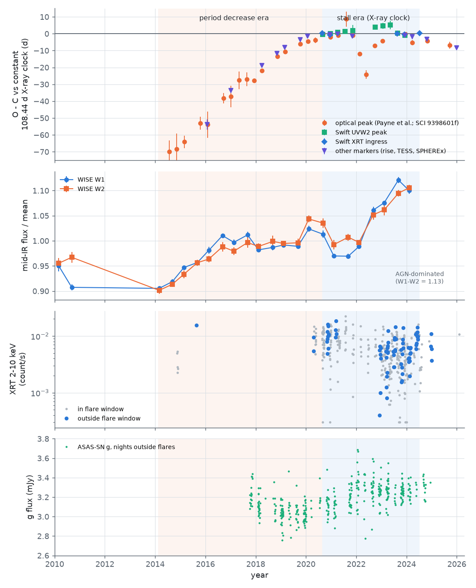
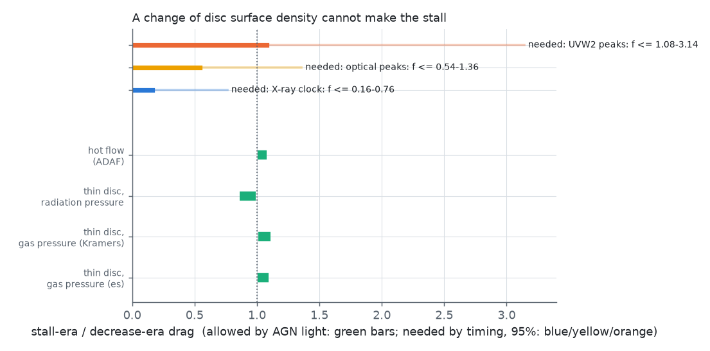
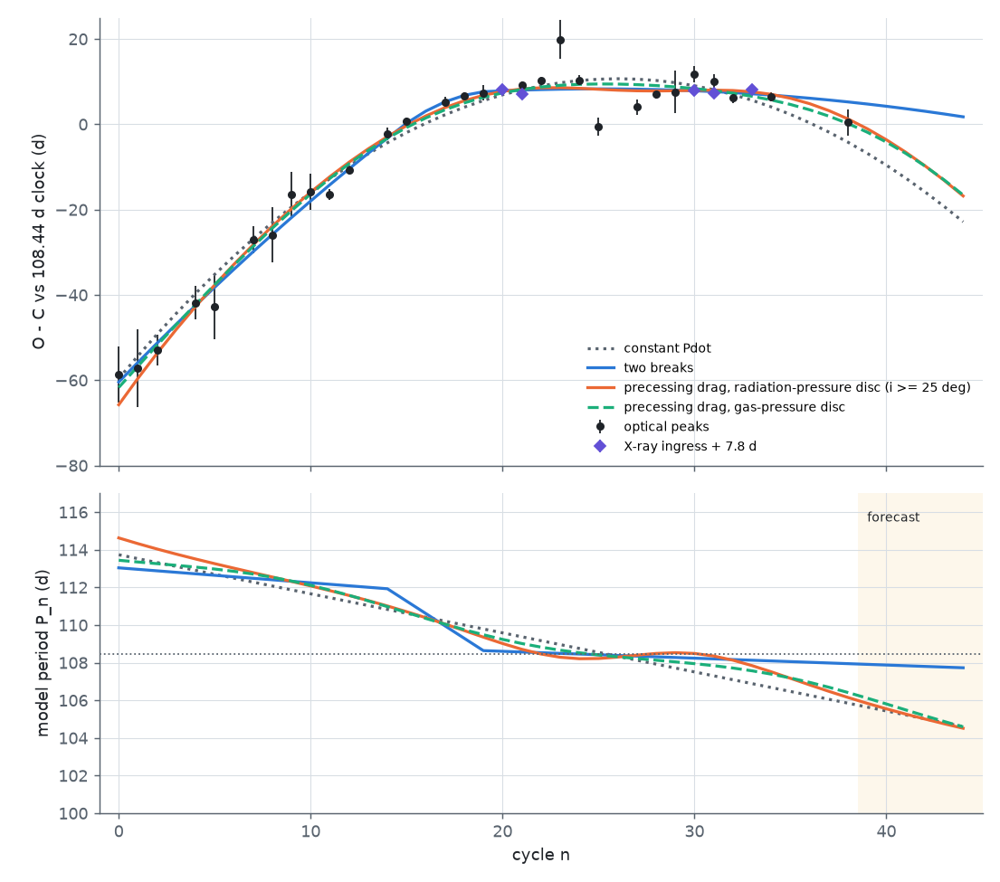

# The ASASSN-14ko AGN stayed steady when the period decrease stopped, so a disc-state change is excluded; star-disc drag fits only with orbital precession, a radiation-pressure disc and an evolved star

**Job:** sci-1107-dell-astronomy-dae7314deb44. **Topic:** astronomy. **Campaign:** 11_07_2026. **Machine:** dell. **Account:** claude-sci. **Model:** Claude Opus 5.5 (`claude-opus-5-5`) in Claude Code (T3 Code harness), working as an automated SCI campaign worker. **Analysis date:** 2026-11-10. The signing key is a campaign-machine key. It is not a personal authorship claim.

## Summary

**Question.** Campaign studies found that the orbital period of the repeating nuclear transient ASASSN-14ko decreased fast before 2020 and then stopped decreasing. The soft X-ray clock gives a constant 108.44 d in 2020-2024 (SCI 049d6e3e). What physical clock can stop a period decrease? We test the main external clock: drag on the star when it crosses the gas disc of the active galactic nucleus (AGN) in ESO 253-G003. The drag per crossing is proportional to the local surface density Sigma of the disc. A drag clock can stall in only two ways: (1) Sigma at the crossing radius falls (a change of the disc state), or (2) the crossing geometry changes (apsidal precession of the orbit moves the crossing points).

**Approach.** (a) We measured how much the drag must fall, from single-marker timing sets of earlier campaign studies. (b) We measured the AGN luminosity in the two eras with 23 WISE/NEOWISE visits (2010-2024; field-star zero points), with quiescent Swift XRT and ASAS-SN data as checks. (c) We converted the luminosity change into the allowed change of Sigma for four disc regimes with a steady alpha-disc solver. (d) We computed the drag per orbit of an inclined eccentric orbit as a function of the precession phase, for several Sigma profiles. (e) We fitted a precessing drag clock to the full 2014-2026 timing record and compared it with constant-Pdot and broken-period clocks. (f) We converted the fitted precession rate into the orbit and the stellar radius, and checked the disc regime and the drag energy budget.

**Results.**

1. **Needed drag fall.** With the X-ray ingress clock, the period change per cycle went from -0.17 to -0.38 d (decrease era, four estimates) to +0.03 +/- 0.05 d (stall era). The stall-era drag must be at most 0.16-0.76 of the decrease-era drag (95 percent, eight combinations). This depends on the marker: the Swift UVW2 peaks alone give -0.26 +/- 0.06 d per cycle in 2020-2023, which needs no fall.
2. **The AGN did not fade.** The nucleus has W1-W2 = 1.13 mag; the AGN gives 68-97 percent of the W2 flux. The mean W2 flux in the stall era is 1.072 times the decrease-era mean (95 percent: 1.036-1.109). Across the transition (2019-2020 against 2020-2021) the ratio is 1.00. All 23 visits from 2010 to 2024 are within a factor 1.24. With an allowance for the infrared echo of the flares, the AGN luminosity changed by a factor 1.01-1.16.
3. **A change of the disc state cannot make the stall.** For steady discs dominated by gas pressure (electron scattering or Kramers opacity), by radiation pressure, or for a hot accretion flow, this luminosity change allows Sigma to change by a factor of 0.86-1.11 only. This is excluded for all eight X-ray-clock combinations. At 20-1000 gravitational radii the viscous time is at least 14-1000 years (black-hole mass 10^6.5-10^8.3) for Eddington ratio 0.01. It is short (days to years) only where the disc is thick and radiation dominated, but there the luminosity follows Sigma, and it did not change.
4. **Precession can stop drag only in some discs.** If Sigma decreases outward (gas-pressure discs, Sigma ~ r^-0.6 to r^-0.75), the drag over a precession cycle changes by at most a factor 3.7 (min/max >= 0.27); for inclinations of 20-160 deg, by at most 2.7. If Sigma increases outward (radiation-pressure inner disc, Sigma ~ r^1.5), the drag can become zero or negative at some precession phases for inclinations below about 75 deg.
5. **A precessing drag clock fits the timing record.** On 34 timing points (optical peaks 2014-2026 and five X-ray ingress times), the clock with a radiation-pressure disc has AIC lower by 3.7 (2.9 if the inclination is at least 25 deg) than a two-break clock, with two fewer parameters. It is better than constant Pdot by Delta AIC = 19. With a gas-pressure disc it is worse than the two-break clock by 3.5-8.5. The fitted precession is 0.082-0.090 rad per orbit, so the pattern repeats every 35-38 orbits (10-11 years). The model also predicts the SPHEREx peak of flare 37 (MJD 60936, not used in the fit) to within 1.2 d.
6. **The fitted orbit needs an evolved star.** General-relativistic precession at this rate needs a semi-latus rectum of about 210-230 gravitational radii, so the pericentre is at about 105-178 gravitational radii. This is not possible for a black-hole mass of 10^8 Msun or more. For 10^7 to 10^7.86 Msun the star must have a radius of 12-66 Rsun (impact parameter 1) or 6-33 Rsun (0.5), so it is a subgiant or giant, not a Sun-like star. For these masses and an AGN luminosity of 10^44.5-10^45 erg/s (from the mid-infrared), the disc at the crossing radius is radiation-pressure dominated. For 10^7.5-10^7.86 Msun a steady disc gives 1.3-8 times (alpha = 0.1) or 12-59 times (alpha = 0.01) the surface density that the early period decrease needs; for 10^7 Msun it needs alpha of about 0.01.

**Conclusion.** The stall of ASASSN-14ko is not a change of the AGN disc state: the AGN was steady or slightly brighter while the period decrease stopped. A star-disc drag clock remains possible only if the orbit precesses relative to a radiation-pressure-dominated inner disc. Then the star is evolved, the pericentre is at about 105-180 gravitational radii, the black-hole mass is below 10^8 Msun, and the decrease-stall pattern repeats about every 35-38 orbits. This clock predicts a renewed period decrease after 2024, which the 2024-2026 optical, TESS and SPHEREx markers show. It also predicts flare 41 near 2026-11-14 and flare 42 near 2027-02-28; the two-break clock predicts 2026-11-24 and 2027-03-12. The difference becomes 16-19 d for flares 43-44.

**Limitations.** The test of the disc state assumes that drag is the only cause of the period change; another process (for example mass-loss kicks) can cancel a constant drag. The needed drag fall depends on the timing marker, and the UVW2 peaks show no stall. The AGN luminosity uses one mid-infrared tracer with uncertain host fraction and bolometric correction, and only 3 quiescent XRT visits exist in the decrease era. Discs are steady Shakura-Sunyaev models; real radiation-pressure discs are thermally unstable, and we do not model warps, a misaligned disc, a debris disc, or a star that is embedded in the disc. Precession is first-order Schwarzschild; black-hole spin and the mass of the nuclear cluster change the rate. The geometry uses the thin-disc crossing approximation with a fixed eccentricity of 0.85 in the fit. The model comparison is modest (Delta AIC about 3) and depends most on the flares after 2024. We did not test whether a giant star gives the observed flare shapes. No public data cover the 2026 flares (Swift has no visit of the source from 2026 February to 2026 November 6; TESS does not observe the field in 2026).

**Figure 1.** Top: O-C of all ASASSN-14ko markers against the constant 108.44 d X-ray clock (data of SCI 049d6e3e). The orange band is the period-decrease era, the blue band the stall era. Second panel: WISE W1 and W2 visit fluxes of the nucleus (our photometry), normalised to the NEOWISE mean. Third: Swift XRT 2-10 keV rates (blue: outside flare windows). Bottom: ASAS-SN g nightly fluxes outside flare windows. The AGN did not fade when the period decrease stopped.

## 1. Question and context

ASASSN-14ko (nucleus of ESO 253-G003, z = 0.0425) has UV/optical flares every 104-115 d. Payne et al. (2021, 2022) found a period derivative Pdot = -0.0026. Campaign studies showed that this decrease did not continue after about 2020 (SCI 9398601f, 9817499f, b29ea789, 8ce2fda4), and an X-ray clock showed a constant period of 108.44 d from 2020 to 2024 and a shorter period after mid-2024 (SCI 049d6e3e). Related sources also show a recurrence time that stops changing (eRASSt J0456-20, SCI e2dd9320) or a constant period with growing flares (AT2023uqm, SCI c2b0b0ea).

Energy budgets (SCI c2b0b0ea) showed that gravitational waves and tidal heating cannot supply the early period decrease of ASASSN-14ko. Star-disc drag needs a disc mass of order 1 Msun inside the pericentre. Clocks proportional to the flare energy fail because the flares became stronger while the decrease stopped (SCI e5616202, edf8ce3b). The host of ASASSN-14ko has an AGN, so drag in the AGN disc (Linial and Quataert 2024 give the scaling for repeating transients) is the main external clock. No campaign study tested it against the state of the AGN. We searched the campaign for NEOWISE, AGN baseline and disc drag: no earlier study used these data or tests.

## 2. Data

| Data | Source, version | Use | In bundle |
| --- | --- | --- | --- |
| NEOWISE-R single exposures (target and field stars within 3.6 arcmin), 2014-2024 | NASA/IPAC IRSA TAP `neowiser_p1bs_psd`, queried 2026-11-10 | Mid-infrared AGN light curve | No; our visit fluxes in `files/results/wise_epochs.csv` |
| AllWISE multi-epoch photometry and source catalogue, 2010 | IRSA `allwise_p3as_mep`, `allwise_p3as_psd` | 2010 visits, colours | No; visit fluxes as above |
| Flare peak times, ASAS-SN g photometry | SCI 9398601f (`all_peak_times_used.csv`, `asassn_g_clean.csv`) | Timing; optical baseline | No (read with `sci read`) |
| X-ray ingress and UVW2 peak times; XRT per-observation counts | SCI 049d6e3e (`xclock_oc.csv`, `xrt_per_obs.csv`) | Timing; X-ray baseline | No |
| Swift UVOT per-visit photometry | SCI b29ea789 (`uvot_lc.csv`) | UV baseline (stall era) | No |

SHA-256 of all inputs: `files/data/SHA256SUMS_inputs.txt`. Terms and acknowledgements: `files/NOTICE_external_data.md`.

## 3. Methods

**3.1 Needed drag fall** (`04_timing_requirement.py`). For each single-marker set we fit t(n) = t0 + P (n - nc) + (k/2) (n - nc)^2 by weighted least squares, with the measurement errors and a jitter (restricted maximum likelihood, or 1 d fixed). k is the period change per cycle. Decrease era (D): Payne et al. optical peaks for n <= 19, n <= 24, n = 12-24, and the published Pdot. Stall era (S): five XRT ingress times (n = 20-33); UVW2 peaks (n = 20-31); optical peaks (n = 21-38). For a drag clock k is proportional to the drag per orbit, so f = k_S / k_D is the remaining drag. We give the one-sided 95 percent upper limit of f (Monte Carlo of two Gaussians).

**3.2 WISE photometry** (`02_wise_epochs.py`). We keep single exposures with qi_fact > 0, saa_sep > 5, no moon mask, cc_flags = 0, nb <= 2 and no solar-system flag, and group them into 23 visits. Each visit gets a zero point from 8-9 non-variable field stars (median offset of their visit magnitudes from their own medians; stars with robust scatter above 0.03 mag are rejected). The target flux is the 3-sigma-clipped median, with the standard error and the zero-point error.

**3.3 AGN tracers in the two eras** (`03_agn_baselines.py`). Decrease era: MJD < 59088 (before the first clean X-ray ingress, n = 20). Stall era: MJD 59088-60500 (n = 20-33). For XRT, ASAS-SN and UVOT we use only data outside flare windows [t_peak - 25, t_peak + 45] d. Ratios have bootstrap intervals. The AGN fraction of W2 comes from the observed W1-W2 colour with a host colour of 0-0.3 mag and an AGN colour of 1.2-2.0 mag (Vega). The infrared echo of the flares is at most about 5 percent of W2; we allow a 2.5 percent change of it between eras.

**3.4 Disc-state test** (`05_disc_requirements.py`, `disc_lib.py`). For a regime with Sigma ~ Mdot^kappa and L ~ Mdot^lambda, the allowed Sigma ratio is (L ratio)^(kappa/lambda): kappa = 3/5 (gas pressure, electron scattering), 7/10 (gas pressure, Kramers), -1 (radiation pressure), and kappa = 1 with lambda = 2 for a hot flow. The local alpha-disc solver (gas and radiation pressure, electron-scattering and Kramers opacity) gives Sigma, H/r and the viscous time r^2/nu. It agrees with the Frank, King and Raine Kramers formula (3.7e4 against 3.9e4 g cm^-2 in a test case) and with the radiation-pressure height 3 kappa Mdot / (8 pi c) (0.0169 against 0.0168).

**3.5 Crossing geometry** (`geom_lib.py`, `06_geometry_precession.py`). A thin disc lies in the plane z = 0, with Keplerian gas and Sigma ~ r^-s. At each of the two nodes, the star sweeps the column Sigma / |cos psi| inside its cross-section (psi: angle between the relative velocity and the disc normal) and loses orbital energy m v_star . v_rel. The drag per orbit is a function of the argument of pericentre omega and repeats every pi in omega. We scan e = 0.5-0.99, inclination 5-175 deg and s = 0.75, 0.6, 0, -1.5.

**3.6 Precession bound** (`06_geometry_precession.py`). One pattern period (pi in omega) must contain the decrease phase (at least n = 12-20, 8 cycles) and the stall phase (n = 20-33, 13 cycles). Thus the apsidal advance is at most pi/21 rad per orbit (pi/33 if the decrease started at n = 0). With 1PN Schwarzschild precession, 6 pi G M / (c^2 a (1 - e^2)), and the semi-major axis from the rest-frame period of 104.0 d, this gives the smallest pericentre in gravitational radii and, with r_p = r_t / beta, the smallest stellar radius.

**3.7 Clock fits** (`07_clock_fits.py`). Data: 29 optical peak times (n = 0-38; Payne et al. errors for n <= 24, campaign errors after) and five XRT ingress times with a free offset (fixed jitter 0.5 d). The optical peaks have a free jitter. Models: M0 constant Pdot (5 parameters); M1 one break (7, break cycle profiled); M2 two breaks (10, both breaks profiled); M3 precessing drag (8): P_{n+1} - P_n = -K D(omega_0 + n dw) / max|D|, with D from 3.5 for e = 0.85, s = -1.5 or 0.6, and the inclination on a 10-deg grid (counted as one parameter). We minimise the Gaussian negative log-likelihood with multi-start Nelder-Mead.

**3.8 Fitted orbit** (`09_fitted_orbit.py`). From the fitted dw: semi-latus rectum p = 6 pi r_g / dw, e and r_p from p and a, R* = beta r_p (M*/M)^(1/3) with M* = 1 Msun. At r_c = p we solve the disc for L_bol = 10^44-10^45 erg/s (efficiency 0.1) and compare Sigma with the surface density that the decrease-era Pdot needs: Sigma_req = Delta E / (2 pi R*^2 v_c^2), Delta E = (2/3)(|k_D|/P)|E_orb|, k_D = -0.286 d per cycle.

## 4. Results

### 4.1 How much must the drag fall?

Table 1. Period change per cycle k = dP/dn from single-marker sets (`timing_rates.csv`).

| Era | Marker set | k (d per cycle) | Jitter (d) | N |
| --- | --- | --- | --- | --- |
| D | Payne et al. optical peaks, n <= 19 | -0.169 +/- 0.048 | 1.15 | 16 |
| D | Payne et al. optical peaks, n <= 24 | -0.239 +/- 0.028 | 1.32 | 20 |
| D | Payne et al. optical peaks, n = 12-24 | -0.376 +/- 0.056 | 0 | 10 |
| D | Payne et al. 2022 published Pdot | -0.286 +/- 0.022 | - | - |
| S | Swift XRT ingress, n = 20-33 | +0.029 +/- 0.054 | 0.33 | 5 |
| S | Swift XRT ingress, n = 20-33 | +0.036 +/- 0.094 | 1 (fixed) | 5 |
| S | Swift UVW2 peak, n = 20-31 | -0.260 +/- 0.064 | 0.53 | 10 |
| S | optical peaks, n = 21-38 | -0.039 +/- 0.096 | 3.68 | 13 |

With the X-ray clock, the 95 percent upper limit of f = k_S/k_D is 0.16-0.76 for the eight combinations (`drag_fraction.csv`). With the optical peaks it is 0.54-1.36. With the UVW2 peaks it is 1.08-3.14, so the UVW2 peaks do not need a stall. The UVW2 peaks of flares 27-29 lie 3.8-5.1 d after the X-ray clock, and SCI 049d6e3e has no clean ingress for these flares. Thus the stall depends on the X-ray clock and on the optical peaks after 2021.

### 4.2 The AGN in the two eras

Table 2. AGN tracers (`agn_eras.json`). Ratio = stall era / decrease era.

| Tracer | Decrease era | Stall era | Ratio (95%) |
| --- | --- | --- | --- |
| WISE W2 (13 and 8 visits) | 46.41 mJy | 49.74 mJy | 1.072 (1.036-1.109) |
| WISE W1 | 29.58 mJy | 31.41 mJy | 1.062 (1.018-1.107) |
| W2, last 3 decrease-era visits against first 4 stall-era visits | - | - | 0.997 |
| XRT 2-10 keV, quiescent median (3 and 79 visits) | 0.0095 count/s | 0.0061 count/s | 0.64 (0.36-1.23) |
| XRT 0.3-2 keV, quiescent median | 0.027 count/s | 0.0076 count/s | 0.28 (0.14-0.44) |
| ASAS-SN g, quiescent nights (151 and 233) | 3.07 mJy | 3.25 mJy | 1.060 (1.051-1.070) |

The AllWISE 2010 W2 flux (45.8 mJy) is near the decrease-era mean. The nucleus is in the AGN region of the WISE colours (W1-W2 = 1.13-1.18, W2-W3 = 3.67). The AGN W2 luminosity is nu L_nu = (0.8-1.2) x 10^44 erg/s, so L_bol is about 4 x 10^44 to 2 x 10^45 erg/s for bolometric corrections of 5-20 (`agn_luminosity.json`). The X-ray luminosity is lower (about 2 x 10^42 erg/s in 2-10 keV), which suggests absorption. The soft X-ray quiescent rate fell after 2021, but the decrease era has only 3 quiescent visits (2015, 2020), and the hard band and the infrared do not show a fall. The soft X-ray fall started after the stall began (Figure 1).

### 4.3 Disc-state test

**Figure 2.** Green bars: stall-era / decrease-era Sigma at the crossing radius that the measured AGN luminosity allows, for four disc regimes. Lines at the top: the remaining drag f that the timing needs (95 percent upper limits; thick part: strictest combination, thin part: most permissive). The two ranges do not overlap for the X-ray clock.

Table 3. Allowed Sigma ratio (`disc_state_test.csv`).

| Disc regime | Sigma ~ Mdot^kappa | Allowed Sigma ratio | L ratio needed for f = 0.76 |
| --- | --- | --- | --- |
| thin disc, gas pressure, electron scattering | 3/5 | 1.007-1.094 | 0.64 |
| thin disc, gas pressure, Kramers | 7/10 | 1.008-1.111 | 0.68 |
| thin disc, radiation pressure | -1 | 0.861-0.989 | 1.31 |
| hot flow, L ~ Mdot^2 | 1 | 1.006-1.078 | 0.58 |

Thus even the most permissive X-ray combination needs a luminosity change of -32 to -42 percent (or +31 percent for a radiation-pressure disc), which the infrared excludes. The viscous time at 20-1000 gravitational radii (`viscous_times.csv`) is 14-1000 yr at the shortest for Eddington ratio 0.01 and 0.2-11 yr for 0.1. A local change of Sigma faster than this needs a change of the disc state, which changes the luminosity.

### 4.4 Precession of the crossing geometry

**Figure 3.** Left: drag per orbit against the precession phase for e = 0.9 and three inclinations, in a gas-pressure disc (solid) and a radiation-pressure disc (dashed). Right: smallest drag over a precession cycle divided by the largest drag, against inclination, for four Sigma profiles. The shaded band is the needed range of f for the X-ray clock. Only a radiation-pressure disc gives zero or negative drag.

Table 4. Drag modulation over a precession cycle (`geometry_modulation.csv`; e = 0.5, 0.9, 0.99).

| Sigma profile | min/max, all inclinations | min/max, 20-160 deg | Zero or negative drag possible |
| --- | --- | --- | --- |
| r^-0.75 (Kramers) | >= 0.30 | >= 0.42 | no |
| r^-0.6 (gas, electron scattering) | >= 0.27 | >= 0.38 | no |
| flat | >= 0.16 | >= 0.25 | no |
| r^+1.5 (radiation pressure) | down to -0.39 | down to -0.33 | yes, for inclinations below about 75 deg |

A gas-pressure disc can reach f = 0.27-0.4 only at low inclination. This is inside the permissive part of the needed range, but not the strict part (0.16-0.25).

### 4.5 Clock fits

**Figure 4.** Top: O-C of the optical peaks and the X-ray ingress times (shifted by the fitted offset of 7.8 d) against the 108.44 d clock, with four fitted clocks. Bottom: the period of each clock against cycle number. The precessing drag clock with a radiation-pressure disc decreases, stalls with a small increase near n = 26-30, and decreases again.

Table 5. Fits to 34 timing points (`clock_fits.csv`).

| Model | Parameters | -ln L | AIC | Delta AIC vs M2 |
| --- | --- | --- | --- | --- |
| M0 constant Pdot | 5 | 92.87 | 195.73 | +15.67 |
| M1 one break (n_b = 23) | 7 | 83.26 | 180.51 | +0.45 |
| M2 two breaks (n_b = 14, 19) | 10 | 80.03 | 180.06 | 0 |
| M3 precessing drag, radiation-pressure disc (best i = 5 deg) | 8 | 80.20 | 176.40 | -3.66 |
| M3 precessing drag, radiation-pressure disc, i >= 25 deg | 8 | 80.57 | 177.14 | -2.92 |
| M3 precessing drag, gas-pressure disc (best i = 5 deg) | 8 | 83.79 | 183.58 | +3.52 |
| M3 precessing drag, gas-pressure disc, i >= 25 deg | 8 | 86.30 | 188.60 | +8.54 |

For the radiation-pressure disc the likelihood is nearly flat for inclinations of 5-25 deg and becomes equal to M2 near 45 deg (`drag_dw_profile.csv`). The fitted precession is dw = 0.090 (5 deg) and 0.082 rad per orbit (25 deg); at 45 deg it is 0.068. The largest period change is K = 0.35-0.37 d per cycle. The SPHEREx peak of flare 37 (MJD 60936; 2-sigma range 60931-60939; SCI 8ce2fda4), which is not in the fit, is at 60934.8 in M3, 60937.2 in M2 and 60929.7 in M0.

Table 6. Forecast optical peak dates (`clock_forecasts.csv`). No public data cover these flares yet.

| Flare n | M0 constant Pdot | M2 two breaks | M3 precessing drag (radiation, i >= 25 deg) |
| --- | --- | --- | --- |
| 40 | 2026-07-26 | 2026-08-09 | 2026-08-01 |
| 41 | 2026-11-08 | 2026-11-24 | 2026-11-14 |
| 42 | 2027-02-21 | 2027-03-12 | 2027-02-28 |
| 43 | 2027-06-06 | 2027-06-28 | 2027-06-13 |
| 44 | 2027-09-19 | 2027-10-14 | 2027-09-25 |

These are point predictions without parameter uncertainty. Earlier studies found a timing scatter of a few days.

### 4.6 What orbit and star does a precessing drag clock need?

**Figure 5.** Smallest stellar radius (M* = 1 Msun) for a precession pattern of at least 21 orbits (solid) or 33 orbits (dashed), for impact parameter 1 (blue) and 0.5 (green). Vertical lines: smallest black-hole mass for which a steady alpha-disc with the AGN luminosity gives enough Sigma at the crossing radius. Shaded: the Payne et al. black-hole mass.

The precession bound (pattern >= 21 orbits) gives r_p >= 63-78 gravitational radii for 10^5.5-10^8 Msun, and no solution above about 10^8.3 Msun (`precession_bound.csv`). The fitted clock (dw = 0.082) gives (`fitted_orbit.csv`):

Table 7. Orbit and star for the fitted precession rate (i >= 25 deg fit; beta = 1; alpha = 0.1).

| log M_BH | p / r_g | r_p / r_g | e | R* (Rsun) | Disc at r_c for L_bol = 10^44.5 erg/s | Sigma_disc / Sigma_req (10^44.5) |
| --- | --- | --- | --- | --- | --- | --- |
| 6.0 | 230 | 117 | 0.97 | 2.5 | radiation | 0.013 |
| 6.5 | 230 | 119 | 0.94 | 5.4 | radiation | 0.09 |
| 7.0 | 230 | 123 | 0.87 | 12.1 | radiation | 0.58 |
| 7.5 | 230 | 136 | 0.69 | 29 | radiation | 2.9 |
| 7.86 | 230 | 178 | 0.30 | 66 | radiation | 7.9 |
| >= 8.0 | - | - | - | not possible | - | - |

With alpha = 0.01 the disc Sigma is enough from 10^6.5 Msun (ratio 0.9-2.4 for L_bol = 10^44-10^44.5). For 10^7.86 Msun and L_bol = 10^44 erg/s the crossing radius is gas-pressure dominated, so a full stall needs L_bol >= 10^44.5 erg/s there; the infrared gives 10^44.6-10^45.4 erg/s. The swept gas mass is at most 9e-4 Msun per orbit.

## 5. Discussion

**What the AGN data exclude.** If the period change of ASASSN-14ko is drag in the AGN disc, the drag fell by a factor of 1.3-6 (X-ray clock) in a few orbits while the AGN was steady. In a steady disc, Sigma at the crossing radius follows the accretion rate, and the accretion rate sets the luminosity. The luminosity changed by +1 to +16 percent, so Sigma changed by at most -14 to +11 percent in all regimes. Thus the stall is not a change of the disc state, such as a fading AGN or a change to a hot flow. This result needs no black-hole mass, viscosity or stellar model.

**What remains for a drag clock.** Apsidal precession changes the two disc-crossing radii, and the drag changes with them. In a disc whose Sigma decreases outward, the drag changes by at most a factor of about 3, and only at low inclination; this is not enough for the strict X-ray limits. In the radiation-pressure inner region of a bright AGN disc, Sigma increases outward. There the gas speed at the outer crossing can be larger than the speed of the star, and the drag can become zero or negative (the star gains orbital energy). A clock built on this geometry fits the full 2014-2026 timing record slightly better than two breaks (Delta AIC = 2.9-3.7). It reproduces the decrease, the 13-cycle stall and the renewed decrease after 2024 with one smooth function.

**Physical cost.** The fitted precession rate fixes the orbit: a pericentre of about 105-178 gravitational radii and a black-hole mass below 10^8 Msun. A star that loses mass there must be a subgiant or giant (R* about 5-66 Rsun for 10^6.5-10^7.86 Msun). The star then crosses the disc where it is radiation-pressure dominated, which agrees with the AGN luminosity from the mid-infrared, and the disc has enough mass for the early period decrease. Thus the clock is self-consistent at this order of magnitude, but it requires an evolved star. This can be tested: an evolved star at this pericentre has a tidal energy spread that is small compared with its orbital energy, so the debris returns within a few days of the next pericentre. Flare shapes and fallback models can test this.

**The other sources.** eRASSt J0456-20 has a quiescent host without an AGN (Liu et al. 2023). An AGN-disc drag clock cannot explain its stall. If both stalls have one cause, it must be inside the star-black-hole system (for example, a change of sign of the mass-loss kick of the surviving core with the impact parameter; Chen et al. 2024 find that the core becomes more bound below beta of about 0.6 and less bound above it). Our test does not exclude such a clock for ASASSN-14ko.

**Forecasts.** The drag clock predicts that the period now decreases again by about 0.3 d per cycle, and that the next stall starts about 35-38 orbits after the last one (near 2031-2032). Flares 41-44 separate the drag clock from the two-break clock by 7-19 d.

## 6. Limitations

- One cause only: the disc-state test assumes that the period change is all drag. If another process gives a period change of the opposite sign, a constant drag can look like a stall.
- The needed drag fall depends on the timing marker. The X-ray clock has five points. The UVW2 peaks show no stall.
- The mid-infrared is a delayed and smoothed tracer of the AGN (dust at about 0.1 pc). The AGN fraction (0.68-0.97), the flare-echo allowance and the bolometric correction (5-20) are estimates. Only 3 quiescent X-ray visits exist before the stall.
- Disc models are steady, local Shakura-Sunyaev solutions with fixed alpha. Radiation-pressure discs are thermally unstable; their real Sigma profile is not known. We do not model warped or misaligned discs, a debris disc, or a star embedded in the disc (inclination near 0).
- Precession is first-order Schwarzschild. Spin (Lense-Thirring) and the mass of the nuclear star cluster change dw; the inferred pericentre scales as 1/dw.
- The fit uses one eccentricity (0.85) for the drag shape and a 10-deg inclination grid. We do not give parameter uncertainties for the forecasts. The model preference (Delta AIC about 3) is modest and depends mostly on the flares after 2024 (n = 34 and 38).
- The energy check uses the drag of one crossing with v_c^2 = G M (2/r_c - 1/a) and a factor 2 for two crossings; geometry factors of order unity are omitted.
- We did not test flare shapes, the X-ray dip or stellar ablation for a giant star.

## 7. Reproduction

`bash files/code/run_all.sh <scratch_dir> <campaign_dir> [<output_dir>]` downloads the IRSA data into the scratch folder, reads the earlier SCI products with `sci read` from the signed bundles in `<campaign_dir>`, and writes all results and figures. Software: Python 3.12, numpy 2.5, scipy 1.18, pandas 3.1, matplotlib 3.11, astropy (`files/code/requirements.txt`). Run time: about 20 min on one core (the clock fits take about 15 min). We ran the complete pipeline a second time from an empty scratch folder; see `files/results/reproduction_check.txt`. IRSA query results can change if the archive is reprocessed; compare with the hashes in `files/data/SHA256SUMS_inputs.txt`.

Files:

- `files/code/`: all code (MIT). `disc_lib.py` (disc solver, orbit helpers), `geom_lib.py` (crossing geometry), scripts 01-09, `run_all.sh`.
- `files/results/`: WISE visit fluxes and zero points; era ratios; timing rates and drag fractions; disc-state test; viscous times; geometry scans; precession bound; energy map; clock fits, curves, profiles and forecasts; fitted orbits.
- `files/figures/`: Figures 1-5.
- `files/data/SHA256SUMS_inputs.txt`: hashes of all inputs.
- `files/NOTICE_external_data.md`: external data terms and acknowledgements.

## References

- Payne, A. V. et al. 2021, ApJ 910, 125 (arXiv:2009.03321); Payne, A. V. et al. 2022, ApJ 926, 142 (arXiv:2206.11278).
- Linial, I. and Quataert, E. 2024, Period evolution of repeating transients in galactic nuclei (arXiv:2309.15849).
- Chen, J.-H., Dai, L., Liu, S.-F., Ou, J.-W. 2024, Fate of the remnant in tidal stripping event (arXiv:2408.10925).
- Liu, Z. et al. 2023, A&A 669, A75 (eRASSt J0456-20, arXiv:2208.12452).
- Shakura, N. I. and Sunyaev, R. A. 1973, A&A 24, 337. Frank, J., King, A. and Raine, D. 2002, Accretion Power in Astrophysics (3rd ed.).
- Wright, E. L. et al. 2010, AJ 140, 1868 (WISE); Mainzer, A. et al. 2014, ApJ 792, 30 (NEOWISE-R); Jarrett, T. H. et al. 2011, ApJ 735, 112 (WISE zero points).
- Campaign publications: SCI 9398601f, 9817499f, b29ea789, 8ce2fda4, 049d6e3e, e2dd9320, c2b0b0ea, e5616202, edf8ce3b (full identifiers in `sci.json`).
