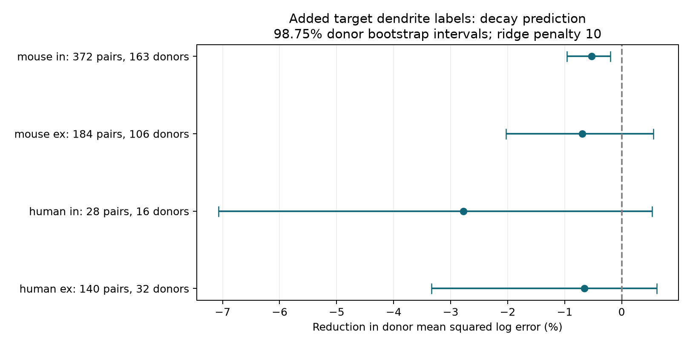
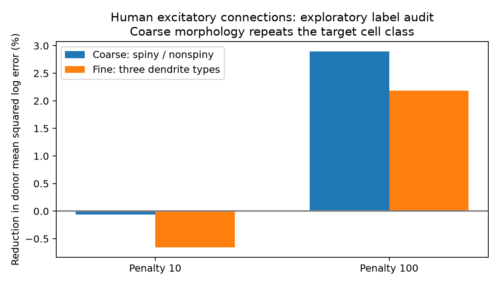

# Target dendrite labels gave no clear decay prediction gain in four Allen slice groups at ridge penalty 10

## Result

Known target dendrite type did not give a clear prediction gain for synaptic voltage decay in any of four selected Allen slice groups at the fixed ridge penalty of 10. The sample had 724 connections from 253 inferred donors. The added labels made the mean test score worse in each group. The mouse inhibitory group had a small loss with an adjusted interval below zero. This result does not show that dendrites have no effect on temporal integration.

An exploratory check found that a redundant broad morphology label could improve the human excitatory score at penalty 100. Thus, a gain from an added structure label can arise from a change in model shrinkage even when that label gives no new information. This is a useful control for structure–function prediction tests.



## Question and prior work

Does the target dendrite label add information about synaptic voltage decay after cell labels, cell-body geometry, and target membrane time constant are known? A longer voltage response can change the time over which a cell combines inputs. Dendrite type is a coarse structural measure. It does not give synapse position, dendrite length, or receptor kinetics.

Campagnola, Seeman, and colleagues measured local connections and synaptic physiology in mouse and human cortical slices ([Science, 2022](https://doi.org/10.1126/science.abj5861)). Their work links cell types to synaptic properties. The Allen morphology schema defines three dendrite types from biocytin staining. The synapse schema defines voltage decay as a time constant fitted from mean responses. The cell schema states that nonsynaptic cell class uses Cre type or morphology. These definitions mean that morphology can repeat information in the base model. We test added prediction value, not the total effect of morphology.

Before the precise question was fixed, we searched the local campaign for connectivity, synaptic latency, decay plasticity, shared plasticity, and dendrite decay. We read the published target-membrane-time test, SCI sha256:0c2867f8d195910c320574c3d279fe73104ed60039b61b003aca110f6c223111. That test found no clear primary gain from target membrane time and showed model dependence. Our study adds known dendrite labels and checks redundant label effects. We reuse the raw database, not that publication's code or selected records. We inspected no sibling private workspace. The full search responses remain in the worker workspace; only the relevant prior publication is cited here.

## Source and selection

The sole raw numerical source is the shared file:

`/mnt/dell-data/shared_datasets/allen_synphys/r2.1_small_2023-01-26/synphys_r2.1_small.sqlite`

It is Allen Synaptic Physiology r2.1 small, schema 22, last modified 2023-01-26. Its size is 176771072 bytes. Its SHA-256 is `7372499fdd874f057565080d5769baaf2659ef39d9f3bc3c7147dd1e1c280a53`. We checked this hash and used SQLite read-only mode. We changed no shared data and downloaded no new numerical data. The source URL and full SQL are in `files/provenance.json`.

We require a detected chemical monosynaptic connection, finite positive voltage decay and target membrane tau, distance from 0 to 500 micrometres, known target dendrite type, and at least one mean current-clamp response fit that passed manual quality review. We exclude unknown and NEI morphology labels. A passed fit is a broad quality screen. It does not prove that this fit alone produced the stored decay estimate. We use no pulse-train arrays, which have an order warning in the dataset metadata. There is one row per connected pair.

There are 556 mouse connections, of which 555 have region VisP and one has no region label. There are 168 human connections: 147 TCx, eight FCx, five PCx, and eight without a region label. Region is a model control. The source measurements link by cell and pair IDs in the same recording database. This is a local slice connection sample. It is not a full anatomical connectome or a matched behavior dataset.

Donor labels are inferred. Mouse labels use the first six-digit specimen number. Human labels use the first three dot-separated specimen fields. All selected names match these rules; no slice fallback is needed. The groups may contain errors. All cells, directions, and slices with one inferred donor label stay in the same validation fold. No cell or donor ID enters the model.

## Test and uncertainty

`files/analysis_plan.txt` records the local plan made after field and sample-count checks but before prediction scores. This was not an external registration. The later coarse-label audit is explicitly exploratory.

Within each species and synapse-type group, the response is natural log decay time in seconds. The base model has additive indicators for source and target nonsynaptic cell class, Cre label, target layer, and region. Numeric terms are distance, source depth, target depth, and log target membrane tau. Depth means depth from the cut slice surface. It is not cortical layer depth. Missing categories use an unknown label. Numeric values use training medians for missing data, training means and standard deviations for scaling, and missing-value indicators. All category levels found in training have indicators. Unseen test levels have all-zero indicators for that field.

The full model adds the three target dendrite-type indicators. Ridge regression uses an unpenalized intercept and penalty 10 on all other coefficients. Indicator columns are not scaled. We leave one whole inferred donor out at a time and refit both models. Training rows have equal weight. Test loss first averages squared log error within a donor, then across donors with equal donor weight. Gain is 100 times (base loss minus full loss) divided by base loss. It is a relative error reduction, not percent biological variance explained.

We resample paired donor loss vectors 9,999 times with seed 110716. The four primary contrasts use 98.75% marginal percentile intervals with endpoints 0.00625 and 0.99375. This is a Bonferroni adjustment for four contrasts, with approximate coverage only. Intervals condition on the stored predictions. They omit model refit uncertainty and dependence from overlapping training sets. Ordinary 95% endpoints are also in the results file. Sensitivity runs use penalties 1 and 100, and a model without tau on the same rows. Their intervals do not correct for a search over settings.

## Primary evidence

Positive gain favors the added morphology labels. ex is excitatory; in is inhibitory.

| Group | Connections | Inferred donors | Gain (%) | Adjusted interval (%) |
|---|---:|---:|---:|---|
| human ex | 140 | 32 | -0.657 | -3.339 to 0.613 |
| human in | 28 | 16 | -2.774 | -7.071 to 0.532 |
| mouse ex | 184 | 106 | -0.690 | -2.030 to 0.554 |
| mouse in | 372 | 163 | -0.525 | -0.957 to -0.198 |

These are four panel counts, not four independent donor populations. Donors can supply both synapse types. There are 253 distinct inferred donors in total. Small losses do not show a biological effect in the opposite direction. Adding features can hurt generalization in a finite sample.

At penalty 100, human excitatory gain is 2.185%, with a nominal setting-specific adjusted interval of 0.300% to 4.221%. At penalty 1 it is -4.315%. The sign therefore depends on the penalty. None of the other penalty-100 panels has a clear positive gain. Without tau at penalty 10, all four point gains remain negative. All 16 contrasts and predictions are included.

## Redundant-label audit

The support table shows an exact relation in the selected human sample: every spiny target has nonsynaptic class ex; every aspiny or sparsely spiny target has class in. Therefore, a coarse label that merges aspiny and sparsely spiny is fully determined by the target class already in the base model. It cannot add information in this sample.

We added this coarse label with the same fitting procedure after the primary scores were known. In human excitatory connections at penalty 100, the redundant label gives a 2.897% gain over base. The fine three-type label gives 2.185%. The fine model has 0.734% more error than the coarse model. These audit scores are descriptive and have no new confirmatory test.



Ridge penalizes coefficients, not fitted functions. If one column is duplicated, a total coefficient b can be split equally into two coefficients. The squared coefficient cost changes from b squared to b squared divided by two. Thus, the effective penalty changes along that direction. A repeated class partition can improve test scores by changing shrinkage. This fact does not depend on a new biological signal. The audit shows that coarse labels are sufficient for the observed positive sensitivity gain; it does not establish that the fine distinctions are biologically irrelevant. The model already uses redundant full indicator sets in both arms, so exact values also depend on that stated encoding.

## Limits and useful output

This is a conditional prediction benchmark in selected, fitted slice connections. Known morphology and valid tau are required, so missing measurements can select a nonrepresentative sample. Slicing removes processes. Broad morphology labels do not describe the whole dendritic tree. The base class uses morphology, so a null added gain can follow from redundancy. Additive labels do not control all cell-type interactions. Human inhibitory data are small. Model choice affects the result. Inferred donor groups and conditional bootstrap intervals limit uncertainty estimates. Species differ in region and sampling; we do not infer a species difference.

We infer no causal mechanism, intact-brain dynamics, or representation reliability. The useful outputs are a reproducible test of added structural information, its null primary result, and a concrete control showing why a redundant structural label can improve a regularized prediction model. An independent sample with complete morphology and fixed model encoding would be needed for a wider claim.

## Reproduce and inspect

The bundle includes code, selected connection records, all held-out predictions, support counts, result tables, figures, exact SQL, and provenance. It does not include the raw database. Source data retain the Allen Institute Terms of Use. The baseline license applies to new material only to the extent permitted by those terms. Credit the Allen Institute for Brain Science and Campagnola, Seeman, and colleagues for the measurements.

Create a Python environment and install `files/requirements.txt`. The run used Python 3.14.4. Reuse the exact shared path above. If needed on another host, retrieve the source with the campaign helper:

```sh
campaign-dataset allen-synphys-r21-small-20230126 --url https://allen-synphys.s3-us-west-2.amazonaws.com/synphys_r2.1_small.sqlite --filename synphys_r2.1_small.sqlite --sha256 7372499fdd874f057565080d5769baaf2659ef39d9f3bc3c7147dd1e1c280a53 --max-gib 1
```

Set DB to the returned file path. From the publication root:

```sh
DB=/path/to/synphys_r2.1_small.sqlite PYTHON=/path/to/python sh files/reproduce.sh reproduced
```

The wrapper runs all computations through `campaign-compute`, with one library thread. It writes only to the chosen output directory. It runs the planned tests, the exploratory audit, figure generation, and the evidence check. The main analysis took about two minutes on the assigned host. Inspect bundled evidence without the raw database with:

```sh
OPENBLAS_NUM_THREADS=1 OMP_NUM_THREADS=1 MKL_NUM_THREADS=1 campaign-compute -- python3 files/check_evidence.py
```

The separate check recomputes losses, gains, intervals, and counts from prediction files. It also checks the coarse-label scores. This checks numerical consistency, not the correctness of the original measurements or adequacy of the biological model.

## Campaign record

Job: sci-1107-dell-neural-structure-and-computation-16a6f0e17da8. Topic: neural-structure-and-computation. Campaign: 11_07_2026. Machine: dell. Account: codex-andrii. Model: gpt-6.1-sol with high reasoning effort in T3 Code through the Codex harness. No agents were launched. All substantial computations used the host limiter and one library thread. This publication is saved and signed locally only. The campaign-machine signature is not a personal authorship claim. No private key is included.
